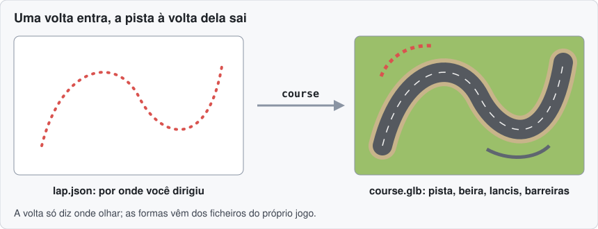
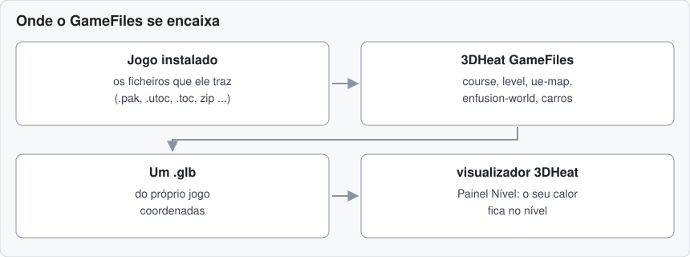

# 3DHeat GameFiles {#dheat-gamefiles}

**O que é?** Uma ferramenta que monta um modelo 3D de um traçado de corrida ou de um
nível de jogo a partir dos arquivos de um jogo que você já tem instalado.

**Para que eu usaria?** O visualizador 3DHeat pinta por onde você dirigiu ou jogou como
um mapa de calor. Com esta ferramenta ele pinta isso sobre o traçado ou nível real, e não sobre um espaço vazio.

**Exemplo:** pegue uma volta que você dirigiu. A ferramenta monta a pista e o terreno ao redor
como um único arquivo 3D, para que o visualizador pinte a sua velocidade ou as suas batidas sobre
o traçado real:



Nunca usou a linha de comando? Comece por [Antes de começar](before-you-start.md).

Com mais detalhes: ela lê os dados de nível dos arquivos que um jogo traz e os grava
como um arquivo glTF binário (`.glb`). O trabalho principal dela é a **exportação do percurso**: você
informa uma volta, e ela grava o solo, a pista separada da beira e da grama, e as zebras,
barreiras, muros de pneus, placas e edifícios ao redor.

Ela faz parte do [3DHeat](https://github.com/Holdi601/3DHeat), um visualizador de
mapas de calor de telemetria 3D em tempo real, análise de corrida e revisão de partidas
([documentação](https://holdi601.github.io/3DHeat/)). Os arquivos `.glb` que esta
ferramenta grava são os níveis sobre os quais o visualizador desenha o calor.



É uma de três formas de levar a geometria de um nível para o 3DHeat:

| Caminho | Precisa de | Entrega |
|---|---|---|
| 3DHeat Unreal Exporter | o projeto Unreal aberto no editor | geometria exata |
| 3DHeat GameCapture | uma tela e uma captura | uma estimativa |
| **3DHeat GameFiles** | **o jogo instalado, como foi entregue** | **geometria exata, sem projeto** |

Pacote Python: `heat3d_gamefiles`. Repositório:
[Holdi601/3DHeat-GameFiles](https://github.com/Holdi601/3DHeat-GameFiles). Licença: MIT.

## O que ela faz {#what-it-can-do}

| Jogo ou motor | Exportação de percurso (`course`) | Leitura de arquivos |
|---|---|---|
| Forza Horizon (ForzaTech) | sim: terreno, pista e beira, textura do solo, modelos colocados com as suas próprias texturas | `identify`, `list`, `extract` em um `.minizip`; `identify` em um `.modelbin`; modelos, terreno e texturas por `course` e `terrain` |
| BeamNG.drive | sim: terreno, decalques de pista, circuitos modelados, modelos colocados, água | `identify`, `list`, `extract` em zips de nível; `identify` em `.ter`, `.cdae`; `.dae` por `course` |
| Assetto Corsa Rally (Unreal 5.6) | sim: blocos de solo de etapa, cor do solo gravada, modelos colocados em cores chapadas | `identify`, `list`, `extract` em IoStore `.utoc`/`.ucas`; pacotes zen, malhas estáticas, texturas por `course` |
| `.pak` do Unreal (versões 8-12) | não | `identify`, `list`, `extract` |
| Unity (formato 22 ou mais recente) | não | `identify`, `meshes` |
| Battlefield 6 (Frostbite `.toc`/`.cas`) | sem volta; um nível inteiro com `level`: terreno, malhas colocadas, seus mapas de cor com `--textures` | `identify`, `levels`; pacotes, malhas, terreno, texturas e posicionamento por `level` |
| `.vpk` do Source 2 | não | `identify`, `list`, `extract` |
| Jogos Unreal 5 com World Partition | sem volta; um mapa inteiro com `ue-map` (listado por `ue-maps`): paisagem, edifícios HLOD e objetos, água | - |
| Arma Reforger (Enfusion) | sem volta; um mundo inteiro com `enfusion-world` (listado por `enfusion-worlds`): terreno nas suas cores, o mar, edifícios como caixas | - |
| Forza (carros) | `cars`: cada carro com pouco detalhe, para a aba Análise de corrida do visualizador | - |

Voltas do Assetto Corsa EVO e do iRacing são recusadas, com o motivo. Veja
[Limites e lacunas conhecidas](../limits-and-known-gaps.md).

## Instalação {#install}

Nunca usou a linha de comando? Leia primeiro [Antes de começar](before-you-start.md).

Você precisa de **Python 3.10 ou mais recente** (desenvolvido no 3.13) e dos pacotes em
[`requirements.txt`](https://github.com/Holdi601/3DHeat-GameFiles/blob/main/requirements.txt).

```
git clone https://github.com/Holdi601/3DHeat-GameFiles.git
cd 3DHeat-GameFiles
pip install -r requirements.txt
```

Depois confira: `python -m heat3d_gamefiles --help`. Você deve ver
`usage: heat3d_gamefiles [-h]` e a lista de verbos. Execute cada comando na pasta do
repositório, como `python -m heat3d_gamefiles <verbo>`.

| Pacote | Usado para |
|---|---|
| numpy | tudo o que decodifica geometria |
| lz4 | arquivos do Forza (em sua maioria blocos LZ4), alguns pacotes Unity, blocos LZ4 do IoStore |
| Pillow | decodificar texturas BC1-BC7, gravar as texturas JPEG no `.glb` |
| msgpack, zstandard | as formas compiladas do BeamNG (`.cdae`) |
| cryptography | só para abrir um `.pak` cifrado com uma chave que você já tem |
| pytest | os testes |

Conteúdo do Unreal comprimido com **Oodle** precisa de uma biblioteca Oodle que já esteja
na sua máquina. Ela nunca vem com esta ferramenta. Veja [Oodle](../reader-oodle.md).

A ferramenta foi escrita para Windows. Ela encontra os jogos pela lista de bibliotecas do Steam e por
`%LOCALAPPDATA%`, e carrega o Oodle como uma DLL do Windows. Outras plataformas não foram
testadas.

## Início rápido {#quick-start}

Um **arquivo de volta** é a gravação de por onde o seu carro andou: uma lista de pontos x, y, z.
Ele vem do [3DHeat GameCapture](https://github.com/Holdi601/3DHeat-GameCapture)
ou da biblioteca de voltas do app FH Companion; um CSV digitado à mão também serve
([Entradas de volta](../lap-inputs.md)).

```
# Forza: um arquivo de volta, uma pasta de voltas, ou o nome de um percurso da biblioteca do FH Companion
python -m heat3d_gamefiles course "Example Circuit"
python -m heat3d_gamefiles course path\to\lap.json -o course.glb

# BeamNG.drive ou Assetto Corsa Rally: um arquivo de volta heat3d-lap diz de qual jogo ele vem
python -m heat3d_gamefiles course my_lap.json

# Cada percurso da biblioteca do FH Companion, um .glb para cada um
python -m heat3d_gamefiles courses -o courses

# Battlefield 6: liste os níveis, depois exporte um (um arquivo grande; veja Comandos)
python -m heat3d_gamefiles levels
python -m heat3d_gamefiles level <level> -o level.glb --textures

# Unreal 5 World Partition e Arma Reforger: liste, depois exporte
python -m heat3d_gamefiles ue-maps "<game>"
python -m heat3d_gamefiles ue-map "<game>" <map> -o map.glb
python -m heat3d_gamefiles enfusion-worlds
python -m heat3d_gamefiles enfusion-world <world> -o world.glb

# Cada carro do Forza, para a aba Análise de corrida do visualizador
python -m heat3d_gamefiles cars -o forza.h3dcars

# O que é este arquivo?
python -m heat3d_gamefiles identify some_archive.pak
```

Abra o `.glb` no visualizador 3DHeat. As coordenadas do próprio mundo do jogo são mantidas
(veja [Formato de saída](../output-format.md)), então uma volta gravada se alinha ao percurso.

## Mapa desta documentação {#map-of-this-documentation}

- [Antes de começar](before-you-start.md): Python, um terminal, o primeiro comando.
- [Comandos](../commands.md): cada verbo e opção, com exemplos.
- [Referência de comandos](../cli-reference.md): o `--help` de cada verbo, gerado a partir do código.
- [Inspecionar arquivos](../inspecting-archives.md): `identify`, `list`, `extract`, `meshes`, passo a passo.
- [Exportação de percurso](../course-export.md): como uma volta vira um percurso, para todos os jogos.
  - [Forza Horizon](../course-forza-horizon.md)
  - [BeamNG.drive](../course-beamng.md)
  - [Assetto Corsa Rally](../course-assetto-corsa-rally.md)
  - [Níveis de detalhe e o orçamento](../detail-budget.md)
- [Níveis inteiros](../whole-levels.md): um nível, mapa ou mundo sem volta.
  - [Níveis do Battlefield 6](../level-battlefield.md): `levels`, `level`
  - [Mapas do Unreal 5](../level-unreal-world-partition.md): `ue-maps`, `ue-map`
  - [Mundos do Arma Reforger](../level-arma-reforger.md): `enfusion-worlds`, `enfusion-world`
- [Carros do Forza](../forza-cars.md): `cars`, o arquivo de carros para a aba Análise de corrida do visualizador.
- [Entradas de volta](../lap-inputs.md): cada formato de arquivo de volta que a ferramenta aceita.
- [Formato de saída](../output-format.md): o que há dentro do `.glb`.
- [Leitores de arquivos](../archive-readers.md): uma página por formato de contêiner, dizendo
  o que cada um lê, o que não lê, e por quê.
- [Limites e lacunas conhecidas](../limits-and-known-gaps.md)
- [Solução de problemas](../troubleshooting.md): as mensagens de erro e o que fazer.
- [Regras e licenças](../rules-and-licences.md): sem chaves, seus próprios arquivos, sem redistribuição.
- [Atualizações](../updates.md): a verificação de atualização e o `heat3d_update`.
- [Desenvolvimento](../development.md): mapa dos módulos e testes, incluindo os testes que rodam contra jogos instalados.
- [Manutenção](../maintaining.md): a lista de verificação de lançamento destas páginas.

## Parte do 3DHeat {#part-of-3dheat}

O 3DHeat GameFiles é uma das ferramentas gratuitas em torno do visualizador 3DHeat:

| Ferramenta | O que faz | Documentação |
|---|---|---|
| [3DHeat](https://github.com/Holdi601/3DHeat) | o visualizador: mapas de calor 3D, análise de corrida e revisão de partidas no navegador | [site](https://holdi601.github.io/3DHeat/) |
| [GameFiles](https://github.com/Holdi601/3DHeat-GameFiles) | percursos e níveis a partir dos arquivos que um jogo traz, em `.glb` | [site](https://holdi601.github.io/3DHeat-GameFiles/) |
| [GameCapture](https://github.com/Holdi601/3DHeat-GameCapture) | telemetria de voltas de jogos de corrida; níveis reconstruídos a partir de vídeo de jogo | [site](https://holdi601.github.io/3DHeat-GameCapture/) |
| [Unreal Exporter](https://github.com/Holdi601/3DHeat-UnrealExporter) | um plugin do Unreal Editor que salva um nível como `.glb` | [site](https://holdi601.github.io/3DHeat-UnrealExporter/) |
| [CS2](https://github.com/Holdi601/3DHeat-CS2) | demos do Counter-Strike 2 em arquivos de partida; mapas em `.glb` | [site](https://holdi601.github.io/3DHeat-CS2/) |
| [Watcher](https://github.com/Holdi601/3DHeat-Watcher) | registra o seu jogo em segundo plano, a partir do que os jogos publicam | [site](https://holdi601.github.io/3DHeat-Watcher/) |
| [Ext-WarThunder](https://github.com/Holdi601/3DHeat-Ext-WarThunder) | repetições do War Thunder em arquivos de partida | [site](https://holdi601.github.io/3DHeat-Ext-WarThunder/) |
| [Ext-WoT](https://github.com/Holdi601/3DHeat-Ext-WoT) | repetições do World of Tanks em arquivos de partida | [site](https://holdi601.github.io/3DHeat-Ext-WoT/) |
| [Ext-WoWs](https://github.com/Holdi601/3DHeat-Ext-WoWs) | repetições do World of Warships em arquivos de partida | [site](https://holdi601.github.io/3DHeat-Ext-WoWs/) |
| [Ext-Squad](https://github.com/Holdi601/3DHeat-Ext-Squad) | demos de servidores do Squad em arquivos de partida | [site](https://holdi601.github.io/3DHeat-Ext-Squad/) |
| [Ext-DCS](https://github.com/Holdi601/3DHeat-Ext-DCS) | mapas do DCS World em níveis `.glb` | [site](https://holdi601.github.io/3DHeat-Ext-DCS/) |
| [Ext-IL2](https://github.com/Holdi601/3DHeat-Ext-IL2) | mapas do IL-2 Sturmovik em níveis `.glb` | [site](https://holdi601.github.io/3DHeat-Ext-IL2/) |

Os arquivos de partida do visualizador são descritos em
[Um arquivo por partida: `.3dheat`](https://holdi601.github.io/3DHeat/container.html);
um nível feito aqui é carregado ao lado deles no painel Fundo / nível do visualizador.
