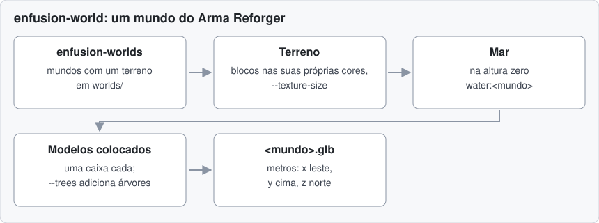

# Mundos do Arma Reforger: `enfusion-worlds` e `enfusion-world` {#arma-reforger-worlds-enfusion-worlds-and-enfusion-world}

**O que é?** Um mundo inteiro do Arma Reforger como um único ficheiro 3D. **Por quê?**
Para que o calor do jogo tenha o solo e os edifícios por baixo. (*Enfusion* é o motor
com que o Arma Reforger é feito; um *mundo* é o que o jogo chama de mapa.)

Exporta um mundo Enfusion inteiro do Arma Reforger instalado: o terreno nas cores
dos seus próprios tiles de supertextura, o mar e cada modelo colocado como uma caixa,
nos metros do próprio jogo.



## Passo a passo {#step-by-step}

1. **Listar os mundos** que têm um terreno:

   ```
   python -m heat3d_gamefiles enfusion-worlds
   python -m heat3d_gamefiles enfusion-worlds --install "D:\Games\Arma Reforger"
   ```

2. **Exportar um**, pelo nome da sua pasta em `worlds/`, como listado:

   ```
   python -m heat3d_gamefiles enfusion-world <world> -o world.glb
   ```

3. **Variações:**

   ```
   python -m heat3d_gamefiles enfusion-world <world> --trees               # vegetation too, as boxes
   python -m heat3d_gamefiles enfusion-world <world> --texture-size 0      # flat colour, small file
   python -m heat3d_gamefiles enfusion-world <world> --ground-spacing 4 --no-structures
   ```

4. **Abrir o `world.glb`** no painel Fundo / nível do visualizador do 3DHeat
   ([carregar um nível](https://holdi601.github.io/3DHeat/levels.html)).

## Opções {#options}

| Opção | Padrão | Significado |
|---|---|---|
| `<world>` | obrigatório | um mundo como o `enfusion-worlds` mostra |
| `-o`, `--out FILE` | `<world>.glb` | o ficheiro a gravar |
| `--install FOLDER` | a biblioteca da Steam que tem o jogo | a pasta do jogo |
| `--ground-spacing METRES` | 2 (o do próprio terreno) | o espaçamento entre vértices do terreno no ficheiro |
| `--texture-size PIXELS` | 4096 | o lado maior da imagem de cor do solo; 0 para cor chapada |
| `--no-structures` | | deixa os modelos colocados de fora |
| `--trees` | desligado | também coloca árvores e outra vegetação, como caixas |

## Exemplo de saída {#example-output}

```text
<world> -> world.glb
  ground      <n> triangles, <w> x <h> m; <n> of <n> tile-edge vertices disagree; colour <w> x <h>
  structure   <n> boxes from <n> entities
  water       <n> triangles (the sea)
  left out    <what>: <n>, ...
```

## As partes {#the-parts}

`ground:<world>` (o terreno), `water:<world>` (o mar, na altura zero) e
`structure:<world>` (as caixas). As coordenadas são as do próprio jogo: x para o
leste, y para cima, z para o norte, em metros, o que um registo dentro do jogo
informa. O referencial do jogo é de mão esquerda; *invert world axis* no visualizador
mostra isso sem espelhamento.

## Como é lido e verificado {#how-it-is-read-and-checked}

Não é preciso o Workbench, e nada é cifrado.

| Formato | O que é | Conferido com |
|---|---|---|
| `.pak` | um bloco de dados e uma árvore de diretórios, entradas guardadas ou em zlib | a árvore usa o seu bloco exatamente; entradas zlib amostradas descompactam exatamente para o tamanho declarado |
| `.edds` | um cabeçalho DDS, depois, por nível de mip, blocos `COPY` ou `LZ4 ` | níveis em blocos descodificam exatamente para o seu tamanho usando exatamente os seus bytes |
| `.terr` / `.ttile` | um cabeçalho e tiles de alturas de 16 bits | toda aresta partilhada entre tiles bate exatamente |
| supertextura | a cor de solo de cada tile, cerca de um metro por pixel | bate com o mar nas alturas; nenhum espelhamento ou transposição encaixa tão bem |
| `.ent` | nomes, GUIDs de recursos, depois entidades como valores tipados | um ficheiro de mundo é lido até ao último byte |
| `resourceDatabase.rdb` | GUID para caminho | quase todo GUID que um mundo usa nomeia um ficheiro que existe |

Objetos marcados como estando numa altura absoluta ficam a poucos centímetros do
terreno descodificado (com a grade transposta, ficariam a metros de distância).
Não são desenhados: os próprios triângulos dos modelos, árvores por padrão
(`--trees` as adiciona como caixas), entidades filhas, lagos e rios, texturas com
cabeçalhos anteriores ao DX10.

**Termos:** a licença do jogo permite uso não comercial e proíbe a engenharia reversa
dos ficheiros do jogo. Ler a sua própria instalação é uma decisão sua sob essa licença;
a saída é para o seu próprio uso e não deve ser partilhada.
