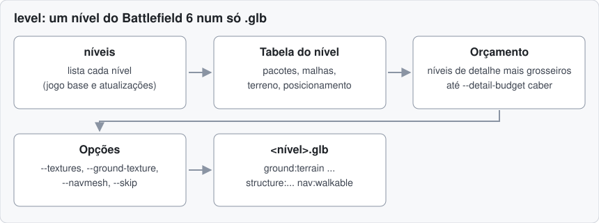

# Níveis do Battlefield 6: `levels` e `level` {#battlefield-6-levels-levels-and-level}

**O que é?** Um nível inteiro do Battlefield 6 como um único ficheiro 3D. **Por quê?**
Para que o calor das suas partidas tenha o solo e os edifícios por baixo. (*Frostbite* é o
motor com que o Battlefield é feito; um *heightfield* é o solo guardado como uma grade
de alturas.)

Exporta um nível inteiro do Frostbite do jogo instalado: o heightfield do terreno,
cada malha que os grupos de modelos estáticos colocam, os objetos colocados um a um,
o pano de fundo do terreno em volta do mapa e, se pedido, os mapas de cor das
superfícies, os decalques de terreno assados no solo e as superfícies caminháveis
dos soldados.



## Passo a passo {#step-by-step}

1. **Listar os níveis** que o jogo traz:

   ```
   python -m heat3d_gamefiles levels
   python -m heat3d_gamefiles levels --install "D:\Games\<game folder>"
   ```

   Cada linha é uma tabela de nível (`levels/<level>/<level>.toc`) com o seu tamanho e
   de onde vem: `Data` para o jogo base, `Update/<pack>` para uma atualização.

2. **Exportar um**, pelo seu nome, uma parte única dele, ou o seu caminho `.toc`.
   Comece sem textura para ver a forma e o tamanho:

   ```
   python -m heat3d_gamefiles level <level> -o level.glb
   ```

3. **Adicionar cor** quando estiver certo:

   ```
   python -m heat3d_gamefiles level <level> -o level.glb --textures 512 --ground-texture 0.5
   ```

4. **Adicionar as superfícies caminháveis**, ou diminuir o ficheiro:

   ```
   python -m heat3d_gamefiles level <level> --textures 512 --ground-texture 0.5 --navmesh
   python -m heat3d_gamefiles level <level> --textures 256 --detail-budget 3000000 --ground-spacing 8
   ```

5. **Abrir o `level.glb`** no painel Fundo / nível do visualizador do 3DHeat
   ([carregar um nível](https://holdi601.github.io/3DHeat/levels.html)).

## Opções {#options}

| Opção | Padrão | Significado |
|---|---|---|
| `<level>` | obrigatório | um nome como o `levels` mostra, uma parte única dele, ou o `.toc` de um nível |
| `-o`, `--out FILE` | `<level>.glb` | o ficheiro a gravar |
| `--install FOLDER` | encontrada nas bibliotecas da Steam | a pasta do jogo |
| `--textures [PIXELS]` | desligado; 512 sem tamanho | o mapa de cor de cada superfície, com no máximo PIXELS de lado |
| `--ground-texture [METRES]` | desligado; 0,5 sem tamanho | assa estradas, pátios e marcações na cor do solo, METRES por pixel |
| `--navmesh` | desligado | adiciona a malha de navegação do soldado como `nav:walkable` |
| `--ground-spacing METRES` | 4 | o espaçamento mais fino do heightfield; 0 o deixa de fora |
| `--detail-budget N` | as cópias mais grosseiras mais um quarto, no mínimo 1.500.000 | um teto de triângulos (o terreno nunca é tornado mais grosseiro) |
| `--skip TEXT` | | deixa de fora grupos de modelos cujo nome de partição contém TEXT; pode repetir |
| `--by-mesh` | desligado | uma parte por malha e material de origem, para descobrir o que é uma parte |
| `--clamped-uvs` | desligado | para renderizadores que não conseguem repetir uma textura |

A tabela completa, com os tamanhos a esperar (um nível inteiro tem centenas de MB),
está em [Comandos](commands.md#levels-and-level-frostbite). Como as tabelas, os
bundles, as malhas e o terreno são lidos está em [Frostbite](reader-frostbite.md).

## Exemplo de saída {#example-output}

O que o `level` imprime, em resumo (as linhas como o código as escreve; `<n>` e os
nomes variam por nível):

```text
<n> copies of <n> meshes, from <n> static model groups
      <n>  <group>
      <n>  placed one by one (object and prefab references)
<n> meshes left out: <why>
<n> triangles, budget <n>; <n> meshes drawn at a coarser level to fit
           <n>  ground:terrain
           <n>  structure:buildings, <n> textures
           ...
<n> of <n> drawn sections carry their colour map; the rest are flat colours
Ground: <what the ground is>.
Navigation mesh: <tiles read>.
-> level.glb (<n> MB)
```

## As partes {#the-parts}

`ground:terrain` (o heightfield), `ground:terrain backdrop` e
`ground:terrain blend`, `structure:<kind>` por tipo de malha (por mapa de cor com
`--textures`, com ` (destructible)` para o que uma partida pode destruir), e
`nav:walkable` com `--navmesh`. Veja [Formato de saída](output-format.md).

O ficheiro guarda o conteúdo do jogo: ele é para a máquina em que foi feito, e não para
ser passado adiante ([Regras e licenças](rules-and-licences.md)).
