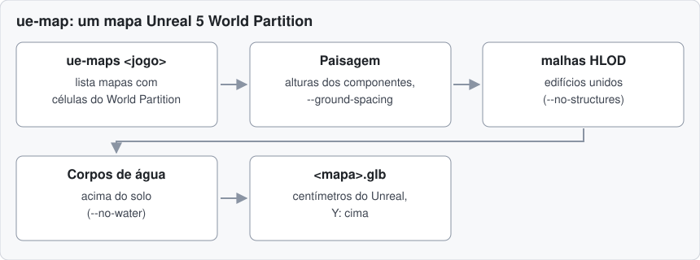

# Mapas World Partition do Unreal 5: `ue-maps` e `ue-map` {#unreal-5-world-partition-maps-ue-maps-and-ue-map}

**O que é?** Um mapa inteiro de um jogo Unreal 5 como um único ficheiro 3D: o solo, os
edifícios e a água. **Por quê?** Para que o calor desse jogo tenha o mapa por baixo.
(*World Partition* é como o Unreal 5 divide um mapa grande em pedaços; *HLOD* é um
substituto simplificado de um grupo de edifícios, o que o jogo desenha de longe.)

Exporta um mapa inteiro de um jogo Unreal 5 cujos mapas são cozidos como células World
Partition: o landscape, as malhas HLOD mescladas do mapa (os seus edifícios e objetos
como o jogo os desenha à distância) e os seus corpos de água. Não é preciso editor nem
projeto, só o jogo instalado.



## Passo a passo {#step-by-step}

1. **Listar os mapas.** `<game>` é a pasta do jogo, a sua `Content/Paks`, ou o nome
   da sua pasta numa biblioteca da Steam:

   ```
   python -m heat3d_gamefiles ue-maps "<Steam game folder name>"
   python -m heat3d_gamefiles ue-maps "D:\Games\<game>"
   ```

   Cada mapa com células World Partition cozidas é impresso com o seu caminho de pacote.

2. **Exportar um** pelo seu nome ou por uma parte única dele:

   ```
   python -m heat3d_gamefiles ue-map "<game>" <map> -o map.glb
   ```

3. **Só o solo, ou mais grosseiro:**

   ```
   python -m heat3d_gamefiles ue-map "<game>" <map> --no-structures --no-water
   python -m heat3d_gamefiles ue-map "<game>" <map> --ground-spacing 4
   ```

4. **Abrir o `map.glb`** no painel Fundo / nível do visualizador do 3DHeat
   ([carregar um nível](https://holdi601.github.io/3DHeat/levels.html)).

## Opções {#options}

| Opção | Padrão | Significado |
|---|---|---|
| `<game>` | obrigatório | a pasta do jogo, a sua `Content/Paks`, ou o nome da sua pasta na Steam |
| `<map>` | obrigatório | um nome como o `ue-maps` mostra, ou uma parte única dele |
| `-o`, `--out FILE` | `<map>.glb` | o ficheiro a gravar |
| `--ground-spacing METRES` | 2 | o espaçamento entre vértices do landscape, arredondado para um número inteiro de seus próprios quads |
| `--no-structures` | | deixa de fora os edifícios e objetos HLOD |
| `--no-water` | | deixa de fora os corpos de água |

Conteúdo comprimido com Oodle precisa de uma biblioteca Oodle já instalada na máquina
(veja [Oodle](reader-oodle.md)).

## Exemplo de saída {#example-output}

```text
<map> -> map.glb
  ground      <n> triangles from <n> landscape components; <n> of <n> vertices stored twice disagree
  structure   <n> triangles in <n> HLOD meshes
  water       <n> triangles from <n> water bodies
```

A contagem de discordâncias é uma autoverificação: componentes de landscape vizinhos
guardam a sua aresta partilhada duas vezes, e as duas precisam bater. Um mapa de 3 km
a 2 m tem cerca de 4,6 milhões de triângulos de solo.

## As partes {#the-parts}

`ground:<map>` (o landscape), `structure:<map>` (as malhas HLOD) e `water:<map>` (a
água acima do solo).

**Unidades:** esta é a única exportação **que não está em metros**: centímetros do
Unreal, com Y e Z trocados (Y para cima), o referencial que o Unreal Exporter do 3DHeat
grava. A telemetria do mesmo jogo usa o mesmo referencial, então ela cai sobre o mapa.

## Como é lido e verificado {#how-it-is-read-and-checked}

| Parte | Lida de | Conferida com |
|---|---|---|
| solo | o mapa de alturas de 16 bits de cada componente de landscape, posicionado pela base de sua secção no transform do landscape | todo vértice guardado duas vezes (numa costura ou borda de componente) precisa bater; as discordâncias são contadas e impressas, não suavizadas |
| estrutura | as malhas HLOD mescladas do mapa, montadas pelo motor no espaço do mundo | uma malha só é mantida se os limites que o seu componente guarda descreverem os seus próprios vértices |
| água | a malha de cada corpo de água, colocada na grade do solo, mantida onde fica acima do solo | a água fica alguns metros acima do solo sob ela, como um rio sobre o seu leito |

As propriedades do landscape são achadas pela forma, e não pelo número do slot (os
slots mudam entre versões do motor). As estruturas são os substitutos simplificados,
não os modelos de detalhe total. Vegetação, decalques e materiais de landscape não são
exportados; o solo fica sem textura e é sombreado pelo visualizador. Detalhes dos
ficheiros: [Unreal 5 IoStore](reader-unreal-iostore.md).

**Termos:** as licenças dos jogos costumam permitir uso pessoal e não comercial e
proibir a engenharia reversa "na medida em que tais atos não possam ser proibidos por
lei". Ler a sua própria instalação é uma decisão sua sob elas; a saída é para o seu
próprio uso e não deve ser partilhada.
