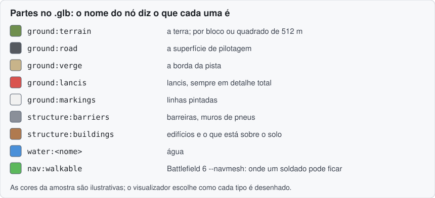

# Formato de saída {#output-format}

Um `.glb` é um ficheiro 3D: o chão, os edifícios e a água de uma pista ou de um nível, que abre no painel Fundo / nível do visualizador do 3DHeat.

Cada exportação (`course`, `courses`, `terrain`, `level`, `ue-map`, `enfusion-world`) escreve um ficheiro **glTF 2.0 binário** (`.glb`). É deliberadamente pequeno e plano, e está organizado da maneira como o visualizador do 3DHeat lê um nível. Fonte:
[`glb.py`](https://github.com/Holdi601/3DHeat-GameFiles/blob/main/heat3d_gamefiles/glb.py).

## Estrutura {#structure}

```
scene 0
 ├─ node "ground:terrain x-2046 z1023"  -> mesh 0 -> 1 primitive, material 0
 ├─ node "ground:road x-2046 z1023"     -> mesh 1 -> 1 primitive, material 1
 ├─ node "ground:markings"               -> mesh 2 -> ...
 ├─ node "ground:kerbs road_gen_rum_..." -> ...
 ├─ node "structure:barriers bar_armco_bclr"
 └─ ...
```

- **Um nó por parte**, todos na raiz da cena, **sem transformações**. Toda a geometria já está em coordenadas do mundo.
- Cada nó tem a sua própria malha com **uma primitiva** e o seu próprio material. O nó, a malha e o material levam todos o nome da parte.
- Cada primitiva tem **as suas próprias matrizes de vértices compactas**, só os vértices que essa parte usa. Uma matriz de vértices partilhada é glTF válido, mas um leitor que expande as matrizes de cada primitiva teria cada vértice guardado uma vez por parte.
- `asset.generator` é `heat3d_gamefiles`.
- **Poucos `extras`**, e nenhum nome de percurso, jogo ou pista:
  - uma parte de uma malha destrutível do Battlefield 6 leva `{"destructible": true}` no seu nó;
  - um percurso do Forza diz o que contém em `asset.extras` (número de versão do formato, id da rota correspondida, quantas cópias da camada própria da corrida, locais; veja [Percursos do Forza Horizon](course-forza-horizon.md#writing-the-file)), e as suas partes ativadas levam a sua camada no nó: `{"layer": "event", "route": <id>}` para a camada própria da corrida, `{"layer": "layer"}` para outra camada ativada, `{"layer": "venue"}` para o chão de um local.

  Tudo o que o visualizador precisa está nos nomes dos nós.

## Nomes dos nós: a classificação {#node-names-the-classification}



O visualizador obtém a classe de uma parte a partir do nome do **nó** (recorrendo ao nome da malha se for preciso), e só quando corresponde a

```
^(ground|structure|water)\s*[:|]
```

Qualquer outra coisa é classificada por uma heurística escrita para paisagens do Unreal. Por isso, cada parte que o exportador escreve começa por um destes prefixos, ou por `nav:` (abaixo):

| Prefixo | Significado | Partes escritas |
|---|---|---|
| `ground:` | a superfície de condução e a terra | `ground:road`, `ground:verge`, `ground:terrain`, `ground:gravel and dirt`, `ground:kerbs`, `ground:markings`, `ground:tyre marks`, `ground:venue`, `ground:plinths` |
| `structure:` | o que está em cima dela | `structure:barriers`, `structure:props`, `structure:signs`, `structure:buildings`, `structure:infrastructure`, `structure:bridges`, `structure:rocks`, `structure:smashables`, `structure:trees`; camadas do Forza `structure:event_<categoria>` e `structure:layer_<categoria>` |
| `water:` | água | `water:water`; `water:<map>` (`ue-map`), `water:<world>` (`enfusion-world`) |
| `nav:` | onde um soldado pode andar (Battlefield 6, só com `--navmesh`) | `nav:walkable` |

`nav:` não corresponde ao padrão do visualizador acima, por isso o visualizador ordena-o pela sua heurística; é uma parte à parte para poder mostrá-la ou escondê-la sozinha. `ue-map` escreve `ground:<map>`, `structure:<map>` e `water:<map>`; `enfusion-world` escreve `ground:<world>`, `structure:<world>` e `water:<world>`.

Depois do tipo vem, conforme o jogo:

| Exemplo | Significado |
|---|---|
| `ground:road x-2046 z1023` | chão do Forza no tile de terreno chamado `x-2046 z1023` (unidades de grelha, 1023 por 512 m) |
| `ground:road 3_-2` | chão do BeamNG no quadrado de 512 m (3, -2) |
| `ground:road 3_-2 asphalt_light` | superfície de condução modelada do BeamNG do material `asphalt_light` nesse quadrado |
| `ground:road 1_-4` | chão do AC Rally no quadrado de 512 m (1, -4) do espaço do Unreal |
| `structure:barriers bar_armco_bclr` | modelos colocados do Forza que partilham uma textura (o nome sem o GUID) |
| `structure:barriers` | modelos colocados sem textura (Forza, AC Rally) |
| `structure:event_barriers bar_example_bclr` | Forza: o que a corrida correspondida põe para si, à parte do mundo de conduta livre (extras do nó `{"layer": "event", "route": <id>}`) |
| `structure:layer_props` | Forza: uma camada que o jogo liga para algo que não esta corrida (uma atividade, um colecionável, uma camada de runtime) |
| `ground:venue`, `ground:plinths` | Forza: modelos já em coordenadas do mundo - o chão próprio de um local (o piso de um estádio), e o chão com que uma rua é decorada |
| `structure:barriers armco_metal` | modelos colocados do BeamNG de um material |
| `ground:markings`, `water:water` | partes planas, uma para o ficheiro inteiro |
| `ground:terrain` (Battlefield 6) | o campo de alturas; `ground:terrain backdrop` as malhas do terreno distante, `ground:terrain blend` as malhas que se misturam com o terreno |
| `nav:walkable` (Battlefield 6, `--navmesh`) | a malha de navegação do nível para um soldado: onde se pode estar, verde plano |
| `ground:terrain x-512 z-512` (Battlefield 6, `--ground-texture`) | o campo de alturas sob um tile de decalque cozido, nomeado pelo canto inferior do tile em metros |
| `structure:buildings t_concreteclean_01_cs` (Battlefield 6, `--textures`) | cada superfície desse tipo que mostra esse mapa de cor; sem `--textures`, uma parte por tipo, sem sufixo |
| `structure:buildings t_concreteclean_01_cs (destructible)` (Battlefield 6) | o mesmo, para malhas que uma partida pode destruir: as que têm um recurso de destruição com o seu próprio nome (paredes, casas, adereços). O nó também traz os extras glTF `{"destructible": true}`. Os seus estados destruídos não são exportados |

O visualizador pode filtrar por estes nomes. Por exemplo, "só a superfície de corrida" é `ground:road` junto com `ground:kerbs`, nos três jogos, e "o mundo sem os adereços próprios da corrida" é tudo menos `structure:event_*`. O prefixo é também a forma como o visualizador desenha uma parte: o chão como a superfície onde o calor assenta, a estrutura como o que está em cima dele.

## Unidades, eixos e referencial {#units-axes-and-frame}

- **Metros, Y para cima**, a convenção do glTF, para todas as exportações exceto `ue-map`. Nada é reescalado nem recentrado: os números são as coordenadas do mundo do jogo, que é precisamente o objetivo de ler o ficheiro em vez de o reconstruir.
- **Mapas do Unreal 5 (`ue-map`): centímetros**, a unidade própria do Unreal, com Y e Z trocados para que Y seja para cima - o referencial que o Exportador do Unreal do 3DHeat escreve e que a telemetria do jogo usa. A única exportação que não está em metros.
- **Arma Reforger (`enfusion-world`):** os metros do próprio jogo, x a leste, y para cima, z a norte. O referencial do jogo é esquerdo; a opção *inverter eixo do mundo* do visualizador mostra-o sem espelho.
- **Forza:** as coordenadas do mundo do próprio jogo (x, y para cima, z), inalteradas. As mesmas da sua telemetria, por isso uma volta gravada assenta no percurso.
- **BeamNG.drive:** `(x, z, -y)` do mundo do BeamNG com Z para cima, que é a rotação que o gravador de telemetria aplica. Uma rotação, não um espelho.
- **Battlefield 6:** as coordenadas do mundo do próprio jogo (x, y para cima, z), inalteradas: as transformações de instância do nível aplicadas a cada malha como estão guardadas. As cópias espelhadas são reenroladas para que as suas normais apontem para fora.
- **Assetto Corsa Rally:** o referencial da volta. Os centímetros do Unreal passam a metros, o Z do Unreal passa a y, e o X e Y do Unreal passam a x e z na orientação das oito possíveis que a volta encaixou (veja [Assetto Corsa Rally](course-assetto-corsa-rally.md#which-stage-and-which-way-round)). Os triângulos são reenrolados onde essa correspondência espelha.

Cada exportação mantém os eixos que a sua telemetria usa, para que a gravação e o nível partilhem um referencial. Se esse referencial é esquerdo ou direito em cada jogo não foi verificado.

## Dados de vértices {#vertex-data}

A forma por omissão é a **quantizada** (`quantize=True`). Precisa da extensão `KHR_mesh_quantization`, que está listada tanto em `extensionsUsed` como em `extensionsRequired`.

| Atributo | Quantizado (por omissão) | Precisão total (`quantize=False`) |
|---|---|---|
| `POSITION` | float32 VEC3, com mín./máx. | float32 VEC3 |
| `NORMAL` | int8 VEC3 normalizado, com preenchimento para 4 bytes (passo 4) | float32 VEC3 |
| `TEXCOORD_0` (só partes com textura) | uint16 VEC2 normalizado, limitado a 0-1; float32 VEC2 onde as texturas se repetem (Battlefield 6) | float32 VEC2 |
| `COLOR_0` (partes sem textura, quando alguma parte tem cor) | uint8 VEC3 normalizado, com preenchimento para 4 bytes | float32 VEC3 |
| índices | uint16 quando a parte tem no máximo 65.535 vértices, senão uint32 | uint32 |

Um vértice tem 20 bytes em vez de 32 (24 em vez de 44 com cor). Isso tira um terço a cada ficheiro, e é a diferença entre um percurso urbano carregar num separador do navegador e não carregar. O custo é menos de meio grau de normal e 1/65.535 de uma UV (um quinze avos de texel a 4.096 px). A linha de comandos escreve sempre a forma quantizada. `write_glb(..., quantize=False)` em Python escreve a outra.

As normais vêm do jogo onde ele as guarda (terreno e modelos do Forza, formas e terreno do BeamNG). Senão são calculadas como normais suaves ponderadas pela área a partir dos triângulos. As normais do AC Rally são sempre calculadas.

## Materiais, cores e texturas {#materials-colours-and-textures}

- Cada material é `metallicFactor 0`, `roughnessFactor 1`.
- **Parte com textura:** `baseColorTexture` com a imagem da parte, as UV, e sem cor de vértice. O glTF multiplica os dois, por isso uma superfície sairia escurecida duas vezes.
- **Parte sem textura:** cor de vértice `COLOR_0` com a cor lisa da parte, e um `baseColorFactor` branco. Se nenhuma parte do ficheiro tiver cor, não há `COLOR_0`. Onde as partes partilham vértices, a cor da parte posterior ganha, por isso as partes planas são escritas por ordem crescente de importância.
- **Imagens** vão embutidas no bloco binário como **JPEG**, qualidade 90, sem subamostragem de crominância, só RGB (o alfa é descartado) - exceto um mapa recortado do Battlefield 6 (folhas, vedações), que é **PNG** com o seu alfa, num material com `alphaMode` MASK, `alphaCutoff` 0.5 e `doubleSided` (veja [Frostbite](reader-frostbite.md#textures-and-materials)). O visualizador do 3DHeat descarta os texels abaixo do limiar. Um chão de 2048 px de relva e copas de árvores é ruído para um codificador sem perdas: vários megabytes por tile em PNG, menos de um em JPEG. Uma imagem partilhada por várias partes é guardada uma só vez.
- Um amostrador para todas as texturas: ampliação linear, minificação linear-mipmap-linear, **fixação à borda** nos dois eixos, para as exportações de percursos, cujas texturas cobrem as suas superfícies uma vez. O BeamNG desenha as texturas repetidas de modelos como cores lisas (veja [BeamNG.drive](course-beamng.md#placed-models)).
- Uma exportação do Battlefield 6 com `--textures`, cujos materiais se repetem em mosaico, escreve as coordenadas de textura do próprio jogo, sem limite, como `TEXCOORD_0` float32 mesmo na forma quantizada, com um amostrador que **repete** nos dois eixos (`write_glb(..., repeat=True)`): uma parede de tijolo é um par de triângulos cuja UV vai de 0 a 40. O visualizador do 3DHeat envolve essa textura dentro do seu atlas (veja a sua página *Model levels*). Para um renderizador que não consegue repetir uma textura, `level --clamped-uvs` (`write_level(..., clamped=True)`) corta cada triângulo ao longo das linhas onde a sua textura se repete e move cada pedaço para 0..1: os mesmos pixels na mesma superfície, cerca de um quinto mais de triângulos. Os triângulos sobre os quais uma textura se repete mais de 16 vezes mantêm as suas coordenadas. Um triângulo que a sua textura cortaria em mais de 4 pedaços - casca a repetir-se por cada ramo de uma árvore, que o corte transformou as 1.099 triângulos de uma árvore em 51.735 - vai para uma parte própria, `<parte> (average colour)`, na cor média da textura; `level` diz quantos.

| Textura | Tamanho | Cobre |
|---|---|---|
| chão (todos os jogos exceto Battlefield 6) | `--texture-size`: 2048, 1024 ou 512 px | um quadrado de 512 m: 25, 50 ou 100 cm por pixel |
| Battlefield 6, campo de alturas | o maior mip do mapa de cor do cenário de fundo no nível, recortado | o quadrado de terreno: 32 m por pixel no nível verificado |
| Battlefield 6, superfícies | `--textures`: no máximo esse número de px de lado | a textura própria da superfície, uma vez por peça (cortada onde se repete) |
| Battlefield 6, chão cozido | `--ground-texture`: metros por pixel, tiles de no máximo 4.096 px | um tile da extensão dos decalques: 2.048 m a 0,5 m por pixel |
| modelo colocado do Forza | no máximo 256 px | a disposição UV própria do modelo |
| modelo colocado do BeamNG | no máximo 256 px | a disposição UV própria do modelo, só onde não se repete |
| modelo colocado do AC Rally | nenhuma | cores lisas |

## O que o escritor recusa {#what-the-writer-refuses}

`write_glb` gera um erro em vez de escrever um ficheiro que um visualizador abriria e mostraria mal:

| Recusado | Porquê |
|---|---|
| posições que não são N x 3, ou que não são finitas | uma malha partida |
| um índice além do fim da lista de vértices | aparece como ruído |
| uma parte texturizada quando o ficheiro não tem UV | aparece como um único pixel esborratado |
| nenhum triângulo | aparece como nada |
| uma matriz de normais, cores ou UV com tamanho errado, ou que não é finita | é preciso uma por vértice |

## Ler noutro sítio {#reading-it-elsewhere}

Qualquer visualizador glTF 2.0 que suporte `KHR_mesh_quantization` deve abrir estes ficheiros. Só o visualizador do 3DHeat foi verificado; os outros visualizadores não são verificados. Um leitor sem a extensão recusa o ficheiro, porque ela está marcada como obrigatória. Os ficheiros podem ser grandes: cerca de 80 MB para um circuito de campo, até várias centenas de MB para um percurso urbano com o orçamento automático.

## No 3DHeat {#in-3dheat}

Carregue o `.glb` no painel Fundo / nível do visualizador do [3DHeat](https://github.com/Holdi601/3DHeat); a telemetria que grava no mesmo jogo assenta sobre ele, porque ambos guardam as coordenadas do jogo. A própria documentação do visualizador ([holdi601.github.io/3DHeat](https://holdi601.github.io/3DHeat/)) cobre o painel Fundo / nível e os ficheiros de partida que as outras ferramentas escrevem ([Um ficheiro por partida: `.3dheat`](https://holdi601.github.io/3DHeat/container.html)). Um nível não é guardado em cada ficheiro `.3dheat`: uma partida nomeia-o nas suas `references` (`kind: "level"`, nome e sha256) e o `.glb` fica ao lado das partidas.
