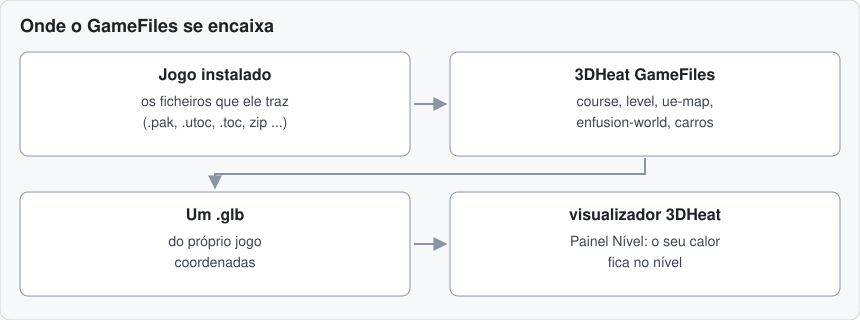

# Níveis inteiros {#whole-levels}

**Em palavras simples:** para jogos de tiro e outros sem voltas, a ferramenta guarda o mapa inteiro como um único ficheiro 3D, para que o visualizador possa desenhar por onde os jogadores andaram.

O `course` corta o chão à volta de uma volta. Para jogos sem voltas, a ferramenta exporta um nível, mapa ou mundo inteiro de uma vez:

| Jogo ou motor | Listar | Exportar | Página |
|---|---|---|---|
| Battlefield 6 (Frostbite) | `levels` | `level <level>` | [Níveis do Battlefield 6](level-battlefield.md) |
| Jogos Unreal 5 World Partition | `ue-maps <game>` | `ue-map <game> <map>` | [Mapas do Unreal 5](level-unreal-world-partition.md) |
| Arma Reforger (Enfusion) | `enfusion-worlds` | `enfusion-world <world>` | [Mundos do Arma Reforger](level-arma-reforger.md) |

Cada par funciona da mesma forma: o primeiro verbo lista o que o jogo instalado tem, o segundo escreve um deles como um único `.glb` nas coordenadas de mundo do próprio jogo, para que as posições gravadas nesse jogo caiam sobre ele. As partes chamam-se `ground:`, `structure:` e `water:`, como em qualquer outra exportação (veja [Formato de saída](output-format.md)); carregue o ficheiro no painel Fundo / nível do visualizador 3DHeat.

