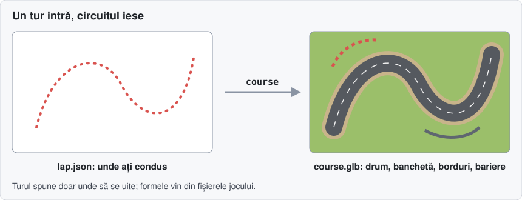
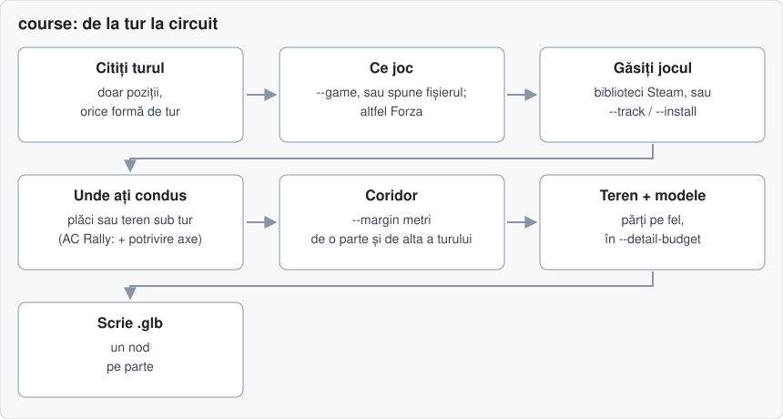

# Export de circuit {#course-export}

**Pe scurt:** ați parcurs un tur; aceasta construiește circuitul pe care l-ați parcurs, ca un fișier 3D. Turul este doar o linie de puncte; drumul, iarba și bordurile vin din fișierele jocului.

`course` transformă un tur într-un circuit: solul dintr-o fâșie de o parte și de alta a locului unde a mers mașina și ce stă pe acel sol, ca un singur `.glb` pentru vizualizator. Această pagină descrie ce au în comun cele trei jocuri acceptate. Paginile de sub ea descriu ce deosebește:

- [Forza Horizon](course-forza-horizon.md): arhive ForzaTech `.minizip`
- [BeamNG.drive](course-beamng.md): arhive zip, un câmp de înălțimi al terenului, forme compilate
- [Assetto Corsa Rally](course-assetto-corsa-rally.md): Unreal 5 IoStore, o etapă World Partition
- [Niveluri de detaliu și buget](detail-budget.md): câte triunghiuri primesc modelele plasate și ce copii rămân

## Pașii {#the-steps}

Cuvinte folosite mai jos: un **cadru** este orientarea axelor; **coridorul** este fâșia de sol de o parte și de alta a turului; o **dală** este o bucată pătrată a terenului unui joc; un **LOD** (nivel de detaliu) este una dintre copiile mai simple ale unui model.

1. **Citește turul.** Doar pozițiile, din oricare dintre formele din [Intrările de tur](lap-inputs.md). Viteza și comenzile nu sunt folosite. Un tur cu mai puțin de două eșantioane este refuzat (`holds no driving`).
2. **Decide jocul.** `--game`, apoi `game` din fișierul de tur, apoi Forza (vezi [Comenzi](commands.md#which-game)).
3. **Găsește jocul instalat.** Toate trei caută în fiecare bibliotecă Steam listată în `config\libraryfolders.vdf` al Steam. Forza caută și în `C:\XboxGames`. `--track` (Forza) sau `--install` (BeamNG, AC Rally) sare peste căutare.
4. **Găsește unde a fost parcurs turul.** Aceasta nu se decide niciodată doar după o potrivire de nume. Forza alege traseul ale cărui dale de teren acoperă turul. BeamNG alege nivelul pe al cărui teren (sau drumuri) stau eșantioanele turului. AC Rally încearcă fiecare etapă în opt orientări ale axelor și o alege pe cea care pune cele mai multe din tur pe drum.
5. **Taie un coridor** de `--margin` metri de o parte și de alta a parcursului (mai jos).
6. **Construiește solul** din coridor, clasat ca drum, acostament, pietriș și pământ, teren, marcaje, urme de anvelope sau apă, și coace o textură de sol pentru fiecare pătrat de 512 m.
7. **Plasează modelele** care stau în coridor, pe categorii, la un nivel de detaliu ales după distanță și după un buget de triunghiuri.
8. **Scrie `.glb`**: un nod numit pentru fiecare piesă. Vezi [Formatul de ieșire](output-format.md).

Ce afișează o rulare, aici pe o instalare sintetică BeamNG.drive pe care o construiesc testele, un tur de 50 m pe o bandă de drum:

## Coridorul {#the-corridor}

Tăietura este o fâșie în jurul liniei parcurse, nu caseta de încadrare a turului. Pentru un circuit, cele două sunt aproape la fel. Pentru un sprint de la un capăt la altul, caseta este în mare parte coastă de deal pe care nimeni nu o străbate, iar fâșia poate fi a zecea parte din suprafață. Sursa: [`corridor.py`](https://github.com/Holdi601/3DHeat-GameFiles/blob/main/heat3d_gamefiles/corridor.py).

Cum se construiește:

- Parcursul se proiectează pe planul solului: x și z ai turului (BeamNG: x și y ai cadrului propriu al jocului).
- Se rasterizează pe o grilă de celule de **4 m** (`CELL`). Fiecare celulă atinsă de parcurs este lărgită printr-un disc de rază `margin + 4 m` în toate direcțiile.
- Eșantioanele consecutive aflate la mai puțin de **50 m** unul de altul (`JOIN`) sunt unite prin puncte la fiecare 4 m, ca fâșia să nu aibă goluri. Eșantioanele mai depărtate sunt tratate ca porțiuni separate de parcurs și nu sunt unite. Un curs din bibliotecă este mai multe fișiere de tur una după alta, iar sfârșitul unui sprint și începutul următorului nu trebuie să tragă o fâșie peste hartă.
- Un triunghi este păstrat dacă vreun colț, mijlocul oricărei muchii sau centroidul lui se află în fâșie. Punctele de mijloc prind un triunghi mare care trece peste o fâșie îngustă cu toate colțurile în afară.
- Înălțimea nu face niciodată parte din tăiere. O casetă care ar limita altitudinea ar tăia solul de sub un deal pe care urcă drumul.

Consola raportează suprafața coridorului, de exemplu `cutting 80 m either side of the driving: 1.53 km2 of a 6,000 by 3,600 m box`.

BeamNG și AC Rally construiesc și un coridor mai larg, **de acces**, de `margin + 60 m`. Un model plasat este luat în calcul dacă originea lui se află în coridorul de acces și este desenat doar dacă amprenta lui atinge coridorul real. Astfel, un obiect lung a cărui origine este chiar în afara fâșiei nu se pierde. BeamNG folosește coridorul de acces și ca să aleagă ce decalcomanii de drum să picteze.

## Din ce este făcut solul {#what-the-ground-is-made-of}

Fiecare export clasează triunghiurile solului în aceleași tipuri, iar fiecare tip este scris ca piesă proprie, ca vizualizatorul să le poată arăta sau ascunde:

| Tip | Numele piesei | Culoare uniformă (RGB liniar) | Forza | BeamNG | AC Rally |
|---|---|---|---|---|---|
| drum | `ground:road` | 0.22, 0.22, 0.23 | fâșii de drum: partea de asfalt | straturi de tip `ASPHALT`, decalcomanii de drum, drum modelat | dalele de traseu (`/MeshesTrack/`) |
| acostament | `ground:verge` | 0.52, 0.47, 0.30 | fâșii de drum: acostamentul | trotuare și modele de acostament | - |
| pietriș și pământ | `ground:gravel and dirt` | 0.50, 0.42, 0.30 | - | straturi și decalcomanii de pământ, pietriș, nisip, noroi | - |
| teren | `ground:terrain` | 0.30, 0.44, 0.18 | tot restul | tot restul | dalele `_Terrain` și terenul îndepărtat |
| borduri | `ground:kerbs` | 0.60, 0.12, 0.10 (Forza) | props `road_gen_rum*` | modele de bordură, de trepte și de rumble | modele de bordură |
| marcaje | `ground:markings` | 0.90, 0.90, 0.88 | submeshuri de decalcomanie, ridicate cu 5 cm | pictate în textură | - |
| urme de anvelope | `ground:tyre marks` | 0.20, 0.17, 0.16 | submeshuri de decalcomanie, ridicate cu 5 cm | pictate în textură | - |
| apă | `water:water` | 0.16, 0.34, 0.48 | materiale de apă | planul mării, blocuri de apă, râuri | - |

Culorile uniforme sunt alese ca să se citească dintr-o privire, nu ca să se potrivească jocului. Sunt folosite pentru piesele fără textură și de vizualizatoarele care ignoră texturile. Sursa: [`surfaces.py`](https://github.com/Holdi601/3DHeat-GameFiles/blob/main/heat3d_gamefiles/surfaces.py).

Piesele de sol sunt împărțite pe pătrate de 512 m, iar fiecare pătrat poartă propria imagine coaptă, deci numele pieselor poartă pătratul:

| Joc | Numele piesei de sol | Cheia pătratului |
|---|---|---|
| Forza | `ground:road x-2046 z1023` | numele în grilă al dalei de teren (pași de 1023, vezi [Forza Horizon](course-forza-horizon.md)) |
| BeamNG | `ground:road 3_-2` | `floor(x / 512)`, `floor(y / 512)` în metri BeamNG |
| AC Rally | `ground:road 1_-4` | `floor(x / 51200)`, `floor(y / 51200)` în centimetri Unreal |

## Ce stă pe el {#what-stands-on-it}

Modelele plasate sunt scrise în piese numite `structure:<category>`, sau `ground:kerbs` pentru borduri (în toate trei jocurile). Când o piesă are propria textură, numele texturii sau al materialului urmează categoria, de exemplu `structure:barriers bar_armco_bclr`.

| Categorie | Forza | BeamNG | AC Rally |
|---|---|---|---|
| bariere | da | da | da |
| recuzită | da | da | da |
| semne | da | da | da |
| clădiri | da (clădiri întregi, unde jocul le are) | da | da |
| infrastructură | da | da | da |
| poduri | da | da | (clasate ca infrastructură) |
| stânci | da | da | da |
| borduri | da, ca sol | da, ca sol | da, ca sol |
| copaci | cu `--trees` | cu `--trees` | cu `--trees` |
| obiecte sfărâmabile | cu `--trees` | - | - |

Împărțirea detaliului este aceeași în toate trei. Copiile aflate la cel mult 25 m de parcurs pornesc la detaliu complet, cele la 25-60 m un nivel mai grosier, iar cele mai îndepărtate la cel mai grosier nivel. Apoi cele mai costisitoare modele coboară până când încape un buget de triunghiuri, iar acolo unde nici cele mai grosiere niveluri nu încap în bugetul pe care îl dați, copiile sunt lăsate afară. Bordurile nu sunt niciodată simplificate sau lăsate afară. Vezi [Niveluri de detaliu și buget](detail-budget.md).

## Opțiuni care modelează rezultatul {#options-that-shape-the-result}

| Vreți | Folosiți |
|---|---|
| un fișier mai mic | `--no-textures` (culori uniforme), `--texture-size 1024` sau `512`, `--detail-budget N`, `--margin 40` |
| doar solul | `--no-placed` |
| și peisajul | `--trees` |
| un alt sezon (Forza) | `--season winter` |
| un joc în afara Steam | `--track` (Forza) sau `--install` (BeamNG, AC Rally) |
| un tur pe care căutarea nu îl plasează | `--level` (BeamNG, AC Rally), `--track` (Forza) |

## Coordonate {#coordinates}

Fiecare export scrie metri, cu Y în sus, într-un cadru în care un tur înregistrat al aceluiași joc se aliniază:

| Joc | Cadrul scris |
|---|---|
| Forza | coordonatele lumii jocului, neschimbate |
| BeamNG | `(x, z, -y)` din lumea BeamNG cu Z în sus, adică rotația pe care o aplică înregistratorul de telemetrie |
| AC Rally | cadrul turului, aflat prin potrivire: centimetrii Unreal devin metri, iar X și Y Unreal devin x și z ai turului, în care dintre cele opt orientări se potrivește |

Vezi [Formatul de ieșire](output-format.md).
