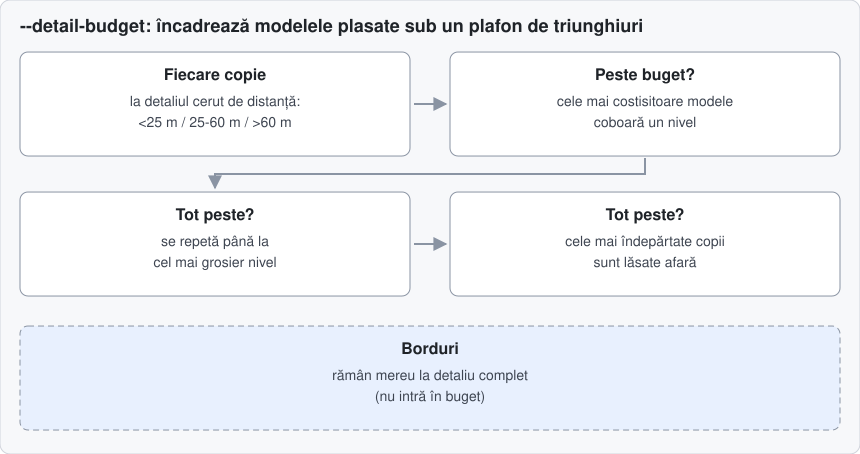

# Niveluri de detaliu și buget {#levels-of-detail-and-the-budget}

Un **triunghi** este o bucată plată, minusculă, a unui model 3D. Mai multe triunghiuri înseamnă un fișier mai mare și mai lent. **Bugetul** este o limită a numărului lor. Un **nivel de detaliu** este o copie mai simplă a unui model, folosită când este departe.

Cel mai fin nivel al tuturor lucrurilor plasate în jurul unui circuit este de câteva milioane de triunghiuri. De exemplu, sute de segmente de parapet și stive de anvelope, de circa o mie de triunghiuri fiecare. Un coridor urban conține peste o sută de mii de copii. Așadar, fiecare export de circuit dă modelelor plasate un **buget de triunghiuri** și decide, pentru fiecare model, la ce nivel de detaliu este desenat și, dacă e nevoie, ce copii să lase afară.

Schema a fost scrisă pentru Forza
([`forzaplacement.py`](https://github.com/Holdi601/3DHeat-GameFiles/blob/main/heat3d_gamefiles/forzaplacement.py):
`choose_levels`, `auto_budget`, `_fit`), iar BeamNG și AC Rally îi refolosesc părțile. Terenul nu se socotește în buget.

## Benzi de distanță {#distance-bands}

Distanța fiecărei copii față de parcurs se măsoară în planul solului, până la cel mai apropiat eșantion al turului. Turul este mai întâi rărit la cel mult 1.000 de puncte, ceea ce costă câțiva metri de precizie și nimic din ce contează aici. Copiile cad apoi în trei benzi, iar fiecare pereche (model, bandă) este bugetată separat:

| Bandă | Distanța | Pornește de la |
|---|---|---|
| aproape | sub 25 m (`NEAR`) | cel mai fin nivel |
| la mijloc | 25-60 m (`FAR`) | un nivel mai grosier |
| departe | 60 m și peste | cel mai grosier nivel |

Fără un traseu (Forza `terrain --box`), distanța se măsoară până la mijlocul casetei.

## Coborârea pentru a încăpea {#stepping-down-to-fit}



Costul unei intrări (model, bandă) este numărul de copii înmulțit cu triunghiurile la nivelul ei actual. Cât timp totalul depășește bugetul, intrarea care costă cel mai mult coboară un nivel, iar asta se repetă până când totalul încape sau nimic nu mai poate coborî. Intrările fixate nu coboară niciodată:

| Joc | Fixate la detaliu complet |
|---|---|
| Forza | bordurile (`road_gen_rum*`) |
| BeamNG | bordurile și orice formă care poartă suprafață de rulare |
| AC Rally | bordurile |

Sumarul Forza raportează asta ca `N of M models drawn at a coarser level to fit the budget`.

## Bugetul automat {#the-automatic-budget}

Fără `--detail-budget`, bugetul se dimensionează singur, astfel încât **nicio copie să nu fie lăsată afară**:

```
budget = max(1,500,000, 1.25 x sum(copies x coarsest level))
```

Intrările fixate se socotesc la cel mai fin nivel al lor. Cei 25% (`HEADROOM`) lasă lucrurile de lângă drum să păstreze un anumit detaliu. Pe un circuit de țară, aceasta este limita de 1,5 milioane (`DEFAULT_BUDGET`). Pe un circuit urban, unde coridorul conține peste o sută de mii de copii, crește la peste zece milioane, iar fișierul ajunge la sute de MB. Vizualizatorul îl încarcă.

## Un buget pe care îl dați {#a-budget-you-give}

`--detail-budget N` este un **plafon**. Nivelurile coboară cum s-a arătat mai sus. Dacă nici cele mai grosiere niveluri nu încap, copiile sunt lăsate afară:

| Joc | Ordinea în care sunt lăsate afară copiile |
|---|---|
| Forza | întâi tot ce stă la 25 m sau mai departe de parcurs, apoi ce stă lângă drum; în fiecare grup, întâi ce pare cel mai mic de pe drum: distanța cea mai mare / dimensiunea (dimensiunea = diagonala casetei de încadrare a modelului înmulțită cu cea mai mare scară a lui, cel puțin 0,25 m) |
| BeamNG | cele mai îndepărtate de parcurs întâi |
| AC Rally | cele mai îndepărtate de parcurs întâi, ca la BeamNG |
| Battlefield 6 | cele mai mici întâi: diagonala casetei de încadrare înmulțită cu scara |

Bordurile (și, la BeamNG, modelele de suprafață de rulare) nu sunt niciodată lăsate afară, deci un buget mai mic decât costă ele singure este depășit doar de ele și de nimic altceva.

Instrumentul folosește distanța împărțită la dimensiune pentru Forza, pentru că, ordonate doar după distanță, o unitate de aer condiționat pe un perete la nouă metri ar supraviețui unei fațade de douăzeci de metri de care este agățată, aflată la doisprezece metri. Lucrurile de lângă drum pleacă ultimele, oricare ar fi dimensiunea lor, pentru că o bariere de trei metri la cinci metri de linie este marginea pistei, pe când o clădire de cincizeci de metri aflată la șaizeci de metri în spate este decor.

Sumarul raportează
`N of M copies left out to fit the budget, the smallest and furthest from the driving first (--detail-budget raises it)`
(Forza), sau `N copies left out to fit the budget, the furthest from the driving first (--detail-budget raises it)`
(BeamNG, AC Rally).

## Clădiri întregi (Forza) {#whole-buildings-forza}

O clădire-înlocuitor întreagă numără drept o copie, la o distanță măsurată până la cea mai apropiată margine a clădirii. Este păstrată sau lăsată afară ca unitate. Piesele modulare pe care le înlocuiește nu sunt deloc bugetate. Vezi [Forza Horizon](course-forza-horizon.md#buildings-drawn-whole).

## Ce este un nivel de detaliu, pe joc {#what-a-level-of-detail-is-per-game}

| Joc | Nivelurile vin din |
|---|---|
| Forza | masca de nivel a fiecărui triunghi din submeshurile `Mesh` ale modelului (bitul `level + 1`); `0xFFFF` pentru piesele sfărâmabile, doar pentru un model fără niciun nivel marcat |
| BeamNG | `details` ale formei `.cdae` cu dimensiune nenegativă, cel mai mare întâi; pentru `.dae`, numărul de la sfârșitul numelor nodurilor de mesh (`barrier75`, `barrier40`) |
| AC Rally | nivelurile de detaliu stocate ale mesh-ului static, cel mai fin întâi |
| Battlefield 6 | nivelurile de detaliu ale MeshSet, cel mai fin întâi, numărând doar secțiunile desenate (nu copiile pentru umbre și adâncime) și fără un ultim nivel care este un înlocuitor pentru vederea de departe (materialele `M_LastLod`, `M_Billboard`, `M_Vista`: rețeaua unui stâlp devine un ac plin) |

Nivelul `level` al Battlefield 6 nu are traseu, deci nu există benzi de distanță: fiecare mesh este o intrare, fiecare copie la același nivel. Bugetul automat este formula de mai sus cu fundalul de teren fixat; câmpul de înălțimi este în afara bugetului și se dimensionează cu `--ground-spacing`. Sub un buget pe care îl dați, odată ce fiecare mesh este la cel mai grosier nivel, copiile sunt lăsate afară cele mai mici întâi, dimensiunea fiind diagonala casetei de încadrare a mesh-ului înmulțită cu scara copiei, pentru că nu există un parcurs de la care să se măsoare distanța. Fundalul de teren nu este lăsat afară niciodată. Un nivel ajunge la circa zece milioane de triunghiuri automat.

## Cum alegeți un număr {#choosing-a-number}

| Vreți | Încercați |
|---|---|
| totul, cu detaliu complet lângă drum | lăsați automat |
| un fișier de câteva ori mai mic | `--detail-budget 500000` cu `--texture-size 1024` |
| doar solul | `--no-placed` (nu intervine bugetul) |
