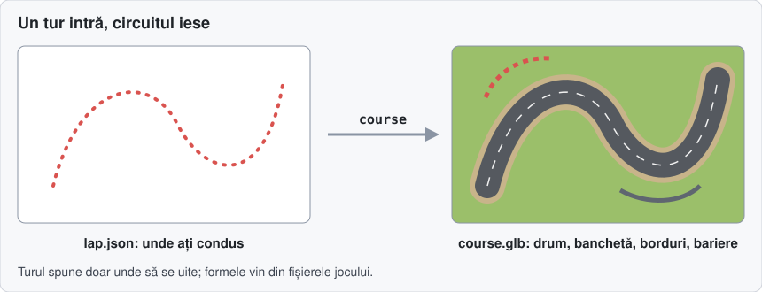
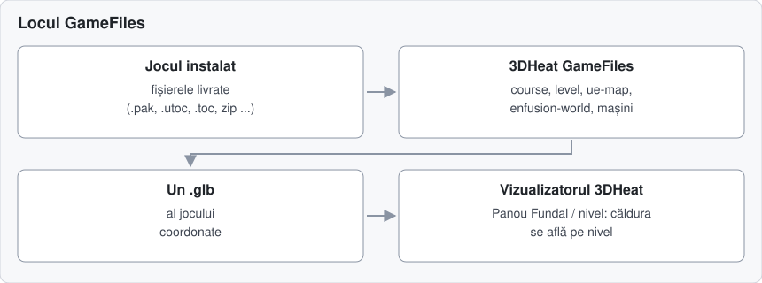

# 3DHeat GameFiles {#dheat-gamefiles}

**Ce este?** Un instrument care construiește un model 3D al unui circuit de curse sau al unui nivel de joc
din fișierele unui joc pe care îl aveți deja instalat.

**De ce l-aș folosi?** Vizualizatorul 3DHeat colorează locurile unde ați condus sau ați jucat, sub formă de
căldură. Cu acest instrument, căldura se pune pe circuitul sau nivelul real, nu pe spațiu gol.

**Exemplu:** luați un tur pe care l-ați condus. Instrumentul construiește drumul și terenul din jur
ca un singur fișier 3D, ca vizualizatorul să poată colora viteza sau accidentele dumneavoastră pe circuitul real:



Nu ați mai lucrat în linia de comandă? Începeți cu [Înainte de a începe](before-you-start.md).

Mai în detaliu: citește datele nivelului din arhivele pe care le livrează un joc și le scrie ca un fișier
binar glTF (`.glb`). Sarcina sa principală este **exportul de circuit**: îi dați un tur, iar el scrie
terenul, drumul separat de banchetă și de iarbă, precum și bordurile, barierele, zidurile de cauciucuri,
semnele și clădirile din jur.

Face parte din [3DHeat](https://github.com/Holdi601/3DHeat), un vizualizator pentru hărți termice 3D în timp real,
analiza cursei și revizuirea meciului ([documentație](https://holdi601.github.io/3DHeat/)). Fișierele `.glb`
pe care le scrie acest instrument sunt nivelele pe care vizualizatorul desenează căldura.



Este una dintre cele trei moduri de a aduce geometria unui nivel în 3DHeat:

| Cale | Are nevoie de | Oferă |
|---|---|---|
| 3DHeat Unreal Exporter | proiectul Unreal deschis în editor | geometrie exactă |
| 3DHeat GameCapture | un ecran și o captură | o estimare |
| **3DHeat GameFiles** | **jocul instalat, așa cum este livrat** | **geometrie exactă, fără proiect** |

Pachet Python: `heat3d_gamefiles`. Depozit:
[Holdi601/3DHeat-GameFiles](https://github.com/Holdi601/3DHeat-GameFiles). Licență: MIT.

## Ce poate face {#what-it-can-do}

| Joc sau motor | Export de circuit (`course`) | Citirea arhivelor |
|---|---|---|
| Forza Horizon (ForzaTech) | da: teren, drum și banchetă, textura solului, modele plasate în propriile lor texturi | `identify`, `list`, `extract` pe un `.minizip`; `identify` pe un `.modelbin`; modele, teren și texturi prin `course` și `terrain` |
| BeamNG.drive | da: teren, decalcomanii de drum, circuite modelate, modele plasate, apă | `identify`, `list`, `extract` pe arhivele zip ale nivelurilor; `identify` pe `.ter`, `.cdae`; `.dae` prin `course` |
| Assetto Corsa Rally (Unreal 5.6) | da: plăci de teren ale etapei, culoarea solului coaptă, modele plasate în culori plate | `identify`, `list`, `extract` pe IoStore `.utoc`/`.ucas`; pachete zen, meshe statice, texturi prin `course` |
| Unreal `.pak` (versiunile 8-12) | nu | `identify`, `list`, `extract` |
| Unity (format 22 și mai nou) | nu | `identify`, `meshes` |
| Battlefield 6 (Frostbite `.toc`/`.cas`) | fără tur; un nivel întreg cu `level`: teren, meshe plasate, hărțile lor de culoare cu `--textures` | `identify`, `levels`; pachete, meshe, teren, texturi și plasare prin `level` |
| Source 2 `.vpk` | nu | `identify`, `list`, `extract` |
| Jocuri Unreal 5 World Partition | fără tur; o hartă întreagă cu `ue-map` (listată de `ue-maps`): teren, clădiri și obiecte HLOD, apă | - |
| Arma Reforger (Enfusion) | fără tur; o lume întreagă cu `enfusion-world` (listată de `enfusion-worlds`): teren în culorile sale, marea, clădiri ca cutii | - |
| Forza (mașini) | `cars`: fiecare mașină la detaliu mic, pentru fila Analiză de cursă a vizualizatorului | - |

Tururile din Assetto Corsa EVO și iRacing sunt refuzate, cu motiv. Vezi [Limite și lacune cunoscute](../limits-and-known-gaps.md).

## Instalare {#install}

Nu ați mai lucrat în linia de comandă? Citiți mai întâi [Înainte de a începe](before-you-start.md).

Aveți nevoie de **Python 3.10 sau mai nou** (dezvoltat pe 3.13) și de pachetele din
[`requirements.txt`](https://github.com/Holdi601/3DHeat-GameFiles/blob/main/requirements.txt).

```
git clone https://github.com/Holdi601/3DHeat-GameFiles.git
cd 3DHeat-GameFiles
pip install -r requirements.txt
```

Apoi verificați: `python -m heat3d_gamefiles --help`. Ar trebui să vedeți
`usage: heat3d_gamefiles [-h]` și lista de verbe. Rulați fiecare comandă din dosarul
depozitului, ca `python -m heat3d_gamefiles <verb>`.

| Pachet | Pentru ce este folosit |
|---|---|
| numpy | tot ce decodează geometrie |
| lz4 | arhivele Forza (în mare parte blocuri LZ4), unele pachete Unity, blocuri LZ4 IoStore |
| Pillow | decodarea texturilor BC1-BC7, scrierea texturilor JPEG în `.glb` |
| msgpack, zstandard | formele compilate ale BeamNG (`.cdae`) |
| cryptography | doar pentru deschiderea unui `.pak` criptat cu o cheie pe care o aveți deja |
| pytest | testele |

Conținutul Unreal comprimat cu **Oodle** are nevoie de o bibliotecă Oodle care există deja pe
calculatorul dumneavoastră. Niciuna nu este livrată cu acest instrument. Vezi [Oodle](../reader-oodle.md).

Instrumentul este scris pentru Windows. Găsește jocurile prin lista de biblioteci Steam și prin
`%LOCALAPPDATA%`, iar Oodle îl încarcă ca DLL Windows. Alte platforme nu au fost testate.

## Pornire rapidă {#quick-start}

Un **fișier de tur** este o înregistrare a locului unde a mers mașina: o listă de puncte x, y, z.
Vine de la [3DHeat GameCapture](https://github.com/Holdi601/3DHeat-GameCapture) sau din biblioteca
de tururi a aplicației FH Companion; un CSV scris de mână funcționează și el
([Intrările de tur](../lap-inputs.md)).

```
# Forza: a lap file, a lap folder, or a course name from the FH Companion library
python -m heat3d_gamefiles course "Example Circuit"
python -m heat3d_gamefiles course path\to\lap.json -o course.glb

# BeamNG.drive or Assetto Corsa Rally: a heat3d-lap file says which game it is from
python -m heat3d_gamefiles course my_lap.json

# Every course in the FH Companion library, one .glb each
python -m heat3d_gamefiles courses -o courses

# Battlefield 6: list the levels, then export one (a large file; see Commands)
python -m heat3d_gamefiles levels
python -m heat3d_gamefiles level <level> -o level.glb --textures

# Unreal 5 World Partition and Arma Reforger: list, then export
python -m heat3d_gamefiles ue-maps "<game>"
python -m heat3d_gamefiles ue-map "<game>" <map> -o map.glb
python -m heat3d_gamefiles enfusion-worlds
python -m heat3d_gamefiles enfusion-world <world> -o world.glb

# Every Forza car, for the viewer's race tab
python -m heat3d_gamefiles cars -o forza.h3dcars

# What is this file?
python -m heat3d_gamefiles identify some_archive.pak
```

Deschideți `.glb` în vizualizatorul 3DHeat. Coordonatele lumii jocului sunt păstrate
(vezi [Formatul de ieșire](../output-format.md)), deci un tur înregistrat se aliniază cu circuitul.

## Harta acestei documentații {#map-of-this-documentation}

- [Înainte de a începe](before-you-start.md): Python, un terminal, prima comandă.
- [Comenzi](../commands.md): fiecare verb și opțiune, cu exemple.
- [Referința comenzilor](../cli-reference.md): `--help` al fiecărui verb, generat din cod.
- [Inspectarea arhivelor](../inspecting-archives.md): `identify`, `list`, `extract`, `meshes`, pas cu pas.
- [Exportul de circuit](../course-export.md): cum devine un tur un circuit, pentru toate jocurile.
  - [Forza Horizon](../course-forza-horizon.md)
  - [BeamNG.drive](../course-beamng.md)
  - [Assetto Corsa Rally](../course-assetto-corsa-rally.md)
  - [Nivelurile de detaliu și bugetul](../detail-budget.md)
- [Niveluri întregi](../whole-levels.md): un nivel, o hartă sau o lume fără tur.
  - [Nivelurile Battlefield 6](../level-battlefield.md): `levels`, `level`
  - [Hărțile Unreal 5](../level-unreal-world-partition.md): `ue-maps`, `ue-map`
  - [Lumile Arma Reforger](../level-arma-reforger.md): `enfusion-worlds`, `enfusion-world`
- [Mașinile Forza](../forza-cars.md): `cars`, fișierul cu mașini pentru fila Analiză de cursă a vizualizatorului.
- [Intrările de tur](../lap-inputs.md): fiecare formă de fișier de tur pe care o acceptă instrumentul.
- [Formatul de ieșire](../output-format.md): ce conține `.glb`.
- [Cititoarele de arhive](../archive-readers.md): câte o pagină pentru fiecare format de container, cu ce citește,
  ce nu citește și de ce.
- [Limite și lacune cunoscute](../limits-and-known-gaps.md)
- [Depanare](../troubleshooting.md): mesajele de eroare și ce să faceți.
- [Reguli și licențe](../rules-and-licences.md): fără chei, propriile fișiere, fără redistribuire.
- [Actualizări](../updates.md): verificarea actualizărilor și `heat3d_update`.
- [Dezvoltare](../development.md): harta modulelor și testele, inclusiv cele care rulează pe jocuri instalate.
- [Întreținere](../maintaining.md): lista de verificare pentru lansarea acestor pagini.

## Parte din 3DHeat {#part-of-3dheat}

3DHeat GameFiles este unul dintre instrumentele gratuite din jurul vizualizatorului 3DHeat:

| Instrument | Ce face | Documentație |
|---|---|---|
| [3DHeat](https://github.com/Holdi601/3DHeat) | vizualizatorul: hărți termice 3D, analiza cursei și revizuirea meciului în browser | [site](https://holdi601.github.io/3DHeat/) |
| [GameFiles](https://github.com/Holdi601/3DHeat-GameFiles) | circuite și nivele din fișierele livrate de un joc, ca `.glb` | [site](https://holdi601.github.io/3DHeat-GameFiles/) |
| [GameCapture](https://github.com/Holdi601/3DHeat-GameCapture) | telemetria turelor din jocurile de curse; nivele reconstruite din videoclipuri de joc | [site](https://holdi601.github.io/3DHeat-GameCapture/) |
| [Unreal Exporter](https://github.com/Holdi601/3DHeat-UnrealExporter) | un plugin pentru Unreal Editor care salvează un nivel ca `.glb` | [site](https://holdi601.github.io/3DHeat-UnrealExporter/) |
| [CS2](https://github.com/Holdi601/3DHeat-CS2) | demo-uri Counter-Strike 2 în fișiere de meci; hărți în `.glb` | [site](https://holdi601.github.io/3DHeat-CS2/) |
| [Watcher](https://github.com/Holdi601/3DHeat-Watcher) | înregistrează jocul dumneavoastră în fundal, din ce publică jocurile | [site](https://holdi601.github.io/3DHeat-Watcher/) |
| [Ext-WarThunder](https://github.com/Holdi601/3DHeat-Ext-WarThunder) | replay-uri War Thunder în fișiere de meci | [site](https://holdi601.github.io/3DHeat-Ext-WarThunder/) |
| [Ext-WoT](https://github.com/Holdi601/3DHeat-Ext-WoT) | replay-uri World of Tanks în fișiere de meci | [site](https://holdi601.github.io/3DHeat-Ext-WoT/) |
| [Ext-WoWs](https://github.com/Holdi601/3DHeat-Ext-WoWs) | replay-uri World of Warships în fișiere de meci | [site](https://holdi601.github.io/3DHeat-Ext-WoWs/) |
| [Ext-Squad](https://github.com/Holdi601/3DHeat-Ext-Squad) | demo-uri de server Squad în fișiere de meci | [site](https://holdi601.github.io/3DHeat-Ext-Squad/) |
| [Ext-DCS](https://github.com/Holdi601/3DHeat-Ext-DCS) | hărțile DCS World în nivele `.glb` | [site](https://holdi601.github.io/3DHeat-Ext-DCS/) |
| [Ext-IL2](https://github.com/Holdi601/3DHeat-Ext-IL2) | hărțile IL-2 Sturmovik în nivele `.glb` | [site](https://holdi601.github.io/3DHeat-Ext-IL2/) |

Fișierele de meci ale vizualizatorului sunt descrise în
[Un fișier pe meci: `.3dheat`](https://holdi601.github.io/3DHeat/container.html);
un nivel făcut aici se încarcă lângă ele, în panoul Fundal / nivel al vizualizatorului.
