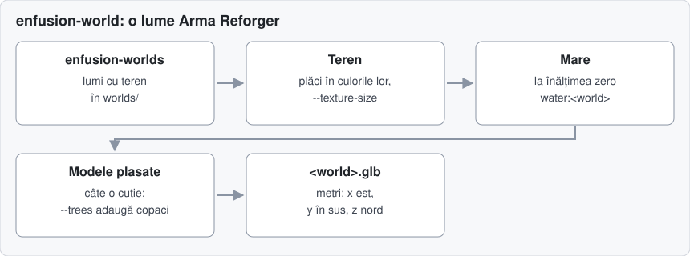

# Lumi Arma Reforger: `enfusion-worlds` și `enfusion-world` {#arma-reforger-worlds-enfusion-worlds-and-enfusion-world}

**Ce este?** O lume întreagă din Arma Reforger, ca un singur fișier 3D. **De ce?** Ca căldura din joc să aibă sub ea solul și clădirile. (*Enfusion* este motorul cu care este făcut Arma Reforger; o *lume* este ceea ce jocul numește hartă.)

Exportă o lume Enfusion întreagă a Arma Reforger instalat: terenul, în culorile propriilor lui dale de supertextură, marea și fiecare model plasat, ca o casetă, în metrii jocului.



## Pas cu pas {#step-by-step}

1. **Listați lumile** care au un teren:

   ```
   python -m heat3d_gamefiles enfusion-worlds
   python -m heat3d_gamefiles enfusion-worlds --install "D:\Games\Arma Reforger"
   ```

2. **Exportați una**, după numele ei de folder din `worlds/`, cum apare în listă:

   ```
   python -m heat3d_gamefiles enfusion-world <world> -o world.glb
   ```

3. **Variante:**

   ```
   python -m heat3d_gamefiles enfusion-world <world> --trees               # vegetation too, as boxes
   python -m heat3d_gamefiles enfusion-world <world> --texture-size 0      # flat colour, small file
   python -m heat3d_gamefiles enfusion-world <world> --ground-spacing 4 --no-structures
   ```

4. **Deschideți `world.glb`** în panoul Background / level al vizualizatorului 3DHeat ([încărcarea unui nivel](https://holdi601.github.io/3DHeat/levels.html)).

## Opțiuni {#options}

| Opțiune | Implicit | Înseamnă |
|---|---|---|
| `<world>` | obligatoriu | o lume, cum o afișează `enfusion-worlds` |
| `-o`, `--out FILE` | `<world>.glb` | fișierul de scris |
| `--install FOLDER` | biblioteca Steam care conține jocul | folderul jocului |
| `--ground-spacing METRES` | 2 (al terenului) | distanța dintre vertexurile terenului în fișier |
| `--texture-size PIXELS` | 4096 | latura mai mare a imaginii culorii solului; 0 pentru culoare uniformă |
| `--no-structures` | | lasă modelele plasate afară |
| `--trees` | oprit | plasează și copacii și alta vegetație, ca casete |

## Exemplu de ieșire {#example-output}

```text
<world> -> world.glb
  ground      <n> triangles, <w> x <h> m; <n> of <n> tile-edge vertices disagree; colour <w> x <h>
  structure   <n> boxes from <n> entities
  water       <n> triangles (the sea)
  left out    <what>: <n>, ...
```

## Piesele {#the-parts}

`ground:<world>` (terenul), `water:<world>` (marea, la înălțimea zero) și `structure:<world>` (casetele). Coordonatele sunt ale jocului: x spre est, y în sus, z spre nord, în metri, adică ceea ce raportează o înregistrare din joc. Cadrul jocului este stângaci; *invert world axis* în vizualizator îl arată nerăsturnat.

## Cum este citit și verificat {#how-it-is-read-and-checked}

Nu este nevoie de Workbench, iar nimic nu este criptat.

| Format | Ce este | Verificat față de |
|---|---|---|
| `.pak` | o bucată de date și un arbore de directoare, intrări stocate sau zlib | arborele își consumă exact bucata; intrările zlib eșantionate se descomprimă exact la dimensiunea declarată |
| `.edds` | un antet DDS, apoi pe fiecare nivel de mip bucăți `COPY` sau `LZ4 ` | nivelurile pe bucăți se decodează exact la dimensiunea lor, folosind exact octeții lor |
| `.terr` / `.ttile` | un antet și dale cu înălțimi pe 16 biți | fiecare muchie comună a două dale este identică |
| supertextură | culoarea solului fiecărei dale, circa un metru pe pixel | se potrivește cu marea din înălțimi; nicio inversare sau transpunere nu se potrivește la fel de bine |
| `.ent` | nume, GUID-uri de resurse, apoi entități ca valori tipizate | un fișier de lume se parsează până la ultimul octet |
| `resourceDatabase.rdb` | GUID către cale | aproape fiecare GUID folosit de o lume numește un fișier care există |

Obiectele marcate ca stând la o înălțime absolută se află la câțiva centimetri de terenul decodat (cu grila transpusă ar fi la metri distanță). Nu sunt desenate: triunghiurile proprii ale modelelor, copacii implicit (`--trees` îi adaugă ca casete), entitățile copil, lacurile și râurile, texturile cu antete dinainte de DX10.

**Termeni:** licența jocului permite utilizarea necomercială și interzice ingineria inversă a fișierelor jocului. Citirea propriei instalări este decizia dumneavoastră în temeiul ei; rezultatul este pentru utilizarea dumneavoastră și nu se împărtășește.
