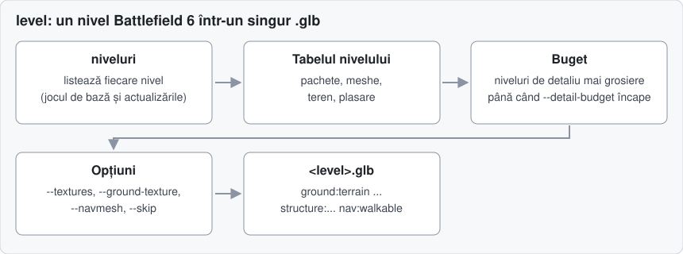

# Niveluri Battlefield 6: `levels` și `level` {#battlefield-6-levels-levels-and-level}

**Ce este?** Un nivel întreg din Battlefield 6, ca un singur fișier 3D. **De ce?** Ca căldura din meciurile dumneavoastră să aibă sub ea solul și clădirile. (*Frostbite* este motorul cu care este făcut Battlefield; un *câmp de înălțimi* este solul stocat ca o grilă de înălțimi.)

Exportă un nivel Frostbite întreg al jocului instalat: câmpul de înălțimi al terenului, fiecare mesh pe care îl plasează grupurile statice de modele, obiectele plasate unul câte unul, fundalul de teren din jurul hărții și, la cerere, hărțile de culoare ale suprafețelor, decalcomaniile de teren coapte în sol și suprafețele pe care pot merge soldații.



## Pas cu pas {#step-by-step}

1. **Listați nivelurile** pe care le livrează jocul:

   ```
   python -m heat3d_gamefiles levels
   python -m heat3d_gamefiles levels --install "D:\Games\<game folder>"
   ```

   Fiecare rând este un tabel de nivel (`levels/<level>/<level>.toc`) cu dimensiunea lui și de unde vine: `Data` pentru jocul de bază, `Update/<pack>` pentru o actualizare.

2. **Exportați unul**, după numele lui, după o parte unică a acestuia sau după calea `.toc`. Începeți fără culori, ca să vedeți forma și dimensiunea:

   ```
   python -m heat3d_gamefiles level <level> -o level.glb
   ```

3. **Adăugați culoare** după ce arată bine:

   ```
   python -m heat3d_gamefiles level <level> -o level.glb --textures 512 --ground-texture 0.5
   ```

4. **Adăugați suprafețele pe care se poate merge**, sau micșorați fișierul:

   ```
   python -m heat3d_gamefiles level <level> --textures 512 --ground-texture 0.5 --navmesh
   python -m heat3d_gamefiles level <level> --textures 256 --detail-budget 3000000 --ground-spacing 8
   ```

5. **Deschideți `level.glb`** în panoul Background / level al vizualizatorului 3DHeat ([încărcarea unui nivel](https://holdi601.github.io/3DHeat/levels.html)).

## Opțiuni {#options}

| Opțiune | Implicit | Înseamnă |
|---|---|---|
| `<level>` | obligatoriu | un nume, cum îl afișează `levels`, o parte unică a unuia, sau calea `.toc` a unui nivel |
| `-o`, `--out FILE` | `<level>.glb` | fișierul de scris |
| `--install FOLDER` | găsit în bibliotecile Steam | folderul jocului |
| `--textures [PIXELS]` | oprit; 512 fără o dimensiune | harta de culoare a fiecărei suprafețe, cel mult PIXELS pe latură |
| `--ground-texture [METRES]` | oprit; 0,5 fără o dimensiune | coacerea drumurilor, platformelor și marcajelor în culoarea solului, METRES pe pixel |
| `--navmesh` | oprit | adaugă plasa de navigare a soldatului ca `nav:walkable` |
| `--ground-spacing METRES` | 4 | distanța cea mai fină a câmpului de înălțimi; 0 îl lasă afară |
| `--detail-budget N` | copiile cele mai grosiere plus un sfert, cel puțin 1.500.000 | un plafon de triunghiuri (terenul nu este niciodată simplificat) |
| `--skip TEXT` | | lasă afară grupurile de modele al căror nume de partiție conține TEXT; se poate repeta |
| `--by-mesh` | oprit | o piesă pentru fiecare mesh sursă și material, ca să găsiți ce este o piesă |
| `--clamped-uvs` | oprit | pentru randerele care nu pot repeta o textură |

Tabelul complet, cu dimensiunile de așteptat (un nivel întreg are sute de MB), se află la [Comenzi](commands.md#levels-and-level-frostbite). Cum sunt citite tabelele, pachetele, mesh-urile și terenul se află la [Frostbite](reader-frostbite.md).

## Exemplu de ieșire {#example-output}

Ce afișează `level`, în linii mari (liniile așa cum le scrie codul; `<n>` și numele variază după nivel):

```text
<n> copies of <n> meshes, from <n> static model groups
      <n>  <group>
      <n>  placed one by one (object and prefab references)
<n> meshes left out: <why>
<n> triangles, budget <n>; <n> meshes drawn at a coarser level to fit
           <n>  ground:terrain
           <n>  structure:buildings, <n> textures
           ...
<n> of <n> drawn sections carry their colour map; the rest are flat colours
Ground: <what the ground is>.
Navigation mesh: <tiles read>.
-> level.glb (<n> MB)
```

## Piesele {#the-parts}

`ground:terrain` (câmpul de înălțimi), `ground:terrain backdrop` și `ground:terrain blend`, `structure:<kind>` pentru fiecare tip de mesh (pentru fiecare hartă de culoare cu `--textures`, cu ` (destructible)` pentru ce poate fi distrus într-un meci), și `nav:walkable` cu `--navmesh`. Vezi [Formatul de ieșire](output-format.md).

Fișierul conține conținutul jocului: este pentru calculatorul pe care a fost făcut, nu pentru a fi dat mai departe ([Reguli și licențe](rules-and-licences.md)).
