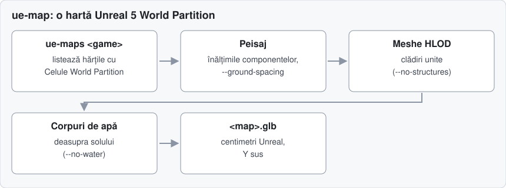

# Hărți Unreal 5 World Partition: `ue-maps` și `ue-map` {#unreal-5-world-partition-maps-ue-maps-and-ue-map}

**Ce este?** O hartă întreagă a unui joc Unreal 5, ca un singur fișier 3D: solul, clădirile și apa. **De ce?** Ca căldura din jocul acela să aibă sub ea harta. (*World Partition* este modul în care Unreal 5 împarte o hartă mare în bucăți; *HLOD* este un înlocuitor simplificat pentru un grup de clădiri, cel pe care jocul îl desenează de departe.)

Exportă o hartă întreagă a unui joc Unreal 5 ale cărui hărți sunt compilate ca celule World Partition: peisajul, mesh-urile HLOD ale hărții (clădirile și recuzita ei, așa cum le desenează jocul de departe) și corpurile de apă. Nu este nevoie de editor și de proiect, doar de jocul instalat.



## Pas cu pas {#step-by-step}

1. **Listați hărțile.** `<game>` este folderul jocului, `Content/Paks` al lui, sau numele folderului său dintr-o bibliotecă Steam:

   ```
   python -m heat3d_gamefiles ue-maps "<Steam game folder name>"
   python -m heat3d_gamefiles ue-maps "D:\Games\<game>"
   ```

   Fiecare hartă cu celule World Partition compilate este afișată cu calea ei de pachet.

2. **Exportați una** după numele ei sau după o parte unică a acestuia:

   ```
   python -m heat3d_gamefiles ue-map "<game>" <map> -o map.glb
   ```

3. **Doar solul, sau mai grosier:**

   ```
   python -m heat3d_gamefiles ue-map "<game>" <map> --no-structures --no-water
   python -m heat3d_gamefiles ue-map "<game>" <map> --ground-spacing 4
   ```

4. **Deschideți `map.glb`** în panoul Background / level al vizualizatorului 3DHeat ([încărcarea unui nivel](https://holdi601.github.io/3DHeat/levels.html)).

## Opțiuni {#options}

| Opțiune | Implicit | Înseamnă |
|---|---|---|
| `<game>` | obligatoriu | folderul jocului, `Content/Paks` al lui, sau numele folderului Steam |
| `<map>` | obligatoriu | un nume, cum îl afișează `ue-maps`, sau o parte unică a lui |
| `-o`, `--out FILE` | `<map>.glb` | fișierul de scris |
| `--ground-spacing METRES` | 2 | distanța dintre vertexurile peisajului, rotunjită la un număr întreg de pătrate proprii |
| `--no-structures` | | lasă afară clădirile HLOD și recuzita |
| `--no-water` | | lasă afară corpurile de apă |

Conținutul comprimat cu Oodle are nevoie de o bibliotecă Oodle deja existentă pe calculator (vezi [Oodle](reader-oodle.md)).

## Exemplu de ieșire {#example-output}

```text
<map> -> map.glb
  ground      <n> triangles from <n> landscape components; <n> of <n> vertices stored twice disagree
  structure   <n> triangles in <n> HLOD meshes
  water       <n> triangles from <n> water bodies
```

Numărul de neconcordanțe este o autoverificare: componentele vecine de peisaj stochează de două ori muchia lor comună, iar cele două trebuie să se potrivească. O hartă de 3 km la 2 m are circa 4,6 milioane de triunghiuri de sol.

## Piesele {#the-parts}

`ground:<map>` (peisajul), `structure:<map>` (mesh-urile HLOD) și `water:<map>` (apa care stă deasupra solului).

**Unități:** acesta este singurul export **care nu este în metri**: centimetri Unreal, cu Y și Z inversate (Y în sus), cadrul pe care îl scrie Unreal Exporter 3DHeat. Telemetria din același joc folosește același cadru, deci se așază pe hartă.

## Cum este citit și verificat {#how-it-is-read-and-checked}

| Piesa | Citită din | Verificată față de |
|---|---|---|
| sol | câmpul de înălțimi pe 16 biți al fiecărei componente de peisaj, plasat după baza de secțiune pe transformarea peisajului | fiecare vertex stocat de două ori (pe o cusătură sau pe o margine de componentă) trebuie să fie identic; neconcordanțele sunt numărate și afișate, nu netezite |
| structuri | mesh-urile HLOD ale hărții, construite de motor în spațiul lumii | un mesh este păstrat doar dacă limitele pe care i le stochează componenta descriu propriile lui vertexuri |
| apă | mesh-ul fiecărui corp de apă, așezat pe grila solului, păstrat unde stă deasupra solului | apa stă la câțiva metri deasupra solului de sub ea, ca un râu deasupra albiei lui |

Proprietățile peisajului se găsesc după formă, nu după numărul slotului (sloturile se mută între versiunile motorului). Structurile sunt înlocuitorii simplificați, nu modelele cu detaliu complet. Vegetația, decalcomaniile și materialele peisajului nu sunt exportate; solul este netexturat și umbrit de vizualizator. Detalii despre arhive: [Unreal 5 IoStore](reader-unreal-iostore.md).

**Termeni:** licențele jocurilor permit de obicei utilizarea personală, necomercială, și interzic ingineria inversă „în măsura în care asemenea acțiuni nu pot fi interzise prin lege”. Citirea propriei instalări este decizia dumneavoastră în temeiul lor; rezultatul este pentru utilizarea dumneavoastră și nu se împărtășește.
