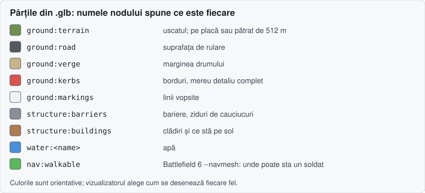

# Formatul de ieșire {#output-format}

Un `.glb` este un singur fișier 3D: terenul, clădirile și apa unui circuit sau nivel, pe care îl deschideți în panoul Fundal / nivel al vizualizatorului 3DHeat.

Fiecare export (`course`, `courses`, `terrain`, `level`, `ue-map`, `enfusion-world`) scrie un singur fișier **binary glTF 2.0** (`.glb`). Este intenționat mic și plat și este așezat cum citește vizualizatorul 3DHeat un nivel. Sursa:
[`glb.py`](https://github.com/Holdi601/3DHeat-GameFiles/blob/main/heat3d_gamefiles/glb.py).

## Structura {#structure}

```
scene 0
 ├─ node "ground:terrain x-2046 z1023"  -> mesh 0 -> 1 primitive, material 0
 ├─ node "ground:road x-2046 z1023"     -> mesh 1 -> 1 primitive, material 1
 ├─ node "ground:markings"               -> mesh 2 -> ...
 ├─ node "ground:kerbs road_gen_rum_..." -> ...
 ├─ node "structure:barriers bar_armco_bclr"
 └─ ...
```

- **Un nod pentru fiecare parte**, toate la rădăcina scenei, **fără transformări**. Toată geometria este deja în coordonate lume.
- Fiecare nod are propriul mesh, cu **o singură primitivă** și propriul material. Nodul, mesh-ul și materialul poartă toate numele părții.
- Fiecare primitivă are **propriile ei tablouri compacte de vârfuri**, doar vârfurile pe care le folosește partea. Un tablou de vârfuri comun este glTF valid, dar un cititor care extinde accesorii fiecărei primitive ar ține fiecare vârf de atâtea ori câte părți există.
- `asset.generator` este `heat3d_gamefiles`.
- **Puține `extras`**, și niciun nume de tur, joc sau circuit:
  - o parte Battlefield 6 a unui mesh distructibil poartă `{"destructible": true}` pe nodul ei;
  - un traseu Forza spune ce conține în `asset.extras` (versiunea formatului, id-ul rutei potrivite, câte copii ale stratului propriu al cursei, locuri; vedeți [Traseele Forza Horizon](course-forza-horizon.md#writing-the-file)), iar părțile lui pornite își poartă stratul pe nod: `{"layer": "event", "route": <id>}` pentru stratul propriu al cursei, `{"layer": "layer"}` pentru alt strat pornit, `{"layer": "venue"}` pentru solul unui loc.

  Tot ce mai are nevoie vizualizatorul este în numele nodurilor.

## Numele nodurilor: clasificarea {#node-names-the-classification}



Vizualizatorul ia clasa unei părți din numele **nodului** (sau, dacă lipsește, din numele mesh-ului), și doar dacă se potrivește cu

```
^(ground|structure|water)\s*[:|]
```

Orice altceva este clasificat de o euristică scrisă pentru peisajele Unreal. Deci fiecare parte pe care o scrie exportatorul începe cu unul dintre aceste prefixe, sau cu `nav:` (mai jos).

| Prefix | Înseamnă | Părți scrise |
|---|---|---|
| `ground:` | suprafața de rulare și terenul | `ground:road`, `ground:verge`, `ground:terrain`, `ground:gravel and dirt`, `ground:kerbs`, `ground:markings`, `ground:tyre marks`, `ground:venue`, `ground:plinths` |
| `structure:` | ce stă pe el | `structure:barriers`, `structure:props`, `structure:signs`, `structure:buildings`, `structure:infrastructure`, `structure:bridges`, `structure:rocks`, `structure:smashables`, `structure:trees`; straturile Forza `structure:event_<category>` și `structure:layer_<category>` |
| `water:` | apa | `water:water`; `water:<map>` (`ue-map`), `water:<world>` (`enfusion-world`) |
| `nav:` | unde poate merge un soldat (Battlefield 6, doar cu `--navmesh`) | `nav:walkable` |

`nav:` nu se potrivește cu tiparul vizualizatorului de mai sus, deci vizualizatorul îl sortează după euristica lui; este o parte separată ca să o puteți arăta sau ascunde singură. `ue-map` scrie `ground:<map>`, `structure:<map>` și `water:<map>`; `enfusion-world` scrie `ground:<world>`, `structure:<world>` și `water:<world>`.

După tip vine, în funcție de joc:

| Exemplu | Înseamnă |
|---|---|
| `ground:road x-2046 z1023` | sol Forza în placa de teren numită `x-2046 z1023` (unități de grilă, 1023 per 512 m) |
| `ground:road 3_-2` | sol BeamNG în pătratul de 512 m (3, -2) |
| `ground:road 3_-2 asphalt_light` | suprafață de rulare modelată BeamNG a materialului `asphalt_light` din pătratul acela |
| `ground:road 1_-4` | sol AC Rally în pătratul de 512 m (1, -4) din spațiul Unreal |
| `structure:barriers bar_armco_bclr` | modele plasate Forza, cu o textură comună (numele lor fără GUID) |
| `structure:barriers` | modele plasate fără textură (Forza, AC Rally) |
| `structure:event_barriers bar_example_bclr` | Forza: ce pune pentru sine cursa potrivită, separat de lumea liberă (extras-ul nodului `{"layer": "event", "route": <id>}`) |
| `structure:layer_props` | Forza: un strat pe care jocul îl pornește pentru altceva decât această cursă (o activitate, un obiect de colectare, un strat de rulare) |
| `ground:venue`, `ground:plinths` | Forza: modele deja în coordonate lume - solul propriu al unui loc (podeaua unui stadion) și solul cu care este împodobit un stradă |
| `structure:barriers armco_metal` | modele plasate BeamNG dintr-un material |
| `ground:markings`, `water:water` | părți plate, câte una pentru tot fișierul |
| `ground:terrain` (Battlefield 6) | harta de înălțimi; `ground:terrain backdrop` meshurile îndepărtate ale terenului, `ground:terrain blend` meshurile care se îmbină cu terenul |
| `nav:walkable` (Battlefield 6, `--navmesh`) | plasa de navigare a nivelului pentru un soldat: unde poate sta cineva, verde plat |
| `ground:terrain x-512 z-512` (Battlefield 6, `--ground-texture`) | harta de înălțimi de sub o placă coaptă de decal, numită după colțul ei de jos în metri |
| `structure:buildings t_concreteclean_01_cs` (Battlefield 6, `--textures`) | fiecare suprafață de acel fel care arată harta aceea de culoare; fără `--textures`, o parte per fel, fără sufix |
| `structure:buildings t_concreteclean_01_cs (destructible)` (Battlefield 6) | același lucru, pentru mesh-urile pe care le poate doborî un meci: cele cu un fișier de distrugere de același nume (pereți, case, recuzită). Nodul poartă și extras-ul glTF `{"destructible": true}`. Stările lor distruse nu se exportă |

Vizualizatorul poate filtra după aceste nume. De exemplu, "doar suprafața de cursă" este `ground:road` împreună cu `ground:kerbs`, în toate cele trei jocuri, iar "lumea fără recuzita cursei" este tot ce nu e `structure:event_*`. Prefixul este și felul în care vizualizatorul desenează o parte: solul ca suprafața pe care stă căldura, structura ca ce stă pe ea.

## Unități, axe și cadru {#units-axes-and-frame}

- **Metri, Y în sus**, convenția glTF, pentru fiecare export în afară de `ue-map`. Nimic nu se redimensionează sau recentrează: numerele sunt coordonatele lumii ale jocului, ceea ce este tocmai scopul citirii arhivei în loc de reconstruire.
- **Hărțile Unreal 5 (`ue-map`): centimetri**, unitatea proprie a Unreal, cu Y și Z schimbate, ca Y să fie în sus - cadrul pe care îl scrie exportatorul Unreal 3DHeat și pe care îl folosește telemetria jocului. Singurul export care nu este în metri.
- **Arma Reforger (`enfusion-world`):** metrii proprii ai jocului, x spre est, y în sus, z spre nord. Cadrul jocului este stângaci; *invert world axis* al vizualizatorului îl arată neoglindit.
- **Forza:** coordonatele lumii ale jocului (x, y în sus, z), nemodificate. Aceleași cu telemetria lui, deci un tur înregistrat stă pe traseu.
- **BeamNG.drive:** `(x, z, -y)` din lumea cu Z în sus a BeamNG, care este rotația aplicată de înregistratorul de telemetrie. O rotație, nu o oglindire.
- **Battlefield 6:** coordonatele lumii ale jocului (x, y în sus, z), nemodificate: transformările de instanță ale nivelului aplicate fiecărui mesh așa cum este stocat. Copiile oglindite sunt reordonate, ca normalele lor să indice spre exterior.
- **Assetto Corsa Rally:** cadrul turului. Centimetrii Unreal devin metri, Z-ul Unreal devine y, iar X și Y Unreal devin x și z în oricare dintre cele opt orientări în care s-a potrivit turul (vedeți [Assetto Corsa Rally](course-assetto-corsa-rally.md#which-stage-and-which-way-round)). Triunghiurile se reordonează acolo unde maparea oglindește.

Fiecare export păstrează axele pe care le folosește telemetria lui, deci înregistrarea și nivelul împart același cadru. Dacă acel cadru este stâng sau drept în fiecare joc, nu s-a verificat.

## Datele vârfurilor {#vertex-data}

Forma implicită este cea **cuantizată** (`quantize=True`). Are nevoie de extensia `KHR_mesh_quantization`, care este listată atât în `extensionsUsed`, cât și în `extensionsRequired`.

| Atribut | Cuantizat (implicit) | Precizie completă (`quantize=False`) |
|---|---|---|
| `POSITION` | float32 VEC3, cu min/max | float32 VEC3 |
| `NORMAL` | int8 VEC3 normalizat, completat la 4 octeți (pas 4) | float32 VEC3 |
| `TEXCOORD_0` (doar părți cu textură) | uint16 VEC2 normalizat, limitat la 0-1; float32 VEC2 acolo unde texturile se repetă (Battlefield 6) | float32 VEC2 |
| `COLOR_0` (părți fără textură, când vreo parte are culoare) | uint8 VEC3 normalizat, completat la 4 octeți | float32 VEC3 |
| indici | uint16 când partea are cel mult 65.535 de vârfuri, altfel uint32 | uint32 |

Un vârf are 20 de octeți în loc de 32 (24 în loc de 44 cu culoare). Asta scoate o treime din fiecare fișier și face diferența dintre un circuit urban care se încarcă într-un tab de browser și unul care nu se încarcă. Costul este sub o jumătate de grad de normală și 1/65.535 dintr-un UV (o cincisprezecime dintr-un texel la 4.096 px). Linia de comandă scrie mereu forma cuantizată. `write_glb(..., quantize=False)` în Python scrie cealaltă.

Normalele vin din joc acolo unde le stochează (teren și modele Forza, forme și teren BeamNG). Altfel se calculează ca normale netede ponderate cu aria, din triunghiuri. Normalele AC Rally se calculează mereu.

## Materiale, culori și texturi {#materials-colours-and-textures}

- Fiecare material este `metallicFactor 0`, `roughnessFactor 1`.
- **Parte cu textură:** `baseColorTexture` cu imaginea părții, UV-urile ei și fără culoare de vârf. glTF le înmulțește pe cele două, deci o suprafață ar ieși întunecată de două ori.
- **Parte fără textură:** culoare de vârf `COLOR_0` cu culoarea plată a părții, și un `baseColorFactor` alb. Dacă nicio parte din fișier nu are culoare, nu există `COLOR_0`. Unde părțile împart vârfuri, culoarea părții ulterioare câștigă, deci părțile plate se scriu în ordinea crescătoare a importanței.
- **Imaginile** sunt încorporate în bucata binară ca **JPEG**, calitate 90, fără submonstrare de crominanță, doar RGB (alfa se elimină) - cu excepția unei hărți Battlefield 6 decupate (frunze, garduri), care este **PNG** cu alfa ei, pe un material cu `alphaMode` MASK, `alphaCutoff` 0,5 și `doubleSided` (vedeți [Frostbite](reader-frostbite.md#textures-and-materials)). Vizualizatorul 3DHeat aruncă texelii sub prag. Un sol de 2048 px cu iarbă și coroane de copaci este zgomot pentru un codor fără pierderi: câțiva megaocteți o placă ca PNG, sub unul ca JPEG. O imagine comună mai multor părți se stochează o dată.
- Un singur eșantionator pentru toate texturile: mărire liniară, micșorare liniar-mipmap-liniar, **clamp to edge** pe ambele axe, pentru exporturile de traseu, ale căror texturi acoperă fiecare suprafață o singură dată. BeamNG desenează texturile repetitive ale modelelor ca culori plate (vedeți [BeamNG.drive](course-beamng.md#placed-models)).
- Un export Battlefield 6 cu `--textures`, ale cărui materiale se repetă, scrie coordonatele de textură ale jocului, nelimitate, ca float32 `TEXCOORD_0` chiar și în forma cuantizată, cu un eșantionator care **se repetă** pe ambele axe (`write_glb(..., repeat=True)`): un perete de cărămidă este o pereche de triunghiuri al cărei UV merge de la 0 la 40. Vizualizatorul 3DHeat împachetează o astfel de textură în atlasul lui (vedeți pagina *Model levels*). Pentru un renderer care nu poate repeta o textură, `level --clamped-uvs` (`write_level(..., clamped=True)`) taie fiecare triunghi de-a lungul liniilor unde textura lui se repetă și mută fiecare bucată în 0..1: aceiași pixeli pe aceeași suprafață, cu aproximativ o cincime mai multe triunghiuri. Triunghiurile peste care o textură se repetă de mai mult de 16 ori își păstrează coordonatele. Un triunghi pe care textura l-ar tăia în mai mult de 4 bucăți - scoarța care se repetă în jos pe fiecare ramură a unui copac, care tăiată a transformat 1.099 triunghiuri ale unui copac în 51.735 - intră într-o parte proprie, `<part> (average colour)`, în culoarea medie a texturii; `level` spune câte sunt.

| Textură | Mărime | Acoperă |
|---|---|---|
| sol (toate jocurile în afară de Battlefield 6) | `--texture-size`: 2048, 1024 sau 512 px | un pătrat de 512 m: 25, 50 sau 100 cm un pixel |
| harta de înălțimi Battlefield 6 | cel mai mare mip al hărții de culoare a fundalului din nivel, decupat | pătratul de teren: 32 m un pixel în nivelul verificat |
| suprafețe Battlefield 6 | `--textures`: cel mult atâția px pe latură | textura proprie a suprafeței, o dată pe bucată (tăiată unde se repetă) |
| sol Battlefield 6 coapt | `--ground-texture`: metri un pixel, plăci de cel mult 4.096 px | o placă a extinderii decalurilor: 2.048 m la 0,5 m un pixel |
| model plasat Forza | cel mult 256 px | aspectul UV propriu al modelului |
| model plasat BeamNG | cel mult 256 px | aspectul UV propriu al modelului, doar unde nu se repetă |
| model plasat AC Rally | niciuna | culori plate |

## Ce refuză scriitorul {#what-the-writer-refuses}

`write_glb` ridică o eroare în loc să scrie un fișier pe care un vizualizator l-ar deschide și l-ar arăta greșit:

| Refuzat | Pentru că |
|---|---|
| poziții care nu sunt N x 3, sau care nu sunt finite | un mesh stricat |
| un index dincolo de sfârșitul listei de vârfuri | se randează ca zgomot |
| o parte cu textură când fișierul nu are UV | se randează ca un singur pixel întins |
| niciun triunghi | se randează ca nimic |
| un tablou de normale, culori sau UV de lungime greșită sau care nu e finit | se cere câte unul per vârf |

## Citirea în alt program {#reading-it-elsewhere}

Orice vizualizator glTF 2.0 care suportă `KHR_mesh_quantization` ar trebui să deschidă aceste fișiere. Doar vizualizatorul 3DHeat a fost verificat; alte vizualizatoare nu sunt verificate. Un cititor fără extensie refuză fișierul, pentru că este marcat ca necesar. Fișierele pot fi mari: aproximativ 80 MB pentru un circuit de țară, până la câteva sute de MB pentru un traseu urban cu bugetul automat.

## În 3DHeat {#in-3dheat}

Încărcați `.glb`-ul în panoul Fundal / nivel al vizualizatorului [3DHeat](https://github.com/Holdi601/3DHeat); telemetria pe care o înregistrați în același joc stă pe el, pentru că ambele păstrează coordonatele jocului. Documentația proprie a vizualizatorului ([holdi601.github.io/3DHeat](https://holdi601.github.io/3DHeat/)) acoperă panoul Fundal / nivel și fișierele de meci pe care le scriu celelalte instrumente ([Un fișier pe meci: `.3dheat`](https://holdi601.github.io/3DHeat/container.html)). Un nivel nu este stocat în fiecare fișier `.3dheat`: un meci îl numește în `references` (`kind: "level"`, nume și sha256), iar `.glb`-ul stă alături de meciuri.
