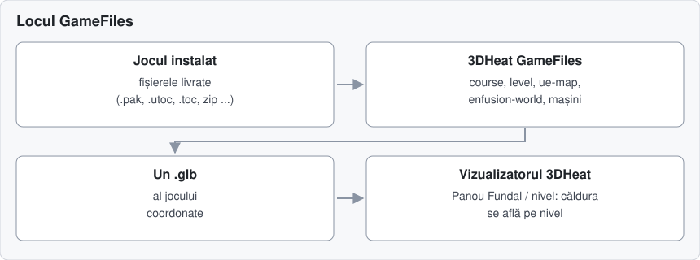

# Niveluri întregi {#whole-levels}

**Pe scurt:** pentru shootere și alte jocuri fără ture, instrumentul salvează întreaga hartă ca un singur fișier 3D, ca vizualizatorul să poată desena unde au mers jucătorii pe ea.

`course` taie solul din jurul unui tur. Pentru jocurile fără ture, instrumentul exportă un nivel întreg, o hartă sau o lume deodată:

| Joc sau motor | Listă | Export | Pagină |
|---|---|---|---|
| Battlefield 6 (Frostbite) | `levels` | `level <level>` | [Niveluri Battlefield 6](level-battlefield.md) |
| Jocuri Unreal 5 World Partition | `ue-maps <game>` | `ue-map <game> <map>` | [Hărți Unreal 5](level-unreal-world-partition.md) |
| Arma Reforger (Enfusion) | `enfusion-worlds` | `enfusion-world <world>` | [Lumi Arma Reforger](level-arma-reforger.md) |

Fiecare pereche funcționează la fel: prima comandă listează ce conține jocul instalat, iar a doua scrie una dintre ele ca un singur `.glb`, în coordonatele lumii jocului, astfel încât pozițiile înregistrate în acel joc se află pe ea. Părțile se numesc `ground:`, `structure:` și `water:` ca orice alt export (vezi [Formatul de ieșire](output-format.md)); încarcă fișierul în panoul Fundal / nivel al vizualizatorului 3DHeat.

