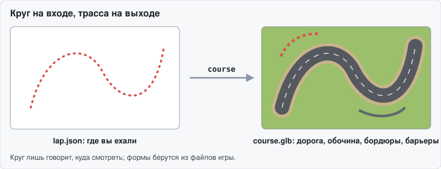
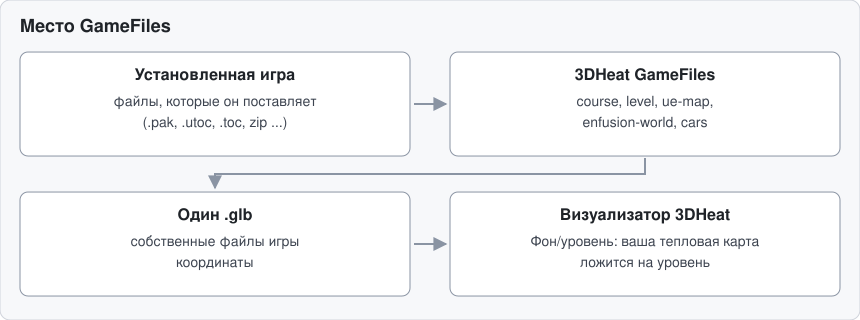

# 3DHeat GameFiles {#dheat-gamefiles}

**Что это?** Инструмент, который строит 3D-модель трассы или уровня игры из файлов игры, уже
установленной на вашем компьютере.

**Зачем это нужно?** Просмотрщик 3DHeat рисует, где вы ехали или играли, в виде тепловой карты.
С этим инструментом карта ложится на настоящую трассу или уровень, а не на пустое место.

**Пример:** возьмите круг, который вы проехали. Инструмент строит дорогу и землю вокруг него одним
3D-файлом, чтобы просмотрщик мог нарисовать вашу скорость или аварии на настоящей трассе:



Впервые в командной строке? Начните с [С чего начать](before-you-start.md).

Подробнее: инструмент читает данные уровней из архивов, которые поставляет игра, и записывает их
в виде двоичного glTF (`.glb`). Его главная задача — **экспорт трассы**: вы даёте ему круг, а он
записывает землю, дорогу (отделённую от обочины и травы), бордюры, барьеры, шины-ограждения, знаки и
здания вокруг неё.

Он входит в [3DHeat](https://github.com/Holdi601/3DHeat), просмотрщик для телеметрии реального
времени в 3D: тепловые карты, анализ заездов и разбор матчей
([документация](https://holdi601.github.io/3DHeat/)). Файлы `.glb`, которые пишет этот инструмент,
— это уровни, на которых просмотрщик рисует тепловую карту.



Есть три способа получить геометрию уровня в 3DHeat:

| Способ | Что нужно | Что даёт |
|---|---|---|
| 3DHeat Unreal Exporter | проект Unreal, открытый в редакторе | точная геометрия |
| 3DHeat GameCapture | экран и запись | приблизительная оценка |
| **3DHeat GameFiles** | **установленная, поставляемая игра** | **точная геометрия, без проекта** |

Пакет Python: `heat3d_gamefiles`. Репозиторий:
[Holdi601/3DHeat-GameFiles](https://github.com/Holdi601/3DHeat-GameFiles). Лицензия: MIT.

## Что он умеет {#what-it-can-do}

| Игра или движок | Экспорт трассы (`course`) | Чтение архивов |
|---|---|---|
| Forza Horizon (ForzaTech) | да: местность, дорога и обочина, текстура земли, размещённые модели в собственных текстурах | `identify`, `list`, `extract` для `.minizip`; `identify` для `.modelbin`; модели, местность и текстуры через `course` и `terrain` |
| BeamNG.drive | да: местность, декали дороги, смоделированные трассы, размещённые модели, вода | `identify`, `list`, `extract` для архивов уровней `.zip`; `identify` для `.ter`, `.cdae`; `.dae` через `course` |
| Assetto Corsa Rally (Unreal 5.6) | да: плитки земли этапа, запечённый цвет земли, размещённые модели плоскими цветами | `identify`, `list`, `extract` для IoStore `.utoc`/`.ucas`; пакеты zen, статичные меши, текстуры через `course` |
| Unreal `.pak` (версии 8–12) | нет | `identify`, `list`, `extract` |
| Unity (формат 22 и новее) | нет | `identify`, `meshes` |
| Battlefield 6 (Frostbite `.toc`/`.cas`) | нет круга; целый уровень через `level`: местность, размещённые меши, их цветовые карты с `--textures` | `identify`, `levels`; пучки, меши, местность, текстуры и размещение через `level` |
| Source 2 `.vpk` | нет | `identify`, `list`, `extract` |
| Игры Unreal 5 World Partition | нет круга; целая карта через `ue-map` (перечисляются через `ue-maps`): ландшафт, здания и props HLOD, вода | - |
| Arma Reforger (Enfusion) | нет круга; целый мир через `enfusion-world` (перечисляются через `enfusion-worlds`): местность в её цветах, море, здания как коробки | - |
| Forza (машины) | `cars`: каждая машина в низкой детализации, для вкладки «Анализ заездов» просмотрщика | - |

Круги из Assetto Corsa EVO и iRacing отклоняются с указанием причины. См.
[Ограничения и известные пробелы](../limits-and-known-gaps.md).

## Установка {#install}

Впервые в командной строке? Сначала прочитайте [С чего начать](before-you-start.md).

Нужен **Python 3.10 или новее** (разработка велась на 3.13) и пакеты из
[`requirements.txt`](https://github.com/Holdi601/3DHeat-GameFiles/blob/main/requirements.txt).

```
git clone https://github.com/Holdi601/3DHeat-GameFiles.git
cd 3DHeat-GameFiles
pip install -r requirements.txt
```

Проверьте: `python -m heat3d_gamefiles --help`. Вы должны увидеть
`usage: heat3d_gamefiles [-h]` и список команд. Запускайте каждую команду из папки репозитория,
как `python -m heat3d_gamefiles <verb>`.

| Пакет | Для чего |
|---|---|
| numpy | всё, что декодирует геометрию |
| lz4 | архивы Forza (в основном блоки LZ4), некоторые пучки Unity, блоки LZ4 IoStore |
| Pillow | декодирование текстур BC1–BC7, запись текстур JPEG в `.glb` |
| msgpack, zstandard | скомпилированные формы BeamNG (`.cdae`) |
| cryptography | только для открытия зашифрованного `.pak` ключом, который у вас уже есть |
| pytest | тесты |

Контент Unreal, сжатый **Oodle**, требует библиотеку Oodle, которая уже есть на вашем компьютере.
Её никогда не поставляет этот инструмент. См. [Oodle](../reader-oodle.md).

Инструмент написан для Windows. Он находит игры по списку библиотек Steam и `%LOCALAPPDATA%` и
загружает Oodle как DLL Windows. Другие платформы не проверялись.

## Быстрый старт {#quick-start}

**Файл круга** — это запись того, где ехала ваша машина: список точек x, y, z. Он берётся из
[3DHeat GameCapture](https://github.com/Holdi601/3DHeat-GameCapture) или из библиотеки кругов
приложения FH Companion; CSV, набранный вручную, тоже подходит ([Входные данные кругов](../lap-inputs.md)).

```
# Forza: файл круга, папка кругов или название трассы из библиотеки FH Companion
python -m heat3d_gamefiles course "Example Circuit"
python -m heat3d_gamefiles course path\to\lap.json -o course.glb

# BeamNG.drive или Assetto Corsa Rally: файл heat3d-lap говорит, из какой игры он
python -m heat3d_gamefiles course my_lap.json

# Каждая трасса из библиотеки FH Companion, по одному .glb на трассу
python -m heat3d_gamefiles courses -o courses

# Battlefield 6: перечислите уровни, затем экспортируйте один (большой файл; см. Команды)
python -m heat3d_gamefiles levels
python -m heat3d_gamefiles level <level> -o level.glb --textures

# Unreal 5 World Partition и Arma Reforger: перечислите, затем экспортируйте
python -m heat3d_gamefiles ue-maps "<game>"
python -m heat3d_gamefiles ue-map "<game>" <map> -o map.glb
python -m heat3d_gamefiles enfusion-worlds
python -m heat3d_gamefiles enfusion-world <world> -o world.glb

# Каждая машина Forza для вкладки заездов просмотрщика
python -m heat3d_gamefiles cars -o forza.h3dcars

# Что это за файл?
python -m heat3d_gamefiles identify some_archive.pak
```

Откройте `.glb` в просмотрщике 3DHeat. Координаты мира самой игры сохраняются
(см. [Формат вывода](../output-format.md)), поэтому записанный круг совпадает с трассой.

## Карта документации {#map-of-this-documentation}

- [С чего начать](before-you-start.md): Python, терминал, первая команда.
- [Команды](../commands.md): каждая команда и параметр, с примерами.
- [Справка по командам](../cli-reference.md): `--help` каждой команды, создано из кода.
- [Просмотр архивов](../inspecting-archives.md): `identify`, `list`, `extract`, `meshes`, пошагово.
- [Экспорт трассы](../course-export.md): как круг становится трассой, для всех игр.
  - [Forza Horizon](../course-forza-horizon.md)
  - [BeamNG.drive](../course-beamng.md)
  - [Assetto Corsa Rally](../course-assetto-corsa-rally.md)
  - [Уровни детализации и бюджет](../detail-budget.md)
- [Целые уровни](../whole-levels.md): уровень, карта или мир без круга.
  - [Уровни Battlefield 6](../level-battlefield.md): `levels`, `level`
  - [Карты Unreal 5](../level-unreal-world-partition.md): `ue-maps`, `ue-map`
  - [Миры Arma Reforger](../level-arma-reforger.md): `enfusion-worlds`, `enfusion-world`
- [Машины Forza](../forza-cars.md): `cars`, файл машин для вкладки заездов просмотрщика.
- [Входные данные кругов](../lap-inputs.md): каждая форма файла круга, которую принимает инструмент.
- [Формат вывода](../output-format.md): что внутри `.glb`.
- [Читатели архивов](../archive-readers.md): по одной странице на каждый формат контейнера: что он
  читает, чего не читает и почему.
- [Ограничения и известные пробелы](../limits-and-known-gaps.md)
- [Устранение неполадок](../troubleshooting.md): сообщения об ошибках и что с ними делать.
- [Правила и лицензии](../rules-and-licences.md): никаких ключей, ваши собственные файлы, никакого
  распространения.
- [Обновления](../updates.md): проверка обновлений и `heat3d_update`.
- [Разработка](../development.md): карта модулей и тесты, включая тесты, которые работают с установленными играми.
- [Сопровождение](../maintaining.md): контрольный список выпуска для этих страниц.

## Часть 3DHeat {#part-of-3dheat}

3DHeat GameFiles — один из бесплатных инструментов вокруг просмотрщика 3DHeat:

| Инструмент | Что делает | Документация |
|---|---|---|
| [3DHeat](https://github.com/Holdi601/3DHeat) | просмотрщик: 3D-тепловые карты, анализ заездов и разбор матчей в браузере | [сайт](https://holdi601.github.io/3DHeat/) |
| [GameFiles](https://github.com/Holdi601/3DHeat-GameFiles) | трассы и уровни из файлов, которые поставляют игры, в виде `.glb` | [сайт](https://holdi601.github.io/3DHeat-GameFiles/) |
| [GameCapture](https://github.com/Holdi601/3DHeat-GameCapture) | телеметрия кругов из гоночных игр; уровни, восстановленные по видео игры | [сайт](https://holdi601.github.io/3DHeat-GameCapture/) |
| [Unreal Exporter](https://github.com/Holdi601/3DHeat-UnrealExporter) | плагин редактора Unreal, который сохраняет уровень как `.glb` | [сайт](https://holdi601.github.io/3DHeat-UnrealExporter/) |
| [CS2](https://github.com/Holdi601/3DHeat-CS2) | демо Counter-Strike 2 в файлы матчей; карты в `.glb` | [сайт](https://holdi601.github.io/3DHeat-CS2/) |
| [Watcher](https://github.com/Holdi601/3DHeat-Watcher) | записывает вашу игру в фоне из того, что игры публикуют | [сайт](https://holdi601.github.io/3DHeat-Watcher/) |
| [Ext-WarThunder](https://github.com/Holdi601/3DHeat-Ext-WarThunder) | реплеи War Thunder в файлы матчей | [сайт](https://holdi601.github.io/3DHeat-Ext-WarThunder/) |
| [Ext-WoT](https://github.com/Holdi601/3DHeat-Ext-WoT) | реплеи World of Tanks в файлы матчей | [сайт](https://holdi601.github.io/3DHeat-Ext-WoT/) |
| [Ext-WoWs](https://github.com/Holdi601/3DHeat-Ext-WoWs) | реплеи World of Warships в файлы матчей | [сайт](https://holdi601.github.io/3DHeat-Ext-WoWs/) |
| [Ext-Squad](https://github.com/Holdi601/3DHeat-Ext-Squad) | демо серверов Squad в файлы матчей | [сайт](https://holdi601.github.io/3DHeat-Ext-Squad/) |
| [Ext-DCS](https://github.com/Holdi601/3DHeat-Ext-DCS) | карты DCS World в уровни `.glb` | [сайт](https://holdi601.github.io/3DHeat-Ext-DCS/) |
| [Ext-IL2](https://github.com/Holdi601/3DHeat-Ext-IL2) | карты IL-2 Sturmovik в уровни `.glb` | [сайт](https://holdi601.github.io/3DHeat-Ext-IL2/) |

Каждый модуль чтения игры — отдельный небольшой проект со своим файлом лицензии, своими выпусками и своим трекером задач, поэтому его можно устанавливать, обновлять, поддерживать - или отозвать по просьбе правообладателя - отдельно, не затрагивая просмотрщик и другие инструменты.

Файлы матчей просмотрщика описаны в
[Один файл на матч: `.3dheat`](https://holdi601.github.io/3DHeat/container.html);
уровень, сделанный здесь, загружается рядом с ними на панели «Фон / уровень» просмотрщика.
