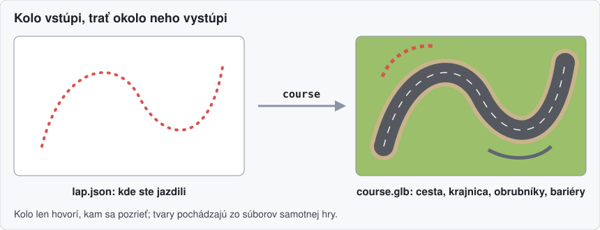
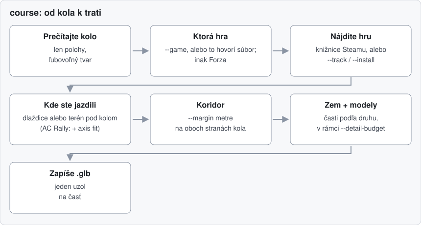

# Export trate {#course-export}

**Jednoducho:** jazdili ste kolo; tento nástroj zostaví trať, po ktorej ste išli, ako
3D súbor. Kolo je len riadok bodov; cesta, tráva a obrubníky pochádzajú zo
vlastných súborov hry.

`course` premení kolo na trať: povrch v pásme na oboch stranách miesta, kde auto
išlo, a to, čo na tomto povrchu stojí, ako jeden `.glb` pre prehliadač. Táto stránka
popisuje, čo majú spoločné všetky tri podporované hry. Stránky pod ňou popisujú, čím
sa líšia:

- [Forza Horizon](course-forza-horizon.md): archívy ForzaTech `.minizip`
- [BeamNG.drive](course-beamng.md): zip archívy, výškové pole terénu, skompilované tvary
- [Assetto Corsa Rally](course-assetto-corsa-rally.md): Unreal 5 IoStore, etapa World Partition
- [Úrovne detailu a rozpočet](detail-budget.md): koľko trojuholníkov dostanú umiestnené modely a ktoré kópie zostanú

## Kroky {#the-steps}

Použité slová: **rámec** je, ktorým smerom ukazujú osi; **koridor** je pás povrchu
na oboch stranách kola; **dlaždica** je jeden štvorcový kus terénu hry; **LOD**
(úroveň detailu) je jedna z jednoduchších kópií modelu.

1. **Prečítať kolo.** Len pozície, z ktoréhokoľvek tvaru v
   [Vstupy kola](lap-inputs.md). Rýchlosť a vstupy sa nepoužívajú. Kolo s menej ako
   dvoma vzorkami sa odmietne („holds no driving“).
2. **Určiť hru.** `--game`, potom pole `game` v súbore kola, potom Forza (pozri
   [Príkazy](commands.md#which-game)).
3. **Nájsť nainštalovanú hru.** Všetky tri prehľadajú každú knižnicu Steam uvedenú
   v `config\libraryfolders.vdf`. Forza prehľadá aj `C:\XboxGames`. `--track` (Forza)
   alebo `--install` (BeamNG, AC Rally) hľadanie preskočí.
4. **Nájsť, kde sa kolo jazdilo.** Nikdy sa to neurčuje len zhodou názvu. Forza vyberie
   trať, ktorej dlaždice terénu pokrývajú kolo. BeamNG vyberie úroveň, na ktorej
   povrchu alebo cestách ležia vzorky kola. AC Rally vyskúša každú etapu v ôsmich
   orientáciách osí a vyberie tú, ktorá dá najviac kola na cestu.
5. **Vyrezať koridor** `--margin` metrov na oboch stranách jazdy (nižšie).
6. **Zostaviť povrch** vo vnútri koridora, rozdelený na cestu, krajnicu, štrk a
   hlinu, terén, značenie, stopy pneumatík a vodu, a upiecť textúru povrchu pre
   každý štvorec 512 m.
7. **Umiestniť modely** stojace v koridore, podľa kategórie, na úrovni detailu zvolenej
   podľa vzdialenosti a rozpočtu trojuholníkov.
8. **Zapísať `.glb`**: jeden pomenovaný uzol na každú časť. Pozri
   [Formát výstupu](output-format.md).

Čo vypíše jeden beh – tu na syntetickej inštalácii BeamNG.drive, ktorú vytvárajú
testy, 50 m kolo po pruhu cesty:

## Koridor {#the-corridor}

Výrez je pás okolo jazdnej čiary, nie ohraničujúci box kola. Pri okruhu sú obe
veci takmer rovnaké. Pri sprinte z bodu do bodu je box väčšinou svah, po ktorom nikto
nejazdí, a pás môže mať desatinu jeho plochy. Zdroj:
[`corridor.py`](https://github.com/Holdi601/3DHeat-GameFiles/blob/main/heat3d_gamefiles/corridor.py).

Ako sa stavia:

- Jazda sa premietne na rovinu povrchu: x a z kola (BeamNG: x a y vlastného rámca
  hry).
- Rastruje sa na mriežke buniek **4 m** (`CELL`). Každá bunka, ktorej sa jazda dotkne,
  sa rozšíri kruhom s polomerom `margin + 4 m` na všetky strany.
- Po sebe idúce vzorky od seba vzdialené menej ako **50 m** (`JOIN`) sa spoja bodmi
  každé 4 m, takže pás nemá medzery. Vzorky od seba vzdialenejšie sa považujú za
  oddelené úseky jazdy a nespájajú sa. Knižnica kurzu je mnoho súborov kôl za sebou
  a koniec jedného sprintu a začiatok ďalšieho nesmú nakresliť pás cez celú mapu.
- Trojuholník sa ponechá, ak ktorýkoľvek roh, stred ktorejkoľvek hrany alebo jeho
  ťažisko leží v páse. Stredové body zachytia veľký trojuholník, ktorý leží cez úzky
  pás, pričom všetky jeho rohy sú mimo.
- Výška nie je súčasťou výrezu. Box, ktorý by ohraničoval nadmorskú výšku, by
  vyrezal povrch spod kopca, po ktorom cesta stúpa.

Konzola hlási plochu koridora, napríklad
`cutting 80 m either side of the driving: 1.53 km2 of a 6,000 by 3,600 m box`.

BeamNG a AC Rally tiež stavajú širší **dosahový** koridor `margin + 60 m`. Umiestnený
model sa zvažuje, ak jeho začiatok leží v dosahovom koridore, a kreslí sa len vtedy,
keď jeho pôdorys zasahuje do skutočného koridora. Tak sa nestratí dlhý objekt, ktorého
začiatok je tesne mimo pásu. BeamNG tiež používa dosahový koridor na výber cestných
dekálov, ktoré sa namaľujú.

## Z čoho je povrch {#what-the-ground-is-made-of}

Každý export zaradí trojuholníky povrchu do rovnakých druhov a každý druh sa zapíše
ako vlastná časť, aby ju prehliadač vedel zobraziť alebo skryť:

| Druh | Názov časti | Plošná farba (lineárne RGB) | Forza | BeamNG | AC Rally |
|---|---|---|---|---|---|
| cesta | `ground:road` | 0,22, 0,22, 0,23 | pásy cesty: časť asfaltu | vrstvy typu `ASPHALT`, cestné dekály, modelovaná cesta | dlaždice trate (`/MeshesTrack/`) |
| krajnica | `ground:verge` | 0,52, 0,47, 0,30 | pásy cesty: rameno | chodníky a modely krajnice | - |
| štrk a hlina | `ground:gravel and dirt` | 0,50, 0,42, 0,30 | - | vrstvy a dekály hlina, štrk, piesok, bahno | - |
| terén | `ground:terrain` | 0,30, 0,44, 0,18 | všetko ostatné | všetko ostatné | dlaždice `_Terrain` a vzdialený terén |
| obrubníky | `ground:kerbs` | 0,60, 0,12, 0,10 (Forza) | rekvizity `road_gen_rum*` | modely obrubníkov, prahov a vibrácií | modely obrubníkov a krajníc |
| značenie | `ground:markings` | 0,90, 0,90, 0,88 | podsiete dekálov, zdvihnuté o 5 cm | namaľované do textúry | - |
| stopy pneumatík | `ground:tyre marks` | 0,20, 0,17, 0,16 | podsiete dekálov, zdvihnuté o 5 cm | namaľované do textúry | - |
| voda | `water:water` | 0,16, 0,34, 0,48 | materiály vody | rovina mora, vodné bloky, rieky | - |

Plošné farby sú zvolené tak, aby sa dali prečítať na prvý pohľad, nie aby zodpovedali
hre. Používajú sa pre časti bez textúry a pre prehliadače, ktoré textúry ignorujú.
Zdroj: [`surfaces.py`](https://github.com/Holdi601/3DHeat-GameFiles/blob/main/heat3d_gamefiles/surfaces.py).

Časti povrchu sa delia na štvorce 512 m a každý nesie vlastný upečený obrázok, preto
názvy častí obsahujú štvorec:

| Hra | Názov časti povrchu | Kľúč štvorca |
|---|---|---|
| Forza | `ground:road x-2046 z1023` | názov mriežky dlaždice terénu (kroky po 1023, pozri [Forza Horizon](course-forza-horizon.md)) |
| BeamNG | `ground:road 3_-2` | `floor(x / 512)`, `floor(y / 512)` v metroch BeamNG |
| AC Rally | `ground:road 1_-4` | `floor(x / 51200)`, `floor(y / 51200)` v centimetroch Unreal |

## Čo stojí na povrchu {#what-stands-on-it}

Umiestnené modely sa zapisujú do častí `structure:<category>`, alebo do
`ground:kerbs` pre obrubníky (vo všetkých troch hrách). Ak má časť vlastnú textúru,
názov textúry alebo materiálu nasleduje kategóriu, napríklad
`structure:barriers bar_armco_bclr`.

| Kategória | Forza | BeamNG | AC Rally |
|---|---|---|---|
| bariéry | áno | áno | áno |
| rekvizity | áno | áno | áno |
| tabule | áno | áno | áno |
| budovy | áno (celé budovy ako náhrady, ak ich hra má) | áno | áno |
| infraštruktúra | áno | áno | áno |
| mosty | áno | áno | (zaradené pod infraštruktúru) |
| skaly | áno | áno | áno |
| obrubníky | áno, ako povrch | áno, ako povrch | áno, ako povrch |
| stromy | s `--trees` | s `--trees` | s `--trees` |
| rozbitné predmety | s `--trees` | - | - |

Rozdelenie detailu je vo všetkých troch rovnaké. Kópie do 25 m od jazdy začínajú
v plnom detaile, kópie 25-60 m ďaleko majú o úroveň hrubší detail a ďalej ležiace
kópie najhrubšiu úroveň. Potom sa najdrahšie modely znížia, až kým nevyjde rozpočet
trojuholníkov, a ak ani najhrubšie úrovne nevychádzajú do rozpočtu, ktorý zadáte,
kópie sa vynechajú. Obrubníky sa nikdy nezjednodušia ani nevynechajú. Pozri
[Úrovne detailu a rozpočet](detail-budget.md).

## Možnosti, ktoré určujú výsledok {#options-that-shape-the-result}

| Chcete | Použite |
|---|---|
| menší súbor | `--no-textures` (plošné farby), `--texture-size 1024` alebo `512`, `--detail-budget N`, `--margin 40` |
| len povrch | `--no-placed` |
| aj scenériu | `--trees` |
| iné ročné obdobie (Forza) | `--season winter` |
| hru mimo Steamu | `--track` (Forza) alebo `--install` (BeamNG, AC Rally) |
| kolo, ktoré vyhľadávanie neumiestni | `--level` (BeamNG, AC Rally), `--track` (Forza) |

## Súradnice {#coordinates}

Každý export zapisuje metre s Y hore, v rámci, do ktorého sa zaznamenané kolo tej
istej hry zarovná:

| Hra | Zapísaný rámec |
|---|---|
| Forza | vlastné svetové súradnice hry, nezmenené |
| BeamNG | `(x, z, -y)` svetových súradníc BeamNG so Z hore, čo je rotácia, ktorú použije zapisovač telemetrie |
| AC Rally | rámec kola, zistený fitovaním: centimetre Unreal sa stanú metrami a osi X a Y Unreal sa stanú x a z kola v tej z ôsmich orientácií, ktorá sedí |

Pozri [Formát výstupu](output-format.md).
