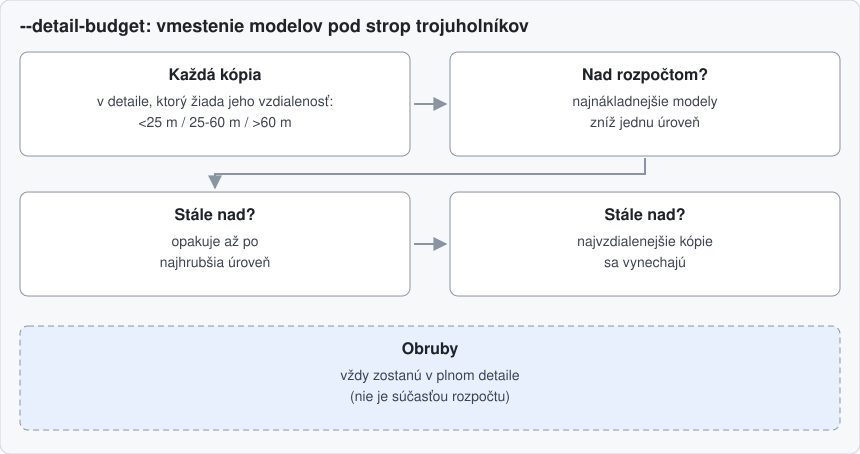

# Úrovne detailu a rozpočet {#levels-of-detail-and-the-budget}

**Trojuholník** je malý plochý kúsok 3D modelu. Viac trojuholníkov znamená väčší,
pomalší súbor. **Rozpočet** je limit, koľko ich smie byť. **Úroveň detailu** je
jednoduchšia kópia modelu, použitá, keď je model ďaleko.

Najjemnejšia úroveň všetkého, čo je umiestnené okolo okruhu, má niekoľko miliónov
trojuholníkov. Napríklad stovky segmentov zvodidiel a stohy pneumatík po asi tisíc
trojuholníkov každý. Koridor mesta obsahuje cez stotisíc kópií. Preto každý export
trate dáva umiestneným modelom **rozpočet trojuholníkov** a pre každý model rozhoduje,
v akej úrovni detailu sa kreslí a v prípade potreby ktoré kópie vynechať.

Schéma vznikla pre Forzu
([`forzaplacement.py`](https://github.com/Holdi601/3DHeat-GameFiles/blob/main/heat3d_gamefiles/forzaplacement.py):
`choose_levels`, `auto_budget`, `_fit`) a BeamNG a AC Rally používajú jej časti.
Terén sa do rozpočtu nepočíta.

## Pásma vzdialenosti {#distance-bands}

Vzdialenosť každej kópie od jazdy sa meria v rovine povrchu k najbližšej vzorke
kola. Kolo sa najprv zredukuje na najviac 1 000 bodov, čo stojí niekoľko metrov
presnosti a nič, na čom záleží. Kópie potom spadajú do troch pásiem a každá dvojica
(model, pásmo) sa rozpočíta samostatne:

| Pásmo | Vzdialenosť | Začína na |
|---|---|---|
| blízke | pod 25 m (`NEAR`) | najjemnejšej úrovni |
| stredné | 25-60 m (`FAR`) | o jednu úroveň hrubšej |
| ďaleké | 60 m a viac | najhrubšej úrovni |

Bez trasy (Forza `terrain --box`) sa vzdialenosť meria k stredu boxu.

## Znižovanie, aby to vyšlo {#stepping-down-to-fit}



Cena položky (model, pásmo) je počet kópií krát trojuholníky na jej aktuálnej úrovni.
Kým je celkový súčet nad rozpočtom, položka, ktorá stojí najviac, sa zníži o jednu
úroveň, a to sa opakuje, kým sa súčet nezmestí alebo sa nedá ďalej znižovať.
Pevné položky sa nikdy nezmenšia:

| Hra | Pevne na plnom detaile |
|---|---|
| Forza | obrubníky (`road_gen_rum*`) |
| BeamNG | obrubníky a každý tvar, ktorý nesie jazdný povrch |
| AC Rally | obrubníky |

Súhrn Forzy to hlási ako
`N of M models drawn at a coarser level to fit the budget`.

## Automatický rozpočet {#the-automatic-budget}

Bez `--detail-budget` si rozpočet nastaví sám tak, aby **nevypadla žiadna kópia**:

```
budget = max(1,500,000, 1.25 x sum(copies x coarsest level))
```

Pevné položky sa počítajú na najjemnejšej úrovni. Rezerva 25 % (`HEADROOM`) necháva
veciam pri ceste nejaký detail. Pri vidieckom okruhu je to dolná hranica 1,5 milióna
(`DEFAULT_BUDGET`). Pri mestskej trati, kde koridor obsahuje cez stotisíc kópií, rastie
rozpočet na viac ako desať miliónov a súbor na niekoľko stoviek MB. Prehliadač to
načíta.

## Rozpočet, ktorý zadáte {#a-budget-you-give}

`--detail-budget N` je **strop**. Úrovne sa znižujú, ako je uvedené vyššie. Ak ani
najhrubšie úrovne nevychádzajú, kópie sa vynechajú:

| Hra | Poradie, v ktorom sa kópie vynechávajú |
|---|---|
| Forza | najprv všetko 25 m a viac od jazdy, potom to, čo stojí pri ceste; v každej skupine najprv to, čo z cesty vyzerá najmenšie: najväčšia vzdialenosť / veľkosť (veľkosť = uhlopriečka ohraničujúceho boxu modelu krát jeho najväčšia mierka, najmenej 0,25 m) |
| BeamNG | najprv najvzdialenejšie od jazdy |
| AC Rally | najprv najvzdialenejšie od jazdy, ako BeamNG |
| Battlefield 6 | najprv najmenšie: uhlopriečka ohraničujúceho boxu krát mierka |

Obrubníky (a pri BeamNG aj modely jazdného povrchu) sa nikdy nevynechajú, takže
rozpočet menší, než čo stoja samy, prekročia len oni a nič iné.

Forza používa vzdialenosť ku veľkosti, lebo keby sa radilo podľa samotnej
vzdialenosti, klimatizačná jednotka na stene deväť metrov od cesty by prežila fasádu
dvadsať metrov, na ktorej visí, vzdialenú dvanásť metrov. Veci pri ceste idú
ako posledné bez ohľadu na veľkosť, lebo bariéra tri metre vysoká päť metrov od
čiary je okraj trate, zatiaľ čo budova päťdesiat metrov vysoká šesťdesiat metrov
dozadu je scenéria.

Súhrn hlási
`N of M copies left out to fit the budget, the smallest and furthest from the driving first (--detail-budget raises it)`
(Forza) alebo `N copies left out to fit the budget, the furthest from the driving first (--detail-budget raises it)`
(BeamNG, AC Rally).

## Celé budovy (Forza) {#whole-buildings-forza}

Náhrada celej budovy sa počíta ako jedna kópia, s vzdialenosťou meranou k najbližšej
hrane budovy. Zostáva alebo sa vynecháva ako celok. Modulárne kusy, ktoré nahrádza,
sa vôbec nerozpočítavajú. Pozri [Forza Horizon](course-forza-horizon.md#buildings-drawn-whole).

## Čo je úroveň detailu, podľa hry {#what-a-level-of-detail-is-per-game}

| Hra | Úrovne pochádzajú z |
|---|---|
| Forza | maska úrovní modelu pre každý trojuholník podsietí `Mesh` (bit `level + 1`); `0xFFFF` lámateľné kusy len pre model bez označenej úrovne |
| BeamNG | `details` tvaru `.cdae` s nezápornou veľkosťou, od najväčšej; pri `.dae` koncové číslo v názvoch sietí uzlov (`barrier75`, `barrier40`) |
| AC Rally | uložené úrovne detailu statickej siete, od najjemnejšej |
| Battlefield 6 | úrovne detailu MeshSet, od najjemnejšej, počítajú len vykreslené sekcie (nie kópie na tiene a hĺbku) a nie poslednú úroveň, ktorá je vzdialeným náhradným modelom (materiály `M_LastLod`, `M_Billboard`, `M_Vista`: mriežka stožiara by sa stala plným hrotom) |

`level` Battlefield 6 nemá jazdu, takže nemá pásma vzdialenosti: každá sieť je jedna
položka a každá kópia je na rovnakej úrovni. Automatický rozpočet je vzorec vyššie
s pevne zafixovaným pozadím terénu; výškové pole je mimo rozpočtu a určuje ho
`--ground-spacing`. Pri rozpočte, ktorý zadáte, keď je každá sieť na najhrubšej úrovni,
sa kópie vynechávajú najmenšie najprv, pričom veľkosťou je uhlopriečka ohraničujúceho
boxu siete krát mierka kópie, lebo tu nie je jazda, od ktorej by sa vzdialenosť
merala. Pozadie terénu sa nikdy nevynechá. Úroveň sa automaticky vyrovná približne
desiatim miliónom trojuholníkov.

## Ako zvoliť číslo {#choosing-a-number}

| Chcete | Skúste |
|---|---|
| všetko, plný detail pri ceste | nechajte automaticky |
| súbor niekoľkonásobne menší | `--detail-budget 500000` s `--texture-size 1024` |
| len povrch | `--no-placed` (rozpočet sa nepoužije) |
