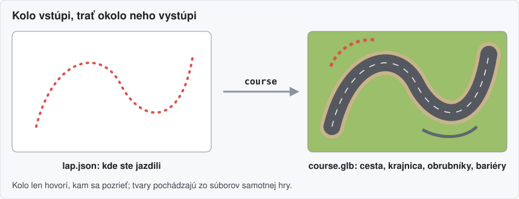
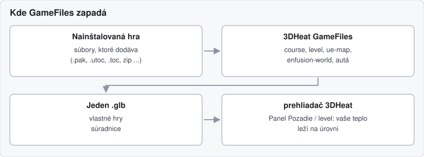

# 3DHeat GameFiles {#dheat-gamefiles}

**Čo to je?** Nástroj, ktorý zostavuje 3D model okruhu alebo úrovne hry
zo súborov hry, ktorú už máte nainštalovanú.

**Prečo by som ho použil?** Prehliadač 3DHeat maľuje, kde ste jazdili alebo hrali, ako
teplo. S týmto nástrojom to maľuje na skutočnej trati alebo úrovni, nie na prázdnom priestore.

**Príklad:** vezmite kolo, ktoré ste odjazdili. Nástroj zostaví cestu a terén okolo nej
ako jeden 3D súbor, takže prehliadač môže namaľovať vašu rýchlosť alebo nehody na skutočnej trati:



Nikdy ste nepracovali s príkazovým riadkom? Začnite s [Ako začať](before-you-start.md).

Podrobnejšie: číta dáta úrovní z archívov, ktoré hra dodáva, a zapisuje ich
ako binárny glTF (`.glb`) súbor. Jeho hlavnou úlohou je **export trate**: dáte mu kolo
a zapíše zem, cestu odlíšenú od krajnice a trávy, a obrubníky, bariéry, steny z pneumatík, značky a budovy okolo nej.

Je súčasťou [3DHeat](https://github.com/Holdi601/3DHeat), prehliadača
telemetrických 3D heatmáp v reálnom čase, analýzy pretekov a prehľadu zápasov
([dokumentácia](https://holdi601.github.io/3DHeat/)). Súbory `.glb`, ktoré tento
nástroj zapisuje, sú úrovne, na ktoré prehliadač kreslí teplo.



Je to jeden z troch spôsobov, ako dostať geometriu úrovne do 3DHeat:

| Cesta | Potrebuje | Dá |
|---|---|---|
| 3DHeat Unreal Exporter | projekt Unreal otvorený v editore | presnú geometriu |
| 3DHeat GameCapture | obrazovku a záznam | odhad |
| **3DHeat GameFiles** | **nainštalovanú, dodanú hru** | **presnú geometriu, bez projektu** |

Balík Python: `heat3d_gamefiles`. Repozitár:
[Holdi601/3DHeat-GameFiles](https://github.com/Holdi601/3DHeat-GameFiles). Licencia: MIT.

## Čo to dokáže {#what-it-can-do}

| Hra alebo engine | Export trate (`course`) | Čítanie archívov |
|---|---|---|
| Forza Horizon (ForzaTech) | áno: terén, cesta a krajnica, textúra zeme, umiestnené modely vo vlastných textúrach | `identify`, `list`, `extract` na `.minizip`; `identify` na `.modelbin`; modely, terén a textúry cez `course` a `terrain` |
| BeamNG.drive | áno: terén, nálepky cesty, modelované okruhy, umiestnené modely, voda | `identify`, `list`, `extract` na zipoch úrovní; `identify` na `.ter`, `.cdae`; `.dae` cez `course` |
| Assetto Corsa Rally (Unreal 5.6) | áno: dlaždice zeme etapy, zapečená farba zeme, umiestnené modely v jednotných farbách | `identify`, `list`, `extract` na IoStore `.utoc`/`.ucas`; balíky zen, statické siete, textúry cez `course` |
| Unreal `.pak` (verzie 8–12) | nie | `identify`, `list`, `extract` |
| Unity (formát 22 a novší) | nie | `identify`, `meshes` |
| Battlefield 6 (Frostbite `.toc`/`.cas`) | bez kola; celá úroveň cez `level`: terén, umiestnené siete, ich farebné mapy s `--textures` | `identify`, `levels`; zväzky, siete, terén, textúry a umiestnenie cez `level` |
| Source 2 `.vpk` | nie | `identify`, `list`, `extract` |
| Hry Unreal 5 World Partition | bez kola; celá mapa cez `ue-map` (vypíše ju `ue-maps`): krajina, budovy HLOD a rekvizity, voda | - |
| Arma Reforger (Enfusion) | bez kola; celý svet cez `enfusion-world` (vypíše ho `enfusion-worlds`): terén vo svojich farbách, more, budovy ako škatule | - |
| Forza (autá) | `cars`: každé auto v nízkom detaile, pre kartu Analýza pretekov prehliadača | - |

Kolá z Assetto Corsa EVO a iRacing sa odmietnu s uvedením dôvodu. Pozri
[Obmedzenia a známe medzery](limits-and-known-gaps.md).

## Inštalácia {#install}

Nikdy ste nepracovali s príkazovým riadkom? Najprv si prečítajte [Ako začať](before-you-start.md).

Potrebujete **Python 3.10 alebo novší** (vyvíjané na 3.13) a balíky z
[`requirements.txt`](https://github.com/Holdi601/3DHeat-GameFiles/blob/main/requirements.txt).

```
git clone https://github.com/Holdi601/3DHeat-GameFiles.git
cd 3DHeat-GameFiles
pip install -r requirements.txt
```

Potom to overte: `python -m heat3d_gamefiles --help`. Mali by ste vidieť
`usage: heat3d_gamefiles [-h]` a zoznam príkazov (verbs). Každý príkaz spúšťajte z
priečinka repozitára, ako `python -m heat3d_gamefiles <verb>`.

| Balík | Na čo sa používa |
|---|---|
| numpy | všetko, čo dekóduje geometriu |
| lz4 | archívy Forza (väčšinou bloky LZ4), niektoré balíky Unity, bloky LZ4 IoStore |
| Pillow | dekódovanie textúr BC1–BC7, zapisovanie textúr JPEG do `.glb` |
| msgpack, zstandard | zostavené tvary BeamNG (`.cdae`) |
| cryptography | len na otvorenie zašifrovaného `.pak` s kľúčom, ktorý už máte |
| pytest | testy |

Obsah Unreal komprimovaný **Oodle** potrebuje knižnicu Oodle, ktorá už je na vašom
počítači. Tento nástroj ju nikdy neobsahuje. Pozri [Oodle](reader-oodle.md).

Nástroj je napísaný pre Windows. Hry nachádza v zozname knižníc Steamu a v
`%LOCALAPPDATA%` a Oodle načítava ako DLL pre Windows. Iné platformy neboli
testované.

## Rýchly štart {#quick-start}

**Súbor kola** je záznam toho, kam išlo vaše auto: zoznam bodov x, y, z.
Pochádza z [3DHeat GameCapture](https://github.com/Holdi601/3DHeat-GameCapture)
alebo z knižnice kôl aplikácie FH Companion; ručne písané CSV tiež funguje
([Vstupy kôl](lap-inputs.md)).

```
# Forza: súbor kola, priečinok kôl, alebo názov trate z knižnice FH Companion
python -m heat3d_gamefiles course "Example Circuit"
python -m heat3d_gamefiles course path\to\lap.json -o course.glb

# BeamNG.drive alebo Assetto Corsa Rally: súbor heat3d-lap hovorí, z ktorej hry je
python -m heat3d_gamefiles course my_lap.json

# Každá trať v knižnici FH Companion, po jednom .glb
python -m heat3d_gamefiles courses -o courses

# Battlefield 6: vypíšte úrovne, potom exportujte jednu (veľký súbor; pozri Príkazy)
python -m heat3d_gamefiles levels
python -m heat3d_gamefiles level <level> -o level.glb --textures

# Unreal 5 World Partition a Arma Reforger: vypíšte, potom exportujte
python -m heat3d_gamefiles ue-maps "<game>"
python -m heat3d_gamefiles ue-map "<game>" <map> -o map.glb
python -m heat3d_gamefiles enfusion-worlds
python -m heat3d_gamefiles enfusion-world <world> -o world.glb

# Každé auto Forza, pre kartu Analýza pretekov prehliadača
python -m heat3d_gamefiles cars -o forza.h3dcars

# Čo je tento súbor?
python -m heat3d_gamefiles identify some_archive.pak
```

Otvorte `.glb` v prehliadači 3DHeat. Herné svetové súradnice hry sa zachovávajú
(pozri [Formát výstupu](output-format.md)), takže zaznamenané kolo sedí na trati.

## Prehľad tejto dokumentácie {#map-of-this-documentation}

- [Ako začať](before-you-start.md): Python, terminál, prvý príkaz.
- [Príkazy](commands.md): každé verb a možnosť, s príkladmi.
- [Referencia príkazov](../cli-reference.md): `--help` každého verba, generované z kódu.
- [Prehliadanie archívov](inspecting-archives.md): `identify`, `list`, `extract`, `meshes`, krok za krokom.
- [Export trate](course-export.md): ako sa kolo stane traťou, pre všetky hry.
  - [Forza Horizon](course-forza-horizon.md)
  - [BeamNG.drive](course-beamng.md)
  - [Assetto Corsa Rally](course-assetto-corsa-rally.md)
  - [Úrovne detailu a rozpočet](detail-budget.md)
- [Celé úrovne](whole-levels.md): úroveň, mapa alebo svet bez kola.
  - [Úrovne Battlefield 6](level-battlefield.md): `levels`, `level`
  - [Mapy Unreal 5](level-unreal-world-partition.md): `ue-maps`, `ue-map`
  - [Svety Arma Reforger](level-arma-reforger.md): `enfusion-worlds`, `enfusion-world`
- [Autá Forza](forza-cars.md): `cars`, súbor áut pre kartu Analýza pretekov prehliadača.
- [Vstupy kôl](lap-inputs.md): každý tvar súboru kola, ktorý nástroj prijíma.
- [Formát výstupu](output-format.md): čo je vnútri `.glb`.
- [Čítače archívov](archive-readers.md): jedna stránka pre každý formát kontajnera, s tým,
  čo číta, čo nečíta a prečo.
- [Obmedzenia a známe medzery](limits-and-known-gaps.md)
- [Riešenie problémov](troubleshooting.md): chybové hlásenia a čo s nimi.
- [Pravidlá a licencie](rules-and-licences.md): žiadne kľúče, vaše vlastné súbory, žiadne ďalšie šírenie.
- [Aktualizácie](updates.md): kontrola aktualizácií a `heat3d_update`.
- [Vývoj](development.md): mapa modulov a testy, vrátane testov, ktoré bežia na nainštalovaných hrách.
- [Údržba](maintaining.md): kontrolný zoznam vydania pre tieto stránky.

## Súčasť 3DHeat {#part-of-3dheat}

3DHeat GameFiles je jeden z bezplatných nástrojov okolo prehliadača 3DHeat:

| Nástroj | Čo robí | Dokumentácia |
|---|---|---|
| [3DHeat](https://github.com/Holdi601/3DHeat) | prehliadač: 3D heatmapy, analýza pretekov a prehľad zápasov v prehliadači | [stránka](https://holdi601.github.io/3DHeat/) |
| [GameFiles](https://github.com/Holdi601/3DHeat-GameFiles) | trate a úrovne zo súborov, ktoré hra dodáva, ako `.glb` | [stránka](https://holdi601.github.io/3DHeat-GameFiles/) |
| [GameCapture](https://github.com/Holdi601/3DHeat-GameCapture) | telemetria kôl z pretekárskych hier; úrovne zrekonštruované z videa hry | [stránka](https://holdi601.github.io/3DHeat-GameCapture/) |
| [Unreal Exporter](https://github.com/Holdi601/3DHeat-UnrealExporter) | plugin pre Unreal Editor, ktorý ukladá úroveň ako `.glb` | [stránka](https://holdi601.github.io/3DHeat-UnrealExporter/) |
| [CS2](https://github.com/Holdi601/3DHeat-CS2) | dema Counter-Strike 2 do súborov zápasov; mapy do `.glb` | [stránka](https://holdi601.github.io/3DHeat-CS2/) |
| [Watcher](https://github.com/Holdi601/3DHeat-Watcher) | zaznamenáva vašu hru na pozadí z toho, čo hry zverejňujú | [stránka](https://holdi601.github.io/3DHeat-Watcher/) |
| [Ext-WarThunder](https://github.com/Holdi601/3DHeat-Ext-WarThunder) | replaye War Thunder do súborov zápasov | [stránka](https://holdi601.github.io/3DHeat-Ext-WarThunder/) |
| [Ext-WoT](https://github.com/Holdi601/3DHeat-Ext-WoT) | replaye World of Tanks do súborov zápasov | [stránka](https://holdi601.github.io/3DHeat-Ext-WoT/) |
| [Ext-WoWs](https://github.com/Holdi601/3DHeat-Ext-WoWs) | replaye World of Warships do súborov zápasov | [stránka](https://holdi601.github.io/3DHeat-Ext-WoWs/) |
| [Ext-Squad](https://github.com/Holdi601/3DHeat-Ext-Squad) | dema zo serverov Squad do súborov zápasov | [stránka](https://holdi601.github.io/3DHeat-Ext-Squad/) |
| [Ext-DCS](https://github.com/Holdi601/3DHeat-Ext-DCS) | mapy DCS World do úrovní `.glb` | [stránka](https://holdi601.github.io/3DHeat-Ext-DCS/) |
| [Ext-IL2](https://github.com/Holdi601/3DHeat-Ext-IL2) | mapy IL-2 Sturmovik do úrovní `.glb` | [stránka](https://holdi601.github.io/3DHeat-Ext-IL2/) |

Každá čítačka hry je samostatný malý projekt s vlastným licenčným súborom, vlastnými vydaniami a vlastným systémom hlásení, takže ju možno inštalovať, aktualizovať, udržiavať - alebo na žiadosť držiteľa práv stiahnuť - samostatne, bez vplyvu na prehliadač a ostatné nástroje.

Súbory zápasov prehliadača sú opísané na stránke
[Jeden súbor na zápas: `.3dheat`](https://holdi601.github.io/3DHeat/container.html);
úroveň vytvorená tu sa načíta vedľa nich na paneli Pozadie / level prehliadača.
