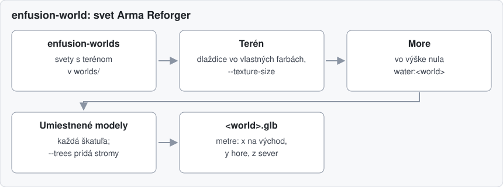

# Svety Arma Reforger: `enfusion-worlds` a `enfusion-world` {#arma-reforger-worlds-enfusion-worlds-and-enfusion-world}

**Čo to je?** Celý svet Arma Reforger ako jeden 3D súbor. **Prečo?** Aby mal teplo
z hry pod sebou zem a budovy. (*Enfusion* je engine, na ktorom je Arma Reforger
postavená; *svet* je to, čo hra nazýva mapa.)

Exportuje celý svet Enfusion nainštalovanej hry Arma Reforger: terén vo farbách jeho
vlastných supertexturových dlaždíc, more a každý umiestnený model ako box, v metroch
samotnej hry.



## Krok za krokom {#step-by-step}

1. **Vypíšte svety**, ktoré majú terén:

   ```
   python -m heat3d_gamefiles enfusion-worlds
   python -m heat3d_gamefiles enfusion-worlds --install "D:\Games\Arma Reforger"
   ```

2. **Exportujte jeden**, podľa názvu jeho priečinka v `worlds/`, ako je vypísaný:

   ```
   python -m heat3d_gamefiles enfusion-world <world> -o world.glb
   ```

3. **Varianty:**

   ```
   python -m heat3d_gamefiles enfusion-world <world> --trees               # vegetation too, as boxes
   python -m heat3d_gamefiles enfusion-world <world> --texture-size 0      # flat colour, small file
   python -m heat3d_gamefiles enfusion-world <world> --ground-spacing 4 --no-structures
   ```

4. **Otvorte `world.glb`** v paneli **Pozadie / level** prehliadača 3DHeat
   ([načítanie levelu](https://holdi601.github.io/3DHeat/levels.html)).

## Možnosti {#options}

| Možnosť | Predvolené | Význam |
|---|---|---|
| `<world>` | povinné | svet, ako ho vypíše `enfusion-worlds` |
| `-o`, `--out FILE` | `<world>.glb` | súbor, ktorý sa zapíše |
| `--install FOLDER` | knižnica Steam, ktorá hru obsahuje | priečinok hry |
| `--ground-spacing METRES` | 2 (vlastné od terénu) | rozstup vrcholov terénu v súbore |
| `--texture-size PIXELS` | 4096 | väčšia strana obrázka farby povrchu; 0 pre plošnú farbu |
| `--no-structures` | | nezahrnie umiestnené modely |
| `--trees` | vypnuté | umiestni aj stromy a inú vegetáciu, ako boxy |

## Príklad výstupu {#example-output}

```text
<world> -> world.glb
  ground      <n> triangles, <w> x <h> m; <n> of <n> tile-edge vertices disagree; colour <w> x <h>
  structure   <n> boxes from <n> entities
  water       <n> triangles (the sea)
  left out    <what>: <n>, ...
```

## Časti {#the-parts}

`ground:<world>` (terén), `water:<world>` (more, na výške nula) a `structure:<world>`
(boxy). Súradnice sú vlastné hry: x na východ, y hore, z na sever, v metroch – to,
čo hlási nahrávka zo hry. Ľavotočivý rámec hry; *Invertovať os sveta* v prehliadači ho
zobrazí nezrkadlene.

## Ako sa to číta a kontroluje {#how-it-is-read-and-checked}

Nie je potrebný Workbench a nič nie je zašifrované.

| Formát | Čo to je | Overené voči |
|---|---|---|
| `.pak` | dátový blok a strom adresárov, položky uložené alebo zlib | strom presne vyčerpá svoj blok; vzorkované položky zlib sa rozbalia presne na svoju uvedenú veľkosť |
| `.edds` | hlavička DDS, potom na každú úroveň mipu bloky `COPY` alebo `LZ4 ` | rozdelené úrovne sa dekódujú presne na svoju veľkosť a použijú presne svoje bajty |
| `.terr` / `.ttile` | hlavička a dlaždice 16-bitových výšok | každá spoločná hrana dlaždíc sa zhoduje presne |
| supertextúra | farba povrchu každej dlaždice, asi jeden meter na pixel | sedí s morom vo výškach; žiadne prevrátenie ani transpozícia nesedí lepšie |
| `.ent` | názvy, GUID zdrojov, potom entity ako typované hodnoty | súbor sveta sa parsuje až do posledného bajtu |
| `resourceDatabase.rdb` | GUID na cestu | takmer každé GUID, ktoré svet používa, pomenúva existujúci súbor |

Objekty označené ako stojace v absolútnej výške sedia v rámci centimetrov od
dekódovaného terénu (pri transponovanej mriežke by boli o metre ďalej). Nekreslí sa:
trojuholníky samotných modelov, stromy štandardne (`--trees` ich pridá ako boxy),
podradené entity, jazerá a rieky, textúry s hlavičkami pred DX10.

**Podmienky:** licencia hry dovoľuje nekomerčné použitie a zakazuje spätné inžinierstvo
herných súborov. Čítanie vašej vlastnej inštalácie je vaše rozhodnutie podľa tejto
licencie; výstup je na váš vlastný účel a nezdieľa sa.
