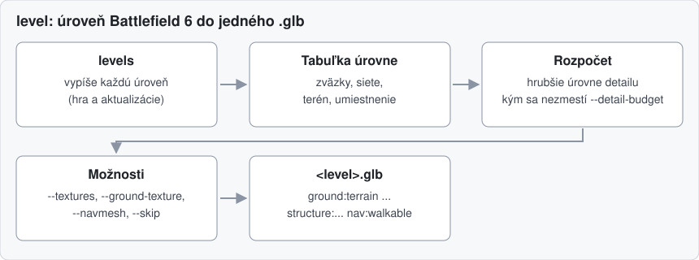

# Levely Battlefield 6: `levels` a `level` {#battlefield-6-levels-levels-and-level}

**Čo to je?** Celý level Battlefield 6 ako jeden 3D súbor. **Prečo?** Aby mal teplo
z vašich zápasov pod sebou zem a budovy. (*Frostbite* je engine, na ktorom je
Battlefield postavený; *výškové pole* je zem uložená ako mriežka výšok.)

Exportuje celý level Frostbite nainštalovanej hry: výškové pole terénu, každú sieť,
ktorú umiestňujú jeho skupiny statických modelov, objekty umiestnené jednotlivo,
pozadie terénu okolo mapy a na požiadanie farebné mapy povrchov, dekály terénu
zapečené do zeme a pochôdzne plochy vojakov.



## Krok za krokom {#step-by-step}

1. **Vypíšte levely**, ktoré hra obsahuje:

   ```
   python -m heat3d_gamefiles levels
   python -m heat3d_gamefiles levels --install "D:\Games\<game folder>"
   ```

   Každý riadok je tabuľka levelu (`levels/<level>/<level>.toc`) s jeho veľkosťou
   a tým, odkiaľ pochádza: `Data` pre základnú hru, `Update/<pack>` pre aktualizáciu.

2. **Exportujte jeden** podľa názvu, jedinečnej časti názvu alebo cesty k jeho `.toc`.
   Začnite bez textúr, aby ste videli tvar a veľkosť:

   ```
   python -m heat3d_gamefiles level <level> -o level.glb
   ```

3. **Pridajte farbu**, keď to vyzerá správne:

   ```
   python -m heat3d_gamefiles level <level> -o level.glb --textures 512 --ground-texture 0.5
   ```

4. **Pridajte pochôdzne plochy**, alebo zmenšite súbor:

   ```
   python -m heat3d_gamefiles level <level> --textures 512 --ground-texture 0.5 --navmesh
   python -m heat3d_gamefiles level <level> --textures 256 --detail-budget 3000000 --ground-spacing 8
   ```

5. **Otvorte `level.glb`** v paneli **Pozadie / level** prehliadača 3DHeat
   ([načítanie levelu](https://holdi601.github.io/3DHeat/levels.html)).

## Možnosti {#options}

| Možnosť | Predvolené | Význam |
|---|---|---|
| `<level>` | povinné | názov, ako ho vypíše `levels`, jedinečná časť názvu alebo `.toc` levelu |
| `-o`, `--out FILE` | `<level>.glb` | súbor, ktorý sa zapíše |
| `--install FOLDER` | nájde sa v knižniciach Steam | priečinok hry |
| `--textures [PIXELS]` | vypnuté; 512 bez veľkosti | farebná mapa každého povrchu, najviac PIXELS na stranu |
| `--ground-texture [METRES]` | vypnuté; 0,5 bez veľkosti | zapečie cesty, plochy a značenie do farby povrchu, METRES na pixel |
| `--navmesh` | vypnuté | pridá navigačnú sieť vojaka ako `nav:walkable` |
| `--ground-spacing METRES` | 4 | najjemnejší rozstup výškového poľa; 0 ho vynechá |
| `--detail-budget N` | najhrubšie kópie plus štvrtina, najmenej 1 500 000 | strop na trojuholníky (terén sa nikdy nezhrubne) |
| `--skip TEXT` | | vynechá skupiny modelov, ktorých názov oddielu obsahuje TEXT; možno opakovať |
| `--by-mesh` | vypnuté | jedna časť na každú zdrojovú sieť a materiál, na zistenie, čo je časť |
| `--clamped-uvs` | vypnuté | pre renderery, ktoré nevedia opakovať textúru |

Úplná tabuľka, s veľkosťami, ktoré treba čakať (celý level má stovky MB), je na
stránke [Príkazy](commands.md#levels-and-level-frostbite). Ako sa čítajú tabuľky,
zväzky, siete a terén, je na stránke [Frostbite](reader-frostbite.md).

## Príklad výstupu {#example-output}

Čo vypíše `level`, v hrubých črtách (riadky tak, ako ich píše kód; `<n>` a názvy sa
líšia podľa levelu):

```text
<n> copies of <n> meshes, from <n> static model groups
      <n>  <group>
      <n>  placed one by one (object and prefab references)
<n> meshes left out: <why>
<n> triangles, budget <n>; <n> meshes drawn at a coarser level to fit
           <n>  ground:terrain
           <n>  structure:buildings, <n> textures
           ...
<n> of <n> drawn sections carry their colour map; the rest are flat colours
Ground: <what the ground is>.
Navigation mesh: <tiles read>.
-> level.glb (<n> MB)
```

## Časti {#the-parts}

`ground:terrain` (výškové pole), `ground:terrain backdrop` a
`ground:terrain blend`, `structure:<kind>` pre každý druh siete (pre každú farebnú
mapu s `--textures`, s ` (destructible)` pre to, čo sa dá v zápase zničiť), a
`nav:walkable` s `--navmesh`. Pozri [Formát výstupu](output-format.md).

Súbor obsahuje obsah hry: je určený pre počítač, na ktorom vznikol, nie na posielanie
ďalej ([Pravidlá a licencie](rules-and-licences.md)).
