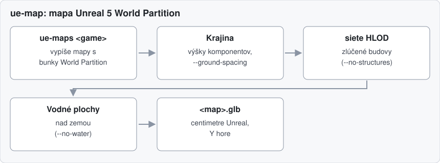

# Mapy Unreal 5 World Partition: `ue-maps` a `ue-map` {#unreal-5-world-partition-maps-ue-maps-and-ue-map}

**Čo to je?** Celá mapa hry Unreal 5 ako jeden 3D súbor: povrch, budovy a voda.
**Prečo?** Aby mal teplo z tej hry pod sebou mapu. (*World Partition* je spôsob, akým
Unreal 5 rozdelí veľkú mapu na kusy; *HLOD* je zjednodušená náhrada za skupinu budov,
tá, ktorú hra kreslí z diaľky.)

Exportuje celú mapu hry Unreal 5, ktorej mapy sú zapečené ako bunky World Partition:
krajinu, zlúčené siete HLOD mapy (jej budovy a rekvizity tak, ako ich hra kreslí
z diaľky) a jej vodné plochy. Nie je potrebný editor ani projekt, len nainštalovaná hra.



## Krok za krokom {#step-by-step}

1. **Vypíšte mapy.** `<game>` je priečinok hry, jej `Content/Paks` alebo názov jej
   priečinka v knižnici Steam:

   ```
   python -m heat3d_gamefiles ue-maps "<Steam game folder name>"
   python -m heat3d_gamefiles ue-maps "D:\Games\<game>"
   ```

   Každá mapa so zapečenými bunkami World Partition sa vypíše s cestou k balíku.

2. **Exportujte jednu** podľa názvu alebo jedinečnej časti názvu:

   ```
   python -m heat3d_gamefiles ue-map "<game>" <map> -o map.glb
   ```

3. **Len povrch, alebo hrubšie:**

   ```
   python -m heat3d_gamefiles ue-map "<game>" <map> --no-structures --no-water
   python -m heat3d_gamefiles ue-map "<game>" <map> --ground-spacing 4
   ```

4. **Otvorte `map.glb`** v paneli **Pozadie / level** prehliadača 3DHeat
   ([načítanie levelu](https://holdi601.github.io/3DHeat/levels.html)).

## Možnosti {#options}

| Možnosť | Predvolené | Význam |
|---|---|---|
| `<game>` | povinné | priečinok hry, jej `Content/Paks` alebo jej názov priečinka v Steame |
| `<map>` | povinné | názov, ako ho vypíše `ue-maps`, alebo jedinečná časť názvu |
| `-o`, `--out FILE` | `<map>.glb` | súbor, ktorý sa zapíše |
| `--ground-spacing METRES` | 2 | rozstup vrcholov krajiny, zaokrúhlený na celý počet jej vlastných štvorcov |
| `--no-structures` | | nezahrnie budovy a rekvizity HLOD |
| `--no-water` | | nezahrnie vodné plochy |

Obsah komprimovaný cez Oodle potrebuje knižnicu Oodle, ktorá je už v počítači
(pozri [Oodle](reader-oodle.md)).

## Príklad výstupu {#example-output}

```text
<map> -> map.glb
  ground      <n> triangles from <n> landscape components; <n> of <n> vertices stored twice disagree
  structure   <n> triangles in <n> HLOD meshes
  water       <n> triangles from <n> water bodies
```

Počet nesúhlasov je sebakontrola: susedné komponenty krajiny ukladajú spoločnú hranu
dvakrát a obe musia súhlasiť. Mapa 3 km pri 2 m má asi 4,6 milióna trojuholníkov
povrchu.

## Časti {#the-parts}

`ground:<map>` (krajina), `structure:<map>` (siete HLOD) a `water:<map>` (voda nad
povrchom).

**Jednotky:** toto je jediný export, ktorý **nie je v metroch**: centimetre Unreal,
s prehodenými Y a Z (Y hore), v rámci, ktorý zapisuje 3DHeat Unreal Exporter.
Telemetria z tej istej hry používa ten istý rámec, takže sedí na mape.

## Ako sa to číta a kontroluje {#how-it-is-read-and-checked}

| Časť | Číta sa z | Overené voči |
|---|---|---|
| povrch | 16-bitová výšková mapa každého komponentu krajiny, umiestnená podľa základne sekcie na transformácii krajiny | každý vrchol uložený dvakrát (na šve alebo hrane komponentu) musí súhlasiť; nesúhlasy sa počítajú a vypíšu, nevyhladzujú sa |
| štruktúra | zlúčené siete HLOD mapy, ktoré engine zostavil vo svetovom priestore | sieť sa ponechá len vtedy, ak hranice, ktoré si komponent ukladá, opisujú jej vlastné vrcholy |
| voda | sieť každého vodného telesa, položená na mriežku povrchu, ponechaná tam, kde je nad povrchom | voda je pár metrov nad povrchom pod ňou, ako rieka nad svojím korytom |

Vlastnosti krajiny sa nachádzajú podľa tvaru, nie podľa čísla slotu (sloty sa medzi
verziami enginu posúvajú). Štruktúry sú zjednodušené náhrady, nie plnodetailné modely.
Vegetácia, dekály a materiály krajiny sa neexportujú; povrch je bez textúry a tieňuje
ho prehliadač. Podrobnosti o archívoch:
[Unreal 5 IoStore](reader-unreal-iostore.md).

**Podmienky:** licencie hier zvyčajne dovoľujú osobné, nekomerčné použitie a zakazujú
spätné inžinierstvo „v rozsahu, v akom takéto konanie nemožno zakázať zákonom“. Čítanie
vašej vlastnej inštalácie je vaše rozhodnutie podľa týchto licencií; výstup je na
váš vlastný účel a nezdieľa sa.
