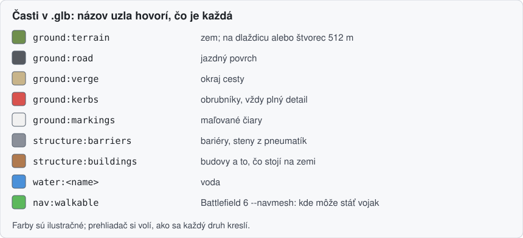

# Výstupný formát {#output-format}

`.glb` je jeden 3D súbor: zem, budovy a voda trate alebo levelu, ktorý otvoríte
v paneli Pozadie / level prehliadača 3DHeat.

Každý export (`course`, `courses`, `terrain`, `level`, `ue-map`, `enfusion-world`) zapíše
jeden **binárny glTF 2.0** súbor (`.glb`). Je úmyselne malý a plochý a rozložený
tak, ako ho číta prehliadač 3DHeat. Zdroj:
[`glb.py`](https://github.com/Holdi601/3DHeat-GameFiles/blob/main/heat3d_gamefiles/glb.py).

## Štruktúra {#structure}

```
scene 0
 ├─ node "ground:terrain x-2046 z1023"  -> mesh 0 -> 1 primitive, material 0
 ├─ node "ground:road x-2046 z1023"     -> mesh 1 -> 1 primitive, material 1
 ├─ node "ground:markings"               -> mesh 2 -> ...
 ├─ node "ground:kerbs road_gen_rum_..." -> ...
 ├─ node "structure:barriers bar_armco_bclr"
 └─ ...
```

- **Jeden uzol na časť**, všetky v koreni scény, **bez transformácií**. Celá geometria je už vo svetových súradniciach.
- Každý uzol má vlastnú sieť s **jedným primitívom** a vlastný materiál. Uzol, sieť aj materiál nesú názov časti.
- Každý primitív má **vlastné kompaktné polia vrcholov**, len vrcholy, ktoré časť používa. Zdieľané pole vrcholov je v glTF povolené, ale čítač, ktorý rozbaľuje prístupové prvky každého primitívu, by držal každý vrchol raz pre každú časť.
- `asset.generator` je `heat3d_gamefiles`.
- **Málo `extras`** a žiadny názov kola, hry ani trate:
  - časť Battlefield 6 rozbitnej siete nesie na svojom uzle `{"destructible": true}`;
  - trať Forzy hovorí, čo obsahuje, v `asset.extras` (verzia formátu, priradené id trasy, koľko kópií vrstvy samotných pretekov, miesta konania; pozri [Trate Forza Horizon](course-forza-horizon.md#writing-the-file)), a jej zapnuté časti nesú svoju vrstvu na uzle: `{"layer": "event", "route": <id>}` pre vrstvu samotných pretekov, `{"layer": "layer"}` pre inú zapnutú vrstvu, `{"layer": "venue"}` pre zem miesta konania.

  Všetko ostatné, čo prehliadač potrebuje, je v názvoch uzlov.

## Klasifikácia názvov uzlov {#node-names-the-classification}



Prehliadač berie triedu časti z názvu **uzla** (ak nie, z názvu siete) a len vtedy,
ak sa zhoduje s

```
^(ground|structure|water)\s*[:|]
```

Čokoľvek iné sa klasifikuje heuristikou napísanou pre Unreal krajiny. Preto každá
časť, ktorú exportér zapíše, začína jednou z týchto predpôn, alebo `nav:`
(nižšie):

| Predpona | Význam | Zapísané časti |
|---|---|---|
| `ground:` | jazdný povrch a zem | `ground:road`, `ground:verge`, `ground:terrain`, `ground:gravel and dirt`, `ground:kerbs`, `ground:markings`, `ground:tyre marks`, `ground:venue`, `ground:plinths` |
| `structure:` | to, čo na nej stojí | `structure:barriers`, `structure:props`, `structure:signs`, `structure:buildings`, `structure:infrastructure`, `structure:bridges`, `structure:rocks`, `structure:smashables`, `structure:trees`; vrstvy Forzy `structure:event_<category>` a `structure:layer_<category>` |
| `water:` | voda | `water:water`; `water:<map>` (`ue-map`), `water:<world>` (`enfusion-world`) |
| `nav:` | kde môže vojak chodiť (Battlefield 6, len `--navmesh`) | `nav:walkable` |

`nav:` nezodpovedá vzoru prehliadača vyššie, takže ho prehliadač zaradí podľa svojej
heuristiky; je to samostatná časť, aby ste ju mohli zobraziť alebo skryť osobitne.
`ue-map` zapíše `ground:<map>`, `structure:<map>` a `water:<map>`;
`enfusion-world` zapíše `ground:<world>`, `structure:<world>` a `water:<world>`.

Za druhom nasleduje podľa hry:

| Príklad | Význam |
|---|---|
| `ground:road x-2046 z1023` | zem Forzy v dlaždici terénu pomenovanej `x-2046 z1023` (jednotky mriežky, 1023 na 512 m) |
| `ground:road 3_-2` | zem BeamNG v štvorci 512 m (3, -2) |
| `ground:road 3_-2 asphalt_light` | modelovaný povrch jazdy BeamNG z materiálu `asphalt_light` v tom štvorci |
| `ground:road 1_-4` | zem AC Rally v štvorci 512 m (1, -4) priestoru Unreal |
| `structure:barriers bar_armco_bclr` | umiestnené modely Forzy zdieľajúce jednu textúru (jej názov bez GUID) |
| `structure:barriers` | umiestnené modely bez textúry (Forza, AC Rally) |
| `structure:event_barriers bar_example_bclr` | Forza: čo zhodné preteky vydávajú len pre seba, okrem voľného sveta (extras uzla `{"layer": "event", "route": <id>}`) |
| `structure:layer_props` | Forza: vrstva, ktorú hra zapína pre niečo iné než tieto preteky (aktivita, zberateľský predmet, runtime vrstva) |
| `ground:venue`, `ground:plinths` | Forza: modely už vo svetových súradniciach - vlastná zem miesta konania (podlaha štadióna) a zem, ktorou je ulica ozdobená |
| `structure:barriers armco_metal` | modely BeamNG jedného materiálu |
| `ground:markings`, `water:water` | ploché časti, jedna pre celý súbor |
| `ground:terrain` (Battlefield 6) | výškové pole; `ground:terrain backdrop` vzdialené siete terénu, `ground:terrain blend` siete, ktoré sa prelínajú do terénu |
| `nav:walkable` (Battlefield 6, `--navmesh`) | navigačná sieť levelu pre vojaka: kde sa dá stáť, plochá zelená |
| `ground:terrain x-512 z-512` (Battlefield 6, `--ground-texture`) | výškové pole pod jednou pečenou dlaždicou nálepiek, pomenovanou podľa jej nízkeho rohu v metroch |
| `structure:buildings t_concreteclean_01_cs` (Battlefield 6, `--textures`) | každý povrch daného druhu, ktorý ukazuje túto farebnú mapu; bez `--textures` jedna časť na druh, bez prípony |
| `structure:buildings t_concreteclean_01_cs (destructible)` (Battlefield 6) | to isté, pre siete, ktoré môže zápas zničiť: tie s vlastným aktívom zničenia rovnakého názvu (steny, domy, rekvizity). Uzol nesie aj glTF extras `{"destructible": true}`. Ich zničené stavy sa neexportujú |

Prehliadač môže filtrovať podľa týchto názvov. Napríklad "len závodný povrch" je
`ground:road` spolu s `ground:kerbs`, vo všetkých troch hrách, a "svet bez
rekvizít pretekov" je všetko okrem `structure:event_*`. Predpona je aj tým, ako
prehliadač časť kreslí: zem ako povrch, na ktorom leží teplo, štruktúra ako to, čo na
nej stojí.

## Jednotky, osi a rámec {#units-axes-and-frame}

- **Metre, Y hore**, konvencia glTF, pre každý export okrem `ue-map`. Nič sa neprepočítava ani necentruje: čísla sú svetové súradnice hry, a to je dôvod, prečo sa číta archív namiesto rekonštrukcie.
- **Mapy Unreal 5 (`ue-map`): centimetre**, vlastná jednotka Unreal, s prehodenými Y a Z, takže Y je hore - rámec, ktorý zapisuje exportér Unreal 3DHeat a ktorý používa telemetria hry. Jediný export, ktorý nie je v metroch.
- **Arma Reforger (`enfusion-world`):** vlastné metre hry, x na východ, y hore, z na sever. Rámec hry je ľavotočivý; zobrazenie *Invertovať os sveta* v prehliadači ukáže, že nie je zrkadlený.
- **Forza:** svetové súradnice samotnej hry (x, y hore, z), nezmenené. Rovnaké ako jej telemetria, takže nahrané kolo leží na trati.
- **BeamNG.drive:** `(x, z, -y)` svetu BeamNG so Z hore, čo je rotácia, ktorú aplikuje nahrávač telemetrie. Rotácia, nie zrkadlenie.
- **Battlefield 6:** svetové súradnice samotnej hry (x, y hore, z), nezmenené: transformácie inštancií levelu aplikované na každú sieť tak, ako sú uložené. Zrkadlené kópie sa preotočia, aby ich normály smerovali von.
- **Assetto Corsa Rally:** rámec kola. Centimetre Unreal sa stanú metrami, Z Unreal sa stane y, a X a Y Unreal sa stanú x a z v tej z ôsmich orientácií, do ktorej kolo zapadlo (pozri [Assetto Corsa Rally](course-assetto-corsa-rally.md#which-stage-and-which-way-round)). Trojuholníky sa preotočia tam, kde toto mapovanie zrkadlí.

Každý export zachováva osi, ktoré jeho telemetria používa, takže nahrávka a level
zdieľajú rámec. Či je tento rámec ľavotočivý alebo pravotočivý v každej hre, nebolo
overené.

## Údaje vrcholov {#vertex-data}

Predvolený je **kvantizovaný** tvar (`quantize=True`). Vyžaduje rozšírenie
`KHR_mesh_quantization`, ktoré je uvedené v `extensionsUsed` aj `extensionsRequired`.

| Atribút | Kvantizovaný (predvolený) | Plná presnosť (`quantize=False`) |
|---|---|---|
| `POSITION` | float32 VEC3, s min/max | float32 VEC3 |
| `NORMAL` | int8 VEC3 normalizovaný, vyplnený na 4 bajty (krok 4) | float32 VEC3 |
| `TEXCOORD_0` (len texturované časti) | uint16 VEC2 normalizovaný, orezaný na 0–1; float32 VEC2 tam, kde sa textúry opakujú (Battlefield 6) | float32 VEC2 |
| `COLOR_0` (netexturované časti, keď má nejaká časť farbu) | uint8 VEC3 normalizovaný, vyplnený na 4 bajty | float32 VEC3 |
| indexy | uint16, keď má časť najviac 65 535 vrcholov, inak uint32 | uint32 |

Vrchol má 20 bajtov namiesto 32 (24 namiesto 44 s farbou). To ubalí každému
súboru tretinu a je to rozdiel medzi mestskou trasou, ktorá sa načíta v
prehliadači, a tou, ktorá sa nenačíta. Cena je pod pol stupňa normály a 1/65 535
UV (pätnástina texelu pri 4 096 px). Príkazový riadok vždy zapisuje kvantizovaný
tvar. `write_glb(..., quantize=False)` v Pythone zapíše ten druhý.

Normály pochádzajú z hry tam, kde ich ukladá (terén a modely Forzy, tvary a terén
BeamNG). Inak sa vypočítajú ako plochou vážené hladké normály z trojuholníkov.
Normály AC Rally sa vždy počítajú.

## Materiály, farby a textúry {#materials-colours-and-textures}

- Každý materiál je `metallicFactor 0`, `roughnessFactor 1`.
- **Texturovaná časť:** `baseColorTexture` s obrázkom časti, UV a bez farby vrcholu. glTF ich násobí, takže by povrch vyšiel dvakrát stmavený.
- **Netexturovaná časť:** farba vrcholu `COLOR_0` s plochou farbou časti a biele `baseColorFactor`. Ak žiadna časť v súbore nemá farbu, `COLOR_0` nie je. Kde časti zdieľajú vrcholy, vyhrá farba neskoršej časti, preto sa ploché časti zapisujú v poradí rastúcej dôležitosti.
- **Obrázky** sú vložené do binárneho bloku ako **JPEG**, kvalita 90, bez podvzorkovania chrominancie, len RGB (alfa sa zahodí) - okrem výrezovej mapy Battlefield 6 (lístie, ploty), ktorá je **PNG** s alfou, na materiáli s `alphaMode` MASK, `alphaCutoff` 0.5 a `doubleSided` (pozri [Frostbite](reader-frostbite.md#textures-and-materials)). Prehliadač 3DHeat zahadzuje texely pod hranicou. 2048 px zem z trávy a korún stromov je pre bezstratový kodér šum: niekoľko megabajtov na dlaždicu ako PNG, pod jeden ako JPEG. Obrázok zdieľaný viacerými časťami sa uloží raz.
- Jeden vzorkovač pre všetky textúry: lineárne zväčšenie, lineárne-mipmapové zmenšenie, **orezanie na okraj** na oboch osiach, pre exporty tratí, ktorých textúry pokrývajú povrch raz. BeamNG kreslí opakujúce sa textúry modelov ako ploché farby (pozri [BeamNG.drive](course-beamng.md#placed-models)).
- Exportu Battlefield 6 s `--textures`, ktorého materiály sa dlaždia, zapíše súradnice textúry hry, neorezané, ako float32 `TEXCOORD_0` aj v kvantizovanom tvare, so vzorkovačom, ktorý sa **opakuje** na oboch osiach (`write_glb(..., repeat=True)`): tehlová stena je jeden pár trojuholníkov, ktorého UV ide od 0 do 40. Prehliadač 3DHeat obalí takú textúru v svojom atlase (pozri jeho stránku *Model levels*). Pre renderer, ktorý textúru opakovať nevie, `level --clamped-uvs` (`write_level(..., clamped=True)`) rozreže každý trojuholník pozdĺž čiar, kde sa textúra opakuje, a presunie každý kus do 0..1: tie isté pixely na tom istom povrchu, asi o pätinu viac trojuholníkov. Trojuholníky, cez ktoré sa textúra opakuje viac než 16-krát, si zachovajú svoje súradnice. Trojuholník, ktorý by jeho textúra rozrezala na viac než 4 kusy - kôra sa opakuje dole každou vetvou stromu, a rez zmenil 1 099 trojuholníkov jedného stromu na 51 735 - ide do vlastnej časti, `<part> (average colour)`, v priemernej farbe textúry; `level` povie, koľko ich je.

| Textúra | Veľkosť | Pokrýva |
|---|---|---|
| zem (všetky hry okrem Battlefield 6) | `--texture-size`: 2048, 1024 alebo 512 px | jeden štvorec 512 m: 25, 50 alebo 100 cm na pixel |
| Battlefield 6 výškové pole | najväčší mip farebnej mapy pozadia v leveli, orezaný | štvorec terénu: 32 m na pixel v skontrolovanom leveli |
| Battlefield 6 povrchy | `--textures`: najviac toľko px na stranu | vlastná textúra povrchu, raz na kus (rezaná tam, kde sa opakuje) |
| Battlefield 6 pečená zem | `--ground-texture`: metre na pixel, dlaždice najviac 4 096 px | jedna dlaždica rozsahu nálepiek: 2 048 m pri 0,5 m na pixel |
| umiestnený model Forzy | najviac 256 px | vlastné rozloženie UV modelu |
| umiestnený model BeamNG | najviac 256 px | vlastné rozloženie UV modelu, len tam, kde sa neopakuje |
| umiestnený model AC Rally | žiadna | ploché farby |

## Čo zapisovač odmietne {#what-the-writer-refuses}

`write_glb` vyvolá chybu namiesto toho, aby zapísal súbor, ktorý by prehliadač otvoril
a zobrazil zle:

| Odmietnuté | Pretože |
|---|---|
| pozície nie N x 3, alebo nie konečné | pokazená sieť |
| index za koncom zoznamu vrcholov | vykreslí sa ako šum |
| texturovaná časť, keď súbor nemá UV | vykreslí sa ako jeden rozmazaný pixel |
| žiadne trojuholníky | vykreslí sa ako nič |
| pole normál, farieb alebo UV zlej dĺžky, alebo nekonečné | potrebná je jedna hodnota na vrchol |

## Čítanie inde {#reading-it-elsewhere}

Každý glTF 2.0 prehliadač, ktorý podporuje `KHR_mesh_quantization`, by mal tieto
súbory otvoriť. Overený je len prehliadač 3DHeat; ostatné prehliadače nie sú overené.
Čitateľ bez tohto rozšírenia súbor odmietne, lebo je označené ako povinné. Súbory
môžu byť veľké: asi 80 MB pre krajinný okruh, až niekoľko stoviek MB pre mestskú
trať s automatickým rozpočtom.

## V 3DHeat {#in-3dheat}

Načítajte `.glb` do panela Pozadie / level prehliadača [3DHeat](https://github.com/Holdi601/3DHeat);
telemetria, ktorú nahrávate v tej istej hre, na ňom leží, lebo obe si ponechávajú
súradnice hry. Vlastná dokumentácia prehliadača
([holdi601.github.io/3DHeat](https://holdi601.github.io/3DHeat/)) pokrýva panel
Pozadie / level a súbory zápasov, ktoré zapisujú ostatné nástroje
([Jeden súbor za zápas: `.3dheat`](https://holdi601.github.io/3DHeat/container.html)).
Level sa neukladá do každého súboru `.3dheat`: zápas ho pomenuje vo svojich
`references` (`kind: "level"`, názov a sha256) a `.glb` zostane vedľa zápasov.
