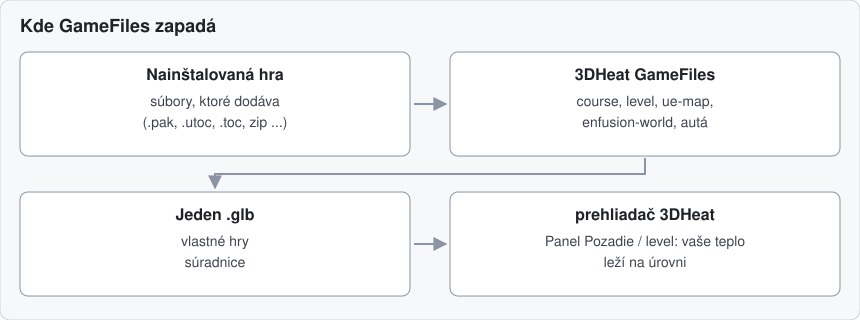

# Celé úrovne {#whole-levels}

**Jednoducho povedané:** pri strieľačkách a ďalších hrách bez kôl nástroj uloží celú mapu ako jeden 3D súbor, aby prehliadač mohol nakresliť, kam hráči na nej chodili.

`course` vystrihne zem okolo kola. Pri hrách bez kôl nástroj exportuje celú úroveň, mapu alebo svet naraz:

| Hra alebo engine | Zoznam | Export | Stránka |
|---|---|---|---|
| Battlefield 6 (Frostbite) | `levels` | `level <level>` | [Úrovne Battlefield 6](level-battlefield.md) |
| Hry Unreal 5 s World Partition | `ue-maps <game>` | `ue-map <game> <map>` | [Mapy Unreal 5](level-unreal-world-partition.md) |
| Arma Reforger (Enfusion) | `enfusion-worlds` | `enfusion-world <world>` | [Svety Arma Reforger](level-arma-reforger.md) |

Každá dvojica funguje rovnako: prvé sloveso vypíše, čo nainštalovaná hra obsahuje, a druhé zapíše jedno z nich ako jediný `.glb` v súradniciach sveta samotnej hry, takže pozície zaznamenané v tej hre na ňom ležia. Časti sa volajú `ground:`, `structure:` a `water:` ako každý iný export (pozri [Formát výstupu](output-format.md)); súbor načítajte v paneli Pozadie / level prehliadača 3DHeat.

