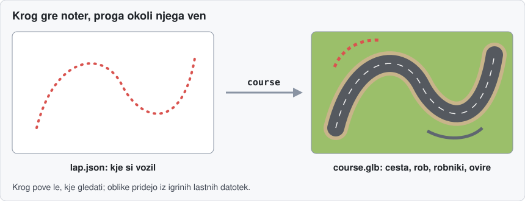
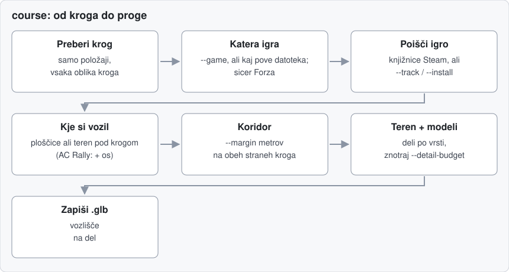

# Izvoz proge {#course-export}

**Preprosto:** vozili ste krog; to iz njega zgradi progo, po kateri ste vozili, kot 3D datoteko. Krog je samo vrstica točk; cesta, trava in robniki pridejo iz igrinih lastnih datotek.

`course` spremeni krog v progo: tla v pasu na vsaki strani mesta, kjer je avto vozil, in to, kar stoji na teh tleh, kot eno datoteko `.glb` za pregledovalnik. Ta stran zajema, kar si delijo vse tri podprte igre. Strani pod njo zajemajo, v čem se razlikujejo:

- [Forza Horizon](course-forza-horizon.md): arhivi ForzaTech `.minizip`
- [BeamNG.drive](course-beamng.md): zip arhivi, višinska mreža terena, sestavljene oblike
- [Assetto Corsa Rally](course-assetto-corsa-rally.md): Unreal 5 IoStore, etapa World Partition
- [Stopnje podrobnosti in proračun](detail-budget.md): koliko trikotnikov dobijo postavljeni modeli in kateri primerki ostanejo

## Koraki {#the-steps}

Pojmi, uporabljeni spodaj: **koordinatni sistem** (frame) pove, kam kažejo osi; **pas** (corridor) je pas tal na vsaki strani kroga; **ploščica** (tile) je en kvadratni kos terena igre; **LOD** (stopnja podrobnosti, level of detail) je ena izmed enostavnejših kopij modela.

1. **Preberite krog.** Samo položaji, iz katerekoli oblike iz [Vhodi za krog](lap-inputs.md). Hitrost in vnosi se ne uporabljajo. Krog z manj kot dvema vzorcema je zavrnjen ("holds no driving").
2. **Odloči igro.** `--game`, nato polje `game` v datoteki kroga, nato Forza (glejte [Ukazi](commands.md#which-game)).
3. **Poiščite nameščeno igro.** Vse tri preiščejo vsako knjižnico Steam, navedeno v `config\libraryfolders.vdf` na Steamu. Forza poleg tega preišče `C:\XboxGames`. `--track` (Forza) ali `--install` (BeamNG, AC Rally) preskoči iskanje.
4. **Poiščite, kje je bil krog voden.** To se nikoli ne odloči samo z ujemanjem imena. Forza izbere progo, katere ploščice terena pokrivajo krog. BeamNG izbere nivo, na katerem (ali na katerih cestah) ležijo vzorci kroga. AC Rally preizkusi vsako etapo v osmih usmeritvah osi in izbere tisto, ki na cesto postavi največ kroga.
5. **Izreži pas** `--margin` metrov na vsako stran vožnje (spodaj).
6. **Zgradi tla** znotraj pasu, razvrščena kot cesta, bankina, gramoz in zemlja, teren, označbe, sledi gum ali voda, in zapeci talno teksturo za vsak kvadrat 512 m.
7. **Postavi modele**, ki stojijo v pasu, po kategorijah, na stopnji podrobnosti, izbrani glede na razdaljo in proračun trikotnikov.
8. **Zapišite `.glb`**: eno imenovano vozlišče za vsak del. Glejte [Oblika izhoda](output-format.md).

Kaj izpiše zagon – tukaj na sintetični namestitvi BeamNG.drive, ki jo gradijo testi, 50 m kroga po ozki cesti:

## Pas {#the-corridor}

Izrez je pas okoli vožnje, ne škatla, ki obdaja krog. Pri krogu sta si skoraj enaki. Pri sprintu od točke do točke je škatla večinoma pobočje, po katerem nihče ne vozi, in pas je lahko le desetina njene površine. Izvorna koda: [`corridor.py`](https://github.com/Holdi601/3DHeat-GameFiles/blob/main/heat3d_gamefiles/corridor.py).

Gradi se tako:

- Vožnja se projicira na talno ravnino: x in z kroga (BeamNG: x in y igrinega lastnega koordinatnega sistema).
- Rasterizira se na mreži celic po **4 m** (`CELL`). Vsaka celica, ki se je dotaknila vožnje, se razširi z diskom polmera `margin + 4 m` v vse smeri.
- Zaporedni vzorci, bližje kot **50 m** (`JOIN`), se povežejo s točkami na vsake 4 m, da pas nima lukenj. Vzorci, ki so bolj narazen, pomenijo ločene odseke vožnje in se ne povezujejo. Knjižnična proga je veliko datotek krogov, zloženih drugo za drugo, zato cilj enega sprinta in start naslednjega ne smeta risati pasu čez zemljevid.
- Trikotnik se obdrži, če katero koli oglišče, sredina katerega koli roba ali njegovo središče leži v pasu. Sredinske točke ujamejo velik trikotnik, ki leži čez ozek pas, medtem ko so vsa njegova oglišča zunaj.
- Višina nikoli ni del reza. Škatla, ki bi omejevala nadmorsko višino, bi odrezala tla pod hribom, po katerem se cesta vzpenja.

Konzola poroča površino pasu, na primer `cutting 80 m either side of the driving: 1.53 km2 of a 6,000 by 3,600 m box`.

BeamNG in AC Rally zgradita tudi širši **doseg** (reach) pasu velikosti `margin + 60 m`. Postavljen model se upošteva, če njegov izhodišče leži v pasu dosega, nariše pa se samo, če se njegov odtis dotika pravega pasu. Tako se dolg predmet, katerega izhodišče je tik zunaj pasu, ne izgubi. BeamNG pas dosega uporablja tudi za izbiro cestnih nalepk, ki se narišejo.

## Iz česa so tla {#what-the-ground-is-made-of}

Vsak izvoz razvrsti talne trikotnike v iste vrste, vsaka vrsta pa je zapisana kot svoj del, da jo pregledovalnik lahko pokaže ali skrije:

| Vrsta | Ime dela | Enobarvna ploskev (linearni RGB) | Forza | BeamNG | AC Rally |
|---|---|---|---|---|---|
| cesta | `ground:road` | 0.22, 0.22, 0.23 | pasovi ceste: del asfalta | sloji tipa `ASPHALT`, nalepke cest, modelirana cesta | ploščice proge (`/MeshesTrack/`) |
| bankina | `ground:verge` | 0.52, 0.47, 0.30 | pasovi ceste: rob ceste | pločniki in modeli bankin | - |
| gramoz in zemlja | `ground:gravel and dirt` | 0.50, 0.42, 0.30 | - | sloji zemlje, gramoza, peska in blata ter nalepke | - |
| teren | `ground:terrain` | 0.30, 0.44, 0.18 | vse drugo | vse drugo | ploščice `_Terrain` in daljni teren |
| robniki | `ground:kerbs` | 0.60, 0.12, 0.10 (Forza) | rekviziti `road_gen_rum*` | modeli robnikov, pragov in ropotajočih pasov | modeli robnikov in pragov |
| označbe | `ground:markings` | 0.90, 0.90, 0.88 | podmeshi nalepk, dvignjeni za 5 cm | vrisane v teksturo | - |
| sledi gum | `ground:tyre marks` | 0.20, 0.17, 0.16 | podmeshi nalepk, dvignjeni za 5 cm | vrisane v teksturo | - |
| voda | `water:water` | 0.16, 0.34, 0.48 | vodni materiali | morska ravnina, vodni bloki, reke | - |

Enobarvne ploskve so izbrane tako, da se beseda hitro prebere, ne da bi ustrezale igri. Uporabljajo se za dele brez teksture in pri pregledovalnikih, ki teksture prezrejo. Vir: [`surfaces.py`](https://github.com/Holdi601/3DHeat-GameFiles/blob/main/heat3d_gamefiles/surfaces.py).

Talni deli so razdeljeni po kvadratih 512 m, vsak kvadrat pa nosi svojo zapečeno sliko, zato imena delov nosijo kvadrat:

| Igra | Ime talnega dela | Ključ kvadrata |
|---|---|---|
| Forza | `ground:road x-2046 z1023` | ime mreže ploščice terena (koraki po 1023, glejte [Forza Horizon](course-forza-horizon.md)) |
| BeamNG | `ground:road 3_-2` | `floor(x / 512)`, `floor(y / 512)` v metrih BeamNG |
| AC Rally | `ground:road 1_-4` | `floor(x / 51200)`, `floor(y / 51200)` v centimetrih Unreal |

## Kaj stoji na njem {#what-stands-on-it}

Postavljeni modeli so zapisani v dele z imenom `structure:<kategorija>`, za robnike pa `ground:kerbs` (pri vseh treh igrah). Kadar ima del svojo teksturo, ime teksture ali materiala sledi kategoriji, na primer `structure:barriers bar_armco_bclr`.

| Kategorija | Forza | BeamNG | AC Rally |
|---|---|---|---|
| ovire | da | da | da |
| rekviziti | da | da | da |
| znaki | da | da | da |
| stavbe | da (celotne stavbe kjer jih igra ima) | da | da |
| infrastruktura | da | da | da |
| mostovi | da | da | (uvrščeni med infrastrukturo) |
| skale | da | da | da |
| robniki | da, kot tla | da, kot tla | da, kot tla |
| drevesa | z `--trees` | z `--trees` | z `--trees` |
| razbijajoči se predmeti | z `--trees` | - | - |

Razdelitev podrobnosti je pri vseh treh enaka. Kopije, oddaljene do 25 m od vožnje, začnejo na polni podrobnosti, kopije od 25 do 60 m ena stopnja nižje, dlje od tega pa na najgrobljši stopnji. Nato se najdražji modeli znižajo, dokler se ne prilega proračun trikotnikov, in kjer tudi najgrobljše stopnje ne ustrezajo proračunu, ki ga podate, se kopije izpustijo. Robniki se nikoli ne poenostavijo ali izpustijo. Glejte [Stopnje podrobnosti in proračun](detail-budget.md).

## Možnosti, ki oblikujejo rezultat {#options-that-shape-the-result}

| Želite | Uporabite |
|---|---|
| manjšo datoteko | `--no-textures` (enobarvne ploskve), `--texture-size 1024` ali `512`, `--detail-budget N`, `--margin 40` |
| samo tla | `--no-placed` |
| tudi scenografijo | `--trees` |
| drugačen letni čas (Forza) | `--season winter` |
| igro, ki ni v Steamu | `--track` (Forza) ali `--install` (BeamNG, AC Rally) |
| krog, ki ga iskanje ne postavi | `--level` (BeamNG, AC Rally), `--track` (Forza) |

## Koordinate {#coordinates}

Vsak izvoz zapiše metre z Y navzgor, v koordinatnem sistemu, v katerem se posnet krog iste igre prilega:

| Igra | Zapisan koordinatni sistem |
|---|---|
| Forza | svetovne koordinate igre same, nespremenjene |
| BeamNG | `(x, z, -y)` svetovnega sistema BeamNG z Z navzgor, to je rotacija, ki jo uporablja snemalnik telemetrije |
| AC Rally | koordinatni sistem kroga, najden z prilagajanjem: centimetri Unreal postanejo metri, Unrealova X in Y pa postaneta x in z kroga v tisti od osmih usmeritev, ki ustreza |

Glejte [Oblika izhoda](output-format.md).
