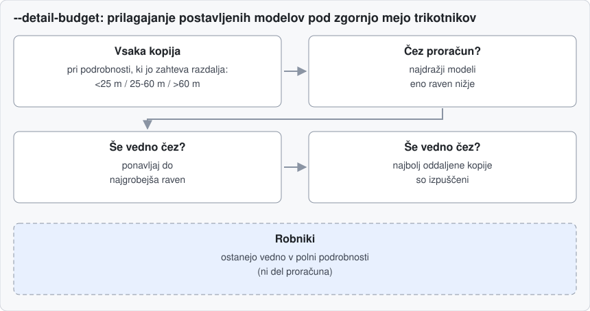

# Stopnje podrobnosti in proračun {#levels-of-detail-and-the-budget}

**Trikotnik** je majhen ravni kos 3D modela. Več trikotnikov pomeni večjo in počasnejšo datoteko. **Proračun** je omejitev, koliko jih sme biti. **Stopnja podrobnosti** je enostavnejša kopija modela, uporabljena, kadar je model daleč.

Najfinejša stopnja vsega, kar je postavljeno okoli dirkališča, je več milijonov trikotnikov. Na primer stotine segmentov varnostnih ograj in kupov pnevmatik po okoli tisoč trikotnikov vsak. Mestni koridor drži več kot sto tisoč kopij. Zato vsak izvoz proge postavljenim modelom dodeli **proračun trikotnikov** in odloči, za vsak model, na kateri stopnji podrobnosti se nariše, in če je treba, katere kopije izpustiti.

Shema je bila napisana za Forzo ([`forzaplacement.py`](https://github.com/Holdi601/3DHeat-GameFiles/blob/main/heat3d_gamefiles/forzaplacement.py): `choose_levels`, `auto_budget`, `_fit`), BeamNG in AC Rally pa jo ponovno uporabljata. Teren se ne šteje v proračun.

## Pasovi razdalje {#distance-bands}

Razdalja vsake kopije do vožnje se meri v ravnini tal, do najbližjega vzorca kroga. Krog se najprej zmanjša na največ 1.000 točk, kar stane nekaj metrov natančnosti in nič, kar je pomembno. Kopije nato padejo v tri pasove, vsak par (model, pas) pa je proračunan posebej:

| Pas | Razdalja | Začne na |
|---|---|---|
| bližnji | pod 25 m (`NEAR`) | najfinejši stopnji |
| srednji | 25-60 m (`FAR`) | eno stopnjo grobljo |
| daljni | 60 m in več | najgrobljši stopnji |

Brez poti (Forza `terrain --box`) se razdalja meri do središča škatle.

## Znižanje, da se prilega {#stepping-down-to-fit}



Cena vnosa (model, pas) je število kopij krat trikotniki na njegovi trenutni stopnji. Dokler je skupna vsota čez proračunom, vnos, ki stane največ, pade za eno stopnjo, in to se ponavlja, dokler se vsota ne prilega ali ne more več padati. Pripeti vnosi se nikoli ne znižajo:

| Igra | Pripeto na polno podrobnost |
|---|---|
| Forza | robniki (`road_gen_rum*`) |
| BeamNG | robniki in vsaka oblika, ki nosi vozno površino |
| AC Rally | robniki |

Forza to poroča kot `N of M models drawn at a coarser level to fit the budget`.

## Samodejni proračun {#the-automatic-budget}

Brez `--detail-budget` proračun sam določi velikost tako, da **nobena kopija ni izpuščena**:

```
budget = max(1,500,000, 1.25 x sum(copies x coarsest level))
```

Pripeti vnosi štejejo na svoji najfinejši stopnji. 25 % (`HEADROOM`) pusti stvarem ob cesti, da ohranijo nekaj podrobnosti. Na državnem dirkališču je to spodnja meja 1,5 milijona (`DEFAULT_BUDGET`). Na mestni progi, kjer koridor drži več kot sto tisoč kopij, zraste čez deset milijonov, datoteka pa na več sto MB. Pregledovalnik to naloži.

## Proračun, ki ga podate {#a-budget-you-give}

`--detail-budget N` je **zgornja meja**. Stopnje se znižajo, kot zgoraj. Če tudi najgrobljše stopnje ne ustrezajo, se kopije izpustijo:

| Igra | Vrstni red, v katerem se kopije izpuščajo |
|---|---|
| Forza | najprej vse, kar je 25 m ali več od vožnje, nato to, kar stoji ob cesti; znotraj vsake skupine najprej to, kar se od ceste zdi najmanjše: največja razdalja / velikost (velikost = diagonala omejujočega kvadra modela, pomnožena z njegovo največjo skalo, vsaj 0,25 m) |
| BeamNG | najprej najbolj oddaljeno od vožnje |
| AC Rally | najprej najbolj oddaljeno od vožnje, kot pri BeamNG |
| Battlefield 6 | najprej najmanjše: diagonala omejujočega kvadra, pomnožena s skalo |

Robniki (in pri BeamNG oblike vozne površine) se nikoli ne izpustijo, zato manjši proračun, kot jih stane sam po sebi, prekoračijo oni in nič drugega.

Forza uporablja razdaljo čez velikost, ker bi, urejeno samo po razdalji, klimatska naprava na steni devet metrov stran preživela fasado dvajset metrov stran, na kateri visi, dvanajst metrov stran. Stvari ob cesti gredo zadnje ne glede na velikost, ker je tri metre visoka ovira pet metrov od črte meja proge, medtem ko je pedeset metrov visoka stavba šestdeset metrov nazaj zgolj scenografija.

Povzetek poroča `N of M copies left out to fit the budget, the smallest and furthest from the driving first (--detail-budget raises it)` (Forza) ali `N copies left out to fit the budget, the furthest from the driving first (--detail-budget raises it)` (BeamNG, AC Rally).

## Cele stavbe (Forza) {#whole-buildings-forza}

Nadomestek celotne stavbe šteje kot ena kopija, razdalja pa se meri do najbližjega roba stavbe. Obdrži se ali izpusti kot enota. Modularni deli, ki jih nadomešča, se sploh ne proračunavajo. Glejte [Forza Horizon](course-forza-horizon.md#buildings-drawn-whole).

## Kaj je stopnja podrobnosti, po igri {#what-a-level-of-detail-is-per-game}

| Igra | Stopnje pridejo od |
|---|---|
| Forza | maske stopenj po trikotniku pri podmeshih `Mesh` modela (bit `level + 1`); `0xFFFF` lomljivi kosi samo za model brez označene stopnje |
| BeamNG | `details` oblike `.cdae` z nenegativno velikostjo, največja prva; pri `.dae` končna številka v imenih mrežnih vozlišč (`barrier75`, `barrier40`) |
| AC Rally | shranjene stopnje podrobnosti statičnega mesha, najfinejša prva |
| Battlefield 6 | stopnje podrobnosti MeshSet, najfinejša prva, šteje se samo narisane odseke (ne senčnih in samo globinskih kopij), in ne zadnja stopnja, ki je oddaljen pogled (materiali `M_LastLod`, `M_Billboard`, `M_Vista`: rešetka stolpa postane trdna konica) |

Battlefield 6 `level` nima kroga, zato ni pasov razdalje: vsak mesh je en vnos, vsaka kopija na isti stopnji. Samodejni proračun je zgornja formula s pripetim pasom ozadja terena; višinska mreža je zunaj proračuna in se določi z `--ground-spacing`. Pod proračunom, ki ga podate, ko je vsak mesh na svoji najgrobljši stopnji, se kopije izpuščajo najprej najmanjše, velikost pa je diagonala omejujočega kvadra mesha, pomnožena s skalo kopije, saj ni vožnje, od koder bi se merila razdalja. Pas ozadja terena se nikoli ne izpusti. Stopnja samodejno pride na približno deset milijonov trikotnikov.

## Izbira številke {#choosing-a-number}

| Želite | Poskusite |
|---|---|
| vse, polno podrobnost blizu ceste | pustite samodejno |
| datoteko, ki je nekajkrat manjša | `--detail-budget 500000` z `--texture-size 1024` |
| samo tla | `--no-placed` (proračun ni vključen) |
