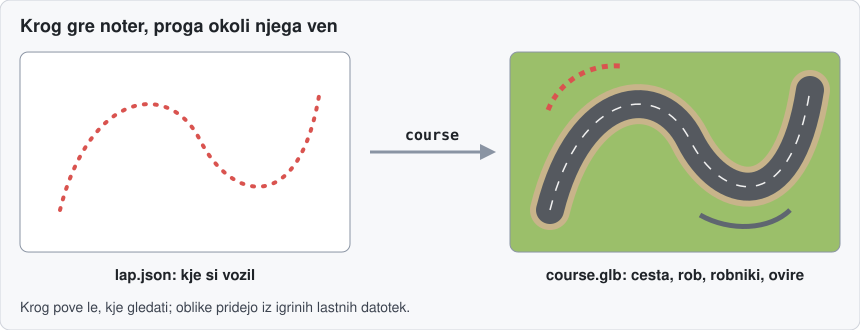
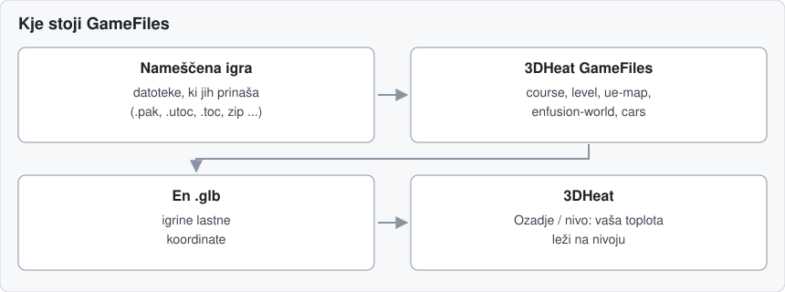

# 3DHeat GameFiles {#dheat-gamefiles}

**Kaj je to?** Orodje, ki iz datotek igre, ki jo že imaš nameščeno, zgradi 3D model dirkalne proge
ali ravni igre.

**Zakaj bi ga uporabil?** Pregledovalnik 3DHeat, kjer si vozil ali igral, prikaže kot toplotno sliko.
S tem orodjem jo prikaže na pravi progi ali ravni, ne na praznem prostoru.

**Primer:** vzemi krog, ki si ga vozil. Orodje okoli njega zgradi cesto in teren kot eno 3D datoteko,
da lahko pregledovalnik na pravi progi prikaže tvojo hitrost ali trke:



Še nisi vajen ukazne vrstice? Začni s [Preden začneš](before-you-start.md).

Podrobneje: bere podatke o ravni iz arhivov, ki jih igra prinese, in jih zapiše kot binarno datoteko
glTF (`.glb`). Njegovo glavno delo je **izvoz proge**: daš mu krog, zapiše pa teren, cesto, ki jo loči
od robu in trave, ter robnike, ovire, zidove iz gum, znake in stavbe okoli nje.

Je del [3DHeat](https://github.com/Holdi601/3DHeat), pregledovalnika za 3D toplotne zemljevide v
realnem času, analizo dirk in pregled tekem ([dokumentacija](https://holdi601.github.io/3DHeat/)).
Datoteke `.glb`, ki jih to orodje zapiše, so ravni, na katerih pregledovalnik riše toploto.



To je eden od treh načinov, kako geometrijo ravni spraviti v 3DHeat:

| Pot | Potrebuje | Daje |
|---|---|---|
| 3DHeat Unreal Exporter | projekt Unreal, odprt v urejevalniku | natančno geometrijo |
| 3DHeat GameCapture | zaslon in zajem | oceno |
| **3DHeat GameFiles** | **nameščeno, izdano igro** | **natančno geometrijo, brez projekta** |

Paket Python: `heat3d_gamefiles`. Repozitorij:
[Holdi601/3DHeat-GameFiles](https://github.com/Holdi601/3DHeat-GameFiles). Licenca: MIT.

## Kaj zmore {#what-it-can-do}

| Igra ali pogon | Izvoz proge (`course`) | Branje arhivov |
|---|---|---|
| Forza Horizon (ForzaTech) | da: teren, cesta in rob, tekstura tal, postavljeni modeli v svojih teksturah | `identify`, `list`, `extract` na `.minizip`; `identify` na `.modelbin`; modeli, teren in teksture prek `course` in `terrain` |
| BeamNG.drive | da: teren, nalepke cest, modelirane proge, postavljeni modeli, voda | `identify`, `list`, `extract` na zip-ih ravni; `identify` na `.ter`, `.cdae`; `.dae` prek `course` |
| Assetto Corsa Rally (Unreal 5.6) | da: ploščice terena etape, zapečena barva tal, postavljeni modeli v ravnih barvah | `identify`, `list`, `extract` na IoStore `.utoc`/`.ucas`; zen paketi, statične mreže, teksture prek `course` |
| Unreal `.pak` (različice 8-12) | ne | `identify`, `list`, `extract` |
| Unity (format 22 in novejši) | ne | `identify`, `meshes` |
| Battlefield 6 (Frostbite `.toc`/`.cas`) | brez kroga; celotna raven z `level`: teren, postavljene mreže, njihove barvne karte z `--textures` | `identify`, `levels`; paketi, mreže, teren, teksture in postavitev prek `level` |
| Source 2 `.vpk` | ne | `identify`, `list`, `extract` |
| Igre Unreal 5 World Partition | brez kroga; celotna karta z `ue-map` (našteta z `ue-maps`): teren, stavbe HLOD in rekviziti, voda | - |
| Arma Reforger (Enfusion) | brez kroga; ves svet z `enfusion-world` (našteta z `enfusion-worlds`): teren v svojih barvah, morje, stavbe kot škatle | - |
| Forza (avtomobili) | `cars`: vsak avtomobil v nizki podrobnosti, za zavihek Analiza dirke v pregledovalniku | - |

Kroge iz Assetto Corsa EVO in iRacinga zavrne z razlogom. Glej
[Omejitve in znane vrzeli](../limits-and-known-gaps.md).

## Namestitev {#install}

Še nisi vajen ukazne vrstice? Najprej preberi [Preden začneš](before-you-start.md).

Potrebuješ **Python 3.10 ali novejši** (razvito na 3.13) in pakete iz
[`requirements.txt`](https://github.com/Holdi601/3DHeat-GameFiles/blob/main/requirements.txt).

```
git clone https://github.com/Holdi601/3DHeat-GameFiles.git
cd 3DHeat-GameFiles
pip install -r requirements.txt
```

Nato preveri: `python -m heat3d_gamefiles --help`. Videti bi moral
`usage: heat3d_gamefiles [-h]` in seznam ukazov. Vsak ukaz zaženi iz mape repozitorija, kot
`python -m heat3d_gamefiles <ukaz>`.

| Paket | Za kaj |
|---|---|
| numpy | vse, kar dekodira geometrijo |
| lz4 | arhivi Forza (večinoma bloki LZ4), nekateri paketi Unity, bloki LZ4 IoStore |
| Pillow | dekodiranje tekstur BC1-BC7, zapis tekstur JPEG v `.glb` |
| msgpack, zstandard | sestavljene oblike BeamNG (`.cdae`) |
| cryptography | samo za odpiranje šifriranega `.pak` s ključem, ki ga že imaš |
| pytest | testi |

Vsebina Unreal, stisnjena z **Oodle**, potrebuje knjižnico Oodle, ki je že na tvojem računalniku.
Tega orodje nikoli ne prinaša. Glej [Oodle](../reader-oodle.md).

Orodje je napisano za Windows. Igre najde prek seznama knjižnic Steam in `%LOCALAPPDATA%`, knjižnico
Oodle pa naloži kot DLL za Windows. Druge platforme niso preizkušene.

## Hitri začetek {#quick-start}

**Datoteka kroga** je posnetek, kam je šel tvoj avto: seznam točk x, y, z. Pride iz
[3DHeat GameCapture](https://github.com/Holdi601/3DHeat-GameCapture) ali iz knjižnice krogov
aplikacije FH Companion; ročno vpisan CSV prav tako deluje ([Vhodi kroga](../lap-inputs.md)).

```
# Forza: datoteka kroga, mapa krogov ali ime proge iz knjižnice FH Companion
python -m heat3d_gamefiles course "Example Circuit"
python -m heat3d_gamefiles course path\to\lap.json -o course.glb

# BeamNG.drive ali Assetto Corsa Rally: datoteka heat3d-lap pove, iz katere igre je
python -m heat3d_gamefiles course my_lap.json

# Vsaka proga iz knjižnice FH Companion, po ena .glb
python -m heat3d_gamefiles courses -o courses

# Battlefield 6: najprej seznam ravni, nato izvozi eno (velika datoteka; glej Ukazi)
python -m heat3d_gamefiles levels
python -m heat3d_gamefiles level <level> -o level.glb --textures

# Unreal 5 World Partition in Arma Reforger: najprej seznam, nato izvoz
python -m heat3d_gamefiles ue-maps "<game>"
python -m heat3d_gamefiles ue-map "<game>" <map> -o map.glb
python -m heat3d_gamefiles enfusion-worlds
python -m heat3d_gamefiles enfusion-world <world> -o world.glb

# Vsak avtomobil Forza, za zavihek Analiza dirke v pregledovalniku
python -m heat3d_gamefiles cars -o forza.h3dcars

# Kaj je ta datoteka?
python -m heat3d_gamefiles identify some_archive.pak
```

Odpri `.glb` v pregledovalniku 3DHeat. Igrine lastne svetovne koordinate ostanejo
(glej [Format izhoda](../output-format.md)), zato se posnet krog poravna s progo.

## Zemljevid te dokumentacije {#map-of-this-documentation}

- [Preden začneš](before-you-start.md): Python, terminal, prvi ukaz.
- [Ukazi](../commands.md): vsak ukaz in možnost, s primeri.
- [Priročnik ukazov](../cli-reference.md): `--help` vsakega ukaza, ustvarjen iz kode.
- [Pregled arhivov](../inspecting-archives.md): `identify`, `list`, `extract`, `meshes`, korak za korakom.
- [Izvoz proge](../course-export.md): kako krog postane proga, za vse igre.
  - [Forza Horizon](../course-forza-horizon.md)
  - [BeamNG.drive](../course-beamng.md)
  - [Assetto Corsa Rally](../course-assetto-corsa-rally.md)
  - [Ravni podrobnosti in proračun](../detail-budget.md)
- [Cele ravni](../whole-levels.md): raven, karta ali svet brez kroga.
  - [Ravni Battlefield 6](../level-battlefield.md): `levels`, `level`
  - [Karte Unreal 5](../level-unreal-world-partition.md): `ue-maps`, `ue-map`
  - [Svetovi Arma Reforger](../level-arma-reforger.md): `enfusion-worlds`, `enfusion-world`
- [Avtomobili Forza](../forza-cars.md): `cars`, datoteka avtomobilov za zavihek Analiza dirke v pregledovalniku.
- [Vhodi kroga](../lap-inputs.md): vsaka oblika datoteke kroga, ki jo orodje sprejme.
- [Format izhoda](../output-format.md): kaj je v `.glb`.
- [Bralniki arhivov](../archive-readers.md): ena stran za vsak format vsebnika, kaj bere, česa ne, in zakaj.
- [Omejitve in znane vrzeli](../limits-and-known-gaps.md)
- [Odpravljanje težav](../troubleshooting.md): sporočila o napakah in kaj storiti.
- [Pravila in licence](../rules-and-licences.md): brez ključev, lastne datoteke, brez ponovnega deljenja.
- [Posodobitve](../updates.md): preverjanje posodobitev in `heat3d_update`.
- [Razvoj](../development.md): zemljevid modulov in testi, vključno s testi, ki tečejo proti nameščenim igram.
- [Vzdrževanje](../maintaining.md): kontrolni seznam izdaje za te strani.

## Del 3DHeat {#part-of-3dheat}

3DHeat GameFiles je eno od brezplačnih orodij okoli pregledovalnika 3DHeat:

| Orodje | Kaj počne | Dokumentacija |
|---|---|---|
| [3DHeat](https://github.com/Holdi601/3DHeat) | pregledovalnik: 3D toplotni zemljevidi, analiza dirk in pregled tekem v brskalniku | [spletno mesto](https://holdi601.github.io/3DHeat/) |
| [GameFiles](https://github.com/Holdi601/3DHeat-GameFiles) | proge in ravni iz datotek, ki jih igra prinese, kot `.glb` | [spletno mesto](https://holdi601.github.io/3DHeat-GameFiles/) |
| [GameCapture](https://github.com/Holdi601/3DHeat-GameCapture) | telemetrija krogov iz dirkalnih iger; ravni, obnovljene iz videoposnetka igre | [spletno mesto](https://holdi601.github.io/3DHeat-GameCapture/) |
| [Unreal Exporter](https://github.com/Holdi601/3DHeat-UnrealExporter) | vtičnik za urejevalnik Unreal, ki raven shrani kot `.glb` | [spletno mesto](https://holdi601.github.io/3DHeat-UnrealExporter/) |
| [CS2](https://github.com/Holdi601/3DHeat-CS2) | demoji Counter-Strike 2 v datoteke tekem; karte v `.glb` | [spletno mesto](https://holdi601.github.io/3DHeat-CS2/) |
| [Watcher](https://github.com/Holdi601/3DHeat-Watcher) | v ozadju beleži tvojo igro iz tega, kar igre objavijo | [spletno mesto](https://holdi601.github.io/3DHeat-Watcher/) |
| [Ext-WarThunder](https://github.com/Holdi601/3DHeat-Ext-WarThunder) | posnetki War Thunder v datoteke tekem | [spletno mesto](https://holdi601.github.io/3DHeat-Ext-WarThunder/) |
| [Ext-WoT](https://github.com/Holdi601/3DHeat-Ext-WoT) | posnetki World of Tanks v datoteke tekem | [spletno mesto](https://holdi601.github.io/3DHeat-Ext-WoT/) |
| [Ext-WoWs](https://github.com/Holdi601/3DHeat-Ext-WoWs) | posnetki World of Warships v datoteke tekem | [spletno mesto](https://holdi601.github.io/3DHeat-Ext-WoWs/) |
| [Ext-Squad](https://github.com/Holdi601/3DHeat-Ext-Squad) | demoji strežnikov Squad v datoteke tekem | [spletno mesto](https://holdi601.github.io/3DHeat-Ext-Squad/) |
| [Ext-DCS](https://github.com/Holdi601/3DHeat-Ext-DCS) | karte DCS World kot ravni `.glb` | [spletno mesto](https://holdi601.github.io/3DHeat-Ext-DCS/) |
| [Ext-IL2](https://github.com/Holdi601/3DHeat-Ext-IL2) | karte IL-2 Sturmovik kot ravni `.glb` | [spletno mesto](https://holdi601.github.io/3DHeat-Ext-IL2/) |

Datoteke tekem pregledovalnika so opisane na
[Ena datoteka na tekmo: `.3dheat`](https://holdi601.github.io/3DHeat/container.html);
raven, narejena tukaj, se naloži poleg njih na plošči Ozadje / nivo pregledovalnika.
