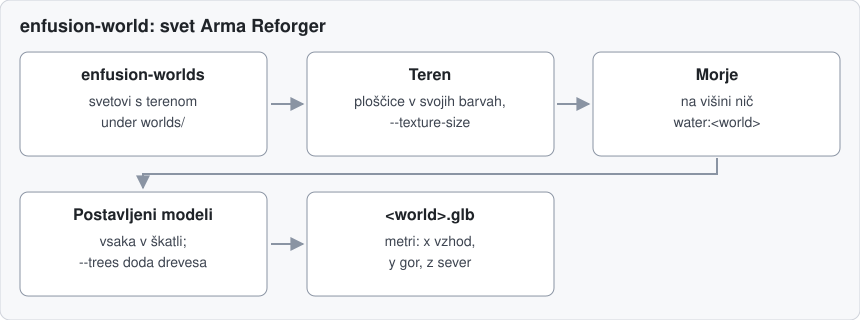

# Svetovi Arma Reforger: `enfusion-worlds` in `enfusion-world` {#arma-reforger-worlds-enfusion-worlds-and-enfusion-world}

**Kaj je to?** Ves svet Arma Reforger kot ena 3D datoteka. **Zakaj?** Da ima toplota iz igre pod seboj teren in stavbe. (*Enfusion* je pogon, s katerim je narejen Arma Reforger; *svet* je tisto, kar igra imenuje zemljevid.)

Izvozi ves svet Enfusion nameščene igre Arma Reforger: teren v barvah njegovih lastnih nadteksturnih ploščic, morje in vsak postavljen model kot škatlo, v igrinih lastnih metrih.



## Korak za korakom {#step-by-step}

1. **Izpišite svetove**, ki imajo teren:

   ```
   python -m heat3d_gamefiles enfusion-worlds
   python -m heat3d_gamefiles enfusion-worlds --install "D:\Games\Arma Reforger"
   ```

2. **Izvozite enega** po njegovi imenu mape pod `worlds/`, kot je izpisan:

   ```
   python -m heat3d_gamefiles enfusion-world <world> -o world.glb
   ```

3. **Različice:**

   ```
   python -m heat3d_gamefiles enfusion-world <world> --trees               # vegetation too, as boxes
   python -m heat3d_gamefiles enfusion-world <world> --texture-size 0      # flat colour, small file
   python -m heat3d_gamefiles enfusion-world <world> --ground-spacing 4 --no-structures
   ```

4. **Odprite `world.glb`** v panelu Ozadje / nivo pregledovalnika 3DHeat ([nalaganje nivojev](https://holdi601.github.io/3DHeat/levels.html)).

## Možnosti {#options}

| Možnost | Privzeto | Pomen |
|---|---|---|
| `<world>` | obvezno | svet, kot ga izpiše `enfusion-worlds` |
| `-o`, `--out FILE` | `<world>.glb` | datoteka, ki se zapiše |
| `--install FOLDER` | knjižnica Steam, ki vsebuje igro | mapa igre |
| `--ground-spacing METRES` | 2 (lastna vrednost terena) | razmik oglišč terena v datoteki |
| `--texture-size PIXELS` | 4096 | večja stranica slike barve tal; 0 za enobarvno |
| `--no-structures` | | izpusti postavljene modele |
| `--trees` | izklopljeno | postavi tudi drevesa in drugo rastlinje, kot škatle |

## Primer izpisa {#example-output}

```text
<world> -> world.glb
  ground      <n> triangles, <w> x <h> m; <n> of <n> tile-edge vertices disagree; colour <w> x <h>
  structure   <n> boxes from <n> entities
  water       <n> triangles (the sea)
  left out    <what>: <n>, ...
```

## Deli {#the-parts}

`ground:<world>` (teren), `water:<world>` (morje, na višini nič) in `structure:<world>` (škatle). Koordinate so igrine lastne: x vzhod, y navzgor, z sever, v metrih – to, kar poroča snemanje v igri. Koordinatni sistem igre je levosučen; *invert world axis* v pregledovalniku ga prikaže nezrcaljenega.

## Kako se bere in preverja {#how-it-is-read-and-checked}

Ni potreben Workbench in nič ni šifrirano.

| Format | Kaj je | Preverjeno proti |
|---|---|---|
| `.pak` | podatkovni chunk in drevo imenikov, shranjeno ali zlib | drevo natanko porabi svoj chunk; vzorčeni vnosi zlib se razširijo natanko na svojo navedeno velikost |
| `.edds` | glava DDS, nato za vsako raven mipa chunki `COPY` ali `LZ4 ` | razdeljene ravni se dekodirajo natanko v svojo velikost z natanko svojimi bajti |
| `.terr` / `.ttile` | glava in ploščice 16-bitnih višin | se vsak skupni rob ploščic ujema natanko |
| nadtekstura | barva tal vsake ploščice, približno en metar na piksel | se ujema z morjem v višinah; nobena obrnitev ali transpozicija se ne prilega bolje |
| `.ent` | imena, GUID-ji virov, nato entitete kot tipizirane vrednosti | datoteka sveta se razčleni do svojega zadnjega bajta |
| `resourceDatabase.rdb` | GUID v pot | skoraj vsak GUID, ki ga svet uporablja, poimenuje obstoječo datoteko |

Predmeti, označeni kot stoječi na absolutni višini, stojijo v centimetrih od dekodiranega terena (pri transponirani mreži bi bili nekaj metrov narobe). Ni narisano: lastni trikotniki modelov, drevesa privzeto (`--trees` jih doda kot škatle), otročji entiteti, jezera in reke, teksture s pred-DX10 glavami.

**Pogoji:** licenca igre dovoljuje nekomercialno uporabo in prepoveduje povratni inženiring datotek igre. Branje lastne namestitve je vaša odločitev po njej; izhod je za lastno uporabo in se ne deli.
