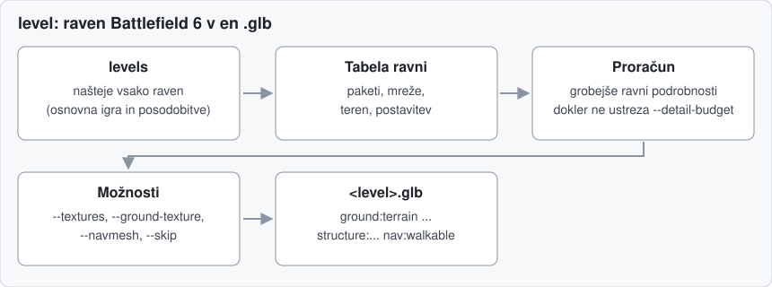

# Nivoji Battlefield 6: `levels` in `level` {#battlefield-6-levels-levels-and-level}

**Kaj je to?** Cel nivo Battlefield 6 kot ena 3D datoteka. **Zakaj?** Da ima toplota iz vaših tekem pod seboj teren in stavbe. (*Frostbite* je pogon, s katerim je narejen Battlefield; *višinska mreža* je teren, shranjen kot mreža višin.)

Izvozite celoten nivo Frostbite nameščene igre: višinsko mrežo terena, vsak mesh, ki ga postavijo njene skupine statičnih modelov, predmete, postavljene posamično, ozadje terena okoli zemljevida ter na zahtevo barvne mape površin, nalepke terena, vrisane v tla, in hodljive površine vojakov.



## Korak za korakom {#step-by-step}

1. **Izpišite nivoje**, ki jih igra ima:

   ```
   python -m heat3d_gamefiles levels
   python -m heat3d_gamefiles levels --install "D:\Games\<game folder>"
   ```

   Vsaka vrstica je tabela nivoja (`levels/<level>/<level>.toc`) z njeno velikostjo in od kod prihaja: `Data` za osnovno igro, `Update/<pack>` za posodobitev.

2. **Izvozite enega**, po njegovem imenu, enem edinstvenem delu imena ali njegovi poti `.toc`. Začnite brez barv, da vidite obliko in velikost:

   ```
   python -m heat3d_gamefiles level <level> -o level.glb
   ```

3. **Dodajte barvo**, ko izgleda prav:

   ```
   python -m heat3d_gamefiles level <level> -o level.glb --textures 512 --ground-texture 0.5
   ```

4. **Dodajte hodljive površine** ali zmanjšajte datoteko:

   ```
   python -m heat3d_gamefiles level <level> --textures 512 --ground-texture 0.5 --navmesh
   python -m heat3d_gamefiles level <level> --textures 256 --detail-budget 3000000 --ground-spacing 8
   ```

5. **Odprite `level.glb`** v panelu Ozadje / nivo pregledovalnika 3DHeat ([nalaganje nivojev](https://holdi601.github.io/3DHeat/levels.html)).

## Možnosti {#options}

| Možnost | Privzeto | Pomen |
|---|---|---|
| `<level>` | obvezno | ime, kot ga izpiše `levels`, edinstven del imena ali `.toc` nivoja |
| `-o`, `--out FILE` | `<level>.glb` | datoteka, ki se zapiše |
| `--install FOLDER` | najde se v knjižnicah Steam | mapa igre |
| `--textures [PIXELS]` | izklopljeno; 512 brez velikosti | barvna mapa vsake površine, največ PIXELS na stranico |
| `--ground-texture [METRES]` | izklopljeno; 0,5 brez velikosti | vžge ceste, ploščadi in označbe v barvo tal, METRES na piksel |
| `--navmesh` | izklopljeno | doda navigacijsko mrežo vojaka kot `nav:walkable` |
| `--ground-spacing METRES` | 4 | najfinejši razmik višinske mreže; 0 jo izpusti |
| `--detail-budget N` | najgrobljše kopije plus četrtina, vsaj 1.500.000 | zgornja meja trikotnikov (teren se nikoli ne poenostavi) |
| `--skip TEXT` | | izpusti skupine modelov, katerih ime particije vsebuje TEXT; lahko se ponovi |
| `--by-mesh` | izklopljeno | en del za vsak izvorni mesh in material, za iskanje, kaj je del |
| `--clamped-uvs` | izklopljeno | za upodabljalnike, ki ne morejo ponoviti teksture |

Popolna tabela, z velikostmi, ki jih je pričakovati (cel nivo je stotine MB), je na [Ukazi](commands.md#levels-and-level-frostbite). Kako se tabele, paketi, meshi in teren berejo, je na [Frostbite](reader-frostbite.md).

## Primer izpisa {#example-output}

Kaj izpiše `level`, v obrisih (vrstice, kot jih koda zapiše; `<n>` in imena se razlikujejo med nivoji):

```text
<n> copies of <n> meshes, from <n> static model groups
      <n>  <group>
      <n>  placed one by one (object and prefab references)
<n> meshes left out: <why>
<n> triangles, budget <n>; <n> meshes drawn at a coarser level to fit
           <n>  ground:terrain
           <n>  structure:buildings, <n> textures
           ...
<n> of <n> drawn sections carry their colour map; the rest are flat colours
Ground: <what the ground is>.
Navigation mesh: <tiles read>.
-> level.glb (<n> MB)
```

## Deli {#the-parts}

`ground:terrain` (višinska mreža), `ground:terrain backdrop` in `ground:terrain blend`, `structure:<kind>` za vsako vrsto mesha (po barvni mapi pri `--textures`, z ` (destructible)` za tisto, kar lahko tekma uniči), in `nav:walkable` pri `--navmesh`. Glejte [Oblika izhoda](output-format.md).

Datoteka vsebuje vsebino igre: namenjena je stroju, na katerem je nastala, ne za deljenje naprej ([Pravila in licence](rules-and-licences.md)).
