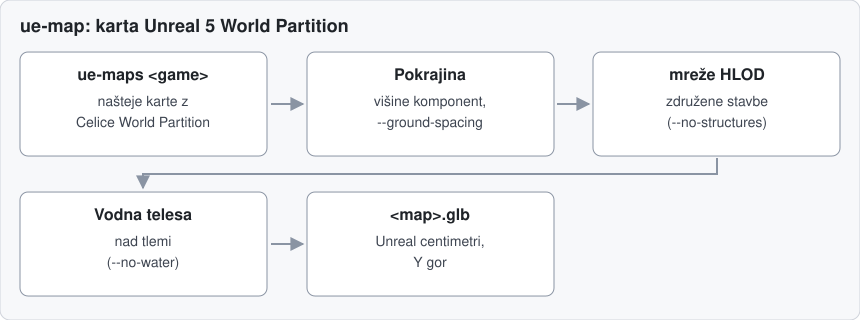

# Zemljevidi Unreal 5 World Partition: `ue-maps` in `ue-map` {#unreal-5-world-partition-maps-ue-maps-and-ue-map}

**Kaj je to?** Cel zemljevid igre Unreal 5 kot ena 3D datoteka: teren, stavbe in voda. **Zakaj?** Da ima toplota iz te igre pod seboj zemljevid. (*World Partition* je način, kako Unreal 5 razdeli velik zemljevid na kose; *HLOD* je poenostavljen nadomestek za skupino stavb, tisti, ki ga igra riše na daljavo.)

Izvozite celoten zemljevid igre Unreal 5, katere zemljevidi so prevedeni kot celice World Partition: krajino, združene HLOD mreže zemljevida (njegove stavbe in rekviziti, kakor jih igra riše na daljavo) in njegova vodna telesa. Ne potrebujete urejevalnika ne projekta, samo nameščeno igro.



## Korak za korakom {#step-by-step}

1. **Izpišite zemljevide.** `<game>` je mapa igre, njen `Content/Paks` ali ime njene mape v knjižnici Steam:

   ```
   python -m heat3d_gamefiles ue-maps "<Steam game folder name>"
   python -m heat3d_gamefiles ue-maps "D:\Games\<game>"
   ```

   Vsak zemljevid s prevedenimi celicami World Partition je izpisan s svojo potjo v paketu.

2. **Izvozite enega** po imenu ali edinstvenem delu imena:

   ```
   python -m heat3d_gamefiles ue-map "<game>" <map> -o map.glb
   ```

3. **Samo tla ali grobeje:**

   ```
   python -m heat3d_gamefiles ue-map "<game>" <map> --no-structures --no-water
   python -m heat3d_gamefiles ue-map "<game>" <map> --ground-spacing 4
   ```

4. **Odprite `map.glb`** v panelu Ozadje / nivo pregledovalnika 3DHeat ([nalaganje nivojev](https://holdi601.github.io/3DHeat/levels.html)).

## Možnosti {#options}

| Možnost | Privzeto | Pomen |
|---|---|---|
| `<game>` | obvezno | mapa igre, njen `Content/Paks` ali njeno ime mape v Steamu |
| `<map>` | obvezno | ime, kot ga izpiše `ue-maps`, ali edinstven del imena |
| `-o`, `--out FILE` | `<map>.glb` | datoteka, ki se zapiše |
| `--ground-spacing METRES` | 2 | razmik oglišč krajine, zaokrožen na celo število njenih lastnih kvadratov |
| `--no-structures` | | izpusti stavbe in rekvizite HLOD |
| `--no-water` | | izpusti vodna telesa |

Vsebina, stisnjena z Oodle, potrebuje knjižnico Oodle, ki je že na računalniku (glejte [Oodle](reader-oodle.md)).

## Primer izpisa {#example-output}

```text
<map> -> map.glb
  ground      <n> triangles from <n> landscape components; <n> of <n> vertices stored twice disagree
  structure   <n> triangles in <n> HLOD meshes
  water       <n> triangles from <n> water bodies
```

Število neskladij je samopreverjanje: sosednje komponente krajine shranijo svoj skupni rob dvakrat, in obe se morata ujemati. Zemljevid 3 km pri 2 m ima okoli 4,6 milijona trikotnikov tal.

## Deli {#the-parts}

`ground:<map>` (krajina), `structure:<map>` (mreže HLOD) in `water:<map>` (voda, ki stoji nad tlemi).

**Enote:** to je edini izvoz, **ki ni v metrih**: centimetri Unreal, z zamenjanima Y in Z (Y navzgor), koordinatni sistem, ki ga piše 3DHeat Unreal Exporter. Telemetrija iste igre uporablja isti koordinatni sistem, zato leži na zemljevidu.

## Kako se bere in preverja {#how-it-is-read-and-checked}

| Del | Prebrano iz | Preverjeno proti |
|---|---|---|
| tla | 16-bitna višinska mapa vsake komponente krajine, postavljena po bazi odseka na transformaciji krajine | vsako oglišče, shranjeno dvakrat (na šivu ali robu komponente), se mora ujemati; neskladja se preštejejo in izpišejo, ne zgladijo |
| struktura | združene HLOD mreže zemljevida, ki jih zgradi motor v svetovnem prostoru | mreža se obdrži, samo če meje, ki jih komponenta predpomni, opisujejo njene lastne oglišče |
| voda | mreža vsakega vodnega telesa, položena na mrežo tal, obdržana tam, kjer stoji nad tlemi | voda stoji nekaj metrov nad tlemi, kot reka nad svojo strugo |

Lastnosti krajine se najdejo po obliki, ne po številki reže (reže se premikajo med različicami motorja). Strukture so poenostavljeni nadomestki, ne polni modeli. Rastlinje, nalepke in materiali krajine se ne izvozijo; tla so brez teksture in osenčena v pregledovalniku. Podrobnosti arhiva: [Unreal 5 IoStore](reader-unreal-iostore.md).

**Vaše lastne datoteke:** zemljevid se prebere iz igre, nameščene na vašem računalniku, in zapiše na vaš disk za vašo lastno analizo; nič iz igre ni priloženo temu orodju.
