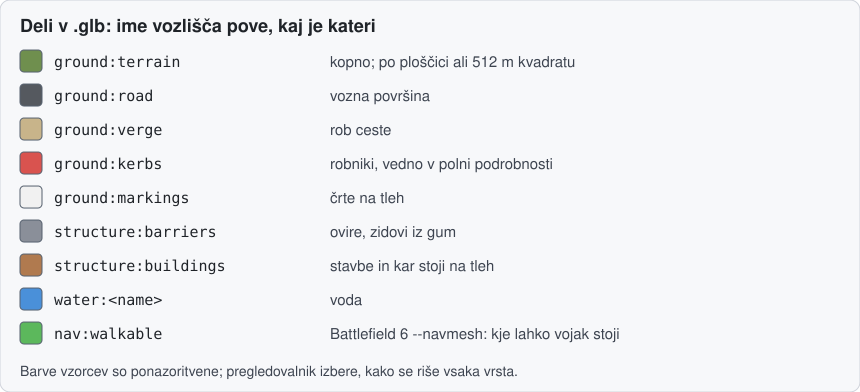

# Oblika izhoda {#output-format}

Datoteka `.glb` je ena 3D datoteka: tla, zgradbe in voda proge ali nivoja, ki jo odprete v
razdelku Ozadje / nivo v pregledovalniku 3DHeat.

Vsak izvoz (`course`, `courses`, `terrain`, `level`, `ue-map`, `enfusion-world`) zapiše eno
**binarno datoteko glTF 2.0** (`.glb`). Namerno je majhna in ravna ter je razporejena tako, kot
pregledovalnik 3DHeat bere nivo. Vir:
[`glb.py`](https://github.com/Holdi601/3DHeat-GameFiles/blob/main/heat3d_gamefiles/glb.py).

## Zgradba {#structure}

```
scene 0
 ├─ node "ground:terrain x-2046 z1023"  -> mesh 0 -> 1 primitive, material 0
 ├─ node "ground:road x-2046 z1023"     -> mesh 1 -> 1 primitive, material 1
 ├─ node "ground:markings"               -> mesh 2 -> ...
 ├─ node "ground:kerbs road_gen_rum_..." -> ...
 ├─ node "structure:barriers bar_armco_bclr"
 └─ ...
```

- **Eno vozlišče na del**, vsa na korenu prizora, **brez transformacij**. Vsa geometrija je
  že v svetovnem prostoru.
- Vsako vozlišče ima svojo mrežo z **enim primitivom** in svoj material. Vozlišče, mreža in
  material nosijo vsi ime dela.
- Vsak primitiv ima **svoje kompaktne tabele oglišč**, samo oglišča, ki jih del uporablja.
  Skupna tabela oglišč je v glTF dovoljena, toda bralnik, ki razširi tabele vsakega primitiva,
  bi imel potem vsako oglišče enkrat za vsak del.
- `asset.generator` je `heat3d_gamefiles`.
- **Malo `extras`** in nobenega imena proge, igre ali steze:
  - del uničljive mreže Battlefield 6 nosi `{"destructible": true}` na svojem vozlišču;
  - tečaj Forza pove, kaj vsebuje, v `asset.extras` (različica formata, ujeti ID poti,
    koliko kopij lastnega sloja dirke, prizorišča; glejte
    [Tečaji Forza Horizon](course-forza-horizon.md#writing-the-file)), njegovi vklopljeni deli pa
    nosijo svoj sloj na vozlišču: `{"layer": "event", "route": <id>}` za lastni sloj dirke,
    `{"layer": "layer"}` za drug vklopljen sloj, `{"layer": "venue"}` za tla prizorišča.

  Vse drugo, kar pregledovalnik potrebuje, je v imenih vozlišč.

## Razvrstitev po imenih vozlišč {#node-names-the-classification}



Pregledovalnik določi razred dela iz imena **vozlišča** (če ga ni, iz imena mreže), in to samo, če
se ujema z

```
^(ground|structure|water)\s*[:|]
```

Vse drugo se razvrsti s heuristiko, napisano za pokrajine Unreal. Zato se vsak del, ki ga
izvoznik zapiše, začne z eno od teh predpon ali z `nav:` (spodaj).

| Predpona | Pomen | Zapisani deli |
|---|---|---|
| `ground:` | voznu površino in zemljo | `ground:road`, `ground:verge`, `ground:terrain`, `ground:gravel and dirt`, `ground:kerbs`, `ground:markings`, `ground:tyre marks`, `ground:venue`, `ground:plinths` |
| `structure:` | kar stoji na njej | `structure:barriers`, `structure:props`, `structure:signs`, `structure:buildings`, `structure:infrastructure`, `structure:bridges`, `structure:rocks`, `structure:smashables`, `structure:trees`; sloji Forza `structure:event_<category>` in `structure:layer_<category>` |
| `water:` | voda | `water:water`; `water:<map>` (`ue-map`), `water:<world>` (`enfusion-world`) |
| `nav:` | kje lahko vojak hodi (Battlefield 6, samo `--navmesh`) | `nav:walkable` |

`nav:` se ne ujema z zgornjim vzorcem pregledovalnika, zato ga pregledovalnik razvrsti s svojo heuristiko;
je ločen del, da ga lahko prikažete ali skrijete samostojno. `ue-map` zapiše `ground:<map>`,
`structure:<map>` in `water:<map>`; `enfusion-world` zapiše `ground:<world>`,
`structure:<world>` in `water:<world>`.

Za vrsto pride, odvisno od igre:

| Primer | Pomen |
|---|---|
| `ground:road x-2046 z1023` | tla Forze v ploščici terena z imenom `x-2046 z1023` (mrežne enote, 1023 na 512 m) |
| `ground:road 3_-2` | tla BeamNG v kvadratu 512 m (3, -2) |
| `ground:road 3_-2 asphalt_light` | modelirana vozna površina BeamNG z materialom `asphalt_light` v tem kvadratu |
| `ground:road 1_-4` | tla AC Rally v kvadratu 512 m (1, -4) prostora Unreal |
| `structure:barriers bar_armco_bclr` | postavljeni modeli Forze, ki delijo eno teksturo (njihovo ime brez GUID) |
| `structure:barriers` | postavljeni modeli brez teksture (Forza, AC Rally) |
| `structure:event_barriers bar_example_bclr` | Forza: to, kar ujeta dirka postavi zase, ločeno od sveta proste vožnje (dodatni podatki vozlišča `{"layer": "event", "route": <id>}`) |
| `structure:layer_props` | Forza: sloj, ki ga igra vklopi za nekaj drugega kot to dirko (dejavnost, zbiralni predmet, izvajalni sloj) |
| `ground:venue`, `ground:plinths` | Forza: modeli že v svetovnih koordinatah - lastna tla prizorišča (tla stadiona) in tla, s katerimi je okrašena ulica |
| `structure:barriers armco_metal` | postavljeni modeli BeamNG enega materiala |
| `ground:markings`, `water:water` | ravni deli, eden za vso datoteko |
| `ground:terrain` (Battlefield 6) | višinski model; `ground:terrain backdrop` daljni mrežni teren, `ground:terrain blend` mreže, ki se stapljajo s terenom |
| `nav:walkable` (Battlefield 6, `--navmesh`) | navigacijska mreža nivoja za vojaka: kjer lahko stoji, ravno zeleno |
| `ground:terrain x-512 z-512` (Battlefield 6, `--ground-texture`) | višinski model pod eno zapečeno ploščico decalov, poimenovano po nizkem kotu ploščice v metrih |
| `structure:buildings t_concreteclean_01_cs` (Battlefield 6, `--textures`) | vsaka površina te vrste, ki kaže ta barvni zemljevid; brez `--textures` en del na vrsto, brez pripone |
| `structure:buildings t_concreteclean_01_cs (destructible)` (Battlefield 6) | isto, za mreže, ki jih lahko ujemanje podre: tiste z lastnim sredstvom za uničenje z enakim imenom (zidovi, hiše, rekviziti). Vozlišče nosi tudi dodatne podatke glTF `{"destructible": true}`. Njena uničena stanja niso izvožena |

Pregledovalnik lahko filtrira po teh imenih. Na primer, "samo vozna površina dirke" je
`ground:road` skupaj z `ground:kerbs`, v vseh treh igrah, "svet brez lastnih rekvizitov dirke"
pa je vse razen `structure:event_*`. Predpona je tudi način, kako pregledovalnik riše del: tla kot
površino, na kateri leži toplota, struktura kot to, kar stoji na njej.

## Enote, osi in okvir {#units-axes-and-frame}

- **Metri, y navzgor**, konvencija glTF, za vsak izvoz razen `ue-map`. Nič se ne preračuna ali
  centrira na novo: številke so svetovne koordinate igre, kar je smisel branja arhiva namesto
  rekonstruiranja.
- **Zemljevidi Unreal 5 (`ue-map`): centimetri**, lastna enota Unreal, z zamenjanima Y in Z,
  tako da je Y navzgor - okvir, ki ga zapisuje izvoznik Unreal 3DHeat in ga uporablja telemetrija
  igre. Edini izvoz, ki ni v metrih.
- **Arma Reforger (`enfusion-world`):** lastni metri igre, x proti vzhodu, y navzgor, z proti
  severu. Levičevni okvir igre; nastavitev pregledovalnika *invert world axis* pokaže, da ni zrcaljeno.
- **Forza:** svetovne koordinate igre (x, y navzgor, z), nespremenjene. Enake so kakor njena
  telemetrija, zato posneti lap leži na tečaju.
- **BeamNG.drive:** `(x, z, -y)` svetovnega sistema BeamNG z osjo Z navzgor, kar je rotacija, ki
  jo uporabi snemalnik telemetrije. Rotacija, ne zrcaljenje.
- **Battlefield 6:** svetovne koordinate igre (x, y navzgor, z), nespremenjene: transformacije
  primerkov nivoja se uporabijo za vsako mrežo, kakor je shranjena. Zrcaljene kopije se ponovno
  navijejo, da njihove normale kažejo navzven.
- **Assetto Corsa Rally:** okvir lapa. Centimetri Unreal postanejo metri, z Unreal Z postane y,
  Unreal X in Y pa postaneta x in z v eni od osmih usmeritev, ki jo je lap ujel (glejte
  [Assetto Corsa Rally](course-assetto-corsa-rally.md#which-stage-and-which-way-round)).
  Trikotniki se ponovno navijejo tam, kjer preslikava zrcali.

Vsak izvoz ohrani osi, ki jih uporablja njegova telemetrija, zato posnetek in nivo delita okvir.
Ali je ta okvir v vsaki igri levičeven ali desničeven, ni preverjeno.

## Podatki oglišč {#vertex-data}

Privzeta je **kvantizirana** oblika (`quantize=True`). Potrebuje razširitev
`KHR_mesh_quantization`, ki je navedena tako v `extensionsUsed` kot v `extensionsRequired`.

| Atribut | Kvantizirano (privzeto) | Polna natančnost (`quantize=False`) |
|---|---|---|
| `POSITION` | float32 VEC3, z min/max | float32 VEC3 |
| `NORMAL` | int8 VEC3 normalizirano, zapolnjeno do 4 bajtov (korak 4) | float32 VEC3 |
| `TEXCOORD_0` (samo teksturirani deli) | uint16 VEC2 normalizirano, omejeno na 0-1; float32 VEC2, kjer se teksture ponavljajo (Battlefield 6) | float32 VEC2 |
| `COLOR_0` (netexturirani deli, kadar ima kateri del barvo) | uint8 VEC3 normalizirano, zapolnjeno do 4 bajtov | float32 VEC3 |
| indeksi | uint16, kadar ima del največ 65.535 oglišč, sicer uint32 | uint32 |

Oglišče je 20 bajtov namesto 32 (24 namesto 44 z barvo). To vzame tretjino vsaki datoteki in
to loči, ali se mestni tečaj naloži v brskalniku ali ne. Cena je manj kot pol stopinje normale
in 1/65.535 UV (petnajstina texela pri 4.096 px). Ukazna vrstica vedno zapiše kvantizirano
obliko. `write_glb(..., quantize=False)` v Pythonu zapiše drugo.

Normale pridejo iz igre, kjer jih igra shranjuje (teren in modeli Forze, oblike in teren BeamNG).
Sicer se izračunajo kot gladke normale, utežene s ploščino, iz trikotnikov. Normale AC Rally se
vedno izračunajo.

## Materiali, barve in teksture {#materials-colours-and-textures}

- Vsak material je `metallicFactor 0`, `roughnessFactor 1`.
- **Teksturiran del:** `baseColorTexture` s sliko dela, UV in brez barve oglišč. glTF ju
  pomnoži, sicer bi bila površina dvakrat potemnjena.
- **Netexturiran del:** barva oglišč `COLOR_0` z enotno barvo dela in belim `baseColorFactor`. Če
  nobeden del v datoteki nima barve, `COLOR_0` ni. Kjer deli delijo oglišča, zmaga barva kasnejšega
  dela, zato se ravni deli pišejo v naraščajočem vrstnem redu pomembnosti.
- **Slike** so vdelane v binarni blok kot **JPEG**, kakovost 90, brez podvzorčenja barv, samo RGB
  (alfa se izpusti) - razen zemljevida izrezov Battlefield 6 (listi, ograje), ki je **PNG** z
  alfo, na materialu z `alphaMode` MASK, `alphaCutoff` 0,5 in `doubleSided` (glejte
  [Frostbite](reader-frostbite.md#textures-and-materials)). Pregledovalnik zavrže texele pod mejo. Tekstura
  2048 px iz trave in krošenj je za brezizgubni zapisovalnik šum: več megabajtov na ploščico kot PNG,
  pod enim kot JPEG. Slika, ki si jo deli več delov, je shranjena enkrat.
- En vzorčilnik za vse teksture: linearno povečanje, linearno-mipmap-linear zmanjšanje, **pritrditev
  na rob** v obeh oseh, za izvoze tečajev, katerih teksture pokrijejo površine enkrat. BeamNG riše
  ponavljajoče se teksture modelov kot ploske barve (glejte [BeamNG.drive](course-beamng.md#placed-models)).
- Battlefield 6 izvoz z `--textures`, katerega materiali se popločijo, zapiše igrine lastne teksturne
  koordinate, neomejene, kot float32 `TEXCOORD_0` tudi v kvantizirani obliki, z vzorčilnikom, ki se
  **ponavlja** v obeh oseh (`write_glb(..., repeat=True)`): zidna opeka je en par trikotnikov, katerega
  UV teče od 0 do 40. Pregledovalnik 3DHeat ovije takšno teksturo znotraj svojega atlasa (glejte njegovo stran
  *Model levels*). Za upodabljalnik, ki teksture ne more ponoviti, `level --clamped-uvs`
  (`write_level(..., clamped=True)`) razreže vsak trikotnik vzdolž črt, kjer se tekstura ponavlja, in vsak
  kos premakne v 0..1: iste piksle na isti površini, približno petina več trikotnikov. Trikotniki, čez
  katere se tekstura ponovi več kot 16-krat, obdržijo svoje koordinate. Trikotnik, ki bi ga njegova
  tekstura razrezala na več kot 4 kose - lubje, ki se ponavlja po vsaki veji drevesa, zaradi česar je
  razrez spremenil 1.099 trikotnikov enega drevesa v 51.735 - gre v svoj del, `<part> (average colour)`,
  v povprečni barvi teksture; `level` pove, koliko jih je.

| Tekstura | Velikost | Pokriva |
|---|---|---|
| tla (vse igre razen Battlefield 6) | `--texture-size`: 2048, 1024 ali 512 px | en kvadrat 512 m: 25, 50 ali 100 cm na piko |
| Battlefield 6 višinski model | največji mip barvnega zemljevida ozadja v nivoju, obrezan | kvadrat terena: 32 m na piko v preverjenem nivoju |
| Battlefield 6 površine | `--textures`: največ toliko px na stran | lastna tekstura površine, enkrat na kos (rezana tam, kjer se ponavlja) |
| Battlefield 6 zapečena tla | `--ground-texture`: metri na piko, ploščice največ 4.096 px | ena ploščica razširitve decalov: 2.048 m pri 0,5 m na piko |
| Forza postavljen model | največ 256 px | lastna postavitev UV modela |
| BeamNG postavljen model | največ 256 px | lastna postavitev UV modela, samo kjer se ne ponavlja |
| AC Rally postavljen model | brez | ploske barve |

## Kaj zapisovalnik zavrne {#what-the-writer-refuses}

`write_glb` vrže napako, namesto da bi zapisal datoteko, ki bi jo pregledovalnik odprl in prikazal napačno:

| Zavrnjeno | Zato ker |
|---|---|
| položaji niso N x 3 ali niso končni | pokvarjena mreža |
| indeks za koncem seznama oglišč | se izriše kot šum |
| teksturiran del, ko datoteka nima UV | se izriše kot en razmazan piksel |
| sploh brez trikotnikov | se izriše kot nič |
| polje normal, barv ali UV napačne dolžine ali ni končno | potrebna je ena vrednost na oglišče |

## Branje drugje {#reading-it-elsewhere}

Vsak bralnik glTF 2.0, ki podpira `KHR_mesh_quantization`, bi moral odpreti te datoteke. Preverjen
je samo pregledovalnik 3DHeat; drugi pregledovalniki niso preverjeni. Bralnik brez razširitve datoteke zavrne, ker
je označena kot zahtevana. Datoteke so lahko velike: okoli 80 MB za državni krog, do nekaj sto MB za
mestni tečaj s samodejnim proračunom.

## V 3DHeat {#in-3dheat}

Naložite `.glb` v razdelku Ozadje / nivo pregledovalnika [3DHeat](https://github.com/Holdi601/3DHeat); telemetrija,
ki jo posnamete v isti igri, leži na njem, ker oba ohranjata koordinate igre. Lastna dokumentacija pregledovalnika
([holdi601.github.io/3DHeat](https://holdi601.github.io/3DHeat/)) pokriva razdelek Ozadje / nivo in datoteke
tekem, ki jih zapisujejo drugi orodji ([One file a match: `.3dheat`](https://holdi601.github.io/3DHeat/container.html)).
Nivo ni shranjen v vsaki datoteki `.3dheat`: tekma ga imenuje v svojih `references` (`kind: "level"`, ime
in sha256), `.glb` pa ostane ob tekmah.
