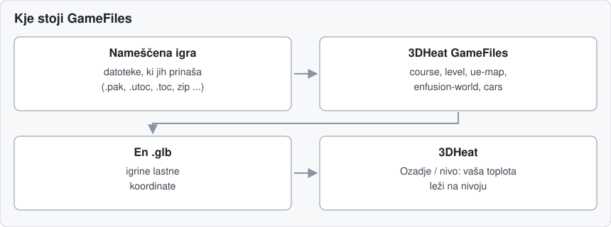

# Celi nivoji {#whole-levels}

**Preprosto povedano:** za streljačine in druge igre brez krogov orodje shrani celoten zemljevid kot eno 3D-datoteko, da lahko pregledovalnik nariše, kje so igralci hodili po njem.

`course` izreže tla okoli kroga. Za igre brez krogov orodje izvozi celoten nivo, zemljevid ali svet naenkrat:

| Igra ali pogon | Seznam | Izvoz | Stran |
|---|---|---|---|
| Battlefield 6 (Frostbite) | `levels` | `level <level>` | [Nivoji Battlefield 6](level-battlefield.md) |
| Igre Unreal 5 z World Partition | `ue-maps <game>` | `ue-map <game> <map>` | [Zemljevidi Unreal 5](level-unreal-world-partition.md) |
| Arma Reforger (Enfusion) | `enfusion-worlds` | `enfusion-world <world>` | [Svetovi Arma Reforger](level-arma-reforger.md) |

Vsak par deluje enako: prvi ukaz izpiše, kaj ima nameščena igra, drugi pa enega od teh zapiše kot eno datoteko `.glb` v lastnih svetovnih koordinatah igre, tako da položaji, zabeleženi v tisti igri, ležijo na njem. Deli se imenujejo `ground:`, `structure:` in `water:` kot pri vseh drugih izvozih (glejte [Oblika izhoda](output-format.md)). Datoteko naložite v panel Ozadje / nivo pregledovalnika 3DHeat.

