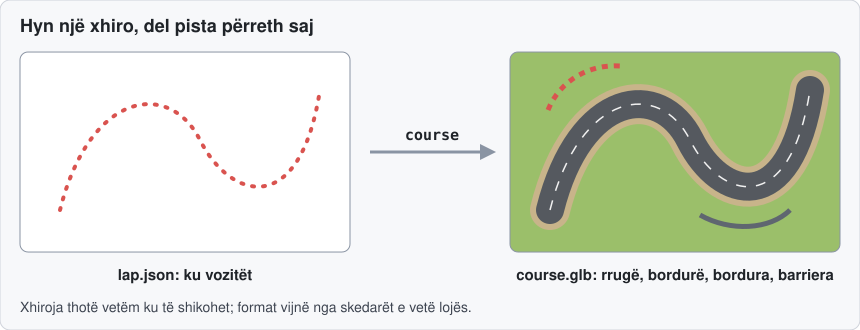
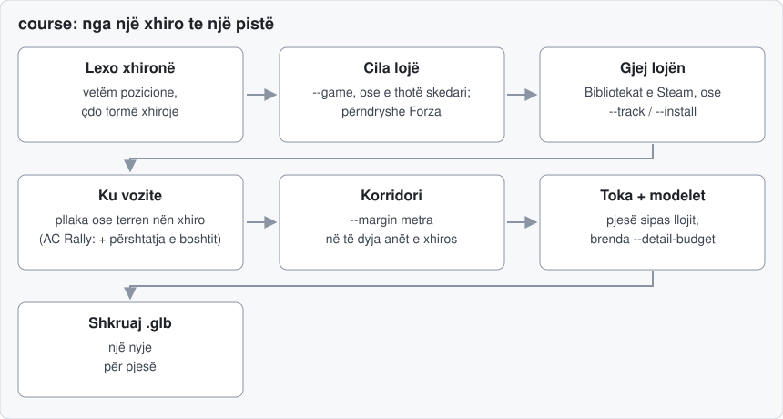

# Eksporti i kursit {#course-export}

**Me fjalë të thjeshta:** ti ke vozitur një xhiro; ky mjet ndërton pistën ku ke vozitur, si
një skedar 3D. Xhiroja është vetëm një vijë pikash; rruga, bari dhe bordurat vijnë nga
skedarët e vetë lojës.

`course` e kthen një xhiro në një kurs: tokën në një brez nga të dyja anët e vendit ku shkoi
makina, dhe çfarë qëndron mbi atë tokë, si një `.glb` për shikuesin. Kjo faqe
mbulon çfarë ndajnë të tria lojërat e mbështetura. Faqet nën të mbulojnë çfarë
ndryshon:

- [Forza Horizon](course-forza-horizon.md): arkivat `.minizip` të ForzaTech
- [BeamNG.drive](course-beamng.md): arkivat zip, një fushë lartësish terreni, forma të përpiluara
- [Assetto Corsa Rally](course-assetto-corsa-rally.md): Unreal 5 IoStore, një etapë World Partition
- [Nivelet e detajit dhe buxheti](detail-budget.md): sa trekëndësha marrin modelet e vendosura dhe cilat kopje mbeten

## Hapat {#the-steps}

Fjalët e përdorura më poshtë: një **kornizë** (frame) është nga cila anë shkojnë akset; **korridori** është
brezi i tokës nga të dyja anët e xhiros; një **pllakë** (tile) është një copë katrore e terrenit
të një loje; një **LOD** (nivel detaji) është një nga kopjet më të thjeshta të një modeli.

1. **Lexo xhiron.** Vetëm pozicionet, nga cilado nga format në
   [Hyrjet e xhiros](lap-inputs.md). Shpejtësia dhe komandat nuk përdoren. Një xhiro me më pak
   se dy mostra refuzohet ("holds no driving").
2. **Vendos lojën.** `--game`, pastaj `game` i vetë skedarit të xhiros, pastaj Forza (shih
   [Komandat](commands.md#which-game)).
3. **Gjej lojën e instaluar.** Të tria kërkojnë në çdo bibliotekë Steam të listuar në
   `config\libraryfolders.vdf` të Steam. Forza kërkon edhe në `C:\XboxGames`.
   `--track` (Forza) ose `--install` (BeamNG, AC Rally) e kapërcen kërkimin.
4. **Gjej ku u vozit xhiroja.** Kjo nuk vendoset kurrë vetëm nga përputhja e një emri.
   Forza zgjedh pistën pllakat e terrenit të së cilës mbulojnë xhiron. BeamNG zgjedh
   nivelin terreni (ose rrugët) e të cilit i përmbajnë mostrat e xhiros. AC Rally provon çdo
   etapë në tetë orientime akesh dhe zgjedh atë që e vë pjesën më të madhe të
   xhiros në rrugë.
5. **Pri një korridor** `--margin` metra nga të dyja anët e vozitjes (më poshtë).
6. **Ndërto tokën** brenda korridorit, të klasifikuar si rrugë, buzë, zhavorr dhe
   dhé, terren, shenja, gjurmë gomash ose ujë, dhe piq një teksturë toke për
   çdo katror 512 m.
7. **Vendos modelet** që qëndrojnë në korridor, sipas kategorisë, me një nivel
   detaji të zgjedhur sipas largësisë dhe një buxheti trekëndëshash.
8. **Shkruaj `.glb`**: një nyje e emërtuar për çdo pjesë. Shih [Formati i daljes](output-format.md).

Çfarë printon një ekzekutim - këtu në një instalim sintetik BeamNG.drive që e ndërtojnë testet,
një xhiro 50 m poshtë një shirit rruge:

## Korridori {#the-corridor}

Prerja është një brez rreth vijës së vozitur, jo kutia kufizuese e xhiros. Për një
qark të mbyllur të dyja janë pothuajse të njëjta. Për një sprint nga një pikë te tjetra kutia është kryesisht
shpat kodre ku nuk kalon njeri, dhe brezi mund të jetë një e dhjeta e sipërfaqes së saj. Burimi:
[`corridor.py`](https://github.com/Holdi601/3DHeat-GameFiles/blob/main/heat3d_gamefiles/corridor.py).

Si ndërtohet:

- Vozitja projektohet në planin e tokës: x dhe z e xhiros
  (BeamNG: x dhe y e kornizës së vetë lojës).
- Rasterizohet në një rrjetë me qeliza **4 m** (`CELL`). Çdo qelizë që e prek vozitja
  zgjerohet me një disk me rreze `margin + 4 m` në çdo drejtim.
- Mostrat e njëpasnjëshme më pak se **50 m** larg (`JOIN`) bashkohen me pika çdo
  4 m, që brezi të mos ketë boshllëqe. Mostrat më larg trajtohen si
  tërheqje të ndara vozitjeje dhe nuk bashkohen. Një kurs biblioteke është shumë skedarë xhiroje
  njëri pas tjetrit, dhe fundi i një sprinti me fillimin e tjetrit nuk duhet të vizatojë
  një brez nëpër hartë.
- Një trekëndësh mbahet nëse ndonjë cep, mesi i ndonjë brinje, ose qendra e tij
  qëndron në brez. Pikat e mesit kapin një trekëndësh të madh që shtrihet përtej një brezi
  të ngushtë me të gjitha cepat jashtë.
- Lartësia nuk është kurrë pjesë e prerjes. Një kuti që kufizonte lartësinë do ta priste
  tokën nën një kodër ku ngjitet rruga.

Konsola raporton sipërfaqen e korridorit, për shembull
`cutting 80 m either side of the driving: 1.53 km2 of a 6,000 by 3,600 m box`.

BeamNG dhe AC Rally ndërtojnë edhe një korridor më të gjerë **arritjeje** (reach) me `margin + 60 m`. Një
model i vendosur merret parasysh nëse origjina e tij qëndron në korridorin e arritjes, dhe vizatohet
vetëm nëse gjurma e tij prek korridorin e vërtetë. Kështu një objekt i gjatë origjina e të cilit
është pak jashtë brezit nuk humbet. BeamNG e përdor korridorin e arritjes edhe
për të zgjedhur cilat decal-e rruge të lyejë.

## Nga çfarë përbëhet toka {#what-the-ground-is-made-of}

Çdo eksport i klasifikon trekëndëshat e tokës në të njëjtat lloje, dhe çdo lloj
shkruhet si pjesë më vete, që shikuesi ta shfaqë ose fshehë:

| Lloji | Emri i pjesës | Ngjyra e sheshtë (RGB lineare) | Forza | BeamNG | AC Rally |
|---|---|---|---|---|---|
| rrugë | `ground:road` | 0.22, 0.22, 0.23 | shiritat e rrugës: pjesa asfalt | shtresat e llojit `ASPHALT`, decal-et e rrugës, rruga e modeluar | pllakat e pistës (`/MeshesTrack/`) |
| buzë | `ground:verge` | 0.52, 0.47, 0.30 | shiritat e rrugës: bankina | trotuaret dhe modelet e buzës | - |
| zhavorr dhe dhé | `ground:gravel and dirt` | 0.50, 0.42, 0.30 | - | shtresat dhe decal-et e dheut, zhavorrit, rërës, baltës | - |
| terren | `ground:terrain` | 0.30, 0.44, 0.18 | gjithçka tjetër | gjithçka tjetër | pllakat `_Terrain` dhe terreni i largët |
| bordura | `ground:kerbs` | 0.60, 0.12, 0.10 (Forza) | objektet `road_gen_rum*` | modelet kerb, curb dhe rumble | modelet kerb dhe curb |
| shenja | `ground:markings` | 0.90, 0.90, 0.88 | nën-rrjetat decal, ngritur 5 cm | lyhen në teksturë | - |
| gjurmë gomash | `ground:tyre marks` | 0.20, 0.17, 0.16 | nën-rrjetat decal, ngritur 5 cm | lyhen në teksturë | - |
| ujë | `water:water` | 0.16, 0.34, 0.48 | materialet e ujit | plani i detit, blloqet e ujit, lumenjtë | - |

Ngjyrat e sheshta janë zgjedhur të lexohen me një shikim, jo të përputhen me lojën. Përdoren
për pjesët pa teksturë dhe nga shikuesit që i injorojnë teksturat. Burimi:
[`surfaces.py`](https://github.com/Holdi601/3DHeat-GameFiles/blob/main/heat3d_gamefiles/surfaces.py).

Pjesët e tokës ndahen për çdo katror 512 m, dhe çdo katror mbart imazhin e vet të pjekur,
prandaj emrat e pjesëve mbajnë katrorin:

| Loja | Emri i pjesës së tokës | Çelësi i katrorit |
|---|---|---|
| Forza | `ground:road x-2046 z1023` | emri i rrjetës së pllakës së terrenit (hapa prej 1023, shih [Forza Horizon](course-forza-horizon.md)) |
| BeamNG | `ground:road 3_-2` | `floor(x / 512)`, `floor(y / 512)` në metra BeamNG |
| AC Rally | `ground:road 1_-4` | `floor(x / 51200)`, `floor(y / 51200)` në centimetra Unreal |

## Çfarë qëndron mbi të {#what-stands-on-it}

Modelet e vendosura shkruhen në pjesë me emra `structure:<category>`, ose
`ground:kerbs` për bordurat (në të tria lojërat). Kur një pjesë ka teksturën e vet,
emri i teksturës ose i materialit pason kategorinë, për shembull
`structure:barriers bar_armco_bclr`.

| Kategoria | Forza | BeamNG | AC Rally |
|---|---|---|---|
| barriera | po | po | po |
| objekte (props) | po | po | po |
| tabela | po | po | po |
| ndërtesa | po (zëvendësues të ndërtesës së plotë ku i ka loja) | po | po |
| infrastrukturë | po | po | po |
| ura | po | po | (klasifikohen si infrastrukturë) |
| shkëmbinj | po | po | po |
| bordura | po, si tokë | po, si tokë | po, si tokë |
| pemë | me `--trees` | me `--trees` | me `--trees` |
| gjëra të thyeshme | me `--trees` | - | - |

Mënyra si ndahet detaji është e njëjtë në të tria. Kopjet brenda 25 m nga
vozitja fillojnë me detaj të plotë, kopjet 25-60 m larg një nivel më të trashë, dhe kopjet
më larg me nivelin më të trashë. Pastaj modelet më të kushtueshme zbresin derisa një
buxhet trekëndëshash të futet, dhe ku edhe nivelet më të trasha nuk futen në një buxhet që ti jep,
kopjet lihen jashtë. Bordurat nuk thjeshtohen e nuk lihen jashtë kurrë. Shih
[Nivelet e detajit dhe buxheti](detail-budget.md).

## Opsionet që e formësojnë rezultatin {#options-that-shape-the-result}

| Dua | Përdor |
|---|---|
| një skedar më të vogël | `--no-textures` (ngjyra të sheshta), `--texture-size 1024` ose `512`, `--detail-budget N`, `--margin 40` |
| vetëm tokën | `--no-placed` |
| edhe peizazhin | `--trees` |
| një stinë tjetër (Forza) | `--season winter` |
| një lojë jashtë Steam | `--track` (Forza) ose `--install` (BeamNG, AC Rally) |
| një xhiro që kërkimi nuk e vendos | `--level` (BeamNG, AC Rally), `--track` (Forza) |

## Koordinatat {#coordinates}

Çdo eksport shkruan metra me Y lart, në një kornizë me të cilën përputhet një xhiro e regjistruar e të njëjtës lojë:

| Loja | Korniza e shkruar |
|---|---|
| Forza | koordinatat e vetë lojës së botës, të pandryshuara |
| BeamNG | `(x, z, -y)` i botës Z-lart të BeamNG, që është rrotullimi që aplikon regjistruesi i telemetrisë |
| AC Rally | korniza e xhiros, e gjetur me përshtatje: centimetrat Unreal bëhen metra, dhe X e Y të Unreal bëhen x dhe z e xhiros në cilindo nga tetë orientimet që përputhet |

Shih [Formati i daljes](output-format.md).
