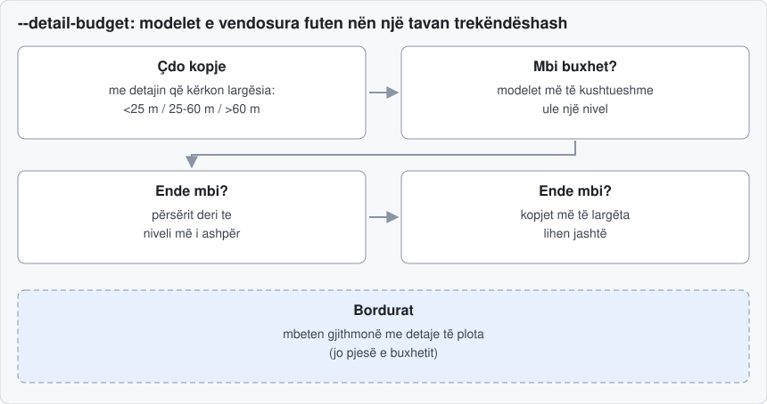

# Nivelet e detajit dhe buxheti {#levels-of-detail-and-the-budget}

Një **trekëndësh** është një copë e vogël e sheshtë e një modeli 3D. Më shumë trekëndësha do të thotë një
skedar më i madh e më i ngadaltë. **Buxheti** është një kufi se sa shumë. Një **nivel
detaji** është një kopje më e thjeshtë e një modeli, që përdoret kur është larg.

Niveli më i imët i gjithçkaje të vendosur rreth një qarku është disa milionë
trekëndësha. Për shembull, qindra segmente parmaku mbrojtës dhe grumbuj gomash me rreth
një mijë trekëndësha secili. Një korridor qyteti mban mbi njëqind mijë kopje. Prandaj çdo
eksport kursi u jep modeleve të vendosura një **buxhet trekëndëshash** dhe vendos, për çdo
model, në cilin nivel detaji vizatohet, dhe, nëse duhet, cilat kopje të lihen
jashtë.

Skema u shkrua për Forza
([`forzaplacement.py`](https://github.com/Holdi601/3DHeat-GameFiles/blob/main/heat3d_gamefiles/forzaplacement.py):
`choose_levels`, `auto_budget`, `_fit`), dhe BeamNG e AC Rally ripërdorin pjesët e saj.
Terreni nuk llogaritet në buxhet.

## Brezat e largësisë {#distance-bands}

Largësia e çdo kopjeje nga vozitja matet në planin e tokës, deri te
mostra më e afërt e xhiros. Xhiroja rrallohet më parë në më së shumti 1,000 pika, që kushton
disa metra saktësi dhe asgjë që ka rëndësi këtu. Pastaj kopjet bien në
tre breza, dhe çdo çift (model, brez) buxhetohet veçmas:

| Brezi | Largësia | Fillon me |
|---|---|---|
| afër | nën 25 m (`NEAR`) | nivelin më të imët |
| mes | 25-60 m (`FAR`) | një nivel më të trashë |
| larg | 60 m e më shumë | nivelin më të trashë |

Pa një rrugë (Forza `terrain --box`), largësia matet deri te mesi i
kutisë.

## Zbritja për t'u futur {#stepping-down-to-fit}



Kostoja e një hyrjeje (model, brez) është kopje x trekëndësha në nivelin e saj aktual.
Ndërsa totali është mbi buxhet, hyrja që kushton më shumë zbret një nivel,
dhe kjo përsëritet derisa totali të futet ose asgjë të mos mund të zbresë më tej. Hyrjet e fiksuara
nuk zbresin kurrë:

| Loja | E fiksuar me detaj të plotë |
|---|---|
| Forza | bordurat (`road_gen_rum*`) |
| BeamNG | bordurat, dhe çdo formë që mban sipërfaqe vozitjeje |
| AC Rally | bordurat |

Përmbledhja e Forza e raporton këtë si
`N of M models drawn at a coarser level to fit the budget`.

## Buxheti automatik {#the-automatic-budget}

Pa `--detail-budget`, buxheti e llogarit vetë madhësinë që **asnjë kopje të mos lihet
jashtë**:

```
budget = max(1,500,000, 1.25 x sum(copies x coarsest level))
```

Hyrjet e fiksuara llogariten me nivelin e tyre më të imët. 25% (`HEADROOM`) lejon që gjërat
pranë rrugës të mbajnë pak detaj. Në një qark fshati kjo është pragu 1.5 milion
(`DEFAULT_BUDGET`). Në një kurs qyteti, ku korridori mban mbi njëqind mijë
kopje, rritet
mbi dhjetë milionë, dhe skedari në disa qindra MB. Shikuesi e ngarkon.

## Një buxhet që e jep ti {#a-budget-you-give}

`--detail-budget N` është një **tavan**. Nivelet zbresin si më sipër. Nëse edhe nivelet
më të trasha nuk futen, kopjet lihen jashtë:

| Loja | Rendi në të cilin lihen jashtë kopjet |
|---|---|
| Forza | së pari gjithçka 25 m ose më larg nga vozitja, pastaj ç'qëndron pranë rrugës; brenda çdo grupi, ajo që duket më e vogla nga rruga së pari: largësia / madhësia më e madhe (madhësia = diagonalja e kutisë kufizuese të modelit shumëzuar me shkallën e tij më të madhe, të paktën 0.25 m) |
| BeamNG | më të largëtat nga vozitja së pari |
| AC Rally | më të largëtat nga vozitja së pari, si BeamNG |
| Battlefield 6 | më të voglat së pari: diagonalja e kutisë kufizuese shumëzuar me shkallën |

Bordurat (dhe, për BeamNG, modelet e sipërfaqes së vozitjes) nuk lihen kurrë jashtë, prandaj një buxhet
më i vogël se sa kushtojnë ato vetë tejkalohet prej tyre dhe prej asgjëje tjetër.

Mjeti përdor largësinë mbi madhësinë për Forza sepse, nëse renditet vetëm sipas largësisë, një
njësi kondicioneri në një mur nëntë metra larg mbijeton më gjatë se fasada njëzet metra e
gjerë ku është varur, dymbëdhjetë metra larg. Gjërat pranë rrugës shkojnë të fundit sido që
të jetë madhësia, sepse një barrierë tre metra pesë metra nga vija është buza e
pistës, ndërsa një ndërtesë pesëdhjetë metra gjatë gjashtëdhjetë metra më prapa është peizazh.

Përmbledhja raporton
`N of M copies left out to fit the budget, the smallest and furthest from the driving first (--detail-budget raises it)`
(Forza), ose `N copies left out to fit the budget, the furthest from the driving first (--detail-budget raises it)`
(BeamNG, AC Rally).

## Ndërtesa të plota (Forza) {#whole-buildings-forza}

Një zëvendësues ndërtese të plotë llogaritet si një kopje, në një largësi të matur deri te
brinja më e afërt e ndërtesës. Mbahet ose lihet jashtë si një e tërë. Pjesët modulare që
ai i zëvendëson nuk buxhetohen fare. Shih
[Forza Horizon](course-forza-horizon.md#buildings-drawn-whole).

## Çfarë është një nivel detaji, sipas lojës {#what-a-level-of-detail-is-per-game}

| Loja | Nivelet vijnë nga |
|---|---|
| Forza | maska e nivelit për çdo trekëndësh e nën-rrjetave `Mesh` të modelit (biti `level + 1`); `0xFFFF` vetëm copa të thyeshme për një model pa nivel të shënuar |
| BeamNG | `details` e formës `.cdae` me madhësi jo-negative, më e madhja së pari; për `.dae`, numri në fund të emrave të nyjeve të rrjetës (`barrier75`, `barrier40`) |
| AC Rally | nivelet e detajit të ruajtura të rrjetës statike, më i imëti së pari |
| Battlefield 6 | nivelet e detajit të MeshSet, më i imëti së pari, duke numëruar vetëm seksionet e vizatuara (jo kopjet e hijes dhe vetëm-thellësisë), dhe jo një nivel të fundit që është zëvendësues pamjeje të largët (materialet `M_LastLod`, `M_Billboard`, `M_Vista`: rrjeta e një pilioni bëhet një thumb i plotë) |

`level` i Battlefield 6 nuk ka xhiro, prandaj nuk ka breza largësie: çdo rrjetë është
një hyrje, çdo kopje në të njëjtin nivel. Buxheti automatik është formula
e mësipërme me sfondin e terrenit të fiksuar; fusha e lartësive është jashtë buxhetit
dhe madhësia e saj caktohet nga `--ground-spacing`. Nën një buxhet që e jep ti, kur çdo rrjetë
është në nivelin më të trashë, kopjet lihen jashtë më të voglat së pari, madhësia është diagonalja e
kutisë kufizuese të rrjetës shumëzuar me shkallën e kopjes, pasi nuk ka vozitje nga
të matet largësia. Sfondi i terrenit nuk lihet kurrë jashtë. Një nivel arrin
rreth dhjetë milionë trekëndësha automatikisht.

## Zgjedhja e një numri {#choosing-a-number}

| Ti do | Provo |
|---|---|
| gjithçka, detaj të plotë pranë rrugës | lëre automatik |
| një skedar disa herë më të vogël | `--detail-budget 500000` me `--texture-size 1024` |
| vetëm tokën | `--no-placed` (nuk përfshihet buxhet) |
