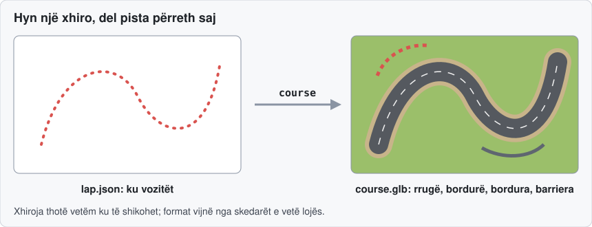
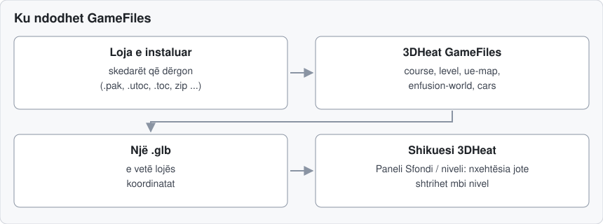

# 3DHeat GameFiles {#dheat-gamefiles}

**Çfarë është?** Një mjet që ndërton një model 3D të një pisteje garash ose të një niveli loje
nga skedarët e një loje që e ke tashmë të instaluar.

**Pse ta përdor?** Shikuesi 3DHeat e ngjyros me nxehtësi ku ke vozitur ose luajtur.
Me këtë mjet e ngjyros mbi pistën ose nivelin e vërtetë, jo mbi hapësirë të zbrazët.

**Shembull:** merr një xhiro që ke vozitur. Mjeti ndërton rrugën dhe tokën përreth saj
si një skedar 3D, që shikuesi të mund të ngjyrosë shpejtësinë ose përplasjet e tua mbi pistën e vërtetë:



Je i ri me rreshtin e komandave? Fillo me [Para se të fillosh](before-you-start.md).

Më në detaje: lexon të dhënat e niveleve nga arkivat që dërgon një lojë dhe i shkruan
si skedar binar glTF (`.glb`). Detyra e tij kryesore është **eksporti i pistës** (course): i jep
një xhiro, dhe ai shkruan tokën, rrugën të dallueshme nga bordura dhe bari, dhe
bordurat, barrierat, muret e gomave, shenjat dhe ndërtesat përreth.

Është pjesë e [3DHeat](https://github.com/Holdi601/3DHeat), një shikuesi për
harta nxehtësie 3D të telemetrisë në kohë reale, analizë gare dhe rishikim ndeshjesh
([dokumentacioni](https://holdi601.github.io/3DHeat/)). Skedarët `.glb` që shkruan ky
mjet janë nivelet mbi të cilat shikuesi vizaton nxehtësinë.



Është një nga tri mënyrat për ta futur gjeometrinë e një niveli në 3DHeat:

| Rruga | Kërkon | Jep |
|---|---|---|
| 3DHeat Unreal Exporter | projektin Unreal të hapur në editor | gjeometri të saktë |
| 3DHeat GameCapture | një ekran dhe një kapje | një vlerësim |
| **3DHeat GameFiles** | **lojën e instaluar, siç dërgohet** | **gjeometri të saktë, pa projekt** |

Paketa Python: `heat3d_gamefiles`. Depoja:
[Holdi601/3DHeat-GameFiles](https://github.com/Holdi601/3DHeat-GameFiles). Licenca: MIT.

## Çfarë mund të bëjë {#what-it-can-do}

| Loja ose motori | Eksporti i pistës (`course`) | Leximi i arkivave |
|---|---|---|
| Forza Horizon (ForzaTech) | po: terren, rrugë dhe bordurë, teksturë toke, modele të vendosura në teksturat e tyre | `identify`, `list`, `extract` mbi një `.minizip`; `identify` mbi një `.modelbin`; modele, terren dhe tekstura përmes `course` dhe `terrain` |
| BeamNG.drive | po: terren, decal rrugësh, qarqe të modeluara, modele të vendosura, ujë | `identify`, `list`, `extract` mbi zip-e nivelesh; `identify` mbi `.ter`, `.cdae`; `.dae` përmes `course` |
| Assetto Corsa Rally (Unreal 5.6) | po: pllaka toke të etapës, ngjyrë toke e pjekur, modele të vendosura në ngjyra të sheshta | `identify`, `list`, `extract` mbi IoStore `.utoc`/`.ucas`; paketa zen, mesh statikë, tekstura përmes `course` |
| Unreal `.pak` (versionet 8-12) | jo | `identify`, `list`, `extract` |
| Unity (formati 22 e më vonë) | jo | `identify`, `meshes` |
| Battlefield 6 (Frostbite `.toc`/`.cas`) | pa xhiro; një nivel i tërë me `level`: terren, mesh të vendosur, hartat e ngjyrave të tyre me `--textures` | `identify`, `levels`; bundle-t, mesh-et, terreni, teksturat dhe vendosja përmes `level` |
| Source 2 `.vpk` | jo | `identify`, `list`, `extract` |
| Lojëra Unreal 5 World Partition | pa xhiro; një hartë e tërë me `ue-map` (listuar nga `ue-maps`): peizazh, ndërtesa dhe objekte HLOD, ujë | - |
| Arma Reforger (Enfusion) | pa xhiro; një botë e tërë me `enfusion-world` (listuar nga `enfusion-worlds`): terren në ngjyrat e tij, deti, ndërtesat si kuti | - |
| Forza (makina) | `cars`: çdo makinë me detaje të ulëta, për skedën Analiza e garës të shikuesit | - |

Xhirot nga Assetto Corsa EVO dhe iRacing refuzohen me një arsye. Shih
[Kufizimet dhe boshllëqet e njohura](limits-and-known-gaps.md).

## Instalimi {#install}

Je i ri me rreshtin e komandave? Lexo së pari [Para se të fillosh](before-you-start.md).

Të duhet **Python 3.10 ose më i ri** (zhvilluar në 3.13) dhe paketat në
[`requirements.txt`](https://github.com/Holdi601/3DHeat-GameFiles/blob/main/requirements.txt).

```
git clone https://github.com/Holdi601/3DHeat-GameFiles.git
cd 3DHeat-GameFiles
pip install -r requirements.txt
```

Pastaj kontrollo: `python -m heat3d_gamefiles --help`. Duhet të shohësh
`usage: heat3d_gamefiles [-h]` dhe listën e foljeve (verb). Ekzekuto çdo komandë nga
dosja e depos, si `python -m heat3d_gamefiles <verb>`.

| Paketa | Përdoret për |
|---|---|
| numpy | gjithçka që dekodon gjeometri |
| lz4 | arkivat e Forza (kryesisht blloqe LZ4), disa bundle-t e Unity, blloqet LZ4 të IoStore |
| Pillow | dekodimin e teksturave BC1-BC7, shkrimin e teksturave JPEG në `.glb` |
| msgpack, zstandard | format e përpiluara të BeamNG (`.cdae`) |
| cryptography | vetëm për hapjen e një `.pak` të enkriptuar me një çelës që e ke tashmë |
| pytest | testet |

Përmbajtja Unreal e ngjeshur me **Oodle** kërkon një bibliotekë Oodle që është tashmë
në kompjuterin tënd. Një të tillë ky mjet nuk e dërgon kurrë. Shih [Oodle](reader-oodle.md).

Mjeti është shkruar për Windows. I gjen lojërat përmes listës së bibliotekave të Steam dhe
`%LOCALAPPDATA%`, dhe e ngarkon Oodle si DLL të Windows. Platformat e tjera nuk janë
provuar.

## Fillimi i shpejtë {#quick-start}

Një **skedar xhiroje** (lap file) është një regjistrim i ku shkoi makina jote: një listë pikash x, y, z.
Vjen nga [3DHeat GameCapture](https://github.com/Holdi601/3DHeat-GameCapture)
ose nga biblioteka e xhirove e aplikacionit FH Companion; funksionon edhe një CSV e shkruar me dorë
([Hyrjet e xhiros](lap-inputs.md)).

```
# Forza: a lap file, a lap folder, or a course name from the FH Companion library
python -m heat3d_gamefiles course "Example Circuit"
python -m heat3d_gamefiles course path\to\lap.json -o course.glb

# BeamNG.drive or Assetto Corsa Rally: a heat3d-lap file says which game it is from
python -m heat3d_gamefiles course my_lap.json

# Every course in the FH Companion library, one .glb each
python -m heat3d_gamefiles courses -o courses

# Battlefield 6: list the levels, then export one (a large file; see Commands)
python -m heat3d_gamefiles levels
python -m heat3d_gamefiles level <level> -o level.glb --textures

# Unreal 5 World Partition and Arma Reforger: list, then export
python -m heat3d_gamefiles ue-maps "<game>"
python -m heat3d_gamefiles ue-map "<game>" <map> -o map.glb
python -m heat3d_gamefiles enfusion-worlds
python -m heat3d_gamefiles enfusion-world <world> -o world.glb

# Every Forza car, for the viewer's race tab
python -m heat3d_gamefiles cars -o forza.h3dcars

# What is this file?
python -m heat3d_gamefiles identify some_archive.pak
```

Hape `.glb` në shikuesin 3DHeat. Koordinatat e vetë botës së lojës ruhen
(shih [Formati i daljes](output-format.md)), kështu që një xhiro e regjistruar përputhet me pistën.

## Harta e këtij dokumentacioni {#map-of-this-documentation}

- [Para se të fillosh](before-you-start.md): Python, një terminal, komanda e parë.
- [Komandat](commands.md): çdo folje dhe opsion, me shembuj.
- [Referenca e komandave](../cli-reference.md): `--help` i çdo foljeje, e gjeneruar nga kodi.
- [Inspektimi i arkivave](inspecting-archives.md): `identify`, `list`, `extract`, `meshes`, hap pas hapi.
- [Eksporti i pistës](course-export.md): si një xhiro bëhet pistë, për të gjitha lojërat.
  - [Forza Horizon](course-forza-horizon.md)
  - [BeamNG.drive](course-beamng.md)
  - [Assetto Corsa Rally](course-assetto-corsa-rally.md)
  - [Nivelet e detajeve dhe buxheti](detail-budget.md)
- [Nivele të plota](whole-levels.md): një nivel, hartë ose botë pa xhiro.
  - [Nivelet e Battlefield 6](level-battlefield.md): `levels`, `level`
  - [Hartat Unreal 5](level-unreal-world-partition.md): `ue-maps`, `ue-map`
  - [Botët e Arma Reforger](level-arma-reforger.md): `enfusion-worlds`, `enfusion-world`
- [Makinat e Forza](forza-cars.md): `cars`, skedari i makinave për skedën Analiza e garës të shikuesit.
- [Hyrjet e xhiros](lap-inputs.md): çdo formë skedari xhiroje që pranon mjeti.
- [Formati i daljes](output-format.md): çfarë ka brenda `.glb`.
- [Lexuesit e arkivave](archive-readers.md): një faqe për çdo format kontejneri, që mbulon
  çfarë lexon secili, çfarë jo, dhe pse.
- [Kufizimet dhe boshllëqet e njohura](limits-and-known-gaps.md)
- [Zgjidhja e problemeve](troubleshooting.md): mesazhet e gabimit dhe çfarë të bëhet.
- [Rregullat dhe licencat](rules-and-licences.md): pa çelësa, skedarët e tu, pa ripërhapje.
- [Përditësimet](updates.md): kontrolli i përditësimeve dhe `heat3d_update`.
- [Zhvillimi](development.md): harta e moduleve dhe testet, përfshirë testet që ekzekutohen mbi lojëra të instaluara.
- [Mirëmbajtja](maintaining.md): lista e kontrollit të botimit për këto faqe.

## Pjesë e 3DHeat {#part-of-3dheat}

3DHeat GameFiles është një nga mjetet falas përreth shikuesit 3DHeat:

| Mjeti | Çfarë bën | Dokumentet |
|---|---|---|
| [3DHeat](https://github.com/Holdi601/3DHeat) | shikuesi: harta nxehtësie 3D, analizë gare dhe rishikim ndeshjesh në shfletues | [faqja](https://holdi601.github.io/3DHeat/) |
| [GameFiles](https://github.com/Holdi601/3DHeat-GameFiles) | piste dhe nivele nga skedarët që dërgon një lojë, si `.glb` | [faqja](https://holdi601.github.io/3DHeat-GameFiles/) |
| [GameCapture](https://github.com/Holdi601/3DHeat-GameCapture) | telemetri xhirosh nga lojëra garash; nivele të rindërtuara nga video loje | [faqja](https://holdi601.github.io/3DHeat-GameCapture/) |
| [Unreal Exporter](https://github.com/Holdi601/3DHeat-UnrealExporter) | një shtojcë e Unreal Editor që ruan një nivel si `.glb` | [faqja](https://holdi601.github.io/3DHeat-UnrealExporter/) |
| [CS2](https://github.com/Holdi601/3DHeat-CS2) | demo të Counter-Strike 2 në skedarë ndeshjesh; harta në `.glb` | [faqja](https://holdi601.github.io/3DHeat-CS2/) |
| [Watcher](https://github.com/Holdi601/3DHeat-Watcher) | regjistron lojën tënde në sfond nga ajo që botojnë lojërat | [faqja](https://holdi601.github.io/3DHeat-Watcher/) |
| [Ext-WarThunder](https://github.com/Holdi601/3DHeat-Ext-WarThunder) | riluajtje të War Thunder në skedarë ndeshjesh | [faqja](https://holdi601.github.io/3DHeat-Ext-WarThunder/) |
| [Ext-WoT](https://github.com/Holdi601/3DHeat-Ext-WoT) | riluajtje të World of Tanks në skedarë ndeshjesh | [faqja](https://holdi601.github.io/3DHeat-Ext-WoT/) |
| [Ext-WoWs](https://github.com/Holdi601/3DHeat-Ext-WoWs) | riluajtje të World of Warships në skedarë ndeshjesh | [faqja](https://holdi601.github.io/3DHeat-Ext-WoWs/) |
| [Ext-Squad](https://github.com/Holdi601/3DHeat-Ext-Squad) | demo serveri të Squad në skedarë ndeshjesh | [faqja](https://holdi601.github.io/3DHeat-Ext-Squad/) |
| [Ext-DCS](https://github.com/Holdi601/3DHeat-Ext-DCS) | harta të DCS World në nivele `.glb` | [faqja](https://holdi601.github.io/3DHeat-Ext-DCS/) |
| [Ext-IL2](https://github.com/Holdi601/3DHeat-Ext-IL2) | harta të IL-2 Sturmovik në nivele `.glb` | [faqja](https://holdi601.github.io/3DHeat-Ext-IL2/) |

Çdo lexues loje është një projekt i vogël më vete, me skedarin e vet të licencës, versionet e veta dhe gjurmuesin e vet të problemeve, që të mund të instalohet, përditësohet, mirëmbahet - ose tërhiqet me kërkesë të një mbajtësi të drejtash - më vete, pa prekur shikuesin apo mjetet e tjera.

Skedarët e ndeshjeve të shikuesit përshkruhen te
[One file a match: `.3dheat`](https://holdi601.github.io/3DHeat/container.html);
një nivel i bërë këtu ngarkohet pranë tyre te paneli Sfondi / niveli i shikuesit.
