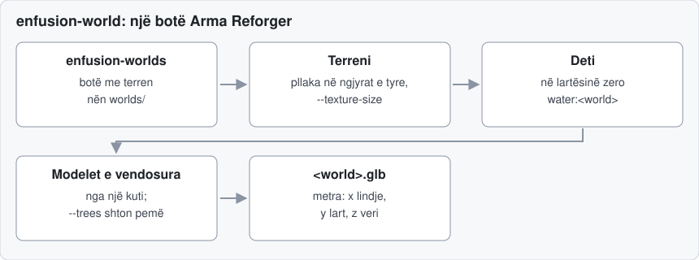

# Botët e Arma Reforger: `enfusion-worlds` dhe `enfusion-world` {#arma-reforger-worlds-enfusion-worlds-and-enfusion-world}

**Çfarë është?** Një botë e plotë e Arma Reforger si një skedar 3D. **Pse?** Që heat
nga loja të ketë tokën dhe ndërtesat poshtë. (*Enfusion* është
motori me të cilin është bërë Arma Reforger; një *botë* është ajo që loja e quan hartë.)

Eksporton një botë të plotë Enfusion të Arma Reforger të instaluar: terrenin në
ngjyrat e pllakave të veta të supertexture, detin, dhe çdo model të vendosur si
kuti, në metrat e vetë lojës.



## Hap pas hapi {#step-by-step}

1. **Liston botët** që kanë terren:

   ```
   python -m heat3d_gamefiles enfusion-worlds
   python -m heat3d_gamefiles enfusion-worlds --install "D:\Games\Arma Reforger"
   ```

2. **Eksporto një**, sipas emrit të dosjes së saj nën `worlds/` siç listohet:

   ```
   python -m heat3d_gamefiles enfusion-world <world> -o world.glb
   ```

3. **Variante:**

   ```
   python -m heat3d_gamefiles enfusion-world <world> --trees               # vegetation too, as boxes
   python -m heat3d_gamefiles enfusion-world <world> --texture-size 0      # flat colour, small file
   python -m heat3d_gamefiles enfusion-world <world> --ground-spacing 4 --no-structures
   ```

4. **Hap `world.glb`** në panelin Sfondi / niveli të shikuesit 3DHeat ([ngarkimi i një niveli](https://holdi601.github.io/3DHeat/levels.html)).

## Opsionet {#options}

| Opsioni | Parazgjedhja | Kuptimi |
|---|---|---|
| `<world>` | e detyrueshme | një botë siç e printon `enfusion-worlds` |
| `-o`, `--out FILE` | `<world>.glb` (në `$HEAT3D_LEVELS/<game>/` kur kjo është caktuar) | skedari për t'u shkruar |
| `--install FOLDER` | biblioteka Steam që mban lojën | dosja e lojës |
| `--ground-spacing METRES` | 2 (ajo e vetë terrenit) | hapësira e kulmeve të terrenit në skedar |
| `--texture-size PIXELS` | 4096 | ana më e madhe e imazhit të ngjyrës së tokës; 0 për ngjyrë të sheshtë |
| `--no-structures` | | lë jashtë modelet e vendosura |
| `--trees` | joaktiv | vendos edhe pemë dhe bimësi tjetër, si kuti |

## Dalja shembull {#example-output}

```text
<world> -> world.glb
  ground      <n> triangles, <w> x <h> m; <n> of <n> tile-edge vertices disagree; colour <w> x <h>
  structure   <n> boxes from <n> entities
  water       <n> triangles (the sea)
  left out    <what>: <n>, ...
```

## Pjesët {#the-parts}

`ground:<world>` (terreni), `water:<world>` (deti, në lartësi zero) dhe
`structure:<world>` (kutitë). Koordinatat janë ato të vetë lojës: x lindje, y lart,
z veri, në metra - çfarë raporton një regjistrim brenda lojës. Korniza e lojës është
e dorës së majtë; *invert world axis* në shikues e tregon të papasqyruar.

## Si lexohet dhe kontrollohet {#how-it-is-read-and-checked}

Nuk nevojitet Workbench dhe asgjë nuk është e enkriptuar.

| Formati | Çfarë është | Kontrolluar kundrejt |
|---|---|---|
| `.pak` | një copë të dhënash dhe një pemë direktorie, hyrje të ruajtura ose zlib | pema e përdor copën saktësisht; hyrjet zlib të mostruara zgjerohen saktësisht në madhësinë e thënë |
| `.edds` | një kokë DDS, pastaj për çdo nivel mip copa `COPY` ose `LZ4 ` | nivelet e copëzuara dekodohen saktësisht në madhësinë e tyre duke përdorur saktësisht bajtet e tyre |
| `.terr` / `.ttile` | një kokë dhe pllaka lartësish 16-bit | çdo skaj i përbashkët i pllakave përputhet saktësisht |
| supertexture | ngjyra e tokës e çdo pllake, rreth një metër për piksel | përputhet me detin në lartësi; asnjë përmbysje ose transpozim nuk përshtatet njësoj mirë |
| `.ent` | emra, GUID-e burimesh, pastaj entitete si vlera të tipizuara | një skedar bote lexohet deri në bajtin e fundit |
| `resourceDatabase.rdb` | GUID në shteg | pothuajse çdo GUID që përdor një botë emërton një skedar që ekziston |

Objektet e shënuara si të vendosura në lartësi absolute qëndrojnë brenda centimetrash nga
terreni i dekoduar (me rrjetën e transpozuar do të ishin metra larg). Nuk vizatohen:
trekëndëshat e vetë modeleve, pemët si parazgjedhje (`--trees` i shton si kuti),
entitetet fëmijë, liqenet dhe lumenjtë, teksturat me koka para-DX10.

**Kushtet:** licenca e lojës lejon përdorim jo-komercial dhe ndalon inxhinierimin
e kundërt të skedarëve të lojës. Leximi i instalimit tënd është vendimi yt sipas saj;
dalja është për përdorimin tënd dhe nuk duhet ndarë me të tjerët.
