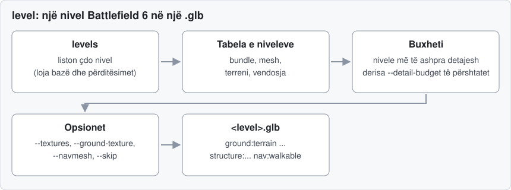

# Nivelet e Battlefield 6: `levels` dhe `level` {#battlefield-6-levels-levels-and-level}

**Çfarë është?** Një nivel i plotë i Battlefield 6 si një skedar 3D. **Pse?** Që heat
nga ndeshjet e tua të ketë tokën dhe ndërtesat poshtë. (*Frostbite* është
motori me të cilin është bërë Battlefield; një *fushë lartësish* (heightfield) është toka e ruajtur si rrjetë
lartësish.)

Eksporton një nivel të plotë Frostbite të lojës së instaluar: fushën e lartësive të terrenit,
çdo rrjetë që vendosin grupet e tij të modeleve statike, objektet e vendosura një nga një,
sfondin e terrenit rreth hartës, dhe sipas kërkesës hartat e ngjyrave të sipërfaqeve,
decal-et e terrenit të pjekura në tokë dhe sipërfaqet e ecshme të ushtarëve.



## Hap pas hapi {#step-by-step}

1. **Liston nivelet** që dërgon loja:

   ```
   python -m heat3d_gamefiles levels
   python -m heat3d_gamefiles levels --install "D:\Games\<game folder>"
   ```

   Çdo rresht është një tabelë niveli (`levels/<level>/<level>.toc`) me madhësinë e saj dhe
   nga vjen: `Data` për lojën bazë, `Update/<pack>` për një përditësim.

2. **Eksporto një**, sipas emrit të tij, një pjese unike të tij, ose shtegut të tij `.toc`. Fillo
   pa tekstura për të parë formën dhe madhësinë:

   ```
   python -m heat3d_gamefiles level <level> -o level.glb
   ```

3. **Shto ngjyra** kur duket mirë:

   ```
   python -m heat3d_gamefiles level <level> -o level.glb --textures 512 --ground-texture 0.5
   ```

4. **Shto sipërfaqet e ecshme**, ose zvogëlo skedarin:

   ```
   python -m heat3d_gamefiles level <level> --textures 512 --ground-texture 0.5 --navmesh
   python -m heat3d_gamefiles level <level> --textures 256 --detail-budget 3000000 --ground-spacing 8
   ```

5. **Hap `level.glb`** në panelin Sfondi / niveli të shikuesit 3DHeat ([ngarkimi i një niveli](https://holdi601.github.io/3DHeat/levels.html)).

## Opsionet {#options}

| Opsioni | Parazgjedhja | Kuptimi |
|---|---|---|
| `<level>` | e detyrueshme | një emër siç e printon `levels`, një pjesë unike e tij, ose `.toc` i një niveli |
| `-o`, `--out FILE` | `<level>.glb` (në `$HEAT3D_LEVELS/<game>/` kur kjo është caktuar) | skedari për t'u shkruar |
| `--install FOLDER` | gjendet në bibliotekat Steam | dosja e lojës |
| `--textures [PIXELS]` | joaktiv; 512 pa madhësi | harta e ngjyrave e çdo sipërfaqeje, më së shumti PIXELS në një anë |
| `--ground-texture [METRES]` | joaktiv; 0.5 pa madhësi | piq rrugët, platformat dhe shenjat në ngjyrën e tokës, METRES për piksel |
| `--navmesh` | joaktiv | shto rrjetën e navigimit të ushtarit si `nav:walkable` |
| `--ground-spacing METRES` | 4 | hapësira më e imët e fushës së lartësive; 0 e lë jashtë |
| `--detail-budget N` | kopjet më të trasha plus një çerek, të paktën 1,500,000 | një tavan për trekëndëshat (terreni nuk trashohet kurrë) |
| `--skip TEXT` | | lë jashtë grupet e modeleve emri i ndarjes së të cilave përmban TEXT; i përsëritshëm |
| `--by-mesh` | joaktiv | një pjesë për çdo rrjetë burimi dhe material, për të gjetur çfarë është një pjesë |
| `--clamped-uvs` | joaktiv | për rendererët që nuk mund ta përsërisin një teksturë |

Tabela e plotë, me madhësitë që priten (një nivel i tërë është qindra MB), është
te [Komandat](commands.md#levels-and-level-frostbite). Si lexohen tabelat, paketat,
rrjetat dhe terreni është te [Frostbite](reader-frostbite.md).

## Dalja shembull {#example-output}

Çfarë printon `level`, në përmbledhje (rreshtat siç i shkruan kodi; `<n>` dhe
emrat ndryshojnë sipas nivelit):

```text
<n> copies of <n> meshes, from <n> static model groups
      <n>  <group>
      <n>  placed one by one (object and prefab references)
<n> meshes left out: <why>
<n> triangles, budget <n>; <n> meshes drawn at a coarser level to fit
           <n>  ground:terrain
           <n>  structure:buildings, <n> textures
           ...
<n> of <n> drawn sections carry their colour map; the rest are flat colours
Ground: <what the ground is>.
Navigation mesh: <tiles read>.
-> level.glb (<n> MB)
```

## Pjesët {#the-parts}

`ground:terrain` (fusha e lartësive), `ground:terrain backdrop` dhe
`ground:terrain blend`, `structure:<kind>` për çdo lloj rrjete (për çdo hartë ngjyrash
me `--textures`, me ` (destructible)` për atë që një ndeshje mund ta shkatërrojë), dhe
`nav:walkable` me `--navmesh`. Shih [Formati i daljes](output-format.md).

Skedari mban përmbajtjen e lojës: është për kompjuterin ku u bë, jo për
t'u shpërndarë ([Rregullat dhe licencat](rules-and-licences.md)).
