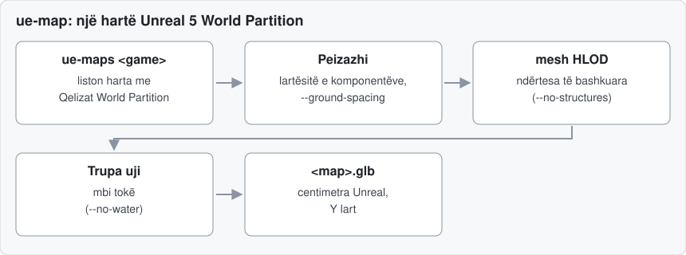

# Hartat World Partition të Unreal 5: `ue-maps` dhe `ue-map` {#unreal-5-world-partition-maps-ue-maps-and-ue-map}

**Çfarë është?** Një hartë e plotë e një loje Unreal 5 si një skedar 3D: toka,
ndërtesat dhe uji. **Pse?** Që heat nga ajo lojë të ketë hartën poshtë.
(*World Partition* është mënyra si Unreal 5 e ndan një hartë të madhe në copa; *HLOD* është një
zëvendësues i thjeshtuar për një grup ndërtesash, ai që loja e vizaton larg.)

Eksporton një hartë të plotë të një loje Unreal 5 hartat e së cilës janë të gatuara si qeliza
World Partition: peizazhin (landscape), rrjetat HLOD të bashkuara të hartës (ndërtesat
dhe objektet e saj siç i vizaton loja në largësi) dhe trupat e saj ujorë. Nuk nevojitet
editor as projekt, vetëm loja e instaluar.



## Hap pas hapi {#step-by-step}

1. **Liston hartat.** `<game>` është dosja e lojës, `Content/Paks` e saj, ose
   emri i dosjes së saj në një bibliotekë Steam:

   ```
   python -m heat3d_gamefiles ue-maps "<Steam game folder name>"
   python -m heat3d_gamefiles ue-maps "D:\Games\<game>"
   ```

   Çdo hartë me qeliza World Partition të gatuara printohet me shtegun e paketës së saj.

2. **Eksporto një** sipas emrit ose një pjese unike të tij:

   ```
   python -m heat3d_gamefiles ue-map "<game>" <map> -o map.glb
   ```

3. **Vetëm toka, ose më e trashë:**

   ```
   python -m heat3d_gamefiles ue-map "<game>" <map> --no-structures --no-water
   python -m heat3d_gamefiles ue-map "<game>" <map> --ground-spacing 4
   ```

4. **Hap `map.glb`** në panelin Sfondi / niveli të shikuesit 3DHeat
   ([ngarkimi i një niveli](https://holdi601.github.io/3DHeat/levels.html)).

## Opsionet {#options}

| Opsioni | Parazgjedhja | Kuptimi |
|---|---|---|
| `<game>` | e detyrueshme | dosja e lojës, `Content/Paks` e saj, ose emri i dosjes së saj në Steam |
| `<map>` | e detyrueshme | një emër siç e printon `ue-maps`, ose një pjesë unike e tij |
| `-o`, `--out FILE` | `<map>.glb` (në `$HEAT3D_LEVELS/<game>/` kur kjo është caktuar) | skedari për t'u shkruar |
| `--ground-spacing METRES` | 2 | hapësira e kulmeve të peizazhit, e rrumbullakuar në një numër të plotë katrorësh të vet |
| `--no-structures` | | lë jashtë ndërtesat dhe objektet HLOD |
| `--no-water` | | lë jashtë trupat ujorë |

Përmbajtja e kompresuar me Oodle ka nevojë për një bibliotekë Oodle që ndodhet tashmë në kompjuter
(shih [Oodle](reader-oodle.md)).

## Dalja shembull {#example-output}

```text
<map> -> map.glb
  ground      <n> triangles from <n> landscape components; <n> of <n> vertices stored twice disagree
  structure   <n> triangles in <n> HLOD meshes
  water       <n> triangles from <n> water bodies
```

Numri i mospërputhjeve është një vetëkontroll: komponentët fqinjë të peizazhit
e ruajnë dy herë skajin e përbashkët, dhe të dyja duhet të përputhen. Një hartë 3 km me 2 m është
rreth 4.6 milion trekëndësha toke.

## Pjesët {#the-parts}

`ground:<map>` (peizazhi), `structure:<map>` (rrjetat HLOD) dhe
`water:<map>` (uji që qëndron mbi tokë).

**Njësitë:** ky është eksporti i vetëm **jo në metra**: centimetra Unreal, me Y
dhe Z të këmbyera (Y lart), korniza që e shkruan 3DHeat Unreal Exporter. Telemetria
nga e njëjta lojë përdor të njëjtën kornizë, prandaj shtrihet mbi hartë.

## Si lexohet dhe kontrollohet {#how-it-is-read-and-checked}

| Pjesa | Lexohet nga | Kontrolluar kundrejt |
|---|---|---|
| toka | harta e lartësive 16-bit e çdo komponenti peizazhi, e vendosur nga baza e seksionit të saj mbi transformimin e peizazhit | çdo kulm i ruajtur dy herë (në një tegel ose skaj komponenti) duhet të përputhet; mospërputhjet numërohen dhe printohen, jo zbuten |
| struktura | rrjetat HLOD të bashkuara të hartës, të ndërtuara nga motori në hapësirën e botës | një rrjetë mbahet vetëm nëse kufijtë që ruan komponenti i saj përshkruajnë kulmet e veta |
| uji | rrjeta e çdo trupi ujor, e shtrirë mbi rrjetën e tokës, e mbajtur ku qëndron mbi tokë | uji qëndron disa metra mbi tokën poshtë tij, si një lumë mbi shtratin e tij |

Vetitë e peizazhit gjenden sipas formës, jo sipas numrit të vendit (vendet lëvizin
mes versioneve të motorit). Strukturat janë zëvendësuesit e thjeshtuar, jo
modelet me detaj të plotë. Gjethet, decal-et dhe materialet e peizazhit nuk eksportohen;
toka është pa teksturë dhe e hijezuar nga shikuesi. Detajet e arkivit:
[Unreal 5 IoStore](reader-unreal-iostore.md).

**Skedarët e tu:** harta lexohet nga loja e instaluar në kompjuterin tënd dhe shkruhet në
diskun tënd për analizën tënde; asgjë nga loja nuk shpërndahet me këtë mjet.
