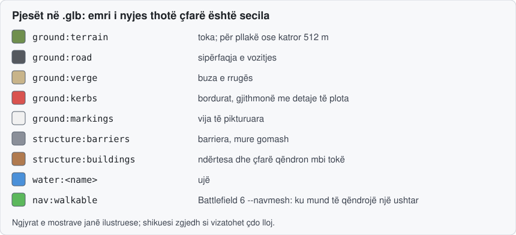

# Formati i daljes {#output-format}

Një `.glb` është një skedar 3D: toka, ndërtesat dhe uji i një piste ose
niveli, që e hap në panelin Sfondi / niveli të shikuesit 3DHeat.

Çdo eksport (`course`, `courses`, `terrain`, `level`, `ue-map`, `enfusion-world`) shkruan një skedar
**glTF 2.0 binar** (`.glb`). Është qëllimisht i vogël dhe i sheshtë, dhe i ngritur ashtu siç
e lexon shikuesi 3DHeat një nivel. Burimi:
[`glb.py`](https://github.com/Holdi601/3DHeat-GameFiles/blob/main/heat3d_gamefiles/glb.py).

## Struktura {#structure}

```
scene 0
 ├─ node "ground:terrain x-2046 z1023"  -> mesh 0 -> 1 primitive, material 0
 ├─ node "ground:road x-2046 z1023"     -> mesh 1 -> 1 primitive, material 1
 ├─ node "ground:markings"               -> mesh 2 -> ...
 ├─ node "ground:kerbs road_gen_rum_..." -> ...
 ├─ node "structure:barriers bar_armco_bclr"
 └─ ...
```

- **Një nyje për pjesë**, të gjitha në rrënjën e skenës, **pa transformime**. E gjithë
  gjeometria është tashmë në hapësirë botërore.
- Çdo nyje ka rrjetën e vet me **një primitiv** dhe materialin e vet. Nyja,
  rrjeta dhe materiali mbajnë të gjitha emrin e pjesës.
- Çdo primitiv ka **vargjet e veta kompakte të kulmeve**, vetëm kulmet që përdor ajo
  pjesë. Një varg kulmesh i përbashkët është glTF i ligjshëm, por një lexues që zgjeron
  accessor-ët e çdo primitivi do të mbante çdo kulm një herë për pjesë.
- `asset.generator` është `heat3d_gamefiles`.
- **Pak `extras`**, dhe asnjë emër xhiroje, loje ose pistë:
  - një pjesë e Battlefield 6 e një rrjete të shkatërrueshme mban `{"destructible": true}` në nyjen e saj;
  - një kurs Forza thotë çfarë mban në `asset.extras` (versioni i formatit, id-ja e
    rrugës së përputhur, sa kopje të shtresës së vetë garës, vendet; shih
    [Kurset e Forza Horizon](course-forza-horizon.md#writing-the-file)), dhe pjesët e tij të
    ndezura mbajnë shtresën e tyre në nyje: `{"layer": "event", "route": <id>}`
    për shtresën e vetë garës, `{"layer": "layer"}` për një shtresë tjetër të ndezur,
    `{"layer": "venue"}` për tokën e një vendi.

  Gjithçka tjetër që i duhet shikuesit është në emrat e nyjeve.

## Emrat e nyjeve: klasifikimi {#node-names-the-classification}



Shikuesi e merr klasën e një pjese nga emri i **nyjes** (me rezervë emrin e rrjetës),
dhe vetëm kur përputhet me

```
^(ground|structure|water)\s*[:|]
```

Çdo gjë tjetër klasifikohet nga një heuristikë e shkruar për peizazhet Unreal. Ndaj
çdo pjesë që shkruan eksportuesi fillon me një nga këto parashtesa, ose me
`nav:` (më poshtë):

| Parashtesa | Kuptimi | Pjesët e shkruara |
|---|---|---|
| `ground:` | sipërfaqja e drejtimit dhe toka | `ground:road`, `ground:verge`, `ground:terrain`, `ground:gravel and dirt`, `ground:kerbs`, `ground:markings`, `ground:tyre marks`, `ground:venue`, `ground:plinths` |
| `structure:` | ç'qëndron mbi të | `structure:barriers`, `structure:props`, `structure:signs`, `structure:buildings`, `structure:infrastructure`, `structure:bridges`, `structure:rocks`, `structure:smashables`, `structure:trees`; shtresat e Forza `structure:event_<category>` dhe `structure:layer_<category>` |
| `water:` | uji | `water:water`; `water:<map>` (`ue-map`), `water:<world>` (`enfusion-world`) |
| `nav:` | ku mund të ecë një ushtar (Battlefield 6, vetëm `--navmesh`) | `nav:walkable` |

`nav:` nuk përputhet me modelin e shikuesit më sipër, ndaj shikuesi e rendit sipas
heuristikës së tij; është pjesë më vete që ta shfaqësh ose fshehësh më vete.
`ue-map` shkruan `ground:<map>`, `structure:<map>` dhe `water:<map>`;
`enfusion-world` shkruan `ground:<world>`, `structure:<world>` dhe `water:<world>`.

Pas llojit vjen, sipas lojës:

| Shembull | Kuptimi |
|---|---|
| `ground:road x-2046 z1023` | toka e Forza në pllakën e terrenit me emrin `x-2046 z1023` (njësi rrjete, 1023 për 512 m) |
| `ground:road 3_-2` | toka e BeamNG në katrorin 512 m (3, -2) |
| `ground:road 3_-2 asphalt_light` | sipërfaqja e drejtimit e modeluar e BeamNG e materialit `asphalt_light` në atë katror |
| `ground:road 1_-4` | toka e AC Rally në katrorin 512 m (1, -4) të hapësirës Unreal |
| `structure:barriers bar_armco_bclr` | modele të vendosura të Forza që ndajnë një teksturë (emri i saj pa GUID) |
| `structure:barriers` | modele të vendosura pa teksturë (Forza, AC Rally) |
| `structure:event_barriers bar_example_bclr` | Forza: ç'nxjerr gara e përputhur për vete, veç botës së lirë (ekstrat e nyjes `{"layer": "event", "route": <id>}`) |
| `structure:layer_props` | Forza: një shtresë që loja e ndez për diçka tjetër nga kjo garë (një aktivitet, një objekt koleksioni, një shtresë kohe-ekzekutimi) |
| `ground:venue`, `ground:plinths` | Forza: modele tashmë në koordinata botërore - toka e vetë një vendi (dyshemeja e një stadiumi), dhe toka me të cilën vishet një rrugë |
| `structure:barriers armco_metal` | modele të vendosura të BeamNG të një materiali |
| `ground:markings`, `water:water` | pjesë të sheshta, një për gjithë skedarin |
| `ground:terrain` (Battlefield 6) | heightfield-i; `ground:terrain backdrop` rrjetat e largëta të terrenit, `ground:terrain blend` rrjetat që përzihen në terren |
| `nav:walkable` (Battlefield 6, `--navmesh`) | rrjeta e navigimit e nivelit për një ushtar: ku mund të qëndrojë dikush, jeshile e sheshtë |
| `ground:terrain x-512 z-512` (Battlefield 6, `--ground-texture`) | heightfield-i nën një pllakë decal-esh të pjekur, i emërtuar nga këndi i ulët i pllakës në metra |
| `structure:buildings t_concreteclean_01_cs` (Battlefield 6, `--textures`) | çdo sipërfaqe e atij lloji që shfaq atë hartë ngjyrash; pa `--textures`, një pjesë për lloj, pa prapashtesë |
| `structure:buildings t_concreteclean_01_cs (destructible)` (Battlefield 6) | e njëjta, për rrjetat që një ndeshje mund t'i shkatërrojë: ato me një aset shkatërrimi me emrin e tyre (mure, shtëpi, objekte). Nyja mban edhe ekstrat glTF `{"destructible": true}`. Gjendjet e tyre të shkatërruara nuk eksportohen |

Shikuesi mund të filtrojë sipas këtyre emrave. Për shembull, "vetëm sipërfaqja e garës" është
`ground:road` bashkë me `ground:kerbs`, në të tria lojërat, dhe "bota pa objektet e vetë garës"
është gjithçka përveç `structure:event_*`. Parashtesa është edhe mënyra se si shikuesi e vizaton një pjesë: toka si
sipërfaqja mbi të cilën shtrihet heat, struktura si ç'qëndron mbi të.

## Njësitë, boshtet dhe kuadri {#units-axes-and-frame}

- **Metra, Y lart**, konventa e glTF, për çdo eksport përveç `ue-map`. Asgjë
  nuk ripërmasohet apo ricentrohet: numrat janë koordinatat botërore të lojës, që
  është ideja e leximit të arkivit në vend të rindërtimit.
- **Hartat Unreal 5 (`ue-map`): centimetra**, njësia e vetë Unreal, me Y dhe Z
  të këmbyera që Y të jetë lart - kuadri që shkruan 3DHeat Unreal Exporter dhe që përdor
  telemetria e lojës. Eksporti i vetëm që nuk është në metra.
- **Arma Reforger (`enfusion-world`):** metrat e vetë lojës, x lindje, y lart,
  z veri. Kuadri i lojës është i dorës së majtë; opsioni i shikuesit *invert world axis*
  e shfaq të papasqyruar.
- **Forza:** koordinatat botërore të vetë lojës (x, y lart, z), të pandryshuara. Njësoj si
  telemetria e saj, ndaj një xhiro e regjistruar shtrihet mbi kursin.
- **BeamNG.drive:** `(x, z, -y)` e botës së BeamNG me Z lart, që është rrotullimi që
  aplikon regjistruesi i telemetrisë. Një rrotullim, jo një pasqyrim.
- **Battlefield 6:** koordinatat botërore të vetë lojës (x, y lart, z), të pandryshuara:
  transformimet e instance-ve të nivelit të aplikuara në çdo rrjetë siç ruhet. Kopjet
  e pasqyruara riorientohen që normalet e tyre të shohin nga jashtë.
- **Assetto Corsa Rally:** kuadri i xhiros. Centimetrat Unreal bëhen metra,
  Z e Unreal bëhet y, dhe X e Y e Unreal bëhen x dhe z në cilindo nga tetë
  orientimet që iu përshtat xhiroja (shih
  [Assetto Corsa Rally](course-assetto-corsa-rally.md#which-stage-and-which-way-round)).
  Trekëndëshat riorientohen aty ku ai hartëzim pasqyron.

Çdo eksport mban boshtet që përdor telemetria e tij, ndaj regjistrimi dhe niveli
ndajnë një kuadër. Nëse ai kuadër është i dorës së majtë apo të djathtë në secilën lojë
nuk është kontrolluar.

## Të dhënat e kulmeve {#vertex-data}

Parazgjedhja është forma **e kuantizuar** (`quantize=True`). Kërkon
shtesën `KHR_mesh_quantization`, e cila është e listuar si në `extensionsUsed`, ashtu edhe në
`extensionsRequired`.

| Atributi | I kuantizuar (parazgjedhja) | Saktësi e plotë (`quantize=False`) |
|---|---|---|
| `POSITION` | float32 VEC3, me min/max | float32 VEC3 |
| `NORMAL` | int8 VEC3 i normalizuar, i plotësuar në 4 bajte (stride 4) | float32 VEC3 |
| `TEXCOORD_0` (vetëm pjesët e teksturuara) | uint16 VEC2 i normalizuar, i kufizuar në 0-1; float32 VEC2 aty ku teksturat përsëriten (Battlefield 6) | float32 VEC2 |
| `COLOR_0` (pjesët pa teksturë, kur ndonjë pjesë ka ngjyrë) | uint8 VEC3 i normalizuar, i plotësuar në 4 bajte | float32 VEC3 |
| indekset | uint16 kur pjesa ka më së shumti 65,535 kulme, ndryshe uint32 | uint32 |

Një kulm është 20 bajte në vend të 32 (24 në vend të 44 me ngjyrë). Kjo heq një
të tretën nga çdo skedar, dhe është dallimi mes një kursi qyteti që ngarkohet në një
skedë shfletuesi dhe një që jo. Kostoja është nën gjysmë grade normale dhe 1/65,535 e një
UV (një e pesëmbëdhjeta e një teksel në 4,096 px). Rreshti i komandave shkruan gjithmonë formën
e kuantizuar. `write_glb(..., quantize=False)` në Python shkruan tjetrën.

Normalet vijnë nga loja aty ku i ruan (terreni dhe modelet e Forza, format dhe terreni
i BeamNG). Përndryshe llogariten si normale të buta të peshuara sipas sipërfaqes
nga trekëndëshat. Normalet e AC Rally llogariten gjithmonë.

## Materialet, ngjyrat dhe teksturat {#materials-colours-and-textures}

- Çdo material është `metallicFactor 0`, `roughnessFactor 1`.
- **Pjesë e teksturuar:** `baseColorTexture` me imazhin e pjesës, UV-të, dhe pa ngjyrë
  kulmesh. glTF i shumëzon të dyja, ndaj një sipërfaqe do dilte e errësuar dy herë.
- **Pjesë pa teksturë:** ngjyra e kulmeve `COLOR_0` me ngjyrën e sheshtë të pjesës, dhe një
  `baseColorFactor` të bardhë. Nëse asnjë pjesë në skedar nuk ka ngjyrë, nuk ka
  `COLOR_0`. Aty ku pjesët ndajnë kulme, fiton ngjyra e pjesës së mëvonshme, ndaj pjesët e sheshta
  shkruhen sipas rendit të rëndësisë në rritje.
- **Imazhet** ngulitën në copën binare si **JPEG**, cilësia 90, pa nënmostrim kromatik,
  vetëm RGB (alfa hiqet) - përveç një harte cut-out të Battlefield 6
  (gjethe, gardhe), që është **PNG** me alfa-n e saj, në një material me
  `alphaMode` MASK, `alphaCutoff` 0.5 dhe `doubleSided` (shih
  [Frostbite](reader-frostbite.md#textures-and-materials)). Shikuesi 3DHeat
  hedh tekselet nën pragun. Një tokë 2048 px me bar dhe kurora pemësh
  është zhurmë për një koder pa humbje: disa megabajte për pllakë si PNG, nën një
  si JPEG. Një imazh i ndarë nga disa pjesë ruhet një herë.
- Një mostrues për të gjitha teksturat: zmadhim linear, zvogëlim linear-mipmap-linear,
  **clamp to edge** në të dy boshtet, për eksportet e kursit, teksturat e të cilave
  mbulojnë sipërfaqet e tyre një herë. BeamNG i vizaton teksturat përsëritëse të modeleve si
  ngjyra të sheshta (shih [BeamNG.drive](course-beamng.md#placed-models)).
- Një eksport Battlefield 6 me `--textures`, materialet e të cilit përsëriten, shkruan
  koordinatat e vetë lojës të teksturës, të pakufizuara, si float32 `TEXCOORD_0` edhe në
  formën e kuantizuar, me një mostrues që **përsërit** në të dy boshtet
  (`write_glb(..., repeat=True)`): një mur tullash është një çift trekëndëshash UV-ja e të cilëve
  shkon nga 0 në 40. Shikuesi 3DHeat e mbështjell një teksturë të tillë brenda atlasit të tij (shih
  faqen e tij *Nivelet e modelit*). Për një renderues që nuk përsërit dot një teksturë,
  `level --clamped-uvs` (`write_level(..., clamped=True)`) e pret çdo trekëndësh
  përgjatë vijave ku teksturat e tij përsëriten dhe e zhvendos çdo copë në 0..1:
  të njëjtat pikselë në të njëjtën sipërfaqe, rreth një të pestën më shumë trekëndësha. Trekëndëshat
  mbi të cilët një teksturë përsëritet më shumë se 16 herë mbajnë koordinatat e tyre. Një
  trekëndësh që teksturat e tij do ta priste në më shumë se 4 copa - lëvorja që përsëritet poshtë
  çdo dege të një peme, ku prerja e ktheu 1,099 trekëndëshat e një peme në
  51,735 - shkon në një pjesë të vetën, `<part> (average colour)`, në ngjyrën mesatare
  të teksturës; `level` thotë sa.

| Tekstura | Madhësia | Mbulon |
|---|---|---|
| toka (të gjitha lojërat përveç Battlefield 6) | `--texture-size`: 2048, 1024 ose 512 px | një katror 512 m: 25, 50 ose 100 cm për piksel |
| heightfield i Battlefield 6 | mip-i më i madh i hartës së ngjyrave të sfondit në nivel, i prerë | katrori i terrenit: 32 m për piksel në nivelin e kontrolluar |
| sipërfaqet e Battlefield 6 | `--textures`: më së shumti aq px për anë | teksturat e vetë sipërfaqes, një herë për copë (prerë aty ku përsëritet) |
| toka e pjekur e Battlefield 6 | `--ground-texture`: metra për piksel, pllaka deri 4,096 px | një pllakë e shtrirjes së decal-eve: 2,048 m në 0.5 m për piksel |
| model i vendosur i Forza | më së shumti 256 px | struktura UV e vetë modelit |
| model i vendosur i BeamNG | më së shumti 256 px | struktura UV e vetë modelit, vetëm aty ku nuk përsëritet |
| model i vendosur i AC Rally | asnjë | ngjyra të sheshta |

## Çfarë refuzon shkruesi {#what-the-writer-refuses}

`write_glb` ngre një gabim në vend që të shkruajë një skedar që një shikues do ta hapte dhe
do ta shfaqte gabim:

| Refuzohet | Sepse |
|---|---|
| pozicione që nuk janë N x 3, ose jo të fundme | një rrjetë e prishur |
| një indeks përtej fundit të listës së kulmeve | vizatohet si zhurmë |
| një pjesë e teksturuar kur skedari nuk ka UV | vizatohet si një piksel i njollosur |
| asnjë trekëndësh fare | vizatohet si asgjë |
| një varg normalesh, ngjyrash ose UV me gjatësi të gabuar, ose jo të fundëm | duhet një për kulm |

## Leximi gjetkë {#reading-it-elsewhere}

Çdo shikues glTF 2.0 që mbështet `KHR_mesh_quantization` duhet t'i hapë këta
skedarë. Vetëm shikuesi 3DHeat është kontrolluar; shikuesit e tjerë nuk janë verifikuar. Një
lexues pa shtesën e refuzon skedarin, sepse është shënuar i detyrueshëm. Skedarët mund të jenë të mëdhenj: rreth 80 MB për një
qark fshati, deri në disa qindra MB për një kurs qyteti me buxhetin
automatik.

## Në 3DHeat {#in-3dheat}

Ngarko `.glb` në panelin Sfondi / niveli të shikuesit [3DHeat](https://github.com/Holdi601/3DHeat);
telemetria që regjistron në të njëjtën lojë shtrihet mbi të, sepse të dyja
mbajnë koordinatat e lojës. Dokumentacioni i vetë shikuesit
([holdi601.github.io/3DHeat](https://holdi601.github.io/3DHeat/)) mbulon panelin
Sfondi / niveli dhe skedarët e ndeshjes që shkruajnë mjetet e tjera
([Një skedar për ndeshje: `.3dheat`](https://holdi601.github.io/3DHeat/container.html)).
Një nivel nuk ruhet në çdo skedar `.3dheat`: një ndeshje e emërton në `references`
të saj (`kind: "level"`, emri dhe sha256) dhe `.glb` qëndron pranë
ndeshjeve.
