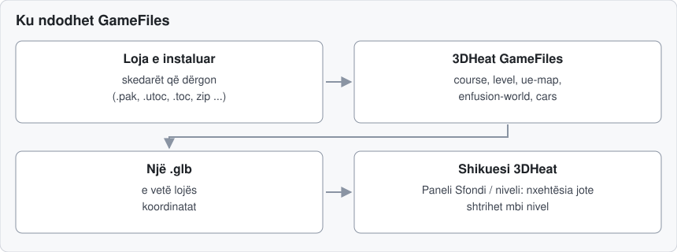

# Nivele të plota {#whole-levels}

**Me fjalë të thjeshta:** për shooter-at dhe lojëra të tjera pa xhiro, mjeti e ruan
gjithë hartën si një skedar 3D, që shikuesi të vizatojë ku shkuan lojtarët mbi të.

`course` pret tokën rreth një xhiroje. Për lojërat pa xhiro mjeti eksporton
një nivel, hartë ose botë të tërë njëherësh:

| Loja ose motori | Listo | Eksporto | Faqja |
|---|---|---|---|
| Battlefield 6 (Frostbite) | `levels` | `level <level>` | [Nivelet e Battlefield 6](level-battlefield.md) |
| Lojëra Unreal 5 World Partition | `ue-maps <game>` | `ue-map <game> <map>` | [Hartat e Unreal 5](level-unreal-world-partition.md) |
| Arma Reforger (Enfusion) | `enfusion-worlds` | `enfusion-world <world>` | [Botët e Arma Reforger](level-arma-reforger.md) |

Çdo çift punon njësoj: komanda e parë liston çfarë ka loja e instaluar,
e dyta shkruan njërën prej tyre si një `.glb` të vetëm në koordinatat e vetë
botës së lojës, kështu që pozicionet e regjistruara në atë lojë shtrihen mbi të. Pjesët
quhen `ground:`, `structure:` dhe `water:` si çdo eksport tjetër (shih
[Formati i daljes](output-format.md)); ngarkoje skedarin te paneli Sfondi / niveli
i shikuesit 3DHeat.

