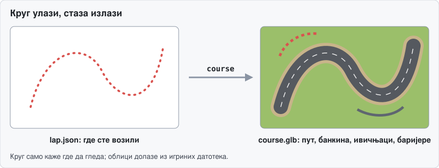
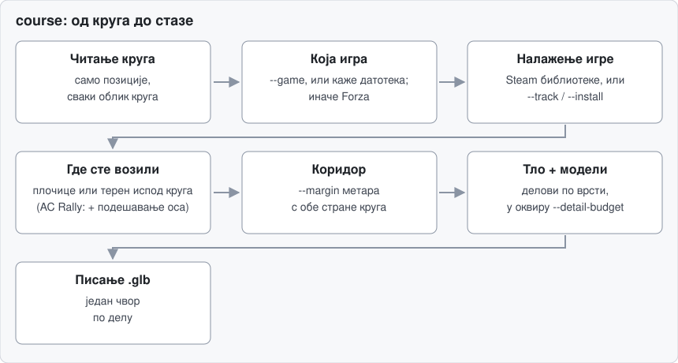

# Извоз стазе {#course-export}

**Укратко:** возили сте круг; ово прави стазу по којој сте возили, као 3D датотеку. Круг је само низ тачака. Пут, трава и ивичњаци долазе из игриних сопствених датотека.

`course` претвара круг у стазу: тло у појасу са обе стране места где је аутомобил прошао, и све што стоји на том тлу, као један `.glb` за приказивач. Ова страница описује што су заједничко све три подржане игре. Странице испод ње описују разлике:

- [Forza Horizon](course-forza-horizon.md): ForzaTech `.minizip` архиве
- [BeamNG.drive](course-beamng.md): zip архиве, висинско поље терена, компајлирани облици
- [Assetto Corsa Rally](course-assetto-corsa-rally.md): Unreal 5 IoStore, World Partition деоница
- [Нивои детаља и буџет](detail-budget.md): колико троуглова добијају постављени модели и које копије остају

## Кораци {#the-steps}

Речи које се користе испод: **оквир** је правац у којем осе гледају; **коридор** је појас тла са обе стране круга; **плочица** је један квадратни део терена игре; **LOD** (ниво детаља) је један од једноставнијих примерака модела.

1. **Прочитај круг.** Само положаји, из било ког облика из [Улазни подаци круга](lap-inputs.md). Брзина и управљање се не користе. Круг са мање од две тачке се одбија („holds no driving“).
2. **Одреди игру.** `--game`, па `game` из фајла круга, па Forza (видите [Команде](commands.md#which-game)).
3. **Нађи инсталирану игру.** Све три траже у свакој Steam библиотеци наведеној у Steam-овом `config\libraryfolders.vdf`. Forza такође тражи у `C:\XboxGames`. `--track` (Forza) или `--install` (BeamNG, AC Rally) прескаче претрагу.
4. **Нађи где је круг вожњен.** Ово се никад не одлучује само по поклапању имена. Forza бира стазу чије плочице терена покривају круг. BeamNG бира ниво на чијем терену (или путевима) леже узорци круга. AC Rally испроба сваку деоницу у осам оријентација осе и узима ону која ставља највише круга на пут.
5. **Исеци коридор** од `--margin` метара са обе стране вожње (испод).
6. **Направи тло** унутар коридора, разврстано као пут, банкина, шљунак и земља, терен, ознаке, трагови гума или вода, и испеци текстуру тла за сваки квадрат од 512 m.
7. **Постави моделе** који стоје у коридору, по категорији, на нивоу детаља који бира удаљеност и буџет троуглова.
8. **Напиши `.glb`**: један именовани чвор по делу. Видите [Формат излаза](output-format.md).

Шта извоз исписује, овде на синтетичкој BeamNG.drive инсталацији коју тестови праве, круг од 50 m низ траку пута:

## Коридор {#the-corridor}

Пресек није оквир око круга, него појас око возане линије. За кружну стазу су готово исти. За спринт од тачке до тачке оквир је углавном падина коју нико не вози, па појас може да буде десетина површине. Извор: [`corridor.py`](https://github.com/Holdi601/3DHeat-GameFiles/blob/main/heat3d_gamefiles/corridor.py).

Начин на који се прави:

- Вожња се пројектује на раван тла: x и z круга (BeamNG: x и y властитог оквира игре).
- Растеризује се на мрежи ћелија од **4 m** (`CELL`). Свака ћелија коју вожња додирује проширује се диском полупречника `margin + 4 m` у свим правцима.
- Узастопни узорци удаљени мање од **50 m** (`JOIN`) спајају се тачкама на сваких 4 m, па појас нема празнина. Узорци даље једни од других сматрају се одвојеним деловима вожње и не спајају се. Библиотечна стаза је много фајлова круга један за другим, и крај једног спринта и почетак следећег не смеју да повуку појас преко мапе.
- Троугао се задржава ако било који његов угао, средина било које ивице или његов центроид лежи у појасу. Средње тачке ухвате велики троугао који прелази уски појас, а чији су сви углови ван њега.
- Висина никад није део пресека. Кутија која би ограничавала надморску висину исекла би тло испод брда по којем пут води.

Конзола јавља површину коридора, на пример
`cutting 80 m either side of the driving: 1.53 km2 of a 6,000 by 3,600 m box`.

BeamNG и AC Rally граде и шири **досег** коридор од `margin + 60 m`. Постављени модел се разматра ако његов почетак лежи у коридору досега, а црта се само ако његов отисак додирује прави коридор. Тако се дуги објекат чији је почетак баш ван појаса не губи. BeamNG такође користи коридор досега да изабере које налепнице пута ће се нацртати.

## Од чега је тло направљено {#what-the-ground-is-made-of}

Сваки извоз разврстава троуглове тла у исте врсте, и свака врста се записује као посебан део, како би приказивач могао да је прикаже или сакрије:

| Врста | Назив дела | Равна боја (линеарни RGB) | Forza | BeamNG | AC Rally |
|---|---|---|---|---|---|
| пут | `ground:road` | 0.22, 0.22, 0.23 | траке пута: део асфалта | слојеви типа `ASPHALT`, налепнице пута, моделован пут | плочице стазе (`/MeshesTrack/`) |
| банкина | `ground:verge` | 0.52, 0.47, 0.30 | траке пута: ивица | тротоари и модели банкина | - |
| шљунак и земља | `ground:gravel and dirt` | 0.50, 0.42, 0.30 | - | слојеви земље, шљунка, песка и блата и налепнице | - |
| терен | `ground:terrain` | 0.30, 0.44, 0.18 | све остало | све остало | плочице `_Terrain` и далеки терен |
| ивичњаци | `ground:kerbs` | 0.60, 0.12, 0.10 (Forza) | пропи `road_gen_rum*` | модели ивичњака, бордуре и ограничавача | модели ивичњака и бордура |
| ознаке | `ground:markings` | 0.90, 0.90, 0.88 | подмреже декала, подигнуте за 5 cm | уцртане у текстуру | - |
| трагови гума | `ground:tyre marks` | 0.20, 0.17, 0.16 | подмреже декала, подигнуте за 5 cm | уцртани у текстуру | - |
| вода | `water:water` | 0.16, 0.34, 0.48 | водени материјали | раван мора, водени блокови, реке | - |

Равне боје су изабране да се лако читају, а не да одговарају игри. Користе се за делове без текстуре и за приказиваче које текстуре не занимају. Извор: [`surfaces.py`](https://github.com/Holdi601/3DHeat-GameFiles/blob/main/heat3d_gamefiles/surfaces.py).

Делови тла се деле по квадрату од 512 m, и сваки квадрат носи своју печену слику, па назив дела садржи квадрат:

| Игра | Назив дела тла | Кључ квадрата |
|---|---|---|
| Forza | `ground:road x-2046 z1023` | мрежно име плочице терена (кораци од 1023, видите [Forza Horizon](course-forza-horizon.md)) |
| BeamNG | `ground:road 3_-2` | `floor(x / 512)`, `floor(y / 512)` у BeamNG метрима |
| AC Rally | `ground:road 1_-4` | `floor(x / 51200)`, `floor(y / 51200)` у Unreal центиметрима |

## Шта стоји на њему {#what-stands-on-it}

Постављени модели се записују у делове под називом `structure:<category>`, или `ground:kerbs` за ивичњаке (у све три игре). Кад део има сопствену текстуру, назив текстуре или материјала прати категорију, на пример `structure:barriers bar_armco_bclr`.

| Категорија | Forza | BeamNG | AC Rally |
|---|---|---|---|
| баријере | да | да | да |
| предмети | да | да | да |
| знакови | да | да | да |
| зграде | да (замене целе зграде тамо где их игра има) | да | да |
| инфраструктура | да | да | да |
| мостови | да | да | (сврстани као инфраструктура) |
| стене | да | да | да |
| ивичњаци | да, као тло | да, као тло | да, као тло |
| дрвеће | уз `--trees` | уз `--trees` | уз `--trees` |
| ситни разбијиви предмети | уз `--trees` | - | - |

Како се дели детаљ, исто је у све три. Копије на раздаљини до 25 m почињу у пуном детаљу, копије на 25-60 m један ниво грубље, а даље копије на најгрубљем нивоу. Затим се најскупљи модели спуштају док се не уклопи буџет троуглова, а тамо где ни најгрубљи нивои не стају у буџет који ви дате, копије се изостављају. Ивичњаци се никад не упрошћавају нити изостављају. Видите [Нивои детаља и буџет](detail-budget.md).

## Опције које мењају резултат {#options-that-shape-the-result}

| Желите | Користите |
|---|---|
| мању датотеку | `--no-textures` (равне боје), `--texture-size 1024` или `512`, `--detail-budget N`, `--margin 40` |
| само тло | `--no-placed` |
| и декорацију | `--trees` |
| друго доба године (Forza) | `--season winter` |
| игру ван Steam-а | `--track` (Forza) или `--install` (BeamNG, AC Rally) |
| круг који претрага не поставља | `--level` (BeamNG, AC Rally), `--track` (Forza) |

## Координате {#coordinates}

Сваки извоз записује метре са Y нагоре, у оквиру у којем се снимљен круг исте игре поклапа:

| Игра | Записани оквир |
|---|---|
| Forza | властите светске координате игре, непромењене |
| BeamNG | `(x, z, -y)` светског BeamNG-а са Z нагоре, што је ротација коју снимач телеметрије примењује |
| AC Rally | оквир круга, пронађен фитовањем: Unreal центиметри постају метри, а Unreal X и Y постају x и z круга у оној од осам оријентација која одговара |

Видите [Формат излаза](output-format.md).
