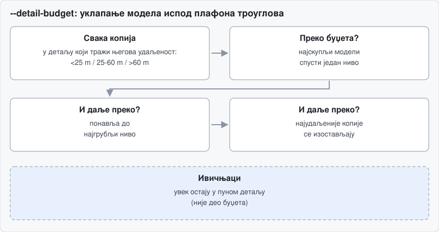

# Нивои детаља и буџет {#levels-of-detail-and-the-budget}

**Троугао** је један ситан раван комад 3D модела. Више троуглова значи већу, спорију датотеку. **Буџет** је ограничење колико их има. **Ниво детаља** је једноставнија копија модела, која се користи кад је далеко.

Најфинији ниво свега постављеног око круга износи неколико милиона троуглова. На пример, стотине сегмената ограде и гомиле гума са око хиљаду троуглова сваки. Градски коридор садржи преко сто хиљада копија. Зато сваки извоз стазе даје постављеним моделима **буџет троуглова** и одлучује, за сваки модел, на ком нивоу детаља се црта, а, ако треба, које копије се изостављају.

Шема је написана за Forza
([`forzaplacement.py`](https://github.com/Holdi601/3DHeat-GameFiles/blob/main/heat3d_gamefiles/forzaplacement.py):
`choose_levels`, `auto_budget`, `_fit`), а BeamNG и AC Rally користе њене делове. Терен се не броји у буџет.

## Опсези удаљености {#distance-bands}

Удаљеност сваке копије до вожње мери се у равни тла, до најближег узорка круга. Круг се прво проређује на највише 1.000 тачака, што кошта неколико метара прецизности и ништа што је овде важно. Копије затим падају у три опсега, и сваки пар (модел, опсег) буџетира се посебно:

| Опсег | Удаљеност | Почиње са |
|---|---|---|
| близу | испод 25 m (`NEAR`) | најфинијим нивоом |
| средње | 25-60 m (`FAR`) | једним нивоом грубље |
| далеко | 60 m и више | најгрубљим нивоом |

Без руте (Forza `terrain --box`), удаљеност се мери до средине кутије.

## Спуштање да би стало {#stepping-down-to-fit}



Трошак уноса (модел, опсег) је број копија x троуглови на његовом тренутном нивоу. Док је збир изнад буџета, унос који највише кошта спушта се за један ниво, и то се понавља док се збир не уклопи или ниједан унос више не може да се спусти. Фиксирани уноси се никад не спуштају:

| Игра | Фиксирано на пуном детаљу |
|---|---|
| Forza | ивичњаци (`road_gen_rum*`) |
| BeamNG | ивичњаци и сваки облик који носи површину за вожњу |
| AC Rally | ивичњаци |

Forza резиме то исписује као
`N of M models drawn at a coarser level to fit the budget`.

## Аутоматски буџет {#the-automatic-budget}

Без `--detail-budget`, буџет се сам поставља тако да **ниједна копија не буде изостављена**:

```
budget = max(1,500,000, 1.25 x sum(copies x coarsest level))
```

Фиксирани уноси се рачунају на свом најфинијем нивоу. Тих 25% (`HEADROOM`) оставља нешто детаља и за оно што је поред пута. На сеоском циркуиту ово је минимум од 1,5 милиона (`DEFAULT_BUDGET`). На градској стази, где коридор садржи преко сто хиљада копија, расте
на преко десет милиона, а датотека на неколико стотина MB. Приказивач то учитава.

## Буџет који ви дате {#a-budget-you-give}

`--detail-budget N` је **плафон**. Нивои се спуштају као горе. Ако ни најгрубљи нивои не стану, копије се изостављају:

| Игра | Редослед у коме се копије изостављају |
|---|---|
| Forza | прво све на 25 m или даље од вожње, па оно што стоји поред пута; унутар сваке групе прво оно што се са пута најмање види: највећа удаљеност / величина (величина = дијагонала граничне кутије модела пута највећа размера, најмање 0,25 m) |
| BeamNG | најдаље од вожње прво |
| AC Rally | најдаље од вожње прво, као BeamNG |
| Battlefield 6 | најмање прво: дијагонала граничне кутије пута размера |

Ивичњаке (а за BeamNG и моделе површине за вожњу) никад не изостављамо, па буџет мањи од њиховог сопственог трошка прелази само они, и ништа друго.

Forza бира удаљеност према величини зато што, ако се ред задаје само удаљеношћу, клима-уређај на зиду удаљеном девет метара преживи двадесетометарску фасаду на којој виси, удаљену дванаест метара. Ствари поред пута иду последње, какве год да су величине, јер је трећеметарска баријера пет метара од линије ивица стазе, а педесетометарска зграда шездесет метара иза је декор.

Резиме исписује
`N of M copies left out to fit the budget, the smallest and furthest from the driving first (--detail-budget raises it)`
(Forza), или `N copies left out to fit the budget, the furthest from the driving first (--detail-budget raises it)`
(BeamNG, AC Rally).

## Целе зграде (Forza) {#whole-buildings-forza}

Замена за целу зграду рачуна се као једна копија, на удаљености мереној до најближе ивице зграде. Задржава се или изостаје као целина. Модуларни делови које замењује се уопште не буџетирају. Видите
[Forza Horizon](course-forza-horizon.md#buildings-drawn-whole).

## Шта је ниво детаља, по игри {#what-a-level-of-detail-is-per-game}

| Игра | Нивои долазе из |
|---|---|
| Forza | маске нивоа по троуглу из `Mesh` подмрежа модела (бит `level + 1`); `0xFFFF` за деливе комаде само за модел без означеног нивоа |
| BeamNG | `details` облика `.cdae` са ненегативном величином, од највећег; за `.dae`, завршни број у називима чворова мреже (`barrier75`, `barrier40`) |
| AC Rally | сачувани нивои детаља статичке мреже, од финијег |
| Battlefield 6 | нивои детаља MeshSet-а, од финијег, рачунајући само приказане делове (не копије за сенку и само дубину), и не последњи ниво који је удаљена замена (материјали `M_LastLod`, `M_Billboard`, `M_Vista`: решеткаста конструкција стуба постаје чврст шиљак) |

Battlefield 6 `level` нема круг, па нема опсега удаљености: свака мрежа је један унос, а свака копија је на истом нивоу. Аутоматски буџет је горња формула, са фиксираном позадином терена. Висинско поље је ван буџета и одређује га `--ground-spacing`. Уз задати буџет, кад је свака мрежа на најгрубљем нивоу, копије се изостављају од најмање, а величина је дијагонала граничне кутије мреже пута размера копије, пошто нема вожње од које би се мерила удаљеност. Позадина терена се никад не изоставља. Ниво долази до око десет милиона троуглова аутоматски.

## Избор броја {#choosing-a-number}

| Желите | Пробајте |
|---|---|
| све, пун детаљ близу пута | оставите аутоматски |
| датотеку неколико пута мању | `--detail-budget 500000` са `--texture-size 1024` |
| само тло | `--no-placed` (буџет се не користи) |
