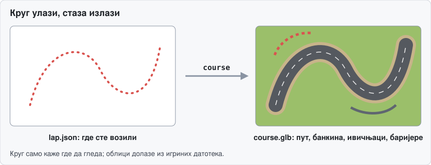
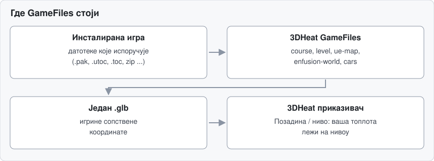

# 3DHeat GameFiles {#dheat-gamefiles}

**Шта је то?** Алат који прави 3D модел стазе за трку или нивоа игре
из датотека игре коју већ имате инсталирану.

**Зашто бих га користио?** 3DHeat приказивач боји где сте возили или играли као
топлотну мапу. Са овим алатом боји то на правој стази или нивоу, а не на празном простору.

**Пример:** узмите круг који сте возили. Алат прави пут и земљиште око њега
као једну 3D датотеку, па приказивач може да боји вашу брзину или удар на правој стази:



Први пут у командној линији? Почните са [Пре почетка](before-you-start.md).

Детаљније: чита податке о нивоима из архива које игра испоручује и пише их као
бинарну glTF (`.glb`) датотеку. Његов главни посао је **извоз стазе**: дате му круг, а
он пише тло, пут одвојен од банкине и траве, и ивичњаке, баријере, зидове од
гума, знакове и зграде око њега.

Део је [3DHeat](https://github.com/Holdi601/3DHeat), приказивача за 3D топлотне мапе
у реалном времену, анализу трке и преглед мечева
([документација](https://holdi601.github.io/3DHeat/)). `.glb` датотеке које
овај алат пише су нивои на којима приказивач црта топлоту.



То је један од три начина да геометрија нивоа уђе у 3DHeat:

| Пут | Треба | Даје |
|---|---|---|
| 3DHeat Unreal Exporter | Unreal пројекат отворен у уређивачу | тачну геометрију |
| 3DHeat GameCapture | екран и снимак | процену |
| **3DHeat GameFiles** | **инсталирана, испоручена игра** | **тачну геометрију, без пројекта** |

Python пакет: `heat3d_gamefiles`. Репозиторијум:
[Holdi601/3DHeat-GameFiles](https://github.com/Holdi601/3DHeat-GameFiles). Лиценца: MIT.

## Шта може да уради {#what-it-can-do}

| Игра или мотор | Извоз стазе (`course`) | Читање архива |
|---|---|---|
| Forza Horizon (ForzaTech) | да: терен, пут и банкина, текстура тла, постављени модели у сопственим текстурама | `identify`, `list`, `extract` над `.minizip`; `identify` над `.modelbin`; модели, терен и текстуре преко `course` и `terrain` |
| BeamNG.drive | да: терен, декали пута, моделовани кругови, постављени модели, вода | `identify`, `list`, `extract` над нивоима у zip-у; `identify` над `.ter`, `.cdae`; `.dae` преко `course` |
| Assetto Corsa Rally (Unreal 5.6) | да: плочице тла етапе, испечена боја тла, постављени модели у равним бојама | `identify`, `list`, `extract` над IoStore `.utoc`/`.ucas`; zen пакети, статичке мреже, текстуре преко `course` |
| Unreal `.pak` (верзије 8-12) | не | `identify`, `list`, `extract` |
| Unity (формат 22 и новији) | не | `identify`, `meshes` |
| Battlefield 6 (Frostbite `.toc`/`.cas`) | нема круга; цео ниво са `level`: терен, постављене мреже, њихове мапе боја са `--textures` | `identify`, `levels`; снопови, мреже, терен, текстуре и постављање преко `level` |
| Source 2 `.vpk` | не | `identify`, `list`, `extract` |
| Unreal 5 World Partition игре | нема круга; цела мапа са `ue-map` (набраја га `ue-maps`): терен, HLOD зграде и реквизити, вода | - |
| Arma Reforger (Enfusion) | нема круга; цео свет са `enfusion-world` (набраја га `enfusion-worlds`): терен у својим бојама, море, зграде као кутије | - |
| Forza (аутомобили) | `cars`: сваки аутомобил у ниском детаљу, за картицу Анализа трке приказивача | - |

Кругови из Assetto Corsa EVO и iRacing се одбијају, с разлогом. Види
[Ограничења и познате празнине](../limits-and-known-gaps.md).

## Инсталација {#install}

Први пут у командној линији? Прво прочитајте [Пре почетка](before-you-start.md).

Треба вам **Python 3.10 или новији** (развијано на 3.13) и пакети из
[`requirements.txt`](https://github.com/Holdi601/3DHeat-GameFiles/blob/main/requirements.txt).

```
git clone https://github.com/Holdi601/3DHeat-GameFiles.git
cd 3DHeat-GameFiles
pip install -r requirements.txt
```

Онда проверите: `python -m heat3d_gamefiles --help`. Требало би да видите
`usage: heat3d_gamefiles [-h]` и списак глагола. Покрећите сваку команду из
фасцикле репозиторијума, као `python -m heat3d_gamefiles <verb>`.

| Пакет | За шта служи |
|---|---|
| numpy | све што декодује геометрију |
| lz4 | Forza архиве (углавном LZ4 блокови), неки Unity снопови, IoStore LZ4 блокови |
| Pillow | декодовање BC1-BC7 текстура, писање JPEG текстура у `.glb` |
| msgpack, zstandard | BeamNG-ови компајлирани облици (`.cdae`) |
| cryptography | само за отварање шифрованог `.pak` са кључем који већ имате |
| pytest | тестови |

Unreal садржај компресован помоћу **Oodle**-а треба Oodle библиотеку која је
већ на вашем рачунару. Она се никад не испоручује уз овај алат. Видите [Oodle](../reader-oodle.md).

Алат је писан за Windows. Игре проналази преко Steam листе библиотека и
`%LOCALAPPDATA%`, а Oodle учитава као Windows DLL. Друге платформе нису
тестиране.

## Брзи почетак {#quick-start}

**Датотека круга** је снимак где је ваш аутомобил ишао: списак x, y, z тачака.
Долази из [3DHeat GameCapture](https://github.com/Holdi601/3DHeat-GameCapture)
или из библиотеке кругова апликације FH Companion; CSV који је унет руком такође ради
([Улази за круг](../lap-inputs.md)).

```
# Forza: датотека круга, фасцикла кругова, или име стазе из библиотеке FH Companion
python -m heat3d_gamefiles course "Example Circuit"
python -m heat3d_gamefiles course path\to\lap.json -o course.glb

# BeamNG.drive или Assetto Corsa Rally: heat3d-lap датотека каже из које је игре
python -m heat3d_gamefiles course my_lap.json

# Свака стаза из библиотеке FH Companion, по један .glb
python -m heat3d_gamefiles courses -o courses

# Battlefield 6: наброј нивое, па извези један (велика датотека; видите Команде)
python -m heat3d_gamefiles levels
python -m heat3d_gamefiles level <level> -o level.glb --textures

# Unreal 5 World Partition и Arma Reforger: наброј, па извези
python -m heat3d_gamefiles ue-maps "<game>"
python -m heat3d_gamefiles ue-map "<game>" <map> -o map.glb
python -m heat3d_gamefiles enfusion-worlds
python -m heat3d_gamefiles enfusion-world <world> -o world.glb

# Сваки Forza аутомобил, за картицу трке приказивача
python -m heat3d_gamefiles cars -o forza.h3dcars

# Шта је ова датотека?
python -m heat3d_gamefiles identify some_archive.pak
```

Отворите `.glb` у 3DHeat приказивачу. Игрине сопствене координате света се чувају
(видите [Формат излаза](../output-format.md)), па се снимљени круг поклапа са стазом.

## Мапа ове документације {#map-of-this-documentation}

- [Пре почетка](before-you-start.md): Python, терминал, прва команда.
- [Команде](../commands.md): свака глагол и опција, с примерима.
- [Референца команди](../cli-reference.md): `--help` сваког глагола, генерисан из кода.
- [Преглед архива](../inspecting-archives.md): `identify`, `list`, `extract`, `meshes`, корак по корак.
- [Извоз стазе](../course-export.md): како круг постаје стаза, за све игре.
  - [Forza Horizon](../course-forza-horizon.md)
  - [BeamNG.drive](../course-beamng.md)
  - [Assetto Corsa Rally](../course-assetto-corsa-rally.md)
  - [Нивои детаља и буџет](../detail-budget.md)
- [Цели нивои](../whole-levels.md): ниво, мапа или свет без круга.
  - [Battlefield 6 нивои](../level-battlefield.md): `levels`, `level`
  - [Unreal 5 мапе](../level-unreal-world-partition.md): `ue-maps`, `ue-map`
  - [Arma Reforger светови](../level-arma-reforger.md): `enfusion-worlds`, `enfusion-world`
- [Forza аутомобили](../forza-cars.md): `cars`, датотека аутомобила за картицу трке приказивача.
- [Улази за круг](../lap-inputs.md): сваки облик датотеке круга који алат прихвата.
- [Формат излаза](../output-format.md): шта је у `.glb`-у.
- [Читачи архива](../archive-readers.md): по једна страница за сваки формат контејнера,
  са тим шта чита, шта не, и зашто.
- [Ограничења и познате празнине](../limits-and-known-gaps.md)
- [Решавање проблема](../troubleshooting.md): поруке о грешкама и шта урадити.
- [Правила и лиценце](../rules-and-licences.md): без кључева, ваше сопствене датотеке, без поновног дељења.
- [Ажурирања](../updates.md): провера ажурирања и `heat3d_update`.
- [Развој](../development.md): мапа модула и тестови, укључујући тестове које раде над инсталираним играма.
- [Одржавање](../maintaining.md): контролна листа издања за ове странице.

## Део 3DHeat-а {#part-of-3dheat}

3DHeat GameFiles је један од бесплатних алата око 3DHeat приказивача:

| Алат | Шта ради | Документација |
|---|---|---|
| [3DHeat](https://github.com/Holdi601/3DHeat) | приказивач: 3D топлотне мапе, анализа трке и преглед мечева у прегледачу | [сајт](https://holdi601.github.io/3DHeat/) |
| [GameFiles](https://github.com/Holdi601/3DHeat-GameFiles) | стазе и нивои из датотека које игра испоручује, као `.glb` | [сајт](https://holdi601.github.io/3DHeat-GameFiles/) |
| [GameCapture](https://github.com/Holdi601/3DHeat-GameCapture) | телеметрија круга из тркачких игара; нивои реконструисани из снимка игре | [сајт](https://holdi601.github.io/3DHeat-GameCapture/) |
| [Unreal Exporter](https://github.com/Holdi601/3DHeat-UnrealExporter) | додатак за Unreal Editor који чува ниво као `.glb` | [сајт](https://holdi601.github.io/3DHeat-UnrealExporter/) |
| [CS2](https://github.com/Holdi601/3DHeat-CS2) | Counter-Strike 2 демои у датотеке меча; мапе у `.glb` | [сајт](https://holdi601.github.io/3DHeat-CS2/) |
| [Watcher](https://github.com/Holdi601/3DHeat-Watcher) | бележи ваше игре у позадини из онога што игре објављују | [сајт](https://holdi601.github.io/3DHeat-Watcher/) |
| [Ext-WarThunder](https://github.com/Holdi601/3DHeat-Ext-WarThunder) | War Thunder репризе у датотеке меча | [сајт](https://holdi601.github.io/3DHeat-Ext-WarThunder/) |
| [Ext-WoT](https://github.com/Holdi601/3DHeat-Ext-WoT) | World of Tanks репризе у датотеке меча | [сајт](https://holdi601.github.io/3DHeat-Ext-WoT/) |
| [Ext-WoWs](https://github.com/Holdi601/3DHeat-Ext-WoWs) | World of Warships репризе у датотеке меча | [сајт](https://holdi601.github.io/3DHeat-Ext-WoWs/) |
| [Ext-Squad](https://github.com/Holdi601/3DHeat-Ext-Squad) | Squad демои са сервера у датотеке меча | [сајт](https://holdi601.github.io/3DHeat-Ext-Squad/) |
| [Ext-DCS](https://github.com/Holdi601/3DHeat-Ext-DCS) | DCS World мапе у `.glb` нивое | [сајт](https://holdi601.github.io/3DHeat-Ext-DCS/) |
| [Ext-IL2](https://github.com/Holdi601/3DHeat-Ext-IL2) | мапе IL-2 Sturmovik у `.glb` нивое | [сајт](https://holdi601.github.io/3DHeat-Ext-IL2/) |

Датотеке меча приказивача описане су у
[Једна датотека по мечу: `.3dheat`](https://holdi601.github.io/3DHeat/container.html);
ниво направљен овде учитава се поред њих на панелу Позадина / ниво приказивача.
