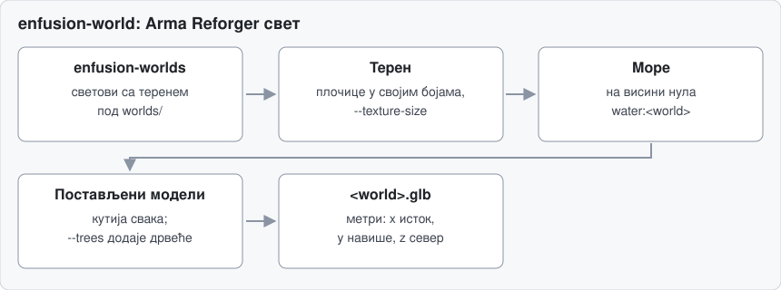

# Светови Arma Reforger: `enfusion-worlds` и `enfusion-world` {#arma-reforger-worlds-enfusion-worlds-and-enfusion-world}

**Шта је то?** Цео свет Arma Reforger-а као једна 3D датотека. **Зашто?** Да топлота из игре има тло и зграде испод себе. (*Enfusion* је мотор од којег је направљен Arma Reforger; *свет* је оно што игра назива мапом.)

Извози цели Enfusion свет инсталиране Arma Reforger игре: терен у бојама својих властитих супертекстура плочица, море, и сваки постављени модел као кутију, у игриним метрима.



## Корак по корак {#step-by-step}

1. **Испиши светове** који имају терен:

   ```
   python -m heat3d_gamefiles enfusion-worlds
   python -m heat3d_gamefiles enfusion-worlds --install "D:\Games\Arma Reforger"
   ```

2. **Извези један**, по његовом називу фасцикле у `worlds/` како је исписан:

   ```
   python -m heat3d_gamefiles enfusion-world <world> -o world.glb
   ```

3. **Варијанте:**

   ```
   python -m heat3d_gamefiles enfusion-world <world> --trees               # vegetation too, as boxes
   python -m heat3d_gamefiles enfusion-world <world> --texture-size 0      # flat colour, small file
   python -m heat3d_gamefiles enfusion-world <world> --ground-spacing 4 --no-structures
   ```

4. **Отворите `world.glb`** у панелу Позадина / ниво 3DHeat приказивача ([учитавање нивоа](https://holdi601.github.io/3DHeat/levels.html)).

## Опције {#options}

| Опција | Подразумевано | Значење |
|---|---|---|
| `<world>` | обавезно | свет како га исписује `enfusion-worlds` |
| `-o`, `--out FILE` | `<world>.glb` | датотека која се записује |
| `--install FOLDER` | Steam библиотека која садржи игру | фасцикла игре |
| `--ground-spacing METRES` | 2 (властито терена) | размак темена терена у датотеци |
| `--texture-size PIXELS` | 4096 | већа страна слике боје тла; 0 за равну боју |
| `--no-structures` | | изостави постављене моделе |
| `--trees` | искључено | постави и дрвеће и осталу вегетацију, као кутије |

## Пример излаза {#example-output}

```text
<world> -> world.glb
  ground      <n> triangles, <w> x <h> m; <n> of <n> tile-edge vertices disagree; colour <w> x <h>
  structure   <n> boxes from <n> entities
  water       <n> triangles (the sea)
  left out    <what>: <n>, ...
```

## Делови {#the-parts}

`ground:<world>` (терен), `water:<world>` (море, на висини нула) и `structure:<world>` (кутије). Координате су игрине: x источно, y нагоре, z северно, у метрима, онако како их извештава снимак из игре. Оквир игре је са левом руком; *invert world axis* у приказивачу га показује без огледања.

## Како се чита и проверава {#how-it-is-read-and-checked}

Није потребан Workbench и ништа није шифровано.

| Формат | Шта је | Проверено према |
|---|---|---|
| `.pak` | блок података и стабло директоријума, уноси сачувани или zlib | стабло потроши свој блок тачно; узорковани zlib уноси се распакују тачно у своју наведену величину |
| `.edds` | DDS заглавље, па по мип нивоу `COPY` или `LZ4 ` блокови | нивои у блоковима се декодирају тачно у своју величину користећи тачно своје бајтове |
| `.terr` / `.ttile` | заглавље и плочице 16-битних висина | сваки заједнички руб плочица се тачно слаже |
| супертекстура | боја тла сваке плочице, око метар по пикселу | слаже се са морем у висинама; ниједно обртање ни транспоновање не пристаје боље |
| `.ent` | називи, GUID-ови ресурса, па ентитети као типизиране вредности | фајл света се парсира до свог последњег бајта |
| `resourceDatabase.rdb` | GUID у путању | скоро сваки GUID који свет користи именује фајл који постоји |

Објекти означени као да стоје на апсолутној висини леже у оквиру центиметара од декодираног терена (да је мрежа транспонована, били би метрима далеко). Није нацртано: троуглови самих модела, дрвеће по подразумеваном (`--trees` га додаје као кутије), подређени ентитети, језера и реке, текстуре са заглављима пре DX10.

**Појмови:** лиценца игре дозвољава некомерцијалну употребу и забрањује реверзни инжењеринг фајлова игре. Читање ваше властите инсталације је ваша одлука по њој; излаз је за вашу сопствену употребу и не дели се.
