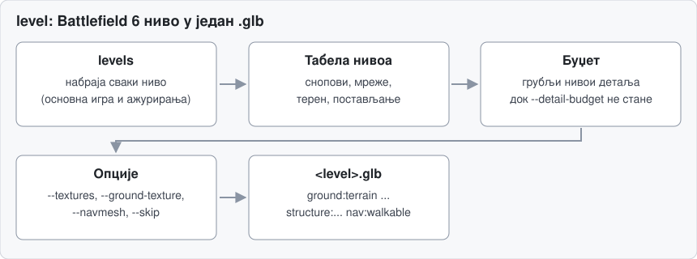

# Battlefield 6 нивои: `levels` и `level` {#battlefield-6-levels-levels-and-level}

**Шта је то?** Цели ниво Battlefield 6 као једна 3D датотека. **Зашто?** Да топлота из ваших мечева има тло и зграде испод себе. (*Frostbite* је мотор од којег је направљен Battlefield; *висинско поље* је тло записано као мрежа висина.)

Извози цели Frostbite ниво инсталиране игре: висинско поље терена, сваку мрежу коју његове групе статичких модела постављају, објекте постављене један по један, позадину терена око мапе, а на захтев и мапе боја површина, налепнице терена уписане у тло и ходљиве површине војника.



## Корак по корак {#step-by-step}

1. **Испишите нивое** које игра испоручује:

   ```
   python -m heat3d_gamefiles levels
   python -m heat3d_gamefiles levels --install "D:\Games\<game folder>"
   ```

   Сваки ред је табела нивоа (`levels/<level>/<level>.toc`) са својом величином и одакле долази: `Data` за основну игру, `Update/<pack>` за ажурирање.

2. **Извезите један**, по његовом називу, јединственом делу назива или путањи његове `.toc` датотеке. Почните без боје да видите облик и величину:

   ```
   python -m heat3d_gamefiles level <level> -o level.glb
   ```

3. **Додајте боју** кад изгледа исправно:

   ```
   python -m heat3d_gamefiles level <level> -o level.glb --textures 512 --ground-texture 0.5
   ```

4. **Додајте ходљиве површине**, или смањите датотеку:

   ```
   python -m heat3d_gamefiles level <level> --textures 512 --ground-texture 0.5 --navmesh
   python -m heat3d_gamefiles level <level> --textures 256 --detail-budget 3000000 --ground-spacing 8
   ```

5. **Отворите `level.glb`** у панелу Позадина / ниво 3DHeat приказивача ([учитавање нивоа](https://holdi601.github.io/3DHeat/levels.html)).

## Опције {#options}

| Опција | Подразумевано | Значење |
|---|---|---|
| `<level>` | обавезно | назив како га исписује `levels`, јединствени део назива, или путања `.toc` нивоа |
| `-o`, `--out FILE` | `<level>.glb` | датотека која се записује |
| `--install FOLDER` | налази се у Steam библиотекама | фасцикла игре |
| `--textures [PIXELS]` | искључено; 512 без величине | мапа боје сваке површине, највише PIXELS по страни |
| `--ground-texture [METRES]` | искључено; 0,5 без величине | утисне путеве, платое и ознаке у боју тла, METRES по пикселу |
| `--navmesh` | искључено | дода навигациону мрежу војника као `nav:walkable` |
| `--ground-spacing METRES` | 4 | најфинији размак висинског поља; 0 га изоставља |
| `--detail-budget N` | најгрубље копије плус четвртина, најмање 1.500.000 | плафон троуглова (терен се никад не грубо) |
| `--skip TEXT` | | изостави групе модела чији назив партиције садржи TEXT; може се поновити |
| `--by-mesh` | искључено | по један део за сваку изворну мрежу и материјал, за проналажење шта је који део |
| `--clamped-uvs` | искључено | за приказиваче који не могу да понове текстуру |

Пун табела, са величинама које треба очекивати (цео ниво је стотине MB), налази се у [Командама](commands.md#levels-and-level-frostbite). Како се табеле, пакети, мреже и терен читају, описано је у [Frostbite](reader-frostbite.md).

## Пример излаза {#example-output}

Шта исписује `level`, у контури (редови како их пише код; `<n>` и називи се мењају од нивоа до нивоа):

```text
<n> copies of <n> meshes, from <n> static model groups
      <n>  <group>
      <n>  placed one by one (object and prefab references)
<n> meshes left out: <why>
<n> triangles, budget <n>; <n> meshes drawn at a coarser level to fit
           <n>  ground:terrain
           <n>  structure:buildings, <n> textures
           ...
<n> of <n> drawn sections carry their colour map; the rest are flat colours
Ground: <what the ground is>.
Navigation mesh: <tiles read>.
-> level.glb (<n> MB)
```

## Делови {#the-parts}

`ground:terrain` (висинско поље), `ground:terrain backdrop` и `ground:terrain blend`, `structure:<kind>` по врсти мреже (по мапи боје уз `--textures`, са ` (destructible)` за оно што меч може да уништи), и `nav:walkable` уз `--navmesh`. Видите [Формат излаза](output-format.md).

Датотека садржи садржај игре: намењена је рачунару на којем је направљена, а не дељењу ([Правила и лиценце](rules-and-licences.md)).
