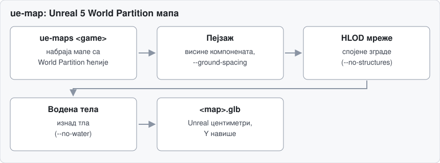

# Unreal 5 World Partition мапе: `ue-maps` и `ue-map` {#unreal-5-world-partition-maps-ue-maps-and-ue-map}

**Шта је то?** Цела мапа Unreal 5 игре као једна 3D датотека: тло, зграде и вода. **Зашто?** Да топлота из те игре има мапу испод себе. (*World Partition* је начин на који Unreal 5 дели велику мапу на делове; *HLOD* је поједностављена замена за групу зграда, она коју игра црта из далека.)

Извози целу мапу Unreal 5 игре чије су мапе печене као World Partition ћелије: подлогу (landscape), спојене HLOD мреже мапе (њене зграде и предмети онако како их игра црта из далека) и водена тела. Није потребан уређивач ни пројекат, само инсталирана игра.



## Корак по корак {#step-by-step}

1. **Испишите мапе.** `<game>` је фасцикла игре, њен `Content/Paks`, или назив њене фасцикле у Steam библиотеци:

   ```
   python -m heat3d_gamefiles ue-maps "<Steam game folder name>"
   python -m heat3d_gamefiles ue-maps "D:\Games\<game>"
   ```

   Свака мапа са печеним World Partition ћелијама исписује се са својом путањом пакета.

2. **Извезите једну** по њеном називу или јединственом делу назива:

   ```
   python -m heat3d_gamefiles ue-map "<game>" <map> -o map.glb
   ```

3. **Само тло, или грубље:**

   ```
   python -m heat3d_gamefiles ue-map "<game>" <map> --no-structures --no-water
   python -m heat3d_gamefiles ue-map "<game>" <map> --ground-spacing 4
   ```

4. **Отворите `map.glb`** у панелу Позадина / ниво 3DHeat приказивача ([учитавање нивоа](https://holdi601.github.io/3DHeat/levels.html)).

## Опције {#options}

| Опција | Подразумевано | Значење |
|---|---|---|
| `<game>` | обавезно | фасцикла игре, њен `Content/Paks`, или назив њене Steam фасцикле |
| `<map>` | обавезно | назив како га исписује `ue-maps`, или јединствени део назива |
| `-o`, `--out FILE` | `<map>.glb` | датотека која се записује |
| `--ground-spacing METRES` | 2 | размак темена подлоге, заокружен на цео број њених властитих квадрата |
| `--no-structures` | | изоставља HLOD зграде и предмете |
| `--no-water` | | изоставља водена тела |

Садржај компресован Oodle-ом треба Oodle библиотеку која је већ на рачунару (видите [Oodle](reader-oodle.md)).

## Пример излаза {#example-output}

```text
<map> -> map.glb
  ground      <n> triangles from <n> landscape components; <n> of <n> vertices stored twice disagree
  structure   <n> triangles in <n> HLOD meshes
  water       <n> triangles from <n> water bodies
```

Број неслагања је самопровера: суседне компоненте подлоге чувају своју заједничку ивицу два пута, и две копије морају да се поклапају. Мапа од 3 km на 2 m има око 4,6 милиона троуглова тла.

## Делови {#the-parts}

`ground:<map>` (подлога), `structure:<map>` (HLOD мреже) и `water:<map>` (вода изнад тла).

**Јединице:** ово је једини извоз који **није у метрима**: Unreal центиметри, са заменом Y и Z (Y нагоре), оквир који записује 3DHeat Unreal Exporter. Телеметрија из исте игре користи исти оквир, па лежи на мапи.

## Како се чита и проверава {#how-it-is-read-and-checked}

| Део | Чита се из | Проверено према |
|---|---|---|
| тло | 16-битне мапе висина сваке компоненте подлоге, постављене по бази њеног одсека на трансформацији подлоге | сваки теме сачуван два пута (на шву или ивици компоненте) мора да се слаже; неслагања се броје и исписују, не глачају |
| структуре | спојене HLOD мреже мапе, које мотор гради у светском простору | мрежа се задржава само ако границе које њена компонента кешира описују њена властита темена |
| вода | мрежа сваког водног тела, положена на мрежу тла, задржана тамо где стоји изнад тла | вода стоји неколико метара изнад тла испод ње, као река изнад свог корита |

Особине подлоге се налазе по облику, а не по броју слота (слотови се померају између верзија мотора). Структуре су поједностављене замене, а не пуни модели. Растиње, налепнице и материјали подлоге се не извозе; тло је без текстуре, а сенчи га приказивач. Детаљи архиве: [Unreal 5 IoStore](reader-unreal-iostore.md).

**Ваше сопствене датотеке:** мапа се чита из игре инсталиране на вашем рачунару и уписује на ваш диск за вашу сопствену анализу; ништа из игре се не испоручује са овим алатом.
