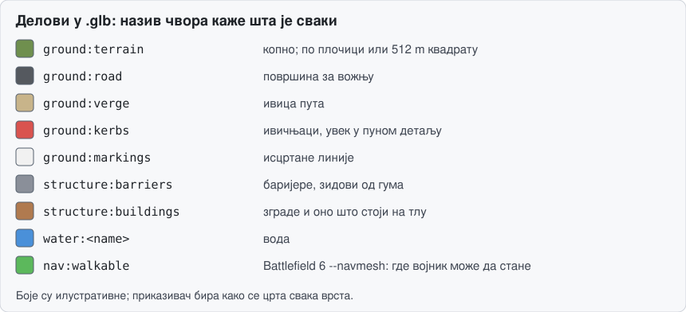

# Формат излаза {#output-format}

`.glb` је једна 3D датотека: тло, зграде и вода стазе или нивоа, коју отварате у панелу
Позадина / ниво у 3DHeat приказивачу.

Сваки извоз (`course`, `courses`, `terrain`, `level`, `ue-map`, `enfusion-world`) пише једну **binary glTF 2.0**
датотеку (`.glb`). Намерно је мала и равна, и уређена онако како 3DHeat приказивач чита ниво.
Извор:
[`glb.py`](https://github.com/Holdi601/3DHeat-GameFiles/blob/main/heat3d_gamefiles/glb.py).

## Структура {#structure}

```
scene 0
 ├─ node "ground:terrain x-2046 z1023"  -> mesh 0 -> 1 primitive, material 0
 ├─ node "ground:road x-2046 z1023"     -> mesh 1 -> 1 primitive, material 1
 ├─ node "ground:markings"               -> mesh 2 -> ...
 ├─ node "ground:kerbs road_gen_rum_..." -> ...
 ├─ node "structure:barriers bar_armco_bclr"
 └─ ...
```

- **Један чвор по делу**, сви у корену сцене, **без трансформација**. Сва геометрија је већ у
  светским координатама.
- Сваки чвор има своју мрежу са **једним примитивом** и сопствени материјал. Чвор, мрежа и материјал
  носе све име дела.
- Сваки примитив има **своја компактна низа темена**, само оних темена која тај део користи.
  Заједнички низ темена је дозвољен у glTF-у, али би читач који разлаже низове сваког примитива
  тада држао свако теме једном по делу.
- `asset.generator` је `heat3d_gamefiles`.
- **Мало `extras`**, и без имена игре, стазе или нивоа:
  - Battlefield 6 део разбивљиве мреже носи `{"destructible": true}` на свом чвору;
  - Forza стаза каже шта садржи у `asset.extras` (верзија формата, подударена
    идентификатор руте, колико копија слоја трке, места; видите
    [Forza Horizon стазе](course-forza-horizon.md#writing-the-file)), а њени укључени делови носе свој
    слој на чвору: `{"layer": "event", "route": <id>}` за слој трке, `{"layer": "layer"}` за други
    укључени слој, `{"layer": "venue"}` за тло места.

  Све остало што приказивачу треба је у именима чворова.

## Имена чворова: класификација {#node-names-the-classification}



Приказивач узима класу дела из имена **чвора** (уз резерву на име мреже), и то само кад се поклапа са

```
^(ground|structure|water)\s*[:|]
```

Све остало се класификује хеуристиком писаном за Unreal пејзаже. Зато сваки део који извозник
пише почиње једним од ових префикса, или са `nav:` (испод).

| Префикс | Значење | Пишу се делови |
|---|---|---|
| `ground:` | површина за вожњу и земља | `ground:road`, `ground:verge`, `ground:terrain`, `ground:gravel and dirt`, `ground:kerbs`, `ground:markings`, `ground:tyre marks`, `ground:venue`, `ground:plinths` |
| `structure:` | оно што стоји на њој | `structure:barriers`, `structure:props`, `structure:signs`, `structure:buildings`, `structure:infrastructure`, `structure:bridges`, `structure:rocks`, `structure:smashables`, `structure:trees`; Forza слојеви `structure:event_<category>` и `structure:layer_<category>` |
| `water:` | вода | `water:water`; `water:<map>` (`ue-map`), `water:<world>` (`enfusion-world`) |
| `nav:` | где војник може да ходи (Battlefield 6, само `--navmesh`) | `nav:walkable` |

`nav:` се не поклапа са горњим обрасцем приказивача, па га приказивач сврстава по својој
хеуристици; то је посебан део како бисте га могли приказати или сакрити сам. `ue-map` пише
`ground:<map>`, `structure:<map>` и `water:<map>`; `enfusion-world` пише `ground:<world>`,
`structure:<world>` и `water:<world>`.

После врсте долази, зависно од игре:

| Пример | Значење |
|---|---|
| `ground:road x-2046 z1023` | Forza тло у плочици терена `x-2046 z1023` (јединице мреже, 1023 по 512 m) |
| `ground:road 3_-2` | BeamNG тло у квадрату од 512 m (3, -2) |
| `ground:road 3_-2 asphalt_light` | BeamNG моделована површина вожње материјала `asphalt_light` у том квадрату |
| `ground:road 1_-4` | AC Rally тло у квадрату од 512 m (1, -4) Unreal простора |
| `structure:barriers bar_armco_bclr` | Forza постављени модели који деле једну текстуру (име без GUID-а) |
| `structure:barriers` | постављени модели без текстуре (Forza, AC Rally) |
| `structure:event_barriers bar_example_bclr` | Forza: оно што подударена трка поставља за себе, осим слободног света (extras чвора `{"layer": "event", "route": <id>}`) |
| `structure:layer_props` | Forza: слој који игра укључује за нешто друго осим ове трке (активност, скупљајући предмет, слој у току рада) |
| `ground:venue`, `ground:plinths` | Forza: модели већ у светским координатама - сопствено тло места (подлога стадиона), и тло којим се улица украшава |
| `structure:barriers armco_metal` | BeamNG постављени модели једног материјала |
| `ground:markings`, `water:water` | равни делови, по један за цео фајл |
| `ground:terrain` (Battlefield 6) | висинско поље; `ground:terrain backdrop` удаљене мреже терена, `ground:terrain blend` мреже које се стапају са тереном |
| `nav:walkable` (Battlefield 6, `--navmesh`) | мрежа за навигацију нивоа за војника: где може да стане, зелено и равно |
| `ground:terrain x-512 z-512` (Battlefield 6, `--ground-texture`) | висинско поље под једном печеном плочицом декала, именовано по доњем углу плочице у метрима |
| `structure:buildings t_concreteclean_01_cs` (Battlefield 6, `--textures`) | свака површина те врсте која приказује ту мапу боја; без `--textures`, по један део по врсти, без наставка |
| `structure:buildings t_concreteclean_01_cs (destructible)` (Battlefield 6) | исто, за мреже које меч може да сруши: оне са објектом за уништавање свог имена (зидови, куће, реквизити). Чвор такође носи glTF extras `{"destructible": true}`. Њихова уништена стања се не извозе |

Приказивач може да филтрира по овим именима. На пример, "само површина за трку" је
`ground:road` заједно са `ground:kerbs`, у све три игре, а "свет без реквизита трке" су све
осим `structure:event_*`. Префикс је такође начин на који приказивач црта део: тло као површину на
којој лежи топлота, структуре као оно што стоји на њој.

## Јединице, осе и оквир {#units-axes-and-frame}

- **Метри, Y горе**, glTF конвенција, за сваки извоз осим `ue-map`. Ништа се не скалира нити
  центрира: бројеви су светске координате игре, што је смисао читања архиве уместо реконструкције.
- **Unreal 5 мапе (`ue-map`): центиметри**, Unreal-ова сопствена јединица, са заменом Y и Z тако да
  је Y горе - оквир који пише 3DHeat Unreal Exporter и који користи телеметрија игре. Једини извоз који
  није у метрима.
- **Arma Reforger (`enfusion-world`):** игрини сопствени метри, x исток, y горе, z север. Оквир игре
  је леворуки; опција приказивача *invert world axis* показује га неогледално.
- **Forza:** сопствене светске координате игре (x, y горе, z), непромењене. Исте као телеметрија, па се
  снимљени круг поклапа са стазом.
- **BeamNG.drive:** `(x, z, -y)` BeamNG-овог света са z осом увис, што је ротација коју телеметријски
  снимач примењује. Ротација, а не пресликавање.
- **Battlefield 6:** сопствене светске координате игре (x, y горе, z), непромењене: трансформације
  инстанци нивоа примењене на сваку мрежу како је записана. Пресликане копије се поново
  намотавају да би им нормале гледале напоље.
- **Assetto Corsa Rally:** оквир круга. Unreal центиметри постају метри, Unreal Z постаје y, а Unreal X
  и Y постају x и z у оној од осам оријентација коју се круг уклопио (видите
  [Assetto Corsa Rally](course-assetto-corsa-rally.md#which-stage-and-which-way-round)).
  Троуглови се поново намотавају где то пресликавање огледа.

Сваки извоз задржава осе које користи његова телеметрија, па снимак и ниво деле исти оквир. Да ли је
тај оквир леворук или десноруки у свакој игри није проверено.

## Подаци темена {#vertex-data}

Подразумевани облик је **квантизован** (`quantize=True`). Треба му проширење
`KHR_mesh_quantization`, које је наведено и у `extensionsUsed` и у `extensionsRequired`.

| Атрибут | Квантизован (подразумевано) | Пуна прецизност (`quantize=False`) |
|---|---|---|
| `POSITION` | float32 VEC3, са min/max | float32 VEC3 |
| `NORMAL` | int8 VEC3 нормализован, попуњен до 4 бајта (корак 4) | float32 VEC3 |
| `TEXCOORD_0` (само делови са текстуром) | uint16 VEC2 нормализован, ограничен на 0-1; float32 VEC2 где се текстуре понављају (Battlefield 6) | float32 VEC2 |
| `COLOR_0` (делови без текстуре, кад било који део има боју) | uint8 VEC3 нормализован, попуњен до 4 бајта | float32 VEC3 |
| индекси | uint16 кад део има највише 65.535 темена, иначе uint32 | uint32 |

Теме има 20 бајтова уместо 32 (24 уместо 44 са бојом). То смањује сваку датотеку за трећину, и то
је разлика између тога да се град-стаза учита у језичку прегледача и да се не учита. Цена је мање од
пола степена нормале и 1/65.535 UV (петнаестина тексела на 4.096 px). Командна линија увек пише
квантизован облик. `write_glb(..., quantize=False)` у Python-у пише други.

Нормале долазе из игре где их она чува (Forza тло и модели, BeamNG облици и терен). Иначе се
рачунају као површински тежински углађене нормале из троуглова. AC Rally нормале се увек рачунају.

## Материјали, боје и текстуре {#materials-colours-and-textures}

- Сваки материјал је `metallicFactor 0`, `roughnessFactor 1`.
- **Део са текстуром:** `baseColorTexture` са сликом дела, UV, и без боје темена. glTF их множи, па би
  површина изгледала двоструко потамњена.
- **Део без текстуре:** боја темена `COLOR_0` са равном бојом дела, и бела `baseColorFactor`. Ако ниједан
  део у фајлу нема боју, нема `COLOR_0`. Где делови деле темена, боја каснијег дела побеђује, па се
  равни делови пишу по растућем реду важности.
- **Слике** се уграђују у бинарни део као **JPEG**, квалитет 90, без поткодирања боје, само RGB (алфа
  се одбацује) - осим Battlefield 6 мапе изрезака (листови, ограде), која је **PNG** са својом алфом, на
  материјалу са `alphaMode` MASK, `alphaCutoff` 0,5 и `doubleSided` (видите
  [Frostbite](reader-frostbite.md#textures-and-materials)). 3DHeat приказивач одбацује текеле испод
  граничне вредности. Тло од 2.048 px са травом и крошњама дрвећа је шум за кодер без губитака: више
  мегабајта по плочици као PNG, испод једног као JPEG. Слика коју дели више делова се чува једном.
- Један узорковач за све текстуре: линеарно увећање, linear-mipmap-linear умањење, **clamp to edge** на
  обе осе, за извозе стаза, чије текстуре покривају своје површине једном. BeamNG црта понављајуће
  текстуре модела као равне боје (видите [BeamNG.drive](course-beamng.md#placed-models)).
- Battlefield 6 извоз са `--textures`, чији се материјали поплочавају, пише игрине сопствене координате
  текстуре, неограничене, као float32 `TEXCOORD_0` чак и у квантизованом облику, са узорковачем који
  се **понавља** на обе осе (`write_glb(..., repeat=True)`): зидна цигла је један пар троуглова чији UV
  иде од 0 до 40. 3DHeat приказивач умотава такву текстуру у свој атлас (видите његову страницу
  *Model levels*). За рендерер који не може да понови текстуру, `level --clamped-uvs`
  (`write_level(..., clamped=True)`) сече сваки троугао дуж линија на којима се његова текстура
  понавља и помера сваки комад у 0..1: исти пиксели на истој површини, око једне петине више
  троуглова. Троуглови преко којих се текстура понавља више од 16 пута задржавају своје координате.
  Троугао који би његова текстура исекла у више од 4 комада - кора која се понавља низ сваку грану
  дрвета, због чега је сечење једног дрвета од 1.099 троуглова дало 51.735 - иде у део сопствен,
  `<part> (average colour)`, у просечној боји текстуре; `level` каже колико их је.

| Текстура | Величина | Покрива |
|---|---|---|
| тло (сви осим Battlefield 6) | `--texture-size`: 2048, 1024 или 512 px | један квадрат од 512 m: 25, 50 или 100 cm по пикселу |
| Battlefield 6 висинско поље | највећи мип мапе боја позадине у нивоу, исечен | квадрат терена: 32 m по пикселу у проверено нивоу |
| Battlefield 6 површине | `--textures`: највише толико px по страни | сопствена текстура површине, једном по комаду (сечено где се понавља) |
| Battlefield 6 печено тло | `--ground-texture`: метри по пикселу, плочице од највише 4.096 px | једна плочица проширења декала: 2.048 m на 0,5 m по пикселу |
| Forza постављени модел | највише 256 px | сопствени UV распоред модела |
| BeamNG постављени модел | највише 256 px | сопствени UV распоред модела, само где се не понавља |
| AC Rally постављени модел | нема | равне боје |

## Шта писац одбија {#what-the-writer-refuses}

`write_glb` подиже грешку, уместо да напише фајл који би приказивач отворио и приказао погрешно:

| Одбијено | Зато што |
|---|---|
| положаји нису N x 3, или нису коначни | покварена мрежа |
| индекс иза краја низа темена | приказује се као шум |
| текстурисани део кад фајл нема UV | приказује се као једна размазана тачка |
| нема троуглова уопште | приказује се као ништа |
| низ нормала, боја или UV погрешне дужине, или није коначан | потребан је по један за свако теме |

## Читање на другом месту {#reading-it-elsewhere}

Сваки glTF 2.0 приказивач који подржава `KHR_mesh_quantization` би требало да отвори ове
фајлове. Проверен је само 3DHeat приказивач; други приказивачи нису проверени. Читач без тог
проширења одбија фајл, јер је означено као обавезно. Фајлови могу бити велики: око 80 MB за сеоску
стазу, и до неколико стотина MB за градску стазу са аутоматским буџетом.

## У 3DHeat-у {#in-3dheat}

Учитајте `.glb` у панелу Позадина / ниво [3DHeat](https://github.com/Holdi601/3DHeat) приказивача;
телеметрија коју снимате у истој игри лежи на њему, јер оба задржавају игрине координате. Сопствена
документација приказивача ([holdi601.github.io/3DHeat](https://holdi601.github.io/3DHeat/)) покрива
панел Позадина / ниво и фајлове мечева које пишу остали алати
([Један фајл по мечу: `.3dheat`](https://holdi601.github.io/3DHeat/container.html)).
Ниво се не чува у сваком `.3dheat` фајлу: меч га именује у свом `references` (`kind: "level"`, име и
sha256), а `.glb` остаје поред мечева.
