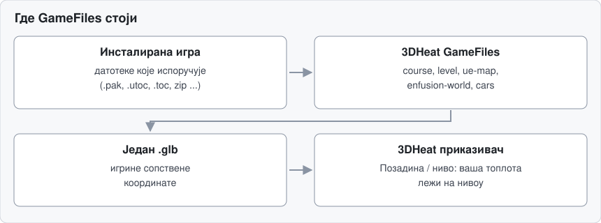

# Цели нивои {#whole-levels}

**Једноставно речено:** за шутере и друге игре без кругова, алат сачува целу мапу као једну 3D датотеку, па приказивач може да нацрта где су играчи били на њој.

`course` исече земљу око круга. За игре без кругова алат извози цео ниво, мапу или свет одједном:

| Игра или мотор | Списак | Извоз | Страница |
|---|---|---|---|
| Battlefield 6 (Frostbite) | `levels` | `level <level>` | [Battlefield 6 нивои](level-battlefield.md) |
| Unreal 5 World Partition игре | `ue-maps <game>` | `ue-map <game> <map>` | [Unreal 5 мапе](level-unreal-world-partition.md) |
| Arma Reforger (Enfusion) | `enfusion-worlds` | `enfusion-world <world>` | [Arma Reforger светови](level-arma-reforger.md) |

Сваки пар ради на исти начин: прва команда исписује шта инсталирана игра садржи, а друга записује један од њих као једну `.glb` датотеку у светским координатама саме игре, па позиције снимљене у тој игри леже на њему. Делови се зову `ground:`, `structure:` и `water:` као и сваки други извоз (видите [Формат излаза](output-format.md)); учитајте датотеку у панел Позадина / ниво приказивача 3DHeat.

