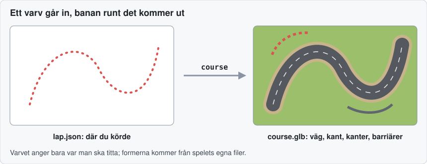
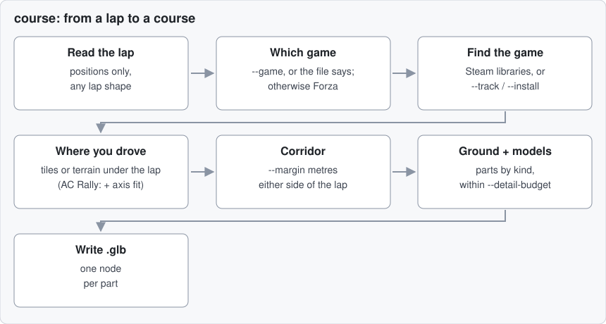
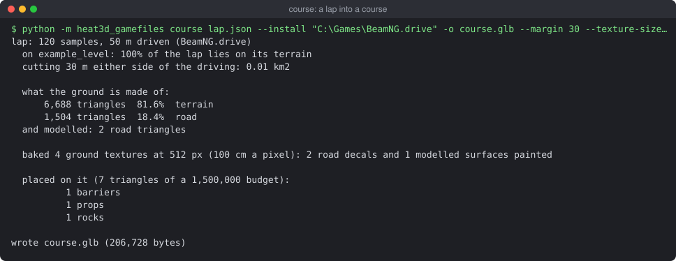

# Banexport

**Enkelt uttryckt:** du körde ett varv, och det här bygger banan du körde på, som en
3D-fil. Varvet är bara en rad punkter. Vägen, gräset och kantstenarna kommer från
spelets egna filer.

`course` gör av ett varv en bana: marken i ett band på båda sidor om där bilen
körde, och det som står på marken, som en `.glb` för visaren. Den här sidan
täcker det alla tre stödda spelen har gemensamt. Sidorna under den täcker det som skiljer dem åt:

- [Forza Horizon](course-forza-horizon.md): ForzaTech `.minizip`-arkiv
- [BeamNG.drive](course-beamng.md): zip-arkiv, ett terränghöjdfält, kompilerade former
- [Assetto Corsa Rally](course-assetto-corsa-rally.md): Unreal 5 IoStore, en World Partition-etapp
- [Detaljnivåer och budgeten](detail-budget.md): hur många trianglar de placerade modellerna får, och vilka kopior som behålls

## Stegen

Ord som används nedan: en **ram** är vilket håll axlarna pekar; **korridoren** är
bandet av mark på båda sidor om varvet; en **ruta** är en kvadratisk bit av ett
spels terräng; en **LOD** (detaljnivå) är en av en modells enklare kopior.

1. **Läs varvet.** Bara positioner, från någon av formerna i
   [Varvindata](lap-inputs.md). Hastighet och inmatning används inte. Ett varv med
   färre än två punkter avvisas ("holds no driving").
2. **Bestäm spelet.** `--game`, sedan varvfilens egna `game`, sedan Forza (se
   [Kommandon](commands.md#which-game)).
3. **Hitta det installerade spelet.** Alla tre söker i varje Steam-bibliotek som
   står i Steams `config\libraryfolders.vdf`. Forza söker även i `C:\XboxGames`.
   `--track` (Forza) eller `--install` (BeamNG, AC Rally) hoppar över sökningen.
4. **Hitta var varvet kördes.** Detta avgörs aldrig enbart av ett namn. Forza väljer
   den bana vars terrängrutor täcker varvet. BeamNG väljer den nivå vars terräng (eller
   vägar) varvets punkter ligger på. AC Rally prövar varje etapp i åtta
   axelriktningar och väljer den som lägger mest av varvet på väg.
5. **Skär ut en korridor** `--margin` meter på båda sidor om körningen (nedan).
6. **Bygg marken** inom korridoren, indelad i väg, kant, grus och jord, terräng,
   markeringar, däckspår eller vatten, och baka en markstruktur för varje 512 m-kvadrat.
7. **Placera modellerna** som står i korridoren, efter kategori, i en detaljnivå som
   väljs efter avstånd och en triangelbudget.
8. **Skriv `.glb`-filen**: en namngiven nod per del. Se [Filformat](output-format.md).

Vad en körning skriver ut. Här på en syntetisk BeamNG.drive-installation som
testerna bygger, ett 50 m långt varv längs en vägremsa:

## Korridoren

Utskärningen är ett band runt den körda linjen, inte varvets omslutande ruta. För
en bana är de två nästan lika. För en sträcka från punkt till punkt är rutan mest
bergssluttning som ingen kör förbi, och bandet kan vara en tiondel av dess yta.
Källa: [`corridor.py`](https://github.com/Holdi601/3DHeat-GameFiles/blob/main/heat3d_gamefiles/corridor.py).

Så här byggs den:

- Körningen projiceras på markplanet: varvets x och z (BeamNG: x och y i spelets egen ram).
- Den rastreras på ett rutnät med **4 m** celler (`CELL`). Varje cell som körningen
  rör breddas med en skiva med radien `margin + 4 m` åt alla håll.
- Punkter som ligger närmare varandra än **50 m** (`JOIN`) sammanfogas med punkter
  var 4:e meter, så att bandet inte har några luckor. Punkter längre från varandra
  behandlas som skilda stycken av körning och sammanfogas inte. En bibliotekskurs
  består av många varvfiler efter varandra, och målgången på ett sprintlopp och
  startpunkten på nästa får inte dra ett band över kartan.
- En triangel behålls om något hörn, mitten av någon kant eller dess tyngdpunkt
  ligger i bandet. Mittpunkterna fångar en stor triangel som ligger tvärs över ett
  smalt band med alla hörn utanför.
- Höjden ingår aldrig i utskärningen. En låda som begränsade höjden skulle skära
  bort marken under en backe som vägen går upp för.

Konsolen redovisar korridorens yta, till exempel
`cutting 80 m either side of the driving: 1.53 km2 of a 6,000 by 3,600 m box`.

BeamNG och AC Rally bygger också en bredare **reach**-korridor på `margin + 60 m`. En
placerad modell tas med om dess origo ligger i reach-korridoren, och ritas bara om
dess yta når in i den verkliga korridoren. Så förloras inte ett långt föremål vars
origo ligger strax utanför bandet. BeamNG använder även reach-korridoren för att
välja vilka vägdekaler som målas.

## Vad marken består av

Varje export delar in markens trianglar i samma slag, och varje slag skrivs som
en egen del så att visaren kan visa eller dölja den:

| Slag | Delens namn | Platt färg (linjär RGB) | Forza | BeamNG | AC Rally |
|---|---|---|---|---|---|
| väg | `ground:road` | 0,22, 0,22, 0,23 | vägremsor: asfaltdelen | typ `ASPHALT`-lager, vägdekaler, modellerad väg | banrutor (`/MeshesTrack/`) |
| kant | `ground:verge` | 0,52, 0,47, 0,30 | vägremsor: axelkanten | trottoarer och kantmodeller | - |
| grus och jord | `ground:gravel and dirt` | 0,50, 0,42, 0,30 | - | jord-, grus-, sand- och lervlager och dekaler | - |
| terräng | `ground:terrain` | 0,30, 0,44, 0,18 | allt annat | allt annat | `_Terrain`-rutor och fjärrterräng |
| kantstenar | `ground:kerbs` | 0,60, 0,12, 0,10 (Forza) | `road_gen_rum*`-rekvisita | kant-, kantsten- och skramlemodeller | kant- och kantstensmodeller |
| markeringar | `ground:markings` | 0,90, 0,90, 0,88 | dekal-undermeshar, lyfta 5 cm | målade in i texturen | - |
| däckspår | `ground:tyre marks` | 0,20, 0,17, 0,16 | dekal-undermeshar, lyfta 5 cm | målade in i texturen | - |
| vatten | `water:water` | 0,16, 0,34, 0,48 | vattenmaterial | havsplan, vattenblock, floder | - |

De platta färgerna är valda för att synas direkt, inte för att efterlikna spelet.
De används för delar utan textur och av visare som ignorerar texturer. Källa:
[`surfaces.py`](https://github.com/Holdi601/3DHeat-GameFiles/blob/main/heat3d_gamefiles/surfaces.py).

Markdelarna delas per 512 m-kvadrat, och varje kvadrat har sin egen inbakade bild,
så delarnas namn bär kvadraten:

| Spel | Markdelens namn | Kvadratnyckel |
|---|---|---|
| Forza | `ground:road x-2046 z1023` | terrängrutans rutnätsnamn (steg om 1023, se [Forza Horizon](course-forza-horizon.md)) |
| BeamNG | `ground:road 3_-2` | `floor(x / 512)`, `floor(y / 512)` i BeamNG-meter |
| AC Rally | `ground:road 1_-4` | `floor(x / 51200)`, `floor(y / 51200)` i Unreal-centimeter |

## Det som står på marken

Placerade modeller skrivs i delar som heter `structure:<kategori>`, eller
`ground:kerbs` för kantstenar (i alla tre spelen). När en del har en egen textur
följer textur- eller materialnamnet kategorin, till exempel
`structure:barriers bar_armco_bclr`.

| Kategori | Forza | BeamNG | AC Rally |
|---|---|---|---|
| barriärer | ja | ja | ja |
| rekvisita | ja | ja | ja |
| skyltar | ja | ja | ja |
| byggnader | ja (hela byggnader som ersättningar där spelet har dem) | ja | ja |
| infrastruktur | ja | ja | ja |
| broar | ja | ja | (räknas som infrastruktur) |
| stenar | ja | ja | ja |
| kantstenar | ja, som mark | ja, som mark | ja, som mark |
| träd | med `--trees` | med `--trees` | med `--trees` |
| krossbara föremål | med `--trees` | - | - |

Hur detaljen delas ut är detsamma i alla tre. Kopior inom 25 m från körningen
börjar i full detalj, kopior 25-60 m bort en nivå grövre, och kopior längre ut i
den grövsta nivån. Sedan får de dyraste modellerna sänkas tills en triangelbudget
passar, och där även de grövsta nivåerna inte passar en budget du anger, utelämnas
kopior. Kantstenar förenklas aldrig och utelämnas aldrig. Se
[Detaljnivåer och budgeten](detail-budget.md).

## Alternativ som styr resultatet

| Du vill ha | Använd |
|---|---|
| en mindre fil | `--no-textures` (platta färger), `--texture-size 1024` eller `512`, `--detail-budget N`, `--margin 40` |
| bara marken | `--no-placed` |
| scenerin också | `--trees` |
| en annan säsong (Forza) | `--season winter` |
| ett spel utanför Steam | `--track` (Forza) eller `--install` (BeamNG, AC Rally) |
| ett varv som sökningen inte placerar | `--level` (BeamNG, AC Rally), `--track` (Forza) |

## Koordinater

Varje export skriver meter med Y uppåt, i ett koordinatsystem som ett inspelat varv
från samma spel passar in i:

| Spel | Skriven ram |
|---|---|
| Forza | spelets egna världskoordinater, oförändrade |
| BeamNG | `(x, z, -y)` i BeamNG:s Z-uppåt-värld, vilket är rotationen som telemetriinspelaren använder |
| AC Rally | varvets ram, funnen genom anpassning: Unreal-centimeter blir meter, och Unreal X och Y blir varvets x och z i den av åtta riktningar som passar |

Se [Filformat](output-format.md).
