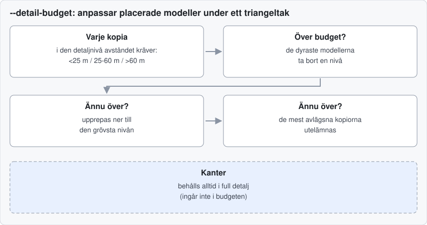

# Detaljnivåer och budgeten {#levels-of-detail-and-the-budget}

En **triangel** är en liten platt bit av en 3D-modell. Fler trianglar ger en större,
långsammare fil. **Budgeten** är en gräns för hur många. En **detaljnivå** är en
enklare kopia av en modell, som används när den är långt bort.

Det finns flera miljoner trianglar i den finaste nivån för allt som placeras runt
en bana. Till exempel hundratals räcksegment och däckstaplar på cirka tusen trianglar
var. En stadskorridor har över hundra tusen kopior. Därför ger varje banexport de
placerade modellerna en **triangelbudget** och avgör för varje modell i vilken
detaljnivå den ritas, och vid behov vilka kopior som utelämnas.

Schemat skrevs för Forza
([`forzaplacement.py`](https://github.com/Holdi601/3DHeat-GameFiles/blob/main/heat3d_gamefiles/forzaplacement.py):
`choose_levels`, `auto_budget`, `_fit`), och BeamNG och AC Rally återanvänder dess delar.
Terrängen räknas inte mot budgeten.

## Avståndsband {#distance-bands}

Varje kopias avstånd till körningen mäts i markplanet, till närmaste varvpunkt. Varvet
gallras först till högst 1 000 punkter, vilket kostar några meter i precision och
inget som spelar roll här. Kopiorna hamnar sedan i tre band, och varje par (modell,
band) budgeteras för sig:

| Band | Avstånd | Börjar på |
|---|---|---|
| nära | under 25 m (`NEAR`) | den finaste nivån |
| mellan | 25-60 m (`FAR`) | en nivå grövre |
| långt | 60 m och mer | den grövsta nivån |

Utan någon rutt (Forza `terrain --box`) mäts avståndet till lådans mitt.

## Sänkning för att passa {#stepping-down-to-fit}



Kostnaden för en (modell, band)-post är kopior gånger trianglar på dess nuvarande
nivå. Så länge summan ligger över budgeten sänks posten som kostar mest en nivå, och
det upprepas tills summan passar eller ingen post kan sänkas mer. Fastlåsta poster
sänks aldrig:

| Spel | Fastlåst i full detalj |
|---|---|
| Forza | kantstenar (`road_gen_rum*`) |
| BeamNG | kantstenar, och varje form som bär körbar yta |
| AC Rally | kantstenar |

Forza-sammanfattningen redovisar detta som
`N of M models drawn at a coarser level to fit the budget`.

## Den automatiska budgeten {#the-automatic-budget}

Utan `--detail-budget` bestämmer budgeten sig själv så att **ingen kopia utelämnas**:

```
budget = max(1,500,000, 1.25 x sum(copies x coarsest level))
```

Fastlåsta poster räknas i sin finaste nivå. De 25 % (`HEADROOM`) gör att saker vid
vägen får behålla lite detalj. På en landsvägsbana blir detta golvet på 1,5 miljoner
(`DEFAULT_BUDGET`). På en stadsbana, där korridoren har över hundra tusen kopior,
växer den till över tio miljoner, och filen till flera hundra MB. Visaren klarar det.

## En budget du anger {#a-budget-you-give}

`--detail-budget N` är ett **tak**. Nivåerna sänks som ovan. Om även de grövsta
nivåerna inte passar utelämnas kopior:

| Spel | Ordning för utelämnade kopior |
|---|---|
| Forza | först allt 25 m eller längre från körningen, sedan det som står bredvid vägen; inom varje grupp först det som ser minst ut från vägen: störst avstånd / storlek (storlek = modellens omslutningsrutas diagonal gånger dess största skala, minst 0,25 m) |
| BeamNG | längst från körningen först |
| AC Rally | längst från körningen först, som BeamNG |
| Battlefield 6 | minst först: omslutningsrutans diagonal gånger skala |

Kantstenar (och för BeamNG, modeller med körbar yta) utelämnas aldrig. En budget som
är mindre än vad de kostar på egen hand överskrids därför av dem och av inget annat.

Verktyget använder avstånd delat med storlek för Forza, för om man bara sorterade på
avstånd skulle en luftkonditioneringsenhet på en vägg nio meter bort överleva den
tjugo meter långa fasaden den hänger på, tolv meter bort. Saker bredvid vägen
kommer sist oavsett storlek, eftersom en tre meter hög barriär fem meter från linjen
är banans kant, medan en femtio meter hög byggnad sextio meter bakom är kulisser.

Sammanfattningen redovisar
`N of M copies left out to fit the budget, the smallest and furthest from the driving first (--detail-budget raises it)`
(Forza), eller `N copies left out to fit the budget, the furthest from the driving first (--detail-budget raises it)`
(BeamNG, AC Rally).

## Hela byggnader (Forza) {#whole-buildings-forza}

En ersättning för en hel byggnad räknas som en kopia, med ett avstånd mätt till
byggnadens närmaste kant. Den behålls eller utelämnas som en enhet. De modulära
bitarna den ersätter budgeteras inte alls. Se
[Forza Horizon](https://holdi601.github.io/3DHeat-Ext-Forza/course-forza-horizon.html#buildings-drawn-whole).

## Vad en detaljnivå är, per spel {#what-a-level-of-detail-is-per-game}

| Spel | Nivåerna kommer från |
|---|---|
| Forza | modellens `Mesh`-undermeshars detaljnivåmask per triangel (bit `level + 1`); `0xFFFF` för sönderbrytbara delar bara för en modell utan markerad nivå |
| BeamNG | `.cdae`-formens `details` med icke-negativ storlek, störst först; för `.dae` det avslutande talet i mesh-nodernas namn (`barrier75`, `barrier40`) |
| AC Rally | den statiska meshens lagrade detaljnivåer, finaste först |
| Battlefield 6 | MeshSet:ens detaljnivåer, finaste först, med bara de sektioner som ritas (inte skuggkopior och bara-djup-kopior), och inte en sista nivå som är en stand-in för långvy (materialen `M_LastLod`, `M_Billboard`, `M_Vista`: ett master-gitterverk blir en solid spik) |

Battlefield 6:s `level` har ingen varvkörning, så det finns inga avståndsband: varje
mesh är en post, och varje kopia ligger på samma nivå. Den automatiska budgeten är
formeln ovan med terrängkulissen fastlåst; höjdfältet ligger utanför budgeten och
bestäms av `--ground-spacing`. Under en budget du anger, när varje mesh ligger i
sin grövsta nivå, utelämnas kopior minst först. Storleken är meshens omslutningsrutas
diagonal gånger kopians skala, eftersom det inte finns någon körning att mäta
avstånd från. Terrängkulissen utelämnas aldrig. En nivå blir automatiskt cirka tio
miljoner trianglar.

## Välja ett tal {#choosing-a-number}

| Du vill ha | Prova |
|---|---|
| allt, full detalj nära vägen | lämna den automatisk |
| en fil som är några gånger mindre | `--detail-budget 500000` med `--texture-size 1024` |
| bara mark | `--no-placed` (ingen budget inblandad) |
