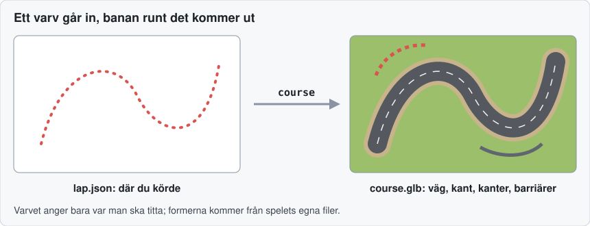
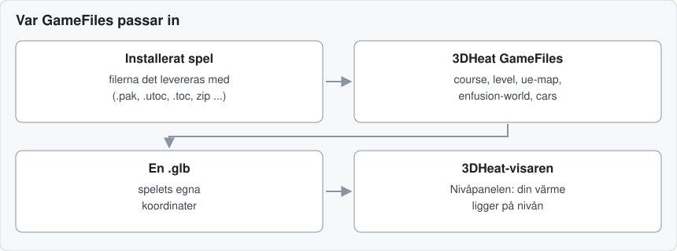

# 3DHeat GameFiles {#dheat-gamefiles}

**Vad är det?** Ett verktyg som bygger en 3D-modell av en banbana eller en spelnivå
från filerna i ett spel du redan har installerat.

**Varför skulle jag använda det?** 3DHeat-visaren målar var du körde eller spelade
som värme. Med det här verktyget målar den på den riktiga banan eller nivån, inte på tom yta.

**Exempel:** ta ett varv du körde. Verktyget bygger vägen och marken runt den
som en enda 3D-fil, så att visaren kan måla din fart eller dina krockar på den riktiga banan:



Har du aldrig använt kommandoraden förut? Börja med [Innan du börjar](before-you-start.md).

Mer i detalj: den läser nivådata ur de arkiv ett spel levereras med och skriver
den som en binär glTF-fil (`.glb`). Dess huvuduppgift är **banexporten**: du
ger den ett varv, och den skriver marken, vägen (skild från kanten och gräset), och kanterna, barriärerna, däcksväggarna, skyltarna och byggnaderna runt den.

Det är en del av [3DHeat](https://github.com/Holdi601/3DHeat), en visare för
3D-telemetrivärmekartor i realtid, Racinganalys och matchgenomgång
([dokumentation](https://holdi601.github.io/3DHeat/)). `.glb`-filerna det här
verktyget skriver är nivåerna visaren ritar värmen på.



Det finns tre sätt att få en nivås geometri in i 3DHeat:

| Väg | Behöver | Ger |
|---|---|---|
| 3DHeat Unreal Exporter | Unreal-projektet öppet i redigeraren | exakt geometri |
| 3DHeat GameCapture | en skärm och en inspelning | en uppskattning |
| **3DHeat GameFiles** | **det installerade, levererade spelet** | **exakt geometri, inget projekt** |

Python-paket: `heat3d_gamefiles`. Repositoryt:
[Holdi601/3DHeat-GameFiles](https://github.com/Holdi601/3DHeat-GameFiles). Licens: MIT.

## Vad den kan göra {#what-it-can-do}

| Spel eller motor | Banexport (`course`) | Arkivläsning |
|---|---|---|
| Forza Horizon (ForzaTech) | ja: terräng, väg och kant, marktextur, placerade modeller i sina egna texturer | `identify`, `list`, `extract` på en `.minizip`; `identify` på en `.modelbin`; modeller, terräng och texturer genom `course` och `terrain` |
| BeamNG.drive | ja: terräng, vägdekaler, modellerade banor, placerade modeller, vatten | `identify`, `list`, `extract` på nivå-zippar; `identify` på `.ter`, `.cdae`; `.dae` genom `course` |
| Assetto Corsa Rally (Unreal 5.6) | ja: etappens markkakel, inbakad markfärg, placerade modeller i platta färger | `identify`, `list`, `extract` på IoStore `.utoc`/`.ucas`; zen-paket, statiska meshar, texturer genom `course` |
| Unreal `.pak` (version 8-12) | nej | `identify`, `list`, `extract` |
| Unity (format 22 och senare) | nej | `identify`, `meshes` |
| Battlefield 6 (Frostbite `.toc`/`.cas`) | ingen bana; en hel nivå med `level`: terräng, placerade meshar, deras färgkartor med `--textures` | `identify`, `levels`; paket, meshar, terräng, texturer och placering genom `level` |
| Source 2 `.vpk` | nej | `identify`, `list`, `extract` |
| Unreal 5 World Partition-spel | ingen bana; en hel karta med `ue-map` (listas med `ue-maps`): landskap, HLOD-byggnader och props, vatten | - |
| Arma Reforger (Enfusion) | ingen bana; en hel värld med `enfusion-world` (listas med `enfusion-worlds`): terräng i sina färger, havet, byggnader som lådor | - |
| Forza (bilar) | `cars`: varje bil i låg detaljnivå, för visarens Racinganalys-flik | - |

Varv från Assetto Corsa EVO och iRacing avvisas med en orsak. Se
[Begränsningar och kända luckor](limits-and-known-gaps.md).

## Installation {#install}

Har du aldrig använt kommandoraden förut? Läs [Innan du börjar](before-you-start.md) först.

Du behöver **Python 3.10 eller senare** (utvecklat på 3.13) och paketen i
[`requirements.txt`](https://github.com/Holdi601/3DHeat-GameFiles/blob/main/requirements.txt).

```
git clone https://github.com/Holdi601/3DHeat-GameFiles.git
cd 3DHeat-GameFiles
pip install -r requirements.txt
```

Kontrollera sedan: `python -m heat3d_gamefiles --help`. Du bör se
`usage: heat3d_gamefiles [-h]` och listan över verb. Kör varje kommando från
repositorymappen, som `python -m heat3d_gamefiles <verb>`.

| Paket | Används till |
|---|---|
| numpy | allt som avkodar geometri |
| lz4 | Forza-arkiv (mestadels LZ4-block), vissa Unity-paket, IoStore LZ4-block |
| Pillow | avkoda BC1-BC7-texturer, skriva JPEG-texturerna i `.glb` |
| msgpack, zstandard | BeamNGs kompilerade former (`.cdae`) |
| cryptography | endast för att öppna en krypterad `.pak` med en nyckel du redan har |
| pytest | testerna |

Unreal-innehåll komprimerat med **Oodle** behöver ett Oodle-bibliotek som redan finns
på din dator. Ett sådant levereras aldrig med det här verktyget. Se [Oodle](reader-oodle.md).

Verktyget är skrivet för Windows. Det hittar spel via Steams bibliotekslista och
`%LOCALAPPDATA%`, och läser in Oodle som en Windows-DLL. Andra plattformar har inte testats.

## Snabbstart {#quick-start}

En **varvfil** är en inspelning av var din bil körde: en lista med x-, y-, z-punkter.
Den kommer från [3DHeat GameCapture](https://github.com/Holdi601/3DHeat-GameCapture)
eller FH Companion-appens varvbibliotek; en handskriven CSV fungerar också
([Varvindata](lap-inputs.md)).

```
# Forza: en varvfil, en varvmapp, eller ett bannamn från FH Companion-biblioteket
python -m heat3d_gamefiles course "Example Circuit"
python -m heat3d_gamefiles course path\to\lap.json -o course.glb

# BeamNG.drive eller Assetto Corsa Rally: en heat3d-lap-fil säger vilket spel den kommer från
python -m heat3d_gamefiles course my_lap.json

# Varje bana i FH Companion-biblioteket, en .glb var
python -m heat3d_gamefiles courses -o courses

# Battlefield 6: lista nivåerna, exportera sedan en (en stor fil; se Kommandon)
python -m heat3d_gamefiles levels
python -m heat3d_gamefiles level <level> -o level.glb --textures

# Unreal 5 World Partition och Arma Reforger: lista, exportera sedan
python -m heat3d_gamefiles ue-maps "<game>"
python -m heat3d_gamefiles ue-map "<game>" <map> -o map.glb
python -m heat3d_gamefiles enfusion-worlds
python -m heat3d_gamefiles enfusion-world <world> -o world.glb

# Varje Forza-bil, för visarens Racinganalys-flik
python -m heat3d_gamefiles cars -o forza.h3dcars

# Vad är den här filen?
python -m heat3d_gamefiles identify some_archive.pak
```

Öppna `.glb`-filen i 3DHeat-visaren. Spelets egna världskoordinater behålls
(se [Utdataformat](output-format.md)), så ett inspelat varv linjerar upp med banan.

## Dokumentationens karta {#map-of-this-documentation}

- [Innan du börjar](before-you-start.md): Python, en terminal, det första kommandot.
- [Kommandon](commands.md): varje verb och alternativ, med exempel.
- [Kommandoreferens](../cli-reference.md): varje verbs `--help`, genererat från koden.
- [Granska arkiv](inspecting-archives.md): `identify`, `list`, `extract`, `meshes`, steg för steg.
- [Banexport](course-export.md): hur ett varv blir en bana, för alla spel.
  - [Forza Horizon](course-forza-horizon.md)
  - [BeamNG.drive](course-beamng.md)
  - [Assetto Corsa Rally](course-assetto-corsa-rally.md)
  - [Detaljnivåer och budgeten](detail-budget.md)
- [Hela nivåer](whole-levels.md): en nivå, karta eller värld utan varv.
  - [Battlefield 6-nivåer](level-battlefield.md): `levels`, `level`
  - [Unreal 5-kartor](level-unreal-world-partition.md): `ue-maps`, `ue-map`
  - [Arma Reforger-världar](level-arma-reforger.md): `enfusion-worlds`, `enfusion-world`
- [Forza-bilar](../forza-cars.md): `cars`, bilfilen för visarens Racinganalys-flik.
- [Varvindata](lap-inputs.md): varje varvfilform verktyget tar emot.
- [Utdataformat](output-format.md): vad som finns inne i `.glb`.
- [Arkivläsare](archive-readers.md): en sida per containerformat, med vad varje läser, vad den inte läser, och varför.
- [Begränsningar och kända luckor](limits-and-known-gaps.md)
- [Felsökning](troubleshooting.md): felmeddelandena och vad man gör åt dem.
- [Regler och licenser](rules-and-licences.md): inga nycklar, dina egna filer, ingen vidaredistribution.
- [Uppdateringar](updates.md): uppdateringskontrollen och `heat3d_update`.
- [Utveckling](development.md): modulkarta och tester, inklusive testerna som körs mot installerade spel.
- [Underhålla](maintaining.md): utgivningschecklistan för de här sidorna.

## En del av 3DHeat {#part-of-3dheat}

3DHeat GameFiles är ett av de fria verktygen runt 3DHeat-visaren:

| Verktyg | Vad det gör | Dokumentation |
|---|---|---|
| [3DHeat](https://github.com/Holdi601/3DHeat) | visaren: 3D-värmekartor, Racinganalys och matchgenomgång i webbläsaren | [webbplats](https://holdi601.github.io/3DHeat/) |
| [GameFiles](https://github.com/Holdi601/3DHeat-GameFiles) | banor och nivåer ur de filer spel levererar, som `.glb` | [webbplats](https://holdi601.github.io/3DHeat-GameFiles/) |
| [GameCapture](https://github.com/Holdi601/3DHeat-GameCapture) | varvtelemetri från racingspel; nivåer återskapade från spelvideo | [webbplats](https://holdi601.github.io/3DHeat-GameCapture/) |
| [Unreal Exporter](https://github.com/Holdi601/3DHeat-UnrealExporter) | ett Unreal Editor-tillägg som sparar en nivå som `.glb` | [webbplats](https://holdi601.github.io/3DHeat-UnrealExporter/) |
| [CS2](https://github.com/Holdi601/3DHeat-CS2) | Counter-Strike 2-demos till matchfiler; kartor till `.glb` | [webbplats](https://holdi601.github.io/3DHeat-CS2/) |
| [Watcher](https://github.com/Holdi601/3DHeat-Watcher) | spelar in ditt spel i bakgrunden, från det spel publicerar | [webbplats](https://holdi601.github.io/3DHeat-Watcher/) |
| [Ext-WarThunder](https://github.com/Holdi601/3DHeat-Ext-WarThunder) | War Thunder-repriser till matchfiler | [webbplats](https://holdi601.github.io/3DHeat-Ext-WarThunder/) |
| [Ext-WoT](https://github.com/Holdi601/3DHeat-Ext-WoT) | World of Tanks-repriser till matchfiler | [webbplats](https://holdi601.github.io/3DHeat-Ext-WoT/) |
| [Ext-WoWs](https://github.com/Holdi601/3DHeat-Ext-WoWs) | World of Warships-repriser till matchfiler | [webbplats](https://holdi601.github.io/3DHeat-Ext-WoWs/) |
| [Ext-Squad](https://github.com/Holdi601/3DHeat-Ext-Squad) | Squad-serverdemos till matchfiler | [webbplats](https://holdi601.github.io/3DHeat-Ext-Squad/) |
| [Ext-DCS](https://github.com/Holdi601/3DHeat-Ext-DCS) | DCS World-kartor till `.glb`-nivåer | [webbplats](https://holdi601.github.io/3DHeat-Ext-DCS/) |
| [Ext-IL2](https://github.com/Holdi601/3DHeat-Ext-IL2) | IL-2 Sturmovik-kartor till `.glb`-nivåer | [webbplats](https://holdi601.github.io/3DHeat-Ext-IL2/) |

Varje spelläsare är ett eget litet projekt med egen licensfil, egna releaser och eget ärendesystem, så att den kan installeras, uppdateras, underhållas - eller dras tillbaka på en rättighetshavares begäran - för sig, utan att påverka visaren eller de andra verktygen.

Visarens matchfiler beskrivs i
[En fil per match: `.3dheat`](https://holdi601.github.io/3DHeat/container.html);
en nivå som görs här läses in bredvid dem i visarens panel Bakgrund / nivå.
